# THE ULTIMATE STROKE RECOVERY REVOLUTION

## From 0% to 90%+ and Still Rising
### The Battle-Tested Blueprint Defying Every "Never"

**By Nicholas "Stroked-Out Sasquatch" Kremers**
*Founder, Stroke Recovery Academy*

*Because recovery isn't healing — it's construction.*

---

## Copyright

Copyright © 2026 Nicholas Kremers. All rights reserved.

No part of this book may be reproduced or transmitted in any form or by any means, electronic or mechanical, including photocopying, recording, or by any information storage and retrieval system, without written permission from the publisher.

Printed in the United States of America.
First Edition: 2026.

ISBN (paperback, ebook, and hardcover): assigned at first printing. The current edition number and ISBN are listed on the copyright page of every printed copy and at strokerecoveryacademy.com/book.

For information, resources, the soundtrack, and to join the movement:

- **Web:** strokerecoveryacademy.com
- **Nonprofit:** strokelyfe.org
- **TikTok:** @nickkremers
- **Facebook:** @NicholasKremersSr
- **Soundtrack:** strokerecoveryacademy.com/soundtrack

Cover art and album art: *Hostile Construction* by Stroked Out Sasquatch.

---

## Dedication

To **Nicholas Jr.** — the spark that turned survival into purpose. The reason I stood back up.

To **Lisa** — for staying by my side when everything fell apart, for our son, and for being the team that raised him even when we weren't together.

To my parents, **Guy and Debbie Kremers** — for always putting up with my crap and believing in me before I believed in myself.

To my brother **Kris** — your memory fuels every swing.

To my cousin **Kasey** — brother from another mother. Thanks for showing up when no one else did.

To **Michael**, the therapist who refused to let me settle — you saved my recovery and you didn't even bill extra for the beer.

To every survivor reading this: your recovery is possible. Your story matters. Your future is unwritten.

---

## Epigraph

> "The impossible is only impossible until someone proves it's not."
>
> — Nicholas "Stroked-Out Sasquatch" Kremers

---

## A Note Before You Start

This book is honest about depression, suicidal thoughts, and the darkest hours after a stroke. Some of those scenes are in here exactly as they happened, because lying about them would have made this another useless recovery book.

If you are in crisis right now — if today is one of the days when "ending it" feels like a real option — please pause and reach out before you turn the next page.

**United States:** Call or text **988** (Suicide and Crisis Lifeline). Available 24/7. Free. Confidential.
**Veterans:** Dial **988**, then press **1**.
**Outside the U.S.:** Visit **findahelpline.com** to find a crisis line in your country.

You're valuable. The Sasquatch has your back. We're watching.

Now turn the page when you're ready.

---

## Disclaimer

This book is for informational and motivational purposes only. It is not medical advice, diagnosis, or treatment. The exercises, techniques, and protocols described here are what worked for *me* — a 36-year-old man who survived a massive hemorrhagic stroke on December 3, 2018. Your stroke, your body, your medications, and your circumstances are different.

Before you try anything in this book, talk to your physician, neurologist, physical therapist, occupational therapist, or speech-language pathologist. Some of what I did was risky. Some of it was unconventional. Some of it I would not recommend without supervision. Where a technique carries elevated risk, I say so directly — but I cannot anticipate every reader's situation.

The author and publisher are not liable for adverse effects from applying any information in this book. Use judgment. Seek expert care. This is battle-tested through lived experience, but lived experience is not a clinical trial.

If something hurts in a way that feels like injury rather than effort: stop. If your therapist says no to a technique here: listen. The goal is to rebuild, not to re-injure.

---

## Foreword

> *Most forewords are a credentialed stranger telling you the author is worth your time. This one is the author telling you why he chose to start without one.*

I sat with this page for almost a year.

I had a short list of people I respected enough to ask. A neurologist who has spent thirty years studying neuroplasticity. A speech-language pathologist who treats stroke aphasia in a teaching hospital. A survivor whose own memoir cleared a path for mine. Any of them could have written four pages that opened this book with the kind of authority a first-time author is supposed to borrow.

I did not write the email.

The reason is simple, and it is the same reason this book exists at all: a stroke survivor in week three, sitting in a hospital bed with a pamphlet in their lap and a future they cannot picture, does not need a credentialed stranger to vouch for the man who is about to talk to them. They need the man to start talking.

So this is me, starting to talk.

My name is Nicholas Kremers. I am a third-generation laundry-equipment operator from Fort Smith, Arkansas. On December 3, 2018, at thirty-six years old, I had a massive hemorrhagic stroke in the bathroom of my own house, two hundred and fifty pounds of working muscle, ninety minutes after I had benched two hundred and eighty-five pounds in my garage. The bleed landed in my left thalamus, paralyzed the left side of my body, scrambled my speech into the wrong word order, and put me in an ICU bed for a month while the doctors told my pregnant wife and my parents to plan for a man who would never walk normally again, never use his left hand again, never recognize music again, and never go back to work.

Seven years later I am at ninety percent function and still rising. I walked my son to his first day of school. I am typing this sentence with both hands. I wrote a twelve-track concept album about the rebuild. I run two companies. I built a stroke-recovery academy from the wheelchair I was supposed to live in. I teach about fifteen thousand survivors a day on TikTok how to refuse the same "nevers" the white coats handed me.

This book is the manual I wish somebody had handed me on Day 30.

It is not a clinical text. The clinical texts already exist and you should read them — Doidge, Bolte Taylor, Cramer, Kleim and Jones — and I cite them where they belong. This is the book that sits *next* to those, on the nightstand of the survivor who is too tired to read a journal article but not too tired to read one chapter at a time. It is honest about depression, suicidal ideation, the diaper, the bib, the marriage that did not survive, and the version of fatherhood I had to grieve before I could build a new one. It is also honest about the protocols that worked — the ones the textbooks never name — like swinging a baseball bat across your living room with a dead arm forced onto the handle, or leaning into a wall at ankle-load until the calf finally answers, or singing your way through aphasia because melody and language live in different houses.

If you came here for permission to keep going past month six, month twelve, year three, year five — you have it. The medical literature describes the average. You are not the average if you do not do the average work. The plateau is a function of effort, not time, and there is no expiration date on the human nervous system's willingness to rewire itself when you give it the right signal at the right intensity for long enough. This book is what *long enough* looks like.

If you came here for permission to grieve the body you used to have — you have that too. Skipping the grief is the single most expensive shortcut in stroke recovery. The chapters on the persona, the emotional spectrum, and the 90-second rule are there because the body does not rebuild while the mind is still arguing with what already happened.

If you came here as a caregiver — Chapter 24 and Chapter 28 are for you. So is Appendix R. You are doing one of the hardest jobs on the planet and the medical system is built to forget that. I see you.

If you came here as a clinician — Appendix L is for you. Use what helps. Push back on what does not. Argue with me at science@strokerecoveryacademy.com. The next edition will be better because of it.

A future printing of this book may carry a foreword from a credentialed voice in stroke medicine. If it does, I will be honored. But it will sit *after* this one, not in place of it, because the first thing a survivor in week three needs to hear is another survivor's voice, not a doctor's. The doctors had their say in the consult room. This is my say. This is the book.

Turn the page. Meet the Sasquatch. Then meet the version of yourself the stroke could not see coming.

— Nicholas "Stroked-Out Sasquatch" Kremers
Fort Smith, Arkansas
2026

---

## Author's Note: The Sasquatch Battle Cry

Listen up, warrior.

December 3, 2018 — the day they told me I'd never be the same.

Seven years later, I'm better than I ever was. Ninety percent function and still climbing, with breakthroughs in year seven that doctors swore couldn't happen after year one. I built Stroke Recovery Academy from a wheelchair in Fort Smith, Arkansas. I run a 501(c)(3) nonprofit called Stroke Lyfe Inc. I cut a twelve-track concept album called *Hostile Construction* about the rebuild — every song you'll see referenced at the end of these chapters. And on TikTok, fourteen and a half thousand survivors and counting use the methods in this book to refuse their own "nevers."

When that well-meaning doctor said, *"You'll probably never walk normally again,"* I had two choices.

**Choice One:** accept the limitations and fade.
**Choice Two:** use it as fuel to prove every expert wrong.

I chose two. It changed everything.

| What they said | What actually happened |
|---|---|
| "You'll probably never walk normally again." | I walk better than most who never had a stroke. |
| "Most recovery happens in the first year." | My biggest wins came in years four through seven. |
| "Accept your new limitations." | I built an academy and helped thousands exceed theirs. |
| "Don't get your hopes up." | Ninety percent and rising — they predicted thirty. |

This started as my stroke recovery blueprint. The principles also work on whatever knocked you down — addiction, business failure, grief, heartbreak — but make no mistake: this is a stroke recovery book first. The deepest cuts go to people whose lives changed in one moment and who refuse to let that moment win.

If an Arkansas boy from Fort Smith with massive brain damage and a chart full of "nevers" can do it — so can you.

Your revolution starts now.

— Nick "Stroked-Out Sasquatch" Kremers
Fort Smith, Arkansas
2026

---

## Preface

I woke up unable to move half my body, handed a timeline full of "nevers."

This book is what happened when I refused them.

It's not a medical textbook. It's the blueprint forged in rage, repetition, and relentless experimentation. These pages contain the laws, tactics, and mindset that took me from a wheelchair to a platform — and the methods I now teach the survivors who find me through TikTok every single day.

Your setback will be different. Your rebuild will be unique. Use this as ammunition, not as a prescription. Take what serves your fight and leave the rest. Adapt the drills to your body. Argue with me where you need to. Then put in the work.

The only failure is staying down.

— Nick Kremers, 2026

---

## How to Read This Book

Different survivors are at different points in the fight. Read the way that serves yours.

**If your stroke was recent (under six months):** Read straight through Parts I and II, then jump to Appendix G (the 90-Day Breakthrough Program). Come back for Part III when you're cleared for the techniques.

**If you're stuck in a plateau (six months to two years):** Skim Parts I and II to absorb the mindset, then live in Part III (techniques) and Part IV (mental warfare). The plateau chapter (Ch 22) is your priority.

**If you're years in and looking for the next gear:** Start at Part V. The breakthroughs in years four through seven are real and they require a different approach than year one.

**If you're a caregiver:** Read it all. Especially Chapter 25. You are doing one of the hardest jobs on the planet.

**If you found this book through TikTok or the album:** Welcome. Open Spotify, Apple Music, or YouTube Music to *Hostile Construction* by Stroked Out Sasquatch. Each chapter that pairs with a track ends with a Track Sync block — listen while you read. The book and the album are one experience.

---

## Table of Contents

**Foreword**
**Author's Note: The Sasquatch Battle Cry**
**Preface**
**How to Read This Book**

**Introduction: Welcome to the Revolution**

### Part I — The Storm: Breakdown to Breakthrough
1. December 3, 2018 — The Day I Refused to Die
2. ICU Hell and the Two Paths *(Track: Fault Line — ICU)*
3. Why Rock Bottom Is Your Best Foundation *(Track: White Coats)*
4. Meeting Michael — The Man Who Saved My Recovery
5. From Patient to Architect *(Track: I Am The Architect)*

### Part II — The Curriculum: The Science of Impossible Recovery
6. Your Recovery Machine — The Brain That Never Quits
7. Neuroplasticity — Recovery Never Stops
8. From Wheelchair to Walking *(Track: Wheelchair Warrior)*
9. The 66-Day Transformation *(Track: Sixty-Six Days)*
10. The Sasquatch Formula — T.L.E.C.A.
11. Think → Twitch → Move

### Part III — The Arsenal: Breakthrough Techniques That Actually Work
12. Baseball Bat Therapy *(Track: Hostile Construction)*
13. Weight Bearing and Negative Pressure Therapy
14. Mirror Therapy Magic *(Track: Phantom Limb)*
15. Drop Foot Destruction
16. Arm and Hand Recovery — From Dead Weight to Dynamic Power
17. Speech Comeback — Finding Your Voice Again
18. Technology Assists — Bioness, Robotics, and the Tools That Earn Their Spot
19. Open Hand Protocol and Recovery Fuel

### Part IV — Mental Mastery: The Psychology of Comeback
20. The Motivation Engine That Never Quits
20½. The Persona Forge — Mindset, Mental Health, and the Stroked-Out Sasquatch in You
21. Emotional Warfare — Crushing Depression and Isolation *(Track: HandiCRAP)*
22. The Plateau Wars *(Track: Maximum Benefit)*
22½. What the Doctors Got Right and What They Got Wrong

### Part V — Living the Recovery: Beyond Comeback to Empire
23. Home Sweet Home — Conquering Daily Life *(Track: Wheeled Out — Discharge)*
24. Family, Caregivers, and Fatherhood Fire *(Track: The Promise — For Nicholas)*
25. Returning to Work and Purpose
26. Build the Tribe

### Part VI — Mastery: Inspiring Others Through Your Journey
27. Building the StrokeLyfe Empire *(Track: The Vanguard)*
28. The Caregiver's Field Manual
29. The Sasquatch Doctrine Beyond Stroke
29½. Year Seven, Tuesday — A Day in the Sasquatch Life
30. The Builder's Promise — Conclusion

**Part VII — Stories from the Tribe** (nine survivor case studies + closing pattern analysis)

**Appendices**
- A: Emergency Stroke Recognition (FAST + BE-FAST)
- B: Recovery Exercise Protocols — Full Library
- C: Technology and Equipment Guide
- D: Nutrition for Brain Recovery
- E: Sasquatch Field Notes (Quote Library)
- F: Support Resources and Communities
- G: 90-Day Breakthrough Program
- H: The Science Behind These Methods (References) — APA 7
- I: The Sasquatch Doctrine — The Survivor's Operating System
- J: The Sasquatch Creed
- K: Companion Workbook & Platform Resources (Book ↔ Academy Bridge)
- L: For Clinicians, Therapists, and Stroke Care Teams (+ CEU)
- M: Stroke Recovery Glossary
- N: Recommended Reading
- O: Letters to the Old Me
- P: The Recovery Math — Five Levers, Worked Examples
- Q: The First Year After Discharge — The Desert Nobody Warns You About
- R: For the Caregiver Whose Survivor Did Not Make It
- S: The Forty Questions to Ask Your Stroke Care Team
- T: The Stroke Survivor's Bill of Rights
- U: Pull-Quotes — The Sasquatch in 100 Lines
- V: The Builder's Toolkit — What the Sasquatch Actually Uses
- W: The Sasquatch Glossary — Field Terms You Will Hear in This Book

**The Soundtrack: Hostile Construction**
**Acknowledgments**
**About the Author**
**The Builder's Seal**

**Index** *(stub — full subject + name index to be compiled in copy-edit pass; chapter-level finder available now at strokerecoveryacademy.com/book/index)*

---

## Introduction: Welcome to the Revolution

Congratulations. You've been drafted into the most demanding war on the planet — the war against your own limitations. You're also enrolled in the only school that matters: Sasquatch Recovery University. There are no semesters. There are no breaks. There is only the work.

**Enrollment requirements:**
- Survived a setback. (You did, or you wouldn't be reading this.)
- Tired of "impossible." (You are, or you'd have stopped already.)
- Willing to work harder than ever before. (Required.)

**The enemy:**
- Low expectations.
- Artificial timelines.
- Statistical limits.
- Protective pessimism — the kind that comes from people who care about you but don't believe in you.
- Comfort-zone thinking.

**Your weapons:**
- The Sasquatch Formula (Chapter 10).
- The breakthrough techniques in Part III.
- The mental warfare drills in Part IV.
- The 66-day commitment.
- Your tribe.

**The phases:**
- **Phase 1: Survival** (months 1–6). Basic restoration. *I will survive this. I will thrive.*
- **Phase 2: Breakthrough** (months 6–18). Accelerated independence. *I will exceed every expectation.*
- **Phase 3: Optimization** (eighteen months and beyond, forever). Maximum potential. *I will prove the impossible possible — and I will teach the next survivor how.*

**The Sasquatch Promise:**
Brutal honesty. Proven methods. Zero artificial limits. Extraordinary results.

### The Thesis, in Three Sentences

The medical chart you were handed is data, not destiny — it describes the average outcome for the average effort, and you are not obligated to be either. The brain you have right now, damaged or not, retains the capacity to rewire itself for the rest of your life, and the only variable that consistently moves that capacity from possibility to reality is the daily, deliberate, high-dose repetition of work that is harder than what the system prescribes. This book is the operating manual for that work — written by a survivor who was given a chart full of "nevers" seven years ago, refused every one of them, and is now teaching the next survivor how to do the same.

Class is in session.

---

# Quick-Start Card: What to Do Today, This Week, This Month, This Quarter

If you just had a stroke — or someone you love just did — this is the page you actually need first. Everything else in this book is the long version of what is on this single card. Tear it out. Tape it to the wall. Read the page that matches today.

## Day 1 — Today

1. Breathe. Your heart is still thumpin'. You have already passed step one.
2. Tell one human, out loud, that you survived. Phone, FaceTime, hand squeeze, blink — any channel. Saying it makes it real and starts the rebuild clock.
3. Get three facts written down — *what happened, what kind of stroke, what side.* Those three facts are your starting coordinates for the next seven years.
4. Ask the team for your **NIH Stroke Scale score at admission.** That is your baseline. Every point you earn back is real, measurable progress.
5. Do not Google your prognosis tonight. Statistics are about populations. You are not a population.

## Day 7 — This Week

1. Identify your **anchor person.** One human who will answer the phone at 3 a.m. and not panic. Tell them they are it.
2. Start the log. Notebook, phone, voice memo. Three lines a day: *what I did, what I learned, what hurts.* The log is the spine of every protocol in this book.
3. Move *something* every two hours during waking. A finger. A toe. A thought sent through the limb. Stillness is the enemy from Day 7 forward.
4. Confirm a swallow eval has been done. Aspiration kills more stroke survivors than the stroke does.
5. Ask the social worker for the discharge plan *in writing.* You will need it the day you go home and nobody hands you instructions.
6. Read Chapters 1, 2, and 6. Skip everything else for now.

## Day 30 — This Month

1. Run the S.O.S. layer of the Sasquatch Doctrine every morning (Appendix I). *Survive. Organize. Strive.* Sixty seconds.
2. Pick one drill from Appendix B and run it daily. *Never zero.*
3. Get screened for **post-stroke depression and anxiety.** One in three. One in four. You are not weak. You are statistically normal — get the help. SSRIs are not a moral failure. Therapy is not a luxury.
4. Identify your therapy team: PT, OT, Speech. Show up to every session early. Stay late. Ask for homework.
5. Find one survivor further along than you. TikTok, Facebook, Tribe at **strokerecoveryacademy.com/tribe**. You need to see what year three actually looks like with your own eyes.
6. Read Part I (Chapters 1–5) and **Chapter 20½ — The Persona Forge.** Build your persona before Day 90.

## Day 90 — This Quarter

1. Begin the **66-Day Rebuild** (Appendix G). Run S.A.S.C.H. — Seize / Absorb / Swing / Combine / Hammer — every day.
2. Have the first hard conversation about identity. *Who am I now?* Forge the persona (Ch 20½). Name it. Use it.
3. If you have plateaued, run the **C.O.M.P.A.S.S.** flow (Appendix I, Layer 4). Plateau is the entrance to mutation, not the end of progress.
4. Build the accountability stack: **one human + one log + one tribe.** Three layers, minimum.
5. If you are home, audit the house for fall risk. Bath bars. Night lights. Phone within reach of every chair you sit in. Caregivers will thank you.
6. Read Parts II–IV. Keep the appendices on your desk.

## Always

- *Heart's still thumpin'? Life's still pumpin'.*
- *Never zero.*
- *Never miss twice.*
- **Crisis line:** call or text **988.** Veterans, dial **988 then press 1.** Crisis Text Line: text **HOME to 741741.**

---

# How to Use This Book — and the Stroke Recovery Academy

Before Part I starts, one page on how this book is built and how to use it with the platform that wraps around it.

This book is a memoir-driven manual. The narrative chapters tell what happened to me. The technique chapters show what I did about it. The appendices give you the protocols, the tools, the science, and the platform map. You can read it cover to cover. You can also pick the chapter that matches what you need today and start there.

**The book lives at strokerecoveryacademy.com/book.** That URL is the master index. Every chapter has a companion resource on the platform — videos, printables, fillable workbooks, audio guides. Every appendix has a deeper version online. The book is the spine. The platform is the muscle. *They feed each other.*

**The platform is mostly free.** The 66-Day Tracker, the 90-Day Program companion app, the moderated tribe community, the soundtrack hub, and the Wednesday office hours cost nothing. The optional paid coaching cohorts and the clinician CEU course fund **Stroke Lyfe Inc.** — the 501(c)(3) that buys gear, coaching, and care for survivors who cannot pay. Every dollar paid here funds the next survivor's protocol.

**Three ways to read this book:**

1. **The minimum.** Read the chapters in order. Print the 66-Day Tracker from Appendix G. Run the 90-Day Program. That alone is enough to change your life.
2. **The middle.** Add the free workbook (Appendix K). Join the free tribe community. Show up to one Wednesday office hour at strokerecoveryacademy.com/officehours.
3. **The full system.** Workbook + tracker + 90-Day app + tribe + monthly office hours + a coaching cohort once a year.

There is no wrong way to use it. There is only the way you actually use.

**One last thing.** I am not a doctor. I am a survivor who became a teacher. Nothing in this book replaces your medical team. *Get clearance from your treating clinicians before starting any protocol in here.* If you are in immediate medical or mental crisis, call **911**, or **988** for suicide and crisis support. Then come back to the book.

Now — Part I.

---

# PART I — THE STORM
## Breakdown to Breakthrough

> *The room went sideways at 11:47 a.m. The cat sat on my chest. The phone was three feet away and three feet might as well have been three miles. The first sentence of the rest of my life was a single word, slurred, into a 911 dispatcher who almost did not understand it.*
>
> *That word was* yes.

---

## Chapter 1: December 3, 2018 — The Day I Refused to Die

> *The wall holds — until the day the wall is the thing that falls.*

December 3, 2018. A Monday.

I remember the exact moment because I have replayed it ten thousand times since.

I was thirty-six years old. Two hundred and fifty pounds of Arkansas, built like a brick outhouse. I had benched over four hundred pounds the week before. I was running Kremers Laundry Equipment — third generation, no boss but myself, working the kind of long days that make you feel like you can't be killed. Lisa was pregnant. Our son was due in the spring. Life was loaded and pointed in one direction: more.

That morning I woke up with a headache I tried to ignore.

By lunch the headache had teeth. Behind my left eye. The kind of pain you don't describe — you just narrow your eyes and keep moving. I drank water. I told myself it was the weather. I told myself it was sleep. I told myself the lie that every strong man tells himself in the hour before his body proves him wrong: *I'll push through.*

I pushed through into the bathroom around three in the afternoon.

I looked in the mirror and watched the left side of my face quietly stop being mine.

The corner of my mouth dropped. The skin under my eye sagged half an inch. I lifted my left hand to touch my own face — the way you do when you're checking whether what you're seeing is real — and my left hand did not lift. It twitched. It hung. The signal left my brain. It did not arrive at my arm.

I tried to say *something is wrong* out loud, just to hear my own voice, just to prove it was still mine.

What came out was three pieces of a word and a slur of vowels.

I went down on the bathroom tile.

The lights did not go out completely. They flickered. I was still inside my body. My body had stopped taking calls. I lay there with my cheek against cold tile and a single thought looped in my head, the way a single thought will loop when the brain is trying to find a path that no longer exists:

*Get up.*

*Get up.*

*Get up.*

I did not get up.

Lisa found me. I will let her tell that part one day if she wants to. What I remember is the sound of her voice and the sound of sirens and the sound of my own breath, fast and wrong, in the back of an ambulance that was driving me toward a sentence I had not yet been handed.

### The Sentence

Massive hemorrhagic stroke. Left thalamus. Significant bleed. They shaved my head. They put fifty staples in my skull. They told my family — pregnant wife in the waiting room, parents driving in from out of town — that the next seventy-two hours would tell.

I lost fifty pounds in the ICU. Most of it in the first two weeks. The body eats itself when the body has nothing to do.

Started on tube feedings. Then graduated to pureed foods that tasted like cardboard mush mixed with disappointment. The doctors told my family the stroke had landed in areas that would scrub out music recognition — *he won't tell a Britney Spears song from a chainsaw again.* They said I wouldn't be able to tell a hot dog from a hamburger by sight. They said *expect significant cognitive deficits.*

They were wrong about the music.

They were wrong about the burgers.

They were wrong about almost all of it, and I will spend the rest of this book showing you how.

But on December 3, 2018, lying in a bed I could not get out of, looking at a ceiling I could not turn away from, listening to a wife I could not properly speak to — they were not wrong yet.

### The Identity Collapse

I had always been the strong one. Football. Basketball. Baseball. Gymnastics as a kid. Power-lifting as a man. Three generations of family business on my shoulders. *If the job takes grit, I'm in.*

The stroke took the grit and locked it in a closet I could not open.

How does a man built on strength function when strength is gone?

I'm going to give you the honest answer, because honesty is the only currency this book trades in. The first answer was: *he doesn't.* The first answer was: *he wonders if his pregnant wife and his unborn son and his aging parents would be better off without him.*

The first answer was the wrong answer.

Finding the right answer took the rest of this book.

### The Chainsaw in My Skull

The pain wasn't what broke me. It was the confusion.

It felt like chainsaws were buzzing behind my eyes. I reached up once — when I had a hand that could reach — convinced I would find steel under my scalp. Every beep of a monitor mocked me. I couldn't fix this with muscle. I couldn't fix this with willpower. The same body that had obeyed every command for thirty-six years was completely ignoring me now.

The morphine didn't help. It rearranged the room. It put nurses in my hallucinations and conspiracies in my IV bag. The doctors had a clean explanation — *swelling and meds.* The real explanation was harder: your own mind turns on you when you need it most, and there is no muscle you can flex to make it stop.

Welcome to the war.

### The First Flicker

When I met Michael, my physical therapist, he didn't look like much. Tall. Lanky. Unassuming. Three or four inches taller than me but at least a hundred pounds lighter.

But he carried belief like a tool belt.

He didn't baby me. He didn't promise miracles. He just looked me in the eye and said, *"We're not here to survive, Nick. We're here to rebuild."*

That was the first flicker. Not in my muscles. In my mind. The idea that maybe, somehow, I could build again.

A few days later — and I mean a few days, not weeks — my left hand twitched. To anyone watching it didn't look like much. To me it was a miracle. A spark of life in a body I had already grieved.

I stared at that twitch like a mechanic watching a dead engine turn over once after months of silence.

That was the day I understood what progress really is. It is not leaps. It is flickers. It is not miracles. It is messages.

The lights in your body and your brain may dim. They never go out — unless you let them.

### One Question

What was your first flicker? Not the day you woke up in the hospital. The first sign — however small — that something inside you was still fighting back. Write it down before you turn the page. You're going to need to remember it.

---

### The Last Normal Morning

Three hours before the bleed I was bench-pressing 285 in my garage gym. Ten reps, easy. Spotted by nobody — I had been training alone for years and the bar had never let me down. The garage door was open. Late fall in Fort Smith, the air had that first cold bite that says winter is coming. I racked the bar, wiped my face on a towel, drank water from the gallon jug I kept on top of the squat rack. *Solid lift. Good morning.*

I had no idea it was the last morning of the version of me that could rack 285.

Lisa was at work. Nicholas Jr. was in his swing in the living room. I had laundry to fold, an email to send, a sales call at noon. Normal Tuesday. Normal life.

The headache started about an hour later. Not bad at first — the kind I always blamed on dehydration. I drank more water. Took two ibuprofen. Sat down at the kitchen table to send the email.

The email never sent. The cursor blinked at me from a screen that was starting to do something I had no word for. Not blurry. Not double. Just *wrong.* Like the screen was at the wrong distance from my eyes and I could not remember how to focus.

### The Sentence That Saved Me

I picked up the phone to call Lisa and the words came out scrambled. Not slurred — actually *re-ordered.* I tried to say *I think something is wrong with me* and it came out *Wrong is something with me think I.* I heard myself say it. I knew it was wrong. I could not fix it.

Lisa answered. I tried again. Same thing. Different word order, same meaning, none of it landed right. I heard her say *Nick. Nick. Are you having a stroke. NICK.*

The word *stroke* hit me in the gut harder than anything has ever hit me before or since. I was thirty-six years old. I was 250 pounds of working muscle. I had benched 285 ninety minutes earlier. Stroke was for old people in nursing homes. Stroke was not for me.

Stroke was for me.

I said the only thing I could get out clean: *Yes.*

That single word saved my life. Lisa called 911 from her office. The ambulance arrived in eleven minutes. The CT scan happened in the first thirty. Every minute that single *Yes* shaved off the time-to-treatment window is a minute that the rest of this book exists.

If you are pre-stroke right now and reading this for somebody else, hear me: *learn the FAST signs* (Appendix A). *Believe them when you see them.* Do not wait. Do not finish the email. Do not "see if it goes away." Call. The minute you waste might be the minute that decides what kind of life the survivor gets.

### The Floor in the Kitchen

Then I fell. The floor in the kitchen came up to meet my face. I do not remember the fall — I remember sitting at the table, then I remember the linoleum two inches from my eye. The left side of my body had stopped existing. My left arm was a dead weight under me. My left leg might as well have been somebody else's leg.

The cat — we had a calico named Trouble — walked over and sniffed my face. Then sat down on my chest. I have read since that animals can sense seizures and strokes. I do not know if Trouble sensed it. I do know that the warm weight of that cat on my chest while I waited for the ambulance was the only thing in the room that did not feel terrifying. *Heart's still thumpin'. Cat's still purrin'.*

The paramedics found me with the cat still on my chest. They had to gently move her to lift me. One of them — a kid maybe twenty-five years old — looked at me and said *We're gonna take care of you, sir.* He called me sir. I was thirty-six and a paramedic younger than me called me sir. I remember thinking *I must look bad.*

I looked bad.

The next thing I remember clearly is the ICU. Everything between the kitchen floor and the staples in my skull is a smear of sirens, IV lines, the inside of a CT tube, and the sound of my mother sobbing in a hallway. The bleed had landed. The stroke had begun.

The Sasquatch was about to be born.

---

## Chapter 2: ICU Hell and the Two Paths

The ICU wasn't a room. It was hell with beeps and fluorescent lights.

I was there for a month.

Morphine turned my brain into a funhouse mirror. Hallucinations where the nurses were plotting against me. People in the room who weren't there. The feeling of being trapped in some medical experiment. The doctors had a clean explanation: brain swelling and meds. The real explanation was harder: your own mind turns against you when you need it most.

### The Night Lisa Saved My Life

Words wouldn't come. The thoughts were clear in my head and my mouth refused to cooperate. Swallowing was gone. They ran a tube down my throat to keep me fed and a smaller one through my nose, and the world narrowed to the small mechanical sounds of pumps and the slow drip of beige nutrition into a body that didn't want to be a body anymore.

It was the third week.

Lisa was asleep in the chair next to my bed. She had been sleeping in that chair almost every night since the ambulance — five months pregnant, swollen ankles tucked under her, head against the wall, hand on the side rail of my hospital bed like she was holding me to the planet by force of grip alone. The only nights she went home were the nights her parents made her, and even then she came back at 6 a.m. with coffee and a face that hadn't slept.

Sometime around two in the morning, the tube shifted.

I woke up with my own throat closing on itself. The feeding tube had migrated. I could feel it pressing against the wrong place. I could feel my airway shutting down. I tried to make noise. The noise that came out of me was not noise. It was the wet half-cough of a man who has run out of ways to ask for help.

Lisa came up out of that chair like a soldier hearing a gunshot.

She hit the call button. She hit it again. She hit it a third time. Somewhere down the hallway a desk speaker chirped a polite acknowledgment. *Be right there.*

Be right there was not going to be right enough.

She looked at me. She looked at the tube. She looked at the door.

She did not wait.

She got both hands on the tube. She braced one hand against the side of my jaw to keep my head still. She told me to look at her. I looked at her. She said two words I will hear until the day I am buried.

*Hold on.*

She pulled.

Slow at first, then steady — the way a person pulls something out of an engine they have never worked on but understand by instinct. The tube came out of my throat and out of my nose with my mucus and my blood trailing it. There was a sound. The sound was the sound of my throat being given back to me.

I coughed. I coughed wet. I coughed *air.*

The nurses came running in two seconds later. I will not pretend the next ten minutes were peaceful. There was blood on my chest. There was a pregnant woman standing over me holding a feeding tube, breathing hard, staring at the door like she was ready to fight whoever walked through it next. There was a charge nurse explaining to her that you are not supposed to do that. There was Lisa explaining back, in a voice I had never heard her use, that she would do it again, faster, the next time, if they didn't come faster themselves.

We are not romantic anymore. We are co-parents. We are friends. We share a son and we share a story.

But that night, in that room, she was the warrior who kept me on this side of the dirt.

I am here typing this because of her.

Some debts you do not pay back. You honor them by doing the work.

### The Britney Moment

The next morning a nurse brought in pureed eggs and a small cup of crushed pills mixed into applesauce. The pills took an hour to swallow. The eggs tasted like cardboard with the suggestion of egg.

In the middle of breakfast, I felt my bowels go. I had no warning. I had no control. I sat there in a hospital gown, in a bed I could not get out of, in front of a nurse who had been doing this job long enough to keep her face flat, and I felt myself become a patient in a way I had not yet become.

The nurse changed me. She was kind about it. That somehow made it worse.

When she left, the radio in the next room was playing.

It was *Oops!... I Did It Again.*

I lay there in a clean diaper at thirty-six years old and I started laughing. I could not laugh hard — I had a chest that didn't move right — but I could laugh, and once I started I could not stop, and once I could not stop I started singing it. Not loud. Not well. The lyrics half-formed in my mouth the way every word formed in my mouth that month.

The nurses probably thought I was losing it.

I was not losing it. I was finding it.

The doctors had told my family the stroke had taken my music. The doctors had told my family I would not recognize Britney from a chainsaw. The doctors had told my family a lot of things they could not actually know.

I was lying in a hospital bed in a soiled diaper singing Britney Spears at three in the afternoon and the brain they said was broken was making the connection between the song and the situation just fine.

If I could find the joke, the brain still worked.

That was Day 1 of Path Two.

### The Hoyer Lift Whale Moment

Everything I had taken for granted became impossible. Rolling over. Reaching the water cup. Adjusting the blanket. Scratching an itch. Bathroom dignity, the kind every adult assumes is a permanent right — gone.

The psychological hit was the worst of it. The body learns to be a patient long before the mind agrees to it. The thing nobody warns you about is that stroke doesn't just take your mobility. It takes your self-worth, and it takes it in a thousand tiny daily humiliations that nobody is ever going to put on a chart.

One afternoon, coming back from physical therapy, I tried to transfer from the wheelchair to the bed using a slide board. My mobility was trash. The board slipped. I slipped with it.

I went down on the tile floor like a felled tree.

Two hundred and fifty pounds of dead weight on cold linoleum. I was not hurt. I was just *down,* in the way a man is down when his body has stopped being something he can move around.

Three people tried to lift me.

Three people could not lift me.

The charge nurse called for the Hoyer lift.

If you have never seen a Hoyer lift, picture a small mobile crane with a sling attached. It is the device they use when a human being has become an object the room cannot pick up.

They worked the sling under me. They cranked the lever. The motor whined. I rose, slow, off the floor, in front of an orderly, two nurses, the charge nurse, a tech, and Lisa, who had walked into the room halfway through and was standing in the doorway with one hand over her mouth.

I was hoisted into the air like a twenty-thousand-pound I-beam getting craned onto a skyscraper.

Total whale moment.

I made eye contact with the ceiling tiles and I made a deal with myself, then and there, while still in the sling: *I will never be in this thing again. Not because I'm too proud. Because I'm going to do the work that makes this thing unnecessary.*

I kept the deal.

### The Catheter

Two months in, the catheter that had been in me almost the entire stay had crystallized to my member.

I am not using "uncomfortable" as an understatement. I mean *crystallized.* The mineral salts in urine, sitting in one place inside a body that doesn't move, will form little hard crusts on a tube. Over time those crusts fuse the tube to the tissue. The tube and the body become one piece of inventory.

The discharge nurse came in to remove it.

She was pleasant about it. She said *small pinch.* She lied.

She pulled.

The pain was so loud I felt it in my hairline. I watched my own blood run down the inside of my left thigh and pool on the tile floor between her shoes. I said something that wasn't a word. I had front-row seats to my own surgical theater and I lasted maybe ten seconds before my eyes rolled back and the room went gray.

I am told I came to about a minute later.

Good thing I love looking at my own blood. If I'd been squeamish, I might have *really* passed out.

I tell you this because the book on stroke recovery you find in a hospital gift shop will not. There is no chapter in any other book that names what a crystallized catheter does to the body of a man who used to bench four hundred pounds. There is no chapter in any other book that names the Hoyer lift moment, the diaper song, the night the pregnant woman pulled the tube.

Those are the moments that shape you. Those are the moments that, if you handle them right, you turn into fuel.

If you handle them wrong, those are the moments that turn you into a patient for life.

You handle them right by *naming them.* Out loud. To someone. In your journal. In a comment on someone else's video. In a chapter in a book.

You cannot fight what you will not name.

I named all of mine.

Now your turn.

### The Darkest Thoughts

Brutal honesty time.

I wondered if everyone would be better off if I didn't make it.

I felt like a burden. I felt like the best days of my life were already behind me. I had a son on the way and I was lying in a hospital bed convinced he was going to grow up with a father who couldn't lift him.

Depression after stroke is real. Thirty to fifty percent of survivors get hit hard. It's not weakness. It's chemistry plus circumstance. But it is deadly if you let it win.

Those thoughts are normal. They are also dangerous. You fight them with purpose, and we will get to that. But first you have to admit they are there.

If you're having them right now, go back two pages and read the Note Before You Start. Then keep reading.

### The Two Paths

The ICU is where you face the choice that defines everything that comes next.

**Path One: Limitation.** You accept the doctor's statistics. You feel guilty for needing help. You let dependency convince you that the fight is over.

**Path Two: Liberation.** You take the humiliation and the dark thoughts and you turn them into fuel. You fight for every flicker. You decide to rebuild for a purpose that is bigger than your pain.

The gap between impossible and inevitable is your refusal to quit.

Your hell is your launching pad.

I picked Path Two in that ICU bed. Not in some cinematic moment with violins playing. I picked it the way you pick anything important when you're broken — quietly, alone, in the middle of the night, with no one watching.

That decision was worth more than every therapy session that came after.

### One Question

What was your most humiliating hospital moment? Write it down on a piece of paper. Then under it, write four words: *That moment is fuel.*

You don't have to share it. You just have to own it.

> ### SASQUATCH TRACK SYNC: Fault Line (ICU)
> **Vibe:** The foundational collapse. The sound of a world splitting open before the rebuild begins.
> **Action:** Listen when the walls feel like they're closing in. Let the static drown out the hospital monitors in your head.
> **Listen here:** [song.link/y/f2-uQbUc70A](https://song.link/y/f2-uQbUc70A) (Spotify · Apple Music · iTunes · YouTube Music · YouTube)
> **Backup:** strokerecoveryacademy.com/soundtrack

---

### Fifty Pounds of Vanishing

I went into the ICU at 250. I came out at 200. Fifty pounds gone in the span of weeks. Not the good fifty — not the cut you train for. The bad fifty. The kind that takes muscle along with fat, the kind that leaves your skin looking like someone deflated you and forgot to repaint. I would catch a glimpse of my own arm reaching for a cup of water and not recognize it. *Whose arm is that.* It was mine. It was just mine after the stroke had finished editing me down.

The mirror in the ICU bathroom was my first real fight with the new body. I rolled the IV pole in the first time I was allowed to look. I saw a man I did not know. Fifty staples in the head. Hollow cheeks. Arms like ropes draped over a coatrack. I made a sound I do not have a word for — somewhere between a laugh and a sob — and rolled back out. *Mirror wins today,* I told the wall. *I'll come back when I'm ready to stare it down.* I came back the next morning. I have stared it down every morning since.

### Oops, I Did It Again

The doctors had told my family the stroke had landed in regions that should have wiped out music recognition. *He won't tell a Britney Spears song from a chainsaw.* They said it with that careful clinical voice doctors use when they think the patient cannot hear them. I could hear them.

So every time the orderly slid that beige tray of pureed mush in front of me — every single time — I sang it. Out loud. As clearly as a brain that had just blown a gasket could manage. *Oops! I did it again.* Verse one. Chorus. Bridge if I was feeling brave. I sang it through the bites. I sang it through the choking. I sang it through the days my mouth could barely shape the words. The nurses thought I was hallucinating. Lisa knew exactly what I was doing.

I was telling the doctors, in the only language I had left, that they were *wrong.* About the music. About the prognosis. About the man on the bed. Every chorus was a middle finger to the chart. Every chorus was the first rep of every rep that came after. The Sasquatch was being born one Britney verse at a time and nobody but Lisa knew it yet.

Years later, when I started cutting *Hostile Construction* — the album that scores this book — the first thing I did in the studio was hum a Britney chorus to myself before the producer hit record. Ritual. The doctors said no music. I built an album. The doctors said no recognition. I named twelve tracks. The doctors said no Britney. I will sing *Oops* at my own funeral if I get to plan it.

### The Hot Dog Dream

The doctors also said I would not be able to tell a hot dog from a hamburger by sight. Visual processing damage. *Significant cognitive deficits expected.*

The night they said it, I dreamed I won the Nathan's Hot Dog Eating Contest on Coney Island. Sixty-eight dogs in ten minutes. Yellow mustard belt around my waist. Joey Chestnut shaking my left hand because my right was still busy holding the trophy. The crowd chanting *Sas-quatch, Sas-quatch.* It was a stupid dream. It was also the first thing my brain produced that felt like *me* after the bleed. Aggressive. Ridiculous. American. Hungry.

I told Lisa in the morning. She laughed. The first real laugh either of us had had in two weeks. *You're going to be okay,* she said. *Your brain is being weird again.* That was the moment I knew the doctors were going to be wrong about this part too. A brain that can dream a hot dog contest can tell a hot dog from a hamburger. A brain that can dream a hot dog contest can tell a hot dog from a *chainsaw.* The dream was the brain saying *I'm still in here, and I'm still ridiculous, and I'm still your brain.*

I have eaten zero competitive hot dogs in the seven years since. The dream was never about the dogs. The dream was about the part of me that was still alive and still mine. That part has not stopped showing up since the night it dreamed itself awake.

### The 325 Years

Then came the chair years. Two and a half of them. The body that had benched four hundred sat down and forgot how to stand. The man who used to walk five miles before breakfast now had a wheel under each thigh and a footplate where his stride used to be.

Sitting eats you. That is the secret nobody tells you about wheelchairs. Sitting eats your hips. Sitting eats your hamstrings. Sitting eats your abs. Sitting eats your hope. And because sitting eats your hope, sitting eats your discipline around the kitchen, and the kitchen starts feeding the part of you that is grieving. I went from 200 in the ICU to 325 in the chair. A hundred and twenty-five pounds, most of it fast food and most of it sadness shaped like pizza.

I do not romanticize that period. I will not pretend the Sasquatch was at the wheel during the 325 years. The Sasquatch was in there — he was the voice that whispered *get up* every day, even when I could not — but the man who actually answered the phone was a depressed, swollen, scared version of me who was buying his groceries through a hole in the front of his face. That man deserves the same respect every other survivor deserves. He kept the heart thumping. That is the only job that matters at 325.

The pivot came when Nicholas Jr. started reaching for me from his crib. I could not lift him from a wheelchair seated. I could barely shift my own weight enough to bend toward the rail. *That ends today,* I said. Out loud. To the crib. The 325 had to come down because the boy had to come up. That sentence is the whole turn of the second half of the book.

I am 230 now. Lean. Strong on the left, getting stronger every quarter. Walking. Catching. Lifting. Building. The 325 years were not wasted — they were *tuition.* I learned what the chair does to a body. I learned what depression does to a fork. I learned what grief eats when nobody is watching. And now I teach it, because no other stroke book on Earth tells you the truth about the chair-and-pizza years.

If you are in them right now: the heart is still thumpin'. The life is still pumpin'. The 325 is not the end of you. It is just the chapter you have to write before the next one starts.

---

## Chapter 3: Why Rock Bottom Is Your Best Foundation

Rock bottom is not the end. It is the cleanest slate you will ever get.

When everything is stripped away, there is no clutter. No excuses. No "what ifs" left to hide behind.

I hit it hard in that ICU bed. Fifty staples in my skull. Left side paralyzed. Mind spinning from hallucinations. Body betraying me at every turn. Doctors whispering "permanent." Family fighting over visitation. Me wondering whether the people I loved would be better off without me as their burden.

That is rock bottom.

Here is what nobody tells you: rock bottom is the most solid foundation you can build on. *Nothing left to lose* means *everything left to gain.*

### The Choice That Defines Everything

Every morning in recovery, you wake up and make a choice that decides your whole future. Most people don't even realize they're making it. It happens on autopilot.

Once you see it clearly, you take control.

The choice is simple: **probable** or **possible**.

**Probable** is what statistics and doctors sell you:
- Most people recover sixty to seventy percent at best.
- Big gains stop after six to twelve months.
- Significant improvement is unlikely after two years.
- Adjust your expectations to avoid disappointment.
- Be "realistic." Manage your limitations. Accept your new normal.

**Possible** is what happens when you refuse the sales pitch:
- What if I push past the timeline?
- What if I experiment until something clicks?
- What if I treat "never" as a dare?
- What if my brain rewires further than anyone has predicted?

Probable feels safe. Predictable. Comfortable. Backed by experts.

But probable costs you everything: your true potential, your breakthrough opportunities, your chance to become living proof that the rules were incomplete.

I made my choice in that hospital bed. A doctor looked at my scans and said, *"You'll probably never walk normally again. We need to focus on helping you adapt."*

In that instant, I could have nodded. Accepted it. Learned to live small.

Instead, I treated it as one person's best guess based on limited data on a survivor he had known for forty-eight hours.

I chose possible.

*Watch me.*

### The Rebellion Against "Never"

When someone says "never," what they're really saying is one of these:
- *I don't know how.*
- *It's statistically unlikely.*
- *I haven't seen it before.*
- *It would take extraordinary effort.*

What they are *not* saying:
- *It's impossible.*
- *Your brain can't change.*
- *You should stop trying.*
- *Miracles don't happen.*

My answer to every "never" became the same two words: **watch me.**

### The Science of Belief

This isn't motivational poster talk. The research backs it hard.

- Patients who believe recovery is possible recover more function. Positive expectations increase therapy compliance. (Cramer et al., 2011.)
- Hope and optimism improve neuroplasticity. Belief drives BDNF release and strengthens new pathways. (Kleim & Jones, 2008.)
- Belief in continued improvement leads to continued improvement. The self-fulfilling prophecy works in both directions — choose which direction.

Your mind isn't along for the ride. It is driving the bus. Choose possible every day, and the bus goes farther.

### My Daily Choice Ritual

Every single morning in recovery, I did the same thing. Took thirty seconds.

- Instead of *"What can't I do today?"* → *"What might be possible today?"*
- Instead of focusing on losses → focused on potential.
- Instead of *"This is as good as it gets"* → *"This is where the real work begins."*

Those small daily choices compounded.

Day 1: try moving a finger instead of accepting paralysis.
Week 1: attempt standing instead of accepting wheelchair life.
Month 1: work on walking instead of immobility.
Year 1: pursue athletic activities instead of basic function.
Year 7: still rising. Still proving.

### The Three Levels of Possibility Thinking

**Level 1: Basic Possibility.** *Maybe I can recover some function.* Better than nothing, still capped by conventional expectations.

**Level 2: Expanded Possibility.** *Maybe I can recover more than the doctors expect.* Open to pushing timelines and unconventional methods. Progress accelerates.

**Level 3: Unlimited Possibility.** *Maybe I can prove the impossible is possible.* No artificial limits. Constant experimentation. Recovery becomes a platform for helping others.

I started at Level 1 in that hospital bed. I now live at Level 3. The path between them was just time and reps.

### One Question

Write down one "never" you've been told — by a doctor, a therapist, a family member, or by yourself. Cross it out with a pen. Underneath it write: *I haven't figured out how yet.*

That sentence is your starting line.

> ### SASQUATCH TRACK SYNC: White Coats
> **Vibe:** High-tension, sterile defiance.
> **Action:** Play this when someone hands you a statistic or a "never." This is your sonic rebellion against probability. You are possible.
> **Listen here:** [youtu.be/Ahd8Hkxb-Qo](https://youtu.be/Ahd8Hkxb-Qo) *(also on Spotify, Apple Music, iTunes, YouTube Music — search "Stroked Out Sasquatch — White Coats")*
> **Backup:** strokerecoveryacademy.com/soundtrack

---

## Chapter 4: Meeting Michael — The Man Who Saved My Recovery

> *Find the one person who refuses to settle for the version of you that the system signed off on. Then refuse to let them down.*

I was pissed off, frustrated, and losing hope fast.

The therapists before Michael were nice. Too nice. They had a tone you learn to hate when you're the patient on the receiving end of it — the praise tone, the *good job, Nick, that was a great try* tone, used the way you use it on a dog you're trying not to spook. Every twitch got a gold-star reaction. Every plateau got a *that's where most people are at this stage* shrug. Comfort. Accept. Don't push too hard, the patient gets upset.

Progress slowed to a crawl. By week three I had started believing I had hit my wall. That this was it. That the doctor's chart was correct and the chart was the future and the future was managed.

Then I rolled into the third-floor gym at Encompass Health one morning and saw a new face standing by the parallel bars holding my chart.

His name was Michael.

He was new to the unit. Tall — three or four inches taller than I was — and at least a hundred pounds lighter. Lanky. Hands that looked like they had never lifted anything heavier than a clipboard. I looked up at this beanpole of a therapist standing over my chair and I had the exact thought you would have: *good luck with this sack of oranges, buddy.*

He read the chart. He looked at me. He set the chart down on the cart beside the parallel bars.

He did not say *let's start with some seated exercises.*

He did not say *let's see what you can do today.*

He walked over, ducked under my dead left arm, hoisted it up onto his shoulder so my hand was hanging down his back, planted his right foot under my limp left foot to stabilize my drop-foot ankle, hooked his other arm around my waist, and said five words.

*"Up. Start walking. Now."*

I laughed.

It was a real laugh. The first one in three weeks. I laughed because what he was asking was absurd — there was no way this lanky white-coat was going to keep two hundred and fifty pounds of me upright, and there was no way I was going to walk on a leg that had not held my weight since December.

But what did I have to lose? It was his back, not mine.

I pushed up out of the chair.

I did not fall.

He was wiry in a way I had not noticed when he was holding the clipboard. Underneath the lanky was muscle that had been built doing exactly this — propping up two-hundred-fifty-pound men who used to bench four hundred. He took my weight. My left foot dragged against his right foot. He angled it forward. I shuffled.

That was step one.

Then he angled the right foot again. I shuffled.

Step two.

We made it ten feet down the parallel bars before I had to stop because my heart was going to come out of my chest. I sat back down in the chair. I was sweating through the gown. I was breathing the way you breathe after a heavy set, except the heavy set had been ten feet of dragging my own dead leg across linoleum.

Michael grinned at me.

He said: *"Tomorrow we go twenty."*

The next day we went twenty.

The day after, thirty.

By the end of my two months at Encompass Health — the first of what would become eight inpatient stays across the next three years — Michael and I were doing full laps around the third-floor therapy gym. Not pretty laps. Not fast laps. *Laps.* Hundreds of feet at a time. With a beanpole holding my arm over his shoulder and a drop-foot ankle that was slowly learning what *forward* meant.

We laughed hysterically the whole way around. Bro jokes flying nonstop. *Bro. Brocephus. Bro-ntosaurus Rex. Brodie. Bro-hemian Rhapsody.* The other patients in the gym hated us. The other therapists in the gym wanted whatever it was we had. I felt like one of the boys for the first time since the day my body went down on the bathroom tile.

That's what Michael did. He didn't just rebuild my leg. He rebuilt the part of me that had still known how to laugh in a gym.

### The Case of Beer

About a month after I was discharged from that first inpatient stay, my phone buzzed at four o'clock on a Saturday afternoon.

It was Michael.

The text said: *On my way over. Bringing a case. Football's at five.*

I read it twice.

Therapists do not do this. Therapists discharge you, write the note, hand you the home-program packet, and you never see them again outside of the building. That is the rule. Michael did not work that way.

He pulled up forty minutes later in his beat-up truck. Walked up the ramp my father had built. Knocked once. Came in carrying a case of cheap beer in one hand and a folded set of resistance bands in the other. Set the beer on the kitchen counter. Set the bands on top of the beer.

He said: *"Twenty minutes of work. Then we drink and we watch football."*

We did twenty minutes of work in the living room. He put me through a band routine for my left arm and a standing balance set against the kitchen counter. He pushed me harder in those twenty minutes in my own house than the new outpatient therapist had pushed me in three weeks of sessions at the clinic. *Comfortable is the enemy of recovered* — he said it then, the way he said it always.

Then he cracked open the first beer and handed it to me with my good hand.

We sat on my couch. We watched the Cowboys lose. We drank cheap cold beer. We talked shit about the offensive line. We talked shit about each other. He told me about a girl he was seeing. I told him about my son who was three months from being born. He said *you're going to be a good dad, Nick.* I told him to shut up. He laughed. He cracked another beer.

I felt human again.

I want you to understand what that night was. It was not a therapy session. It was not a special event. It was a guy who had no professional reason to be in my house showing up in my house with a case of beer to watch football because he had decided I was no longer his patient — I was his friend.

That is the difference between the people who rebuild your body and the people who rebuild your life.

Almost every other friend I had at the time of the stroke had vanished. Smoke. The ones who didn't know what to say said nothing, and the nothing kept compounding until there was no relationship left to come back to. The only one who kept showing up was my cousin Kasey — brother from another mother, our moms are sisters, raised together, sports together, weights together, addicted to opiates together in the early 2000s opioid mess together, recovered together. Kasey came to the hospital. Kasey came to the house. Kasey was family the way some friends become family.

Michael gave me back the rest.

Camaraderie. Laughs. Belief when I had none. The unlikely savior who turned *I can't* into *watch this.*

The beer didn't hurt either.

### The Tough Love That Wasn't Mean — It Was Real Care

Michael's philosophy was simple and brutal in the best way:

- No participation trophies for showing up.
- Push beyond comfort zones every session — safely.
- Celebrate breakthrough, not just effort.
- Treat me like an athlete who forgot how to compete, not a fragile patient.

His favorite line: *"Comfortable is the enemy of recovered."*

He was always looking out for my best interest. Never reckless. Always calculated. Safe enough to trust. Hard enough to grow.

### The Breakthrough Session

We were working on walking patterns. My left leg dragged. My gait was a mess. Every other therapist had accepted it as "pretty good considering."

Michael said, *"This isn't walking. This is limping with style. We're fixing this."*

He broke down which muscles needed to fire. Targeted the weak spots. Created drills. Made me repeat until perfect. Refused "good enough."

One session — *one* — and the improvement was visible to anyone who watched. Other therapists had said the change would take months.

### High Expectations vs. Low Expectations

Low expectations kill. They reduce effort, breed self-limiting beliefs, turn plateaus into parking lots, and create learned helplessness.

High expectations, applied safely, build. They increase effort, install a growth mindset, push you toward breakthroughs, and produce extraordinary results.

The right person believing in you at the right time changes everything.

### Finding Your Michael — Or Becoming Your Own

Not everyone gets a Michael. But everyone needs his approach.

**Look for therapists who:**
- Believe in unlimited potential.
- Push you safely beyond your comfort zone.
- Collaborate on solutions instead of dictating them.
- Treat you like an athlete in training.
- Refuse "good enough."

**Become your own Michael:**
- Set breakthrough goals, not maintenance goals.
- Push safely every single day.
- Treat your recovery like elite athletic training.
- Demand extraordinary from yourself.
- Reject "good enough" as a final answer.

**Avoid:**
- Low-expectation protectors.
- "Good enough" accepters.
- People who treat you as fragile.
- Limitation managers.
- Comfort keepers.

### The Michael Challenge

Michael's challenge to you is the same one he gave me: *"You're not even close to trying hard enough. You have more potential than you're using. Stop accepting good enough and start demanding extraordinary — safely."*

Will you accept it?

### One Question

Who is your Michael? If you have one — call them this week and tell them. If you don't have one — what is one way you will *be* your own Michael for the next seven days?

---

## Chapter 5: From Patient to Architect

The hospital bed is a battlefield. But the real war isn't against the paralysis, the slurred speech, or the numbers on the monitor.

The real war is the one for your identity.

When you're hooked up to machines, depending on a nurse for a water cup, listening to doctors use words like *deficit* and *permanent* — you are a Patient. You have handed control of your future to the system.

The moment you decide your "new normal" is a *dare* — you stop being a Patient.

You become the Architect.

### The Identity Collapse and the Rebuild

I was an athlete. A builder. A force.

The stroke stripped that away in one night.

I lay there — this big, Sasquatch-like dude reduced to a helpless lump. The grief for the old me, the four-hundred-pound bench presser, the unbreakable man, was brutal.

But you can't build a new house on old, ruined foundations. You have to grieve the old self. Then you use the rage and the sadness as the mortar for the new one.

The new identity isn't about recovering the old one. It's about creating a stronger, more resilient one. The stroke wasn't a tragedy that happened *to* me. It was the universe's most violent, extreme, and necessary intervention — and looking back, I needed it.

### Patient vs. Architect

| The Patient says | The Architect says |
|---|---|
| Tell me what to do and I'll do it. | I will take what you give me, learn the science, experiment, and push the limits you don't know exist. |
| The therapist is in charge. | The therapist is my advisor. I am the foreman. |
| I hope this works. | I'll figure out what works. |
| When can I be done? | When can I take the next step? |
| Don't let me fail. | Let me fail enough times to learn. |

Therapy is essential. Doctors are vital. But they are advisors. They give you the tools and a section of the blueprint. You are the foreman of the build.

When I left the constant supervision of inpatient rehab, the training wheels came off. Suddenly I was on my own — responsible for every single rep, every minute of practice. That moment is terrifying. It is also the moment of total empowerment. They had given me my freedom. Now I had to earn it, one rep at a time.

### The Architect's Vow

To be the Architect, you vow to:

1. **Demand intensity.** Never accept low-rep, low-focus work. If it's comfortable, it isn't wiring.
2. **Be the investigator.** When progress slows, don't quit — investigate. Change the tool. Change the angle. Change the routine. (This is the *Experiment* phase of the Sasquatch Formula in Chapter 10.)
3. **Refuse learned helplessness.** Don't let your weak side become a lazy appendage. Force its use. Trick your brain (mirror therapy). Load your limb (weight bearing). Give it no choice but to fire.

The transformation from Patient to Architect is the first true act of recovery. It's the day you pick up the hammer, strap on the tool belt, and tell the stroke:

*You don't own the blueprint. I do.*

### One Question

Look at the tools and exercises you're currently using. Are you following them blindly (Patient), or are you adapting and pushing their limits (Architect)? Pick one exercise this week. Modify it or intensify it. Prove you're the one in charge.

> ### SASQUATCH TRACK SYNC: I Am The Architect
> **Vibe:** Structured, powerful ownership.
> **Action:** You are no longer a patient. Hit play. Strap on the tool belt. Take control of the blueprint.
> **Listen here:** [youtu.be/ULhgaRk13_k](https://youtu.be/ULhgaRk13_k) *(also on Spotify, Apple Music, iTunes, YouTube Music — search "Stroked Out Sasquatch — I Am The Architect")*
> **Backup:** strokerecoveryacademy.com/soundtrack

---

# PART II — THE CURRICULUM
## The Science of Impossible Recovery

> *Day 41. Late afternoon. Inpatient rehab. Thirty-seven days of staring at a toe that would not move. Then, in the half-second before the dinner tray, the toe lifted three millimeters. The aide did not understand why I was crying. The brain understood. The science is the part of the book where I show you why the toe lifts.*

---

## Chapter 6: Your Recovery Machine — The Brain That Never Quits

Your brain is the most adaptive piece of biological machinery on this planet.

The doctors gave you a timeline. They gave you a percentage. They told you what most patients with your scan look like in twelve months.

What they did not tell you — because the system is built for the average and you are not the average — is that your brain is designed to adapt around damage. New pathways form. Old ones strengthen. Damaged areas hand off function to undamaged areas. This is not magic. It is mechanics. And it does not have an expiration date unless you give it one.

This chapter is the science. The next chapters are the application.

### The Brain That Refuses to Quit

When I first tried to move my left hand, nothing. Zero.

But every attempt, every flicker, every failed rep sent a signal. The brain listened. It started building bridges around the damage. Slow. Painful. Invisible for months.

It never stopped.

### Builder's Science: How Rewiring Actually Works

Five concepts. Memorize them. They are the entire scientific foundation of this book.

**1. BDNF — Brain-Derived Neurotrophic Factor.**
Exercise, repetition, and novelty trigger your brain to release BDNF, a protein that acts like fertilizer for neurons. More BDNF means more growth and stronger connections. (Cotman & Berchtold, 2002.)

**2. Hebb's Law.**
*"Neurons that fire together wire together."* Every time you attempt a movement — even a failed attempt — the relevant neurons fire. Repeat enough times and they wire new pathways. (Hebb, 1949.)

**3. Use it or lose it.**
Idle areas of the brain weaken. Forced use — therapy, daily reps, deliberate effort — strengthens them. (Kleim & Jones, 2008.)

**4. Bilateral training.**
The strong side teaches the weak side. Mirror therapy tricks the brain into seeing movement on the paralyzed side, which activates the mirror neuron system and primes the damaged motor cortex. (Ramachandran & Rogers-Ramachandran, 1996.)

**5. Intensity matters.**
Low-effort therapy gives low-effort results. High-rep, high-focus work rewires faster. (Lang et al., 2009; Horn et al., 2015.)

I didn't wait for my brain to heal itself.

I attacked it with reps, tools, and experiments. The brain responded — not because it had to, but because I gave it no choice.

### My Proof: 0% to 90%+

- **Year 1:** Flickers. Tiny movements. First assisted steps.
- **Year 2–3:** Walking without an AFO. Basic arm use.
- **Year 4–5:** Strength gains. Bilateral coordination. Speech clarity.
- **Year 6–7:** Memory doubled again. Athletic movements returning. Still rising.

The doctors said I'd plateau after year one.

I said *watch me.*

The brain kept rewiring because I kept feeding it signals.

### Reflection Point

What "never" has your brain been told? Write it down. Then write one small daily action you can take to send a new signal. Do it today. Your brain is listening. Feed it the right input. Watch it rebuild.

### Stroked-Out Sasquatch Motivational Quote

*"Your brain isn't broken. It's waiting for orders. Give it reps. Give it purpose. Give it no choice but to rewire. The Sasquatch didn't quit. Neither should you."*

### Builder's Note

The brain that survives doesn't just adapt — it transcends. What didn't kill your neural network makes it exponentially stronger. Keep feeding it signals. Keep swinging.

---

## Chapter 7: Neuroplasticity — Recovery Never Stops

The doctors gave you a timeline. Six months. Maybe a year.

They said recovery slows down.

I'm here to tell you that's a lie.

It doesn't slow down. *You* slow down. You accept "good enough." You stop feeding your brain what it needs: continuous, high-intensity novelty.

Neuroplasticity is the science that proves the impossible is merely a starting point. It's your brain's ability to change its structure and function by reorganizing connections. This power has no expiration date. It is a fire — but you have to keep adding fuel.

### A Sasquatch-Honest Caveat About the Window

A working stroke neurologist will read the sentence above and want to push back, and they would be partly right. The literature is clearer than my chapter title makes it sound: plasticity does continue across the lifespan, but the *density* of available rewiring is highest in the first thirty to one hundred and eighty days post-stroke (Cramer et al., 2011; Kleim & Jones, 2008; Krakauer et al., 2012). That window does not close on day 181. It tapers. The brain after Day 181 still rewires — every chapter from here forward, every Year-Four and Year-Seven story I tell, is proof — but each rep buys *more* circuit in those first six months than it does in Year Two. The clinical literature calls that early window the *sensitive period.* I call it the part of the road that is paved.

Two operational consequences for the reader, depending on where you are sitting when you read this paragraph:

- **If you are inside the first one hundred and eighty days:** *Do not waste a single one of them.* The road is paved right now. Every honest, intense, novel rep you bank in this window is wiring you can spend for the next forty years. This is the chapter that tells you why the next eighteen chapters of techniques exist. Run them now.
- **If you are outside the first one hundred and eighty days — month seven, year three, year fifteen:** *The road is not closed. The road is gravel now.* Gravel still goes somewhere. It just costs more reps per inch. The plateau chapters (Ch. 22, Ch. 22½) and the late-recovery case studies in Part VII are the proof that the gravel road still leads up the mountain. The Sasquatch is on the gravel road now. So is everyone in this book past Year Two. We do the work because the work still works. It just costs more.

I am not softening the chapter title. *Recovery never stops* is true. I am sharpening it: *recovery never stops, but it never stops being expensive either, and the price per rep goes up over time. So buy the cheap reps while they are on sale, and never accept the lie that the store has closed.*

### The Lie of the Plateau

A plateau is not your brain's final answer.

It's your brain saying, *"I have optimized the current routine. I'm waiting for a new challenge."*

The moment you change your exercise, increase the difficulty, or add a creative problem-solving element, the plateau ends.

It wasn't a parking lot. It was a launching pad waiting for you to ignite the next stage.

### The Neuroplasticity Power-Up: Novelty + Intensity

Two ingredients. Both required.

**Novelty.** Your brain learns fastest when forced to solve a new problem. Repeating the same five exercises at the same intensity builds maintenance, not growth. You need new, awkward, frustrating challenges. That's why pushing a cart, throwing a ball, or swinging a baseball bat (more on that in Chapter 12) works better than another boring rep on a therapy table.

**Intensity.** Low-effort, low-rep work produces low-effort, low-rep wiring. You need high-effort, high-repetition, laser-focused work. Failures aren't setbacks. They are data points that teach your brain exactly where the disconnect is. You must force the problem-solving.

### Builder's Science: BDNF on Demand

Every time you break a sweat, every time you force a movement that felt impossible, you release BDNF — fertilizer for your neurons. It's what makes new connections bloom.

Want more neuroplasticity? Work harder. Simple.

The harder you work, the more fertilizer you create, the faster your brain rewires.

Recovery is not a passive event. It is an act of aggressive biological engineering.

### Reflection Point

What in your current recovery routine has become too easy, too comfortable? Write it down. Then write down how you will add novelty or intensity to that exercise this week.

### Stroked-Out Sasquatch Motivational Quote

*"The doctor who gives you a timeline just admitted he doesn't know what you're made of. Neuroplasticity doesn't stop. You stop. Re-light the fire. The brain is waiting for orders. Give it a challenge that makes you sweat and swear."*

### Builder's Note

The plateau is the launching pad. Treat it that way.

---

## Chapter 8: From Wheelchair to Walking

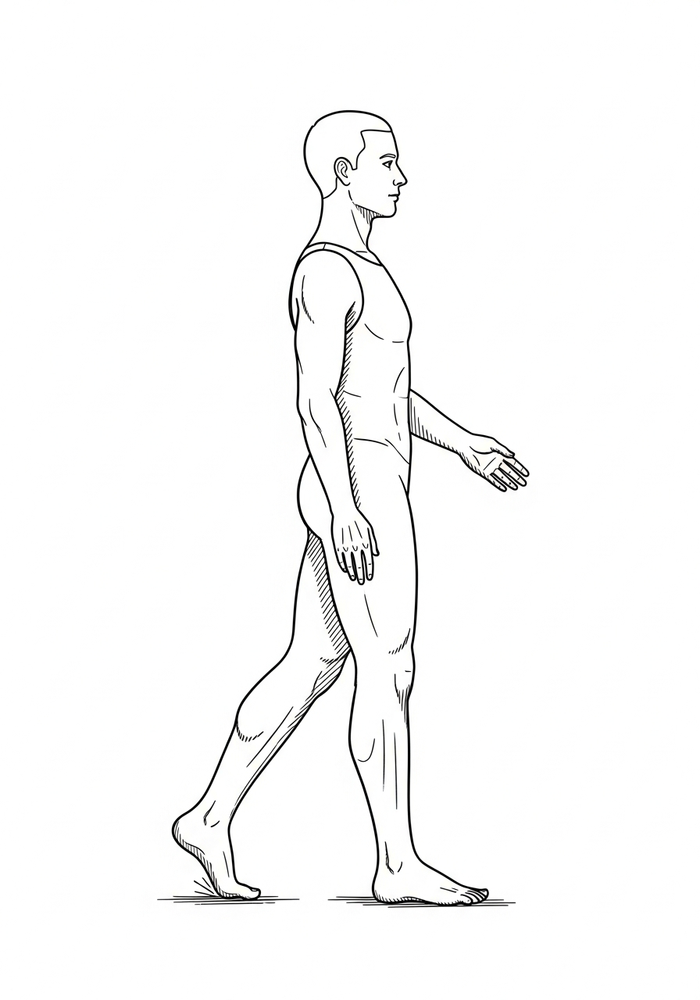

The first time I tried to move my left leg, it felt like someone else's. Dead weight. A floppy anchor. Every step was a shuffle, a drag, or a face-plant waiting to happen.

The worst was drop foot — that inability to lift the front of my foot, guaranteeing I'd catch my toe on every rug, every curb, every change in floor color.

The doctors offered the AFO — Ankle-Foot Orthosis — a plastic brace that manages drop foot. I wore it because I had to. But I decided right there: this was a temporary tool. Not a permanent solution. My goal was to *cure* the problem, not manage the symptom.

### The Two Pillars of Leg Recovery

**1. High-load, high-rep weight bearing.**
Your leg needs to feel weight and gravity. You can't just swing it around in the air. You have to stand, lean, squat, and force the connection between your brain and the floor. This wakes up the proprioceptive system and the massive anti-gravity muscles. (Full deep dive in Chapter 13.)

**2. Forced dorsiflexion.**
Drop foot is caused by paralysis of the anterior tibialis — the muscle that lifts your toes. To cure it, you must find creative, low-risk ways to force that muscle to fire. (Full destruction protocol in Chapter 15.)

### The Sasquatch Drop-Foot Destroyer Drills

**The Wall Lean (negative pressure).** Stand facing a wall, about a foot away. Lean forward slowly, putting maximum controlled pressure onto your feet and ankles. You will feel a massive stretch in your calf and the anterior tibialis fighting to pull your toes up. Hold for thirty seconds. Repeat ten times. You are forcing the muscle to work under load.

**Toe Taps to Exhaustion.** Sit in a chair. Lift your foot slightly off the ground. Tap your toes up and down as fast and as hard as you can. Don't stop until the muscle burns. Rest. Repeat. This is a direct, high-intensity signal to the damaged circuit.

**Uneven Terrain.** As soon as you are safe, get off the smooth gym floor. Walk on grass, carpet, concrete, gravel. The uneven surface forces your brain to problem-solve a new balance issue with every single step, igniting a massive surge of neuroplasticity.

### The Mental Shift: From Dragging to Driving

Walking is not just moving a leg. It's a conversation between your brain and the ground.

If you accept the drag, the drag becomes permanent. Refuse it. Every step is an act of war against the drop foot.

It took me years, not months. But I now walk without an AFO, better than most people who have never had a stroke.

### Reflection Point

What is the biggest limitation you are accepting in your walking right now? The AFO? The cane? The walker? Write it down. Then write one drill from this chapter you will add to your daily routine *today.*

### Stroked-Out Sasquatch Motivational Quote

*"You can rent a solution (the AFO), or you can build a cure. The brain will only do what you force it to do. If you want to walk like a warrior, you have to train like one. The biggest win is when you walk out of the doctor's office with your gear — not on you."*

### Builder's Note

Conversations between brain and ground get more eloquent the more you have them. Have them every day.

> ### SASQUATCH TRACK SYNC: Wheelchair Warrior
> **Vibe:** Heavy, rolling momentum.
> **Action:** If you're stuck in the chair today, put this on. Treat the chair like a tank, not a cage, until you build the strength to stand up.
> **Listen here:** [song.link/y/X0UZmboiGOo](https://song.link/y/X0UZmboiGOo) (Spotify · Apple Music · iTunes · YouTube Music · YouTube)
> **Backup:** strokerecoveryacademy.com/soundtrack

---

## Chapter 9: The 66-Day Transformation

Everyone is looking for the miracle cure. The silver bullet. The new device that does the work for them.

I'll tell you the secret. It's sixty-six days. Not magic. Just brutal, relentless consistency.

The average time it takes to form a habit is sixty-six days. (Lally et al., 2010.) That means sixty-six days to turn a painful, forced, deliberate exercise into a non-negotiable part of your daily routine. This is the period where the flickering neuroplasticity spark becomes a hardwired, unstoppable pathway.

### The Myth of the Motivation Mountain

Motivation is a honeymoon phase. It's what gets you started.

What gets you results is **discipline.**

Discipline is showing up on the day you feel zero motivation, when the pain is crushing, and when you can't see any progress. You don't wait to feel motivated. You rely on the discipline you built during the sixty-six days.

### The Rules of the 66-Day Commitment

**1. Choose ONE target.** Don't try to master your hand, leg, and speech all at once. Choose one primary goal (lift my left toes; open my left hand) and one primary drill (toe taps; mirror therapy).

**2. Zero exceptions.** You do the work every single day for sixty-six days. No excuses. Not busy. Not tired. Not sore. Not "just skipping one day." If you miss a day, you start over on Day 1. The goal is to make the work non-negotiable.

**3. Time is fuel, not a clock.** Don't set a time limit ("thirty minutes"). Set a rep limit or a fatigue limit. You stop when the target muscle fails or the prescribed reps are complete — not when the clock says time's up. You are feeding the machine, not punching a clock.

**4. Track everything.** Use the 66-Day Tracker (Appendix G; downloadable at strokerecoveryacademy.com/tracker). Track your mood, your pain, and your performance. You won't see change day-to-day. On Day 66, when you look back, the progress will be undeniable.

### The Compound Effect of the Habit

By Day 66, your brain is no longer fighting the new action. It is *expecting* it. The resistance melts away. The pathway is built.

This is how you bypass the conventional wisdom that recovery slows down. You don't have to think about it anymore. You just do it. You have replaced a destructive habit (non-use, apathy) with a constructive one (relentless construction).

### Reflection Point

What is the one new action you will commit to for the next sixty-six days to create permanent change? Write it down. Look at the tracker. Sign your name at the bottom of Day 1 like a contract — because that's what it is.

### Stroked-Out Sasquatch Motivational Quote

*"Consistency is the true miracle cure. The 66-day commitment is the most important promise you will ever make to yourself. Don't wait for motivation. Be the discipline. Be the Architect. Start over every time you fail. But never, ever quit."*

### Builder's Note

A streak is just one day, repeated.

> ### SASQUATCH TRACK SYNC: Sixty-Six Days
> **Vibe:** Relentless, unchanging discipline.
> **Action:** Use this mid-tempo grind as the background beat for your daily reps. No skipping days. Match your work to the rhythm.
> **Listen here:** [song.link/y/nArO3HANbfo](https://song.link/y/nArO3HANbfo) (Spotify · Apple Music · iTunes · YouTube Music · YouTube)
> **Backup:** strokerecoveryacademy.com/soundtrack

---

## Chapter 10: The Sasquatch Formula — T.L.E.C.A.

My recovery wasn't a straight line.

It was chaos. Trial and error. Throwing everything against the wall to see what stuck.

The Sasquatch Formula is the battle-tested, five-step system I distilled from the mess. It's a repeatable framework for finding breakthroughs where others find plateaus. It's the operating system that runs every chapter in Part III.

### T — TAKE

**Action:** Take what the system gives you. Initial therapy. The AFO. The speech drill. The conventional advice.
**Mindset:** Gratitude, but suspicion. Use it as a foundation. Never accept it as the final word. It is your starting point — not your finish line.

### L — LEARN

**Action:** Study the science behind the problem. Why does the brain do that? What is neuroplasticity? What is BDNF? What is a mirror neuron?
**Mindset:** Become the expert in your own brain. When you understand the *why*, you can engineer the *how* better than anyone else. Read the references in Appendix H. Ask your therapists tough questions.

### E — EXPERIMENT

**Action:** Use the knowledge to modify the conventional advice. If a drill is three sets of ten, try one set of a hundred. If you're sitting, try standing. If you're using a ball, try a hammer. Add novelty and intensity.
**Mindset:** Refuse to be a follower. Treat your recovery like a high-stakes science project. Document what works, what fails, and what makes you swear the loudest.

### C — COMBINE

**Action:** Stack the techniques that worked. Combine weight bearing with toe taps. Combine mirror therapy with speech drills. Use technology (Bioness, electrical stim) while performing a compound movement (walking).
**Mindset:** Synergy. 1 + 1 must equal 3. Two proven, high-intensity techniques used together produce results exponentially greater than each alone.

### A — APPLY

**Action:** Integrate the breakthrough methods into your daily life. This is the 66-Day Commitment from the previous chapter — make the new combination the new non-negotiable routine.
**Mindset:** Consistency and relentless purpose. The work never stops. You aren't applying a cure. You are applying a new operating system.

### Builder's Note

Most people stop at TAKE. They follow the script and they hit the plateau.

The Sasquatch lives in EXPERIMENT and COMBINE. That's where the impossible becomes inevitable.

Your job is not to *heal*. Your job is to *rebuild* using this formula.

### Reflection Point

What is one piece of conventional therapy advice (TAKE) that you can EXPERIMENT with today? How will you make it novel and intensely frustrating?

### Stroked-Out Sasquatch Motivational Quote

*"Don't let your recovery be a recipe. Make it a formula. Take the ingredients. Learn the science. Experiment with the ratios. Combine the best methods. Apply it every damn day. That's the blueprint for a comeback."*

---

## Chapter 11: Think → Twitch → Move

When a limb is paralyzed, the circuit from your brain to that muscle is broken or severely damaged. You can't just yell at your foot to move. You have to patiently, aggressively, and repeatedly send the signal until the circuit reroutes.

The progression from zero to full function follows three distinct, brutal phases.

### Phase 1 — THINK: The Signal

**Goal:** Send the thought, even if there is zero visible movement.

**Action:** Sit down. Look at the paralyzed limb. Close your eyes. Imagine the movement (wiggle that toe; open that hand). Open your eyes. Now, focus all your mental will, all your rage, all your hope on trying to make that movement happen. Even if it stays dead still, hold the *tension* of the thought.

**Why it works:** This is the initial spark. The brain is trying to find a new path around the damage. Every failure is just a failed attempt to reroute the signal. Keep trying. The signal is real even when the movement is invisible.

### Phase 2 — TWITCH: The Flicker

**Goal:** Achieve the first involuntary, tiny flicker of movement.

**Action:** This happens spontaneously after days, weeks, or months of THINKing. It might be a slight tremor. A muscle spasm. A sensation of warmth. It is often non-functional and uncoordinated.

**The Sasquatch Response:** **Celebrate it like a Super Bowl win.** That flicker is proof the wire has connected. It is the moment the impossible becomes possible. Don't stop there. Immediately increase the THINK intensity on that specific movement, forcing the new connection to thicken.

### Phase 3 — MOVE: The Construction

**Goal:** Voluntary, repeatable, controlled movement.

**Action:** Move from THINK drills to Think-Twitch-MOVE drills. Use an external assist to help the muscle complete the motion. For drop foot: use your strong hand to pull your toes up, then try to hold them there with your weak muscle. For the hand: use a table to slide the hand open, then force the muscle to try to keep it there.

**Why it works:** The assist helps the new, weak circuit complete its job. *Neurons that fire together wire together.* By completing the movement, you teach the new pathway: *this is the correct destination.* Repetition is the cement that holds the new path in place.

### Builder's Science: What Is Actually Happening Inside Your Skull During THINK

When the visible movement is zero and the work feels like screaming into a void, here is what is actually happening — measurable on functional MRI, EEG, and TMS in study after study.

**Motor imagery activates the same neural circuits as motor execution.** Jeannerod's 1995 framework, confirmed by hundreds of subsequent imaging studies, established that imagined movement of a limb activates roughly 70 to 80 percent of the same cortical and subcortical motor networks as actual movement of that limb. Premotor cortex, supplementary motor area, basal ganglia, and cerebellum all light up. The only thing missing is the final descending signal to the muscle. This means a stroke survivor stuck in the THINK phase, with no visible movement, is **still doing real motor cortex work** with every imagined rep.

**Mental practice has measurable effects on motor recovery after stroke.** Page, Levine, and Leonard (2007) showed in a randomized trial that adding mental practice to physical therapy produced significantly greater upper-extremity improvement than physical therapy alone in chronic stroke survivors. Braun and colleagues' (2013) systematic review pooled the evidence and concluded mental practice is a valid, evidence-based component of stroke rehabilitation — not a placebo, not a stalling tactic, but a real driver of cortical reorganization.

**The mechanism is Hebbian.** Repeated activation of a circuit — even an "incomplete" circuit that doesn't reach the muscle — strengthens the synapses in that circuit. The next attempt requires fewer neurons to fire, more efficiently. Eventually the threshold drops low enough that some descending signal does get through. That is the TWITCH.

**The tracker is the work.** Log every THINK session even when nothing moves. The act of logging the rep is itself a metacognitive rehearsal — the brain encodes the practice as practice and starts to expect it daily. This is part of why the 66-day streak in Appendix G works.

What you should feel during a clean THINK rep: total focus on the muscle, a faint warmth or tingling in the limb (proprioceptive priming), and exhaustion after 10 minutes that is real but invisible. If you are not exhausted at the end, you are not concentrating hard enough.

What the research is also honest about: motor imagery does not bypass the lesion. If the corticospinal tract is completely destroyed, no amount of THINK creates motion. But for the vast majority of survivors with **partial** lesions — which is most strokes — the dormant pathways are recoverable, and THINK is one of the cheapest, safest tools to wake them.

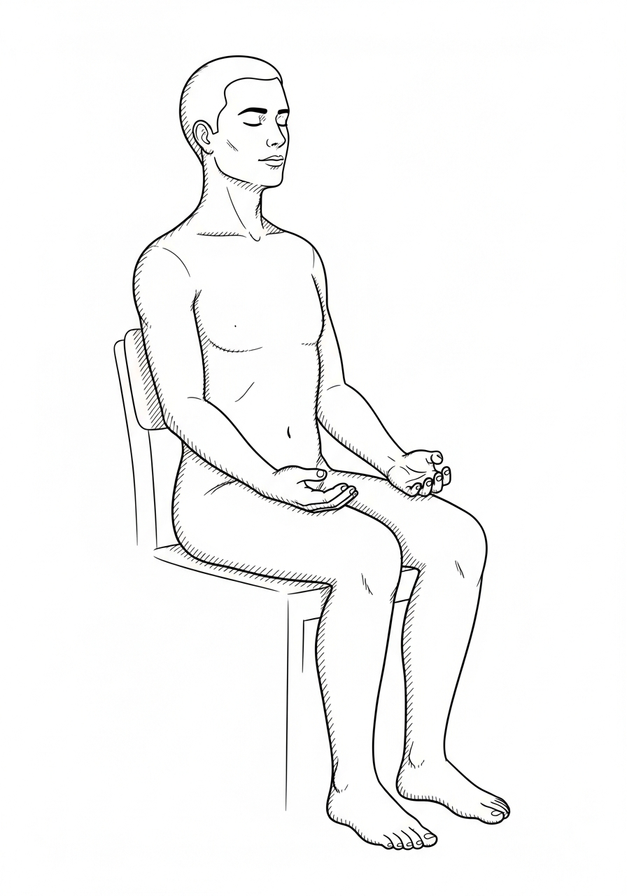

Audio THINK guides at **strokerecoveryacademy.com/protocols/think**.

### Builder's Note

Most people quit in the THINK phase because they can't see results. You must trust the science.

The thought is the beginning of the repair. Every single THINK attempt — every focused signal — is an act of biological construction.

Do not stop until you get the TWITCH.

### The Day My Toe Twitched

I want to put a date on what THINK looks like when it works.

It was day forty-one after the stroke. I was in inpatient rehab at the rehab hospital. I had been doing focused THINK work on my left big toe for thirty-seven straight days — at least three blocks a day, ten minutes each, sitting up in the bed or in the chair, staring at the toe like the toe owed me money.

For thirty-seven days, the toe did nothing.

On day forty-one, in the late afternoon, I was in the bed. The shift was about to change. The room had that quiet hospital light that falls in the late afternoon. Lisa was at home napping. I had thirty seconds before the dinner tray was going to show up. I closed my eyes. I sent the signal one more time. *Lift. Lift. Lift.*

I opened my eyes.

The toe lifted.

About three millimeters. For maybe a quarter of a second. Then it dropped back to the sheet.

I did not breathe for ten seconds. Then I tried it again. Nothing. I tried it again. Nothing. I tried it a fourth time and the toe lifted again — even smaller, but it lifted.

I started crying. The dinner tray showed up. The aide asked if I was okay. I told her my toe just moved. She did not understand what that meant. I do not blame her. To anyone outside the work, a toe lifting three millimeters for a quarter-second is nothing. To anyone inside the work, it is the entire world.

I called Lisa. I told her the toe moved. She did not understand either. I told Michael the next morning. He understood. He did not smile. He just nodded and said, *"Now we don't lose it. Now we go a hundred a day."*

The toe is the part of my body I am most grateful for. Not because it is impressive. Because it was the first piece of evidence that the work was working. Every other piece of recovery — the foot, the calf, the knee, the hip, the arm, the hand — followed the same arc. THINK for weeks. TWITCH on a random Tuesday afternoon. Then the work of MOVE.

If you are in week three of THINK and the muscle has not moved, you are not failing. You are on day three of forty-one. Keep sending the signal. The universe really is listening. So is your brain.

### Reflection Point

Where are you in the progression for your priority muscle? Still in THINK? Achieved a TWITCH? Living in MOVE? Write down the next step you will focus on today to advance one phase.

### Stroked-Out Sasquatch Motivational Quote

*"The distance between THINK and TWITCH is the hardest work you will ever do. The distance between TWITCH and MOVE is just simple, non-negotiable repetition. Send the signal. The universe is listening."*

---

# PART III — THE ARSENAL
## Breakthrough Techniques That Actually Work

> *Garage. 6 a.m. A 32-inch Louisville Slugger leaning against the wheelbarrow. A roll of duct tape. A 24-inch IKEA mirror. A bag of #19 office bands. Total cost: under sixty dollars. The clinic costs a thousand a session and the clinic was about to get fired. The arsenal is what you build when the system stops showing up. The arsenal is what showed up instead.*

---

## Chapter 12: Baseball Bat Therapy

### The First Swing — March 2019

I was three months out. Living in the spare bedroom because the stairs to ours were not happening. My left arm was a pound and a half of dead weight in a sling I hated. The OT had given me a foam therapy ball and told me to squeeze it twenty times a day. Twenty. The ball was the color of a peach. I squeezed the ball five times and threw it across the room. It hit the dresser and rolled under the bed. It is probably still there.

The bat was leaning against the corner. A 32-inch wood Louisville Slugger from college. I had not touched it in fifteen years. I picked it up with my right hand. I forced my dead left hand onto the handle below the right hand. I stood up. I swung. The swing was bad — the left arm did almost nothing, the body torqued the wrong direction, the bat clipped the lampshade — but for the first time in three months, my left shoulder *felt* something. A pull. A stretch. A signal.

I swung again. Then ten more times. Then twenty.

When I sat back down on the bed, my left arm was warm. Tingling. *Awake.* The ball under the dresser had done nothing. The bat had done everything in fifteen reps.

That night I wrote in the notebook: *the bat works. don't lose it.*

I have swung that bat almost every morning of the seven years since.

---

When you start recovery, your therapist gives you soft goals. Wiggle a toe. Lift a cup.

These are small victories and you must celebrate them like fireworks.

But to achieve a *big* comeback, you need to graduate to *big* victories. You need to apply the intensity, creativity, and the COMBINE phase of the Sasquatch Formula.

My first massive breakthrough with my arm — going from useless weight to having active movement — came from a method no textbook will ever recommend.

**Baseball Bat Therapy.**

### The Problem with Conventional Arm Therapy

Most initial arm therapy is low-weight, low-rep, and often passive. The therapist moves your arm for you. This builds little neuroplasticity. Your brain gets bored. You need to shock the system.

### Baseball Bat Therapy: High-Load, High-Intensity

I couldn't lift my left arm. But I *could* use my right arm to force the left arm to participate in a functional, heavy, problem-solving task.

**The Setup.** I took a lightweight baseball bat (a sledgehammer handle or a broomstick works too). I grasped it firmly with my good (right) hand and placed my weak (left) hand loosely on the handle.

**The Swing.** I would use my right arm to force a slow, controlled, full-range-of-motion swing. As the right arm moved, I would mentally and physically scream at the paralyzed left arm to participate and stabilize.

**The Load.** The weight of the bat — even a light one — created load through my left shoulder, elbow, and wrist. That load, combined with the full-range movement, was a massive novel signal to my brain.

### Why It Worked: The Three-Way Attack

**1. Massive proprioception.** The weight and force of the swing overloaded the weak limb with sensory input — exactly what a dormant neural circuit needs to wake up.

**2. Forced bilateral use.** The powerful right arm forced the weak left arm to co-contract for stability. This is high-level bilateral training — the strong side dragging the weak side back online.

**3. Functional task.** I wasn't just lifting a can. I was swinging a weapon. This taps into primal motor pathways, making the movement feel more purposeful to the deep brain.

### Safety Note

This is an advanced technique. Start with a light broomstick. Ensure the movement is slow and controlled. Have someone supervise the first few sessions. Never risk injury — the goal is *load and signal*, not power. If you have a shoulder subluxation or rotator cuff issue, do not attempt without your therapist's clearance.

### Builder's Science: Why Bilateral Training Wakes Dead Limbs

The bat works because of a phenomenon the literature calls **interlimb coupling.** Move one arm and the motor cortex on the *opposite* side of the brain fires sympathetically — even if the limb on that side is paralyzed. The healthy hemisphere drags the damaged hemisphere into the conversation. Cauraugh and colleagues (2010) showed in a meta-analysis of 11 studies that bilateral arm training produced significantly better upper-extremity outcomes than unilateral training in chronic stroke survivors. Stoykov and Madhavan (2015) added the why: **bilateral movement reduces inhibition between the two hemispheres**, which is exactly the wrong-direction current that keeps a paralyzed arm paralyzed long after the lesion has stabilized.

The bat stacks three of Kleim and Jones's ten neuroplasticity principles in one rep:

- **Use it or lose it** — the dormant arm is forced into use, even passively at first.
- **Repetition matters** — every swing is a rep.
- **Intensity matters** — the load is real, the focus is total, the failure is visible.

What you should *feel* if it is working: warmth in the weak shoulder during the swing, fatigue in the weak forearm by the third set, an odd "echo" sensation in the dead muscle for a few minutes after you put the bat down. That echo is the cortical map waking up. Log it in the Tracker. Track the rep count. Track the bat weight. Climb both over sixty-six days.

What you should *not* feel: sharp pain in the shoulder (stop — you may be subluxing), pain in the wrist or elbow (lighten the bat, shorten the range), or a "pop" anywhere (stop, ice, call your PT).

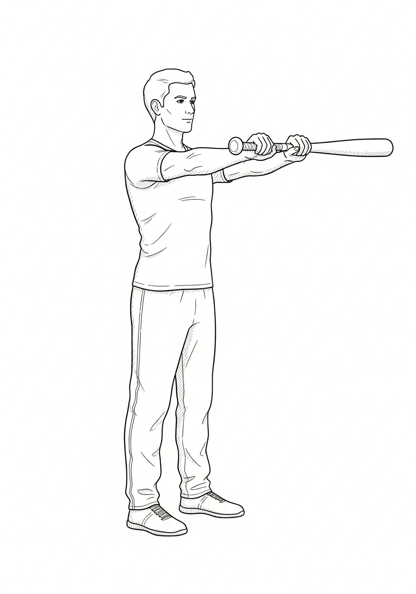

Video demo at **strokerecoveryacademy.com/protocols/bat**.

### Builder's Note

The real breakthroughs happen outside the clinic.

You have to find ways to combine load (weight bearing, bat swinging) with novelty (a new task) and intensity (high focus, high reps). The simple stick became my secret weapon. Find yours.

### Reflection Point

What is the most functional, heavy object you can safely use to force your weak limb to assist your strong one? Start thinking outside the box.

### Stroked-Out Sasquatch Motivational Quote

*"Don't just lift the light weights. Find the hard task. Find the heavy challenge. Your brain is not impressed by easy. It only rewires for the war you show it. Swing the bat. Build the comeback."*

> ### SASQUATCH TRACK SYNC: Hostile Construction
> **Vibe:** Heavy, violent rebuilding.
> **Action:** This is the title track. Put it on for your heaviest, most frustrating reps — like swinging the baseball bat. Let the beat drive the weak side.
> **Listen here:** [youtu.be/EOYE1qB9sak](https://youtu.be/EOYE1qB9sak) *(also on Spotify, Apple Music, iTunes, YouTube Music — search "Stroked Out Sasquatch — Hostile Construction")*
> **Backup:** strokerecoveryacademy.com/soundtrack

---

## Chapter 13: Weight Bearing and Negative Pressure Therapy

### The Day I Stood Up Alone

Month four. Encompass third-floor gym. Late afternoon, the light through the west windows the color of weak tea. Michael had the parallel bars set wide. He told me he was going to let go of my belt for ten seconds and not catch me unless I started to actually fall. He said it the way he said everything — flat, no drama, like he was reading the lunch menu.

Ten seconds with no hand on my belt. Just my left leg, which two months earlier had been a sandbag, and my right leg, which had been carrying both of us. I locked my eyes on a smudge of paint on the far wall. I felt the left quad fire — *late*, but it fired. The knee held. The ankle wobbled and rolled out and rolled back. My breath stopped. Michael counted out loud.

*Three. Four. Five.*

The left leg was working. *Working.* Not well. Not pretty. But working alone for the first time since December.

*Eight. Nine. Ten.*

He grabbed the belt. He said, *"Twenty next time."*

I did not let go of the bars. I cried into them. The leg I was told to brace forever had just held me up for ten seconds without anybody's help. That is when I knew the AFO was a tool, not a sentence.

---

Weight bearing isn't just exercise. It's medicine.

After the stroke, my left leg was dead weight. No tone. No control. No hope from most therapists. They said *use the AFO forever* and *don't put too much pressure on it — you might hurt yourself.*

I heard *stay weak.*

I chose to stand anyway.

### Why Weight Bearing Works

Standing loads the bones, muscles, joints, and nervous system. It sends signals upward: *Hey brain — this leg still exists. Wake it up.* Gravity plus body weight plus intention equals neuroplasticity on steroids.

- Bones get stronger. (Wolff's Law: bone remodels under stress.)
- Anti-gravity extensor muscles fire.
- Proprioception rebuilds — the brain relearns where the leg is in space.
- Circulation improves — no more pooling blood in a limp limb.
- The brain gets massive sensory input. Every second standing is thousands of neural signals.

I started with parallel bars and Michael's shoulder. Ten seconds felt like ten hours. Every second counted.

### Negative Pressure Therapy — My Secret Hack

This was my own twist. Controlled "negative" (downward) pressure used to force activation.

**How I did it:**
1. Stood facing a wall or parallel bar.
2. Leaned forward slowly so body weight pressed into ankles and feet.
3. Held for thirty to sixty seconds — feeling the stretch in calves and the anterior tibialis fighting to lift my toes.
4. Repeated ten to twenty times per session.
5. Progressed: less wall support, longer holds, added small ankle weights.

**Why it worked:**
- Eccentric loading strengthens muscles during lengthening. Most stroke therapies focus only on concentric (shortening) work — they miss half the picture.
- Stretches spastic muscles safely.
- Forces dorsiflexion under load. Directly attacks drop foot.
- Builds confidence. Every successful hold proves *this leg can support me.*

Combined with weight bearing, this became my revolution. From zero to standing independently. From dragging to walking. From AFO to freedom.

### Safety First — But Don't Baby Yourself

Listen to your body. Start assisted. Build slowly. Don't let fear stop progress. Pain that feels like injury? Stop. Discomfort that feels like growth? Keep going safely.

If you have osteoporosis, severe spasticity, or a recent fracture: clear this with your therapist first.

### Builder's Science: Why Loading the Leg Is the Single Most Underused Lever

Standing is not just exercise. It is **antigravity sensorimotor input** — the single highest-bandwidth signal a damaged motor cortex can receive. Take one second of standing on the affected leg. In that second, the brain is processing pressure data from roughly 200,000 mechanoreceptors in the foot sole, length-and-tension data from every muscle spindle and Golgi tendon organ from the toes to the hip, and joint-angle data from the ankle, knee, and hip capsules. Multiply that by the duration of the hold. The number of neural signals the cortex receives in a 30-second standing rep is in the tens of millions. Sitting in a wheelchair, that number is roughly zero.

This is why the Veerbeek and colleagues (2014) systematic review of 467 stroke rehab RCTs found that **task-specific training with high doses of gait and standing practice** produced the largest effect sizes for lower-extremity recovery — larger than any drug, any device, any passive modality. The dose-response relationship is nearly linear: more weight-bearing minutes, more recovery, all the way up to the clinical limits of fatigue and safety.

The eccentric-loading wrinkle (the wall-lean negative) does extra work because eccentric contractions produce **roughly 1.4 times the muscle tension of concentric contractions at the same load** (Hortobágyi & Katch, 1990). For a stroke survivor with spasticity, that means you can train strength and length *at the same time* — and that is exactly what spastic, shortened calf and tibialis muscles need.

What you should feel if it's working: a slow ankle "wake-up" warmth within 30 seconds, calf fatigue inside 90 seconds, the toes starting to pull upward involuntarily after the third or fourth set. The involuntary toe-lift is the anterior tibialis re-firing. Log it. The first day you feel it is a milestone — circle it in the Tracker.

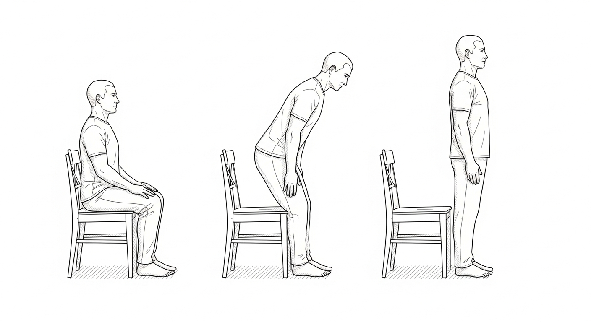

Video demo at **strokerecoveryacademy.com/protocols/weight-bearing**.

### Reflection Point

Where in your routine are you avoiding weight on your weak side? Set one weight-bearing block this week. Ten seconds is fine. Just stand.

### Stroked-Out Sasquatch Motivational Quote

*"Stand even when standing hurts. Weight bearing isn't punishment — it's medicine. Lean into the pressure. The Sasquatch didn't stay seated. Neither should you."*

### Builder's Note

Weight bearing turns dead weight into living strength. Don't wait for permission. Stand. Feel gravity. Rewire your brain. Keep swinging.

---

## Chapter 14: Mirror Therapy Magic

### The Mirror in the Bathroom Doorway

Month five. The closet mirror was leaned in the bathroom doorway because the bedroom did not have a wall I trusted to hold it. I sat on a wooden chair Lisa pulled out of the kitchen. I put my dead left hand behind the mirror, propped on a folded towel. I put my live right hand in front of the mirror. I told myself I was about to do twenty minutes of a therapy I had read about in a Norman Doidge book.

I felt stupid. I am six-foot-two and the mirror was at hip height and I was about to stare at my own right hand for twenty minutes pretending it was my left.

I started opening and closing the right hand. Slow. Watched the reflection. The reflection looked like the left hand. *Tried* to look like the left hand. Three minutes in, my actual left hand — the one hidden behind the mirror — went warm. *Warm.* Not moved, not twitched, not anything visible. Just a band of warmth from the wrist to the fingertips.

I almost stopped. I thought it was wishful thinking. I kept going.

At minute eleven, the left index finger twitched. Once. About three millimeters. The same kind of twitch the toe had thrown in the rehab bed. The kind of twitch that means the wire just connected.

I did not move for the last nine minutes. I just kept opening and closing the right hand and watched the reflection do the work the left hand was supposed to do. The left hand did one more twitch at minute seventeen. Two for the day. Two more than yesterday. Two enough.

The mirror cost thirty dollars at IKEA.

---

Mirror therapy was one of the most powerful, stupidly simple tools I used.

A mirror. A box. Some duct tape. And a brain that can be fooled into rewiring itself.

### How It Works

1. Place a mirror vertically between your arms (or legs).
2. Good side in front of the mirror. Paralyzed side hidden behind.
3. Move the good side. Watch the reflection as if the paralyzed side is moving.
4. Your brain sees "movement" on the bad side. Mirror neurons fire. Damaged pathways get stimulated.

I did this ten to twenty minutes daily. Watched my right hand open and close. Imagined my left doing the same. Felt weird at first — like lying to my brain.

It wasn't a lie. It was training.

### My Results

- **Early weeks:** Nothing visible. But I felt tingles, warmth in the left hand.
- **Months 2–3:** Small twitches when mirroring.
- **Month 4 and beyond:** The left hand started opening on its own during sessions.
- **Long term:** Bilateral coordination improved dramatically.

The science backs it: mirror therapy activates the mirror neuron system, increases excitability in the damaged motor cortex, and reduces learned non-use. (Ramachandran & Rogers-Ramachandran, 1996; Thieme et al., 2018.) Cheap, safe, stupidly effective.

### Builder's Science: Why a Twenty-Dollar Mirror Outperforms a Ten-Thousand-Dollar Robot

Mirror therapy is in the rare class of stroke interventions where the mechanism is genuinely simple, the cost is essentially zero, and the evidence is overwhelming. The Cochrane systematic review (Thieme and colleagues, 2018) pooled 62 trials and 1,982 stroke survivors and found mirror therapy improved motor function, motor impairment, activities of daily living, and pain — all four — with effect sizes that hold up against any modern technology assist on the market. The same review put it bluntly: most interventions in stroke rehab struggle to beat sham. Mirror therapy beats it consistently.

The mechanism is **visual capture of motor intention.** When you look at the reflected good hand and intend to move the hidden bad hand, three things happen simultaneously in the brain:

1. **Mirror neurons fire** in premotor cortex on both sides — the same neurons that fire when you watch someone else move. Your brain treats the reflected hand as the affected hand's hand.
2. **Inhibition of the damaged motor cortex drops** — the contralateral excitability that normally suppresses the lesioned hemisphere relaxes, opening a window for new motor output.
3. **Pain and learned non-use unlearn themselves** — the brain stops "guarding" the affected limb because the visual evidence says it is moving normally.

This is also why **head position matters.** Tilt your head so your direct line of sight goes to the mirror, not over the top of it. Your peripheral vision should not see the hidden hand. The illusion needs to be unbroken for the mirror neuron firing to be maximal. Twenty minutes is the sweet spot — long enough for the priming effect, short enough that fatigue doesn't crash the focus.

Pair it with the Phantom Limb track in the soundtrack. Headphones on. Eyes locked. Twenty minutes. Sixty-six days. Watch what happens.

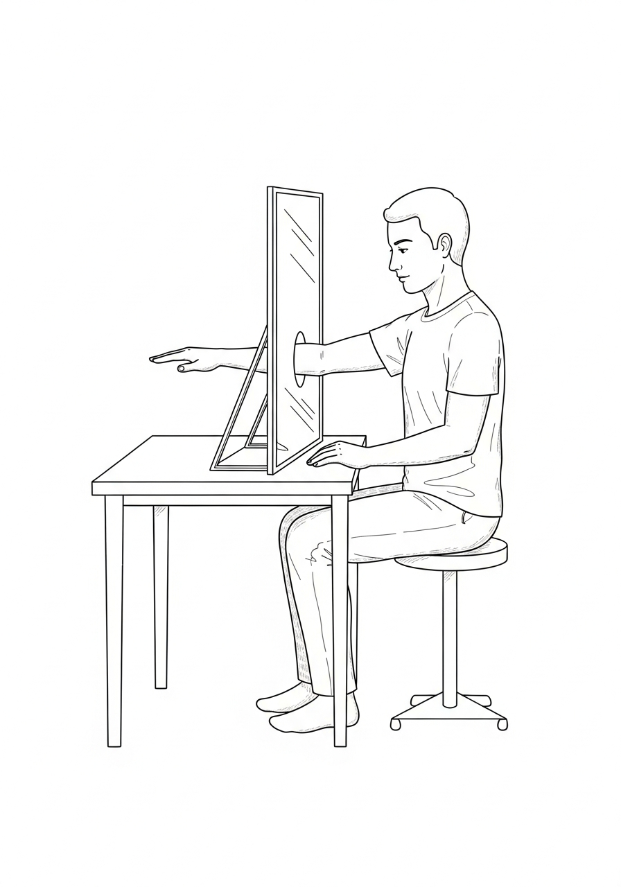

Video demo at **strokerecoveryacademy.com/protocols/mirror**.

### Reflection Point

Set up a mirror this week. Block twenty minutes. Watch your strong side succeed. Imagine the weak side following. Do it daily for sixty-six days.

### Stroked-Out Sasquatch Motivational Quote

*"Mirror therapy fools the brain — but the results are real. Watch the strong side win. Make the weak side jealous. Then make it join the party. The Sasquatch didn't wait for movement — I created it. So can you."*

### Builder's Note

A mirror, some imagination, and relentless reps. That's all it takes to start rewiring. Don't wait for the brain to catch up. Trick it into catching up.

> ### SASQUATCH TRACK SYNC: Phantom Limb
> **Vibe:** Ethereal, focused, percussive.
> **Action:** Put headphones on during your ten to twenty minutes of mirror therapy. Let the sound help trick your brain into rewiring the disconnected circuits.
> **Listen here:** [song.link/y/wdj337f5yH4](https://song.link/y/wdj337f5yH4) (Spotify · Apple Music · iTunes · YouTube Music · YouTube)
> **Backup:** strokerecoveryacademy.com/soundtrack

---

## Chapter 15: Drop Foot Destruction

### The Driveway and the Crack

Year two. The driveway in front of the house had a crack about an inch wide running across the second slab from the garage. I had walked past it a thousand times in the chair, looking down at it the way you look at a moat. The toe of my left shoe always caught the lip of that crack and the foot would not lift over it.

A Tuesday in October. AFO on. Cane in the right hand. I made it to the slab before the crack and stopped. I stared at the inch. I thought about the anterior tibialis I had been screaming at for a hundred days of dorsiflexion drills. I told the foot, out loud, in the driveway, alone: *lift.*

The foot lifted. Half an inch — just enough. The toe cleared the crack. The heel came down on the other side. I did not fall.

I turned around and did it again. Then again. Twenty crossings of that crack, alone, in the driveway, on a Tuesday, in October, in year two. The neighbor across the street watched me from her porch with a coffee cup. She raised the cup. I raised the cane. Neither of us said anything.

That crack is the line where my drop foot ended and the rest of my walking started. It is still there. I still cross it most days on purpose.

---

Drop foot was my daily enemy for years.

Toes dragged. Ankle flopped. Every step risked a fall. Doctors said *permanent nerve damage.*

I said *temporary bullshit.*

Here's how I destroyed drop foot and reclaimed a natural stride.

### Understanding Drop Foot

Peroneal nerve damage → weak anterior tibialis → foot drops → drag toes → trip → fear → less walking → weaker muscles → worse drop foot.

Vicious cycle.

I broke it with a multi-attack strategy.

### My Drop-Foot Destruction Arsenal

**1. Ankle Dorsiflexion Drills — 100+ reps per day.**
- Seated: lift toes toward shin with band resistance.
- Standing: heel walks (walk on heels only).

**2. Negative Pressure / Eccentric Loading.**
- Stand on a step edge. Lower heels below the step slowly (eccentric). Rise onto toes (concentric).
- Wall leans: lean forward, press ankles into dorsiflexion under body weight.

**3. Mirror Therapy + Mental Rehearsal.**
- Watch the good foot lift in the mirror. Imagine the left doing the same. Ten to twenty minutes per day.

**4. AFO Ditching Protocol.** *Risky. Do safely.*
- Started short walks without the AFO, holding the wall or Michael.
- Built confidence in ankle stability.
- Gradual outdoor use. Never fell hard. Adjusted when needed.
- When in doubt: AFO on. The brace is a tool, not a sentence.

**5. The 66-Day Streak.**
- Locked in daily reps for sixty-six days. Habit formed. Brain rewired. Foot lift became automatic.

### Results

- **Year 1–2:** AFO required. Dragging bad.
- **Year 3:** Short walks without AFO possible.
- **Year 4 and beyond:** Drop foot almost gone. Walk with little limp. Natural stride reclaimed.

### Builder's Science: Why Drop Foot Looks Permanent and Usually Isn't

Drop foot earns its bad reputation because of a brutally honest neurological fact: the **anterior tibialis** — the small shin muscle that lifts the foot during the swing phase of walking — is one of the muscles most aggressively suppressed after an upper-motor-neuron stroke. The brain stops sending the lift signal. The opposing calf muscle, freed from its counterweight, shortens and tightens. Within weeks the ankle has lost dorsiflexion range. Within months the calf has actual contracture. Within a year the orthopedic textbook calls the deformity "fixed" and the AFO becomes the recommendation for life.

Almost none of that has to be true.

The Bowden, Behrman, and colleagues (2010) work on locomotor training showed that **task-specific gait training with maximal loading on the paretic limb** drives substantial drop-foot recovery even in chronic survivors years post-stroke. Belda-Lois and colleagues (2011) reviewed the rehabilitation literature and concluded that the combination of (a) high-repetition active dorsiflexion drills, (b) stretching of the gastrocnemius-soleus complex, and (c) functional electrical stimulation of the peroneal nerve produced the largest effect sizes — exactly the multi-attack stack in this chapter.

The mechanism is two-stage. First, you have to **restore the cortical signal** — the brain has to remember it owns this muscle. Mirror therapy and 100+ daily dorsiflexion reps drive that. Second, you have to **restore mechanical range** — the calf has to be long enough for the foot to clear the ground. Eccentric heel drops and wall leans drive that. Skip either stage and you stall. Stack both for sixty-six days and the foot lifts.

The AFO question is honest: a brace that prevents falls in week one is a tool. A brace that prevents practice in year three is a sentence. The transition out is gradual, supervised, and started indoors. The end-state for many survivors is brace-on for distance walking, brace-off for short household walks, and recovery that keeps trending toward the latter.

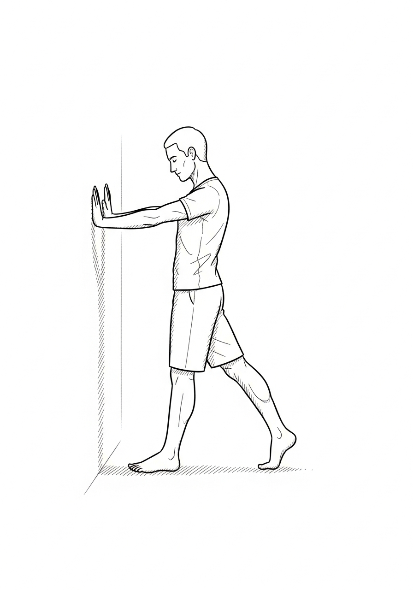

Video demo at **strokerecoveryacademy.com/protocols/dropfoot**.

### Reflection Point

Pick one drop-foot drill from this chapter. Commit to sixty-six days. Track it on the Appendix G grid.

### Stroked-Out Sasquatch Motivational Quote

*"Drop foot ain't permanent until you quit trying. Attack it daily. Rewire it. Destroy it. The Sasquatch didn't drag his foot forever — neither should you."*

### Builder's Note

Drop foot destruction isn't luck. It's reps, refusal, and system. Reclaim your stride. Walk like a warrior again.

---

## Chapter 16: Arm and Hand Recovery — From Dead Weight to Dynamic Power

### The First Time I Held the Coffee Cup

Year two, a kitchen morning, sun on the counter. The cup was a heavy ceramic one Lisa had bought at a craft fair — fat handle, thick wall, half-full of black coffee. I had been training the left grip on a tennis ball for ninety days. A hundred squeezes a day. The grip strength dynamometer had crawled from zero to four kilograms. The therapy team called four kilograms *not yet functional.* Functional, by the textbook, started at twelve.

I picked up the cup with my left hand anyway.

The handle pinched between my thumb and the side of my index finger. The wrist screamed. The bicep had to do a hundred percent of the lift because the forearm could not stabilize. The cup came up about eight inches off the counter and shook like a Polaroid. Coffee sloshed onto my left thumb. It was hot. I did not let go.

I held the cup at chest height for maybe four seconds. Then I set it down — *set* it, not dropped it. The coffee did not spill on the counter. The handle did not slip out of my hand.

I sat down. I wrote it in the notebook: *picked up the cup. left hand. four seconds. did not drop.*

The textbook said I was not yet functional. The cup said the textbook was four kilograms behind.

---

My left arm was dead weight for over a year. Hung like a wet noodle. No grip. No reach. No hope from most therapists.

I refused to let it stay dead.

Here's the arsenal that turned it from useless to useful — and eventually powerful.

### The Long Road Reality

Arm and hand recovery is slower than leg recovery for three reasons:

1. **More complex movements.** Fine motor versus gross motor.
2. **Less daily use.** Legs carry you everywhere. Arms can idle.
3. **Spasticity fights progress.** The very tone that gives the arm any shape often pulls it into the wrong shape.

I fought back with a layered system.

### Arm Recovery Arsenal

**1. Weight bearing — early and often.**
Wall leans. Quadruped position (on all fours, supervised at first). Loaded shoulder, elbow, wrist. Forced activation.

**2. Bilateral training.**
Baseball bat swings (Chapter 12). Two-handed lifts, pushes, and pulls. Weak side learns from strong side.

**3. Mirror therapy.**
Ten to twenty minutes daily. Watching the right arm move and imagining the left. Tingles → twitches → small movements.

**4. Repetition and intensity.**
100 to 300 reps per day on grip (squeeze ball, towel twists). Finger extensions with bands. Sixty-six-day streaks for habit lock-in.

**5. Functional tasks.**
Brushing teeth. Holding a fork. Buttoning a shirt. Forced use. Started assisted, progressed to independent.

### My Timeline

- **Year 1:** Flickers. Assisted grip.
- **Year 2:** Basic hold. Push.
- **Year 3–4:** Functional use. Carry groceries. Type.
- **Year 5+:** Dynamic power. Push-ups. Weights. Daily tasks easy.

### Builder's Science: Why the Hand Comes Last and How to Speed It Up Anyway

The hand recovers more slowly than any other body region after stroke for reasons that are anatomical, not motivational. The hand has the **largest cortical representation of any body part** — the famous Penfield homunculus draws the hand the size of the rest of the body combined. That is a feature when the cortex is intact (it is why you can thread a needle) and a bug when a stroke wipes out a piece of motor cortex (it means more of the territory you need is in the lesion zone). Add the fact that hand muscles are small, distal, and dependent on the corticospinal tract — the very tract most often damaged by middle cerebral artery strokes — and the math is brutal. Most spontaneous recovery of the hand happens in the first three months. After that, the curve flattens. Hard.

That curve is *not* a destiny. It is an average. Late hand recovery happens when survivors do three things the average survivor does not:

**1. Drive volume — way past what the clinic prescribes.** Birkenmeier, Prager, and Lang (2010) showed that high-repetition task-specific training (300 + reps per session) produced significant hand-function gains in chronic stroke survivors years out from injury. The clinic gives you 30 reps per visit. The protocol that moves the needle gives you 300. That gap is the work, and it has to happen at home.

**2. Train the hand on real objects, not putty.** McEwen and colleagues' work on the CO-OP approach showed that **task-specific** practice (buttoning a real shirt, opening a real jar, signing a real check) drove transfer to daily function in ways that abstract grip training did not. The brain rewires for what you ask it to do, exactly. Train on the task you want back.

**3. Combine modalities.** The high-yield stack: mirror therapy primes the motor cortex, then 100+ task-specific reps consolidate, then a constraint period (mitt on the good hand for 30 minutes a day) forces transfer. Each modality alone is mediocre. The stack is the multiplier.

What the literature is also honest about: there are survivors with severe damage who do not get useful hand function back even with perfect protocol adherence. Compensation strategies (one-handed techniques, adaptive equipment) are not failure — they are the right tool for that situation. Appendix C lists what works.

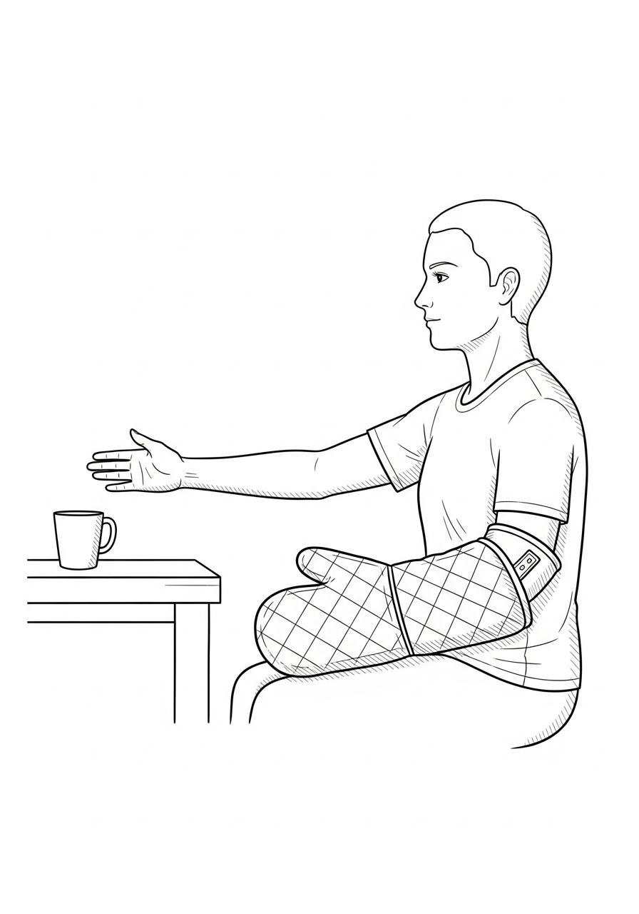

Video demo at **strokerecoveryacademy.com/protocols/hand**.

### Reflection Point

Pick one daily arm or hand drill. Commit to sixty-six days. Track every rep.

### Stroked-Out Sasquatch Motivational Quote

*"Dead weight becomes dynamic power one rep at a time. Grip it. Swing it. Own it. The Sasquatch didn't let a dead arm stop him. Neither should you."*

### Builder's Note

Arm recovery is the long road. The view at the end is worth every rep.

---

## Chapter 17: Speech Comeback — Finding Your Voice Again

### The Drive-Thru That Nearly Killed Me

Month nine. McDonald's drive-thru on Rogers Avenue. Lisa was in the passenger seat. I was finally driving again — short loops only, the kind of driving the SLP had cleared but no one outside the house trusted. I pulled up to the speaker box. The cheerful voice asked what I wanted.

I tried to say *number two with a Coke.*

What came out was three syllables in the wrong order, slurred at the edges, and the word *Coke* never made it past my lower lip. I tried again. The voice in the speaker said, *I'm sorry sir, can you repeat that?* I tried a third time. The voice said the same thing. The car behind me honked.

Lisa reached across the gear shift, squeezed my right hand once, and said into the speaker, *number two with a Coke, thanks.*

I drove around to the window. I did not say a word the whole way home. I sat in the driveway after she went inside and I cried into the steering wheel of a 2017 Tahoe for fifteen minutes — not because of the order, but because the order had told me, in front of my wife and a stranger and a guy in the next car who was honking, that the speech was not back.

The next morning I started reading aloud for fifteen minutes a day. The morning after that I called and ordered my own pizza, mumbled and slow, and the kid on the phone repeated it back correctly. The morning after *that* I went back to the same drive-thru, alone, and ordered the same number two with a Coke. The voice understood me on the first try.

The drive-thru is the smallest possible test of whether the speech is back. Take it. Fail it. Train. Take it again.

---

The first time I tried to ask for water in the ICU, the word came out in three pieces and none of them sounded like *water.*

I stopped trying for two days after that.

That was the worst decision of my early recovery, and I want to spare you from making it.

Aphasia and dysarthria — the two main speech consequences of stroke — are not a verdict. They are a circuit problem. The same neuroplasticity that rebuilt my arm and my leg rebuilt my voice. It just takes a different set of drills, and it takes the *willingness to sound stupid* in front of the people who love you.

### Aphasia vs. Dysarthria — Know Which Fight You're In

These two get mixed up constantly. They are different problems with different solutions.

- **Aphasia** is a language problem. The thought is in your head and the word won't come out, or the wrong word comes out, or the sentence falls apart in the middle. Word-finding errors. Substitutions ("table" when you mean "chair"). Comprehension issues. Caused by damage to language centers, usually on the left side.
- **Dysarthria** is a motor speech problem. You know exactly what word you want, but the muscles of your tongue, lips, jaw, and palate won't fire correctly to produce it. Slurred speech. Quiet speech. Slow, effortful articulation.

### Builder's Science: Why High-Dose Speech Therapy Beats Everything Else

The aphasia literature is one of the cleanest dose-response stories in stroke rehabilitation. Bhogal, Teasell, and Speechley (2003) reviewed the trials and found a stark pattern: **studies that delivered more than 8.8 hours of speech therapy per week showed significant improvement; studies that delivered less did not.** Same population. Same diagnosis. Same protocols. The only variable that mattered was dose.

This is not a small effect. It is the difference between recovery and stagnation. And it is the exact opposite of the dose most stroke survivors actually receive — typical outpatient speech therapy is one or two sessions per week, totaling under two hours.

The Pulvermüller and Berthier (2008) Constraint-Induced Aphasia Therapy work showed the same principle from the other direction: **massed practice** (intensive blocks of training over short periods) outperformed distributed practice (the same total hours spread over months). The brain rewires for what you ask of it, intensely and frequently. Aphasia is a language-circuit problem, and language circuits are use-dependent like any other.

For dysarthria, the LSVT LOUD program (Lee Silverman Voice Treatment) has the strongest single-protocol evidence. It is high-effort, high-amplitude, high-frequency — sixteen sessions over four weeks, focused on producing maximum-effort loudness on every rep. The mechanism is **scaling up the motor output amplitude** so that even at a "normal" volume the muscles fire more completely. The protocol was developed for Parkinson's and adapted to stroke; it works in both populations.

The honest gap: insurance rarely pays for the dose the literature says works. The workaround is the same as the rest of this book — the clinic delivers the framework, you deliver the volume, the platform delivers the practice material. Daily reading aloud, daily song singing, daily structured conversation with a partner who will not finish your sentences for you. Twenty minutes a day, every day, for a year. That is what gets you to the recovery the literature describes.

Daily speech drills, recorded targets, and song-along tracks at **strokerecoveryacademy.com/protocols/speech**.

Most stroke survivors have one or the other. Some have both. Talk to a speech-language pathologist (SLP) and find out which one is your fight. The drills are different.

### My Stack — What Worked

I had dysarthria more than aphasia. My tongue was weak. My lips on the left didn't seal. My voice was a mumble for a year. Here is the stack I built with my SLP and ran on my own.

**1. Lee Silverman Voice Treatment (LSVT LOUD) principles.**
Stroke survivors with weak voices instinctively get quieter. The fix is the opposite of what feels natural: train **loud**, every day. Not yelling — *projected.* Stand up. Take a deep breath from the diaphragm. Say "ahhh" as loud and as long as you can. Hold each note for as long as your air lasts. Repeat ten times, three times a day. Your brain recalibrates what "normal volume" feels like. (Ramig et al., LSVT LOUD literature.)

**2. Tongue and lip drills — high reps.**
Stick your tongue out as far as it will go. Hold five seconds. Repeat twenty times. Push your tongue against your cheek from the inside, hard, against your finger pressing back from the outside. Smile as wide as you can. Pucker as tight as you can. Alternate fast — *eee* / *ooh* / *eee* / *ooh*. This is the drop-foot protocol applied to your mouth.

**3. Diadochokinetic (DDK) drills.**
Say *puh-tuh-kuh* as fast and as cleanly as you can for ten seconds. Then twenty. Then thirty. This trains coordination across the lips, tongue tip, and back of the tongue. Track your reps per ten seconds — it is one of the most measurable progress markers in speech recovery.

**4. Read aloud daily.**
Pick a book. Read it out loud for fifteen minutes a day. Articulate every consonant like you mean it. Over-pronounce. Your kids' picture books are perfect for this — short sentences, clear words, no pressure. Bonus: if you have a young kid, you're reading to them at the same time.

**5. Sing.**
This one saved my life. Singing uses different brain pathways than speaking. Many people who can barely talk can sing entire songs cleanly. (Look up "Melodic Intonation Therapy" — it's a real, evidence-based treatment.) For me it was Britney Spears in the ICU. Whatever embarrasses your nurses works.

**6. Record yourself.**
Once a month, record yourself reading the same paragraph out loud. Compare. The brain is a liar — it will tell you nothing has changed. The recording will not lie.

### Aphasia-Specific Drills — If Words Are the Problem

If your fight is aphasia rather than dysarthria, the drill set shifts. These are general principles — your SLP should personalize them.

- **Naming drills.** Pictures of common objects. Name them out loud, fast. If the word doesn't come, describe it ("the thing you sit on with four legs"). Description builds the bridges that retrieve the lost word.
- **Sentence completion.** *"I drink coffee out of a ____."* Fill it in. Move from one-word completion to full sentences.
- **Conversation, not avoidance.** The single biggest mistake aphasia survivors make is avoiding conversation because it's hard. Avoidance is learned non-use. Force it. Order your own coffee. Make your own appointment calls. Tell the cashier the joke.
- **Constraint-induced aphasia therapy.** Worked into a CIAT-style program if your SLP offers it. Same principle as constraint-induced movement therapy — restrict the workaround, force the language.

### Swallowing — Don't Skip This

If you came out of the hospital on a thickened-liquid diet or with any swallowing concern, the protocol matters. Aspiration pneumonia is one of the leading causes of death in stroke survivors. This is not a chapter to wing.

The drills your SLP will likely give you:
- **Effortful swallow.** Swallow your saliva while squeezing every muscle in your throat as hard as you can. Twenty reps, three times a day.
- **Mendelsohn maneuver.** Swallow, but in the middle hold your Adam's apple at its highest point for two to three seconds, then let it down.
- **Masako maneuver.** Stick your tongue out and hold it gently between your teeth. Try to swallow without pulling your tongue back in.
- **Shaker exercise.** Lie flat. Lift just your head (not your shoulders) to look at your toes. Hold one minute. Rest. Repeat.

These aren't optional. They protect your airway.

### My Timeline

- **Month 1:** Tube feeding. No real speech.
- **Month 2:** Pureed food. One- and two-word answers.
- **Month 6:** Conversational, slurred. Avoided phone calls.
- **Year 1:** Comfortable in person, still hated phones.
- **Year 2–3:** Phones reclaimed. Started filming TikToks with no shame.
- **Year 4+:** Speech is normal to most listeners. I still warm up before a long video.

### Safety + The SLP

Get a speech-language pathologist on your team. Insurance often covers it. A good SLP will customize the drills to your specific deficit, monitor your swallowing safety, and push you in the same way Michael pushed me on the leg work. If your insurance has cut you off and you cannot afford an SLP, the Lingraphica Aphasia Tablet, the Tactus Therapy apps, and the free YouTube channel *Tactus Therapy* are real, legitimate self-directed options.

### Reflection Point

Are you avoiding any conversation today because your speech makes it hard? Pick one and have it. Order your own coffee. Make the call yourself. Read to your kid. Speech recovers in conversation, not in silence.

### Stroked-Out Sasquatch Motivational Quote

*"Your voice didn't die. It got buried. Dig it out. Loud, slow, every day. The Sasquatch sang Britney through tube feedings — your turn."*

### Builder's Note

Speech is courage as much as it is muscle. The drills build the muscle. The willingness to be heard while you're still rebuilding builds the courage. Both are required.

---

## Chapter 18: Technology Assists — Bioness, Robotics, and the Tools That Earn Their Spot

### The Cuff That Walked Me Around the Block

Spring, 2019. Five months out. Driveway again. Always the driveway.

The Bioness L300 cuff sits cold around my right shin. Velcro tight. Electrodes pressed to skin I cannot feel. I press the button on the controller. A click in the heel sensor. A sting in the peroneal nerve.

My foot lifts.

Not by *me.* Not yet. By the machine. But the foot lifts at the right moment in the swing, and the heel lands flat instead of slapping, and I take a step that does not look like a stroke step.

I take another. Another. The block is one hundred and forty paces. I have measured.

By pace forty I am crying because the toe is clearing the sidewalk crack that has caught me three times this week. By pace ninety I am laughing because I have not had to look at my foot once. By pace one hundred and forty I am back at the driveway and the cuff is hot and the skin under it is angry and I do not care.

I sit on the porch step. Pull the cuff off. Look at the leg.

The leg, on its own, does nothing.

But for one hundred and forty paces, that leg got to *practice* what a normal step felt like. The brain got the input. The brain got to watch the cycle. The brain got the rep.

This is what the chapter is about. The right tool, used right, is not a crutch. It is a multiplier. The wrong tool, used wrong, is a crutch you spend the rest of your life leaning on.

The rule is the rule. Earn the rep, or surrender the muscle. The cuff is allowed because it lets me earn more reps than I could earn without it. The day it lets me earn fewer is the day it gets retired.

Two years later, I retired it. Anterior tibialis came back online. Foot lifts on its own now. The cuff sits in a drawer. It earned its retirement.

That is the whole chapter in one scene.

---

Technology in stroke recovery is a double-edged sword.

Used right, the right device unlocks reps you could not otherwise do, fires muscles you could not otherwise reach, and keeps you in the fight on days your willpower is shot.

Used wrong — used as a *substitute* for the work instead of a *multiplier* of the work — technology becomes a crutch. Worse than a crutch: it becomes the thing your brain learns to depend on instead of rebuilding the circuit.

This chapter is the rules of engagement, and the specific tech I have used, paid for, and would buy again.

### The Rule of Tech

**A device earns its spot in your recovery only if it lets you do *more* reps at *higher* intensity than you could do without it. The moment a device replaces effort instead of multiplying it, it becomes harmful.**

Read that twice. It is the entire chapter.

### Bioness L300 Go — Drop Foot Stim

This is a wearable that delivers electrical stimulation to the peroneal nerve at the exact moment your leg swings forward in your gait cycle. Result: the toe lifts when it's supposed to, instead of dragging. (FDA-cleared functional electrical stimulation device.)

**Why it earned its spot for me.** It let me walk farther, faster, and on more uneven ground than I could without it — which meant more reps, more proprioceptive input, more rewiring. I used it as a *training tool* for two years, then retired it as my own anterior tibialis came back online.

**Cost reality.** Several thousand dollars, sometimes covered by insurance with proper documentation. Look for refurbished units and rental programs. Don't pay full retail without checking your benefits.

**Watch out for.** Skin irritation under the cuff. Set a max wear time. Take it off for a chunk of every day so your own muscles still have to do some of the work.

### Bioness H200 — Hand Stim

Same concept as the L300, applied to the wrist and fingers. Stimulates the muscles that open the hand to break the spastic flexed-fist pattern.

**Why it earned its spot.** Spastic hands love to live in a closed fist. Every minute they spend closed is a minute the open-hand circuit gets weaker. The H200 forces openings.

**Watch out for.** Same as L300 — fit, time, skin. And the same trap: pair it with active mirror therapy and intentional movement so you are not just *receiving* stim, you are *training* with it.

### Home E-Stim Units (Russian Stim, NMES, TENS)

Cheap. Fifty to two hundred dollars. Available on Amazon. Worth their weight in gold for cued muscle activation.

**Why they earned a spot.** I used a basic NMES (neuromuscular electrical stimulation) unit on my anterior tibialis at home — pads on the muscle, pulse on, intentionally try to fire the muscle along with the pulse. The combination of the pulse and the conscious effort doubled the signal to my brain.

**Watch out for.** TENS (pain-relief mode) and NMES (muscle-contraction mode) are different settings. You want NMES mode for rebuilding. Read the manual. Get an OT or PT to set it up correctly the first time.

### Armeo Spring (and similar arm exoskeletons)

Found in higher-end outpatient clinics. A spring-loaded arm support that takes gravity out of the equation so you can move your arm against very low resistance and get the rep count up.

**Why it earned its spot.** When my arm was at zero against gravity, the Armeo let me get hundreds of reps that I could not have done unsupported. Volume drives plasticity.

**Cost reality.** Clinic-only for most people. If your clinic has one, ask to use it. If not, mirror therapy plus weight bearing covers the same ground for free.

### Lokomat / Body-Weight-Supported Treadmill Training

A robotic treadmill that takes weight off you and helps move your legs through a normal gait pattern.

**Why it earned its spot.** Early-recovery walking practice without the catastrophic risk of a fall. Hundreds of clean steps per session, which conventional walking practice cannot match.

**Watch out for.** It does the work for you if you let it. Stay engaged. Try to drive every step yourself. Treat the robot as a safety net, not a chauffeur.

### SaeboFlex / SaeboGlove

Spring-loaded hand orthoses that hold your hand open and let you grip and release.

**Why it earned a spot.** Hand opening is one of the hardest things to recover. The Saebo gives you a tool that allows functional grasp-and-release training even when your own extensors are weak.

### Smart Apps and Cheap Plays

These cost almost nothing and earn their spot:

- **CIMT-style oven mitt or sock on your good hand for a few hours a day** — forces the weak hand to do everything. Constraint-Induced Movement Therapy at home, free.
- **Resistance bands** — every level, ten dollars. Build a band library.
- **Theraputty** — different resistances, ten dollars per tub.
- **A baseball bat or broomstick** — see Chapter 12.
- **A floor-length mirror** — see Chapter 14.
- **A timer app on your phone** — for interval reps. Make the rep schedule the boss.
- **Tactus Therapy apps** — for speech. Real evidence base.
- **YouTube / TikTok form-check videos** — record yourself, watch back, fix.

### What I Would Not Spend Money On

- Anything advertised as "rewires your brain in seven days." Nothing rewires your brain in seven days. Stop.
- Vibration-only devices marketed for stroke. Vibration alone, without active engagement, is mostly a waste.
- Expensive supplements making neuroplasticity claims. The science backs exercise, sleep, omega-3s, and a handful of others. The science does not back most of what is in the back-page ads of stroke magazines.
- Anything that promises results without you doing the reps.

### Reflection Point

Look at the tech in your recovery routine. For each piece, ask one question: *Does this let me do more high-quality reps than I could without it?* If yes, keep it. If no, retire it.

### Stroked-Out Sasquatch Motivational Quote

*"Tech doesn't recover for you. Tech lets you recover harder. The brace is a hammer, not a hand. Use the hammer. Build the hand."*

### Builder's Note

Affiliate links and full reviews of every device I have personally used live at strokerecoveryacademy.com/gear. I update them as I find new tools and retire old ones. Buy nothing without reading the review first.

---

## Chapter 19: Open Hand Protocol and Recovery Fuel

### The Morning the Hand Would Not Let Go

Six months out. 5:47 a.m. Kitchen.

I reach for the coffee mug with my left hand because my right hand is asleep — the bad sleep, the spastic sleep, the kind of sleep where the brain forgets the limb exists for eight hours and the limb does what gravity and tone tell it to do.

The right hand has curled into a fist overnight.

Not a soft fist. A locked fist. Thumb pulled into the palm. Fingers wrapped over the thumb. Wrist flexed inward, knuckles pointing at my own chest. Like the hand is trying to punch me from the inside.

I sit down. Set the mug aside. Use my left hand to pry the right hand open finger by finger. The pinky comes first — small, willing. The ring finger fights. The middle finger fights harder. The index finger is iron. The thumb has to be peeled out like opening a stuck jar.

When all five are open, I hold them open against the table for sixty seconds. The hand wants to close. The whole forearm wants to close. The bicep wants to pull the whole arm into a chest-cradled wad of meat that is no use to anyone.

I count to sixty out loud because saying numbers makes my brain stay in charge of the hand instead of letting the spinal cord run the show.

When sixty is done, I let go. The hand snaps shut like a mousetrap.

I open it again. Sixty more.

This is what every morning looks like for the next two years.

This chapter is what I learned in those two years. Spasticity is not a character flaw. It is a circuit running without its boss home. You do not beat it with willpower. You beat it with reps, splints, sleep, food, and a refusal to let the hand make the decisions.

If you skip this chapter, the hand wins. If you run this chapter, the hand becomes yours again.

The mug is still there. By 6:15 I am holding it. Not gracefully. But holding.

---

This chapter is three fights in one because they are all the same fight.

Spasticity will close your hand. Bad sleep and bad food will starve the brain that is trying to open it. If you do not win all three, you will plateau no matter how many reps you do.

### Part 1 — The Open Hand Protocol: Beating Spasticity Before It Wins

Spasticity is the silent killer of hand recovery.

Six months after a stroke, the affected hand wants to live in a closed, flexed fist. The wrist curls in. The fingers curl in. The thumb pulls into the palm. It is the natural response of a brain that has lost descending inhibition over the muscle.

If you let it win, two things happen, in this order:
1. **Functional loss.** You can't use the hand for anything because it's a fist.
2. **Structural loss — contractures.** The tendons and joint capsules permanently shorten. Now the hand can't open *even passively.* Now the only options are Botox, surgery, or living with a permanent fist.

You do not let it get there.

### The Open Hand Protocol

This is what I ran. It is the single most important set of drills in this book if your hand is your priority.

**1. Open every hour, for one minute.**
Set an hourly alarm. When it goes off, use your strong hand to gently pry the fingers and thumb of the weak hand fully open. Hold for sixty seconds. Stretch — don't yank. The goal is to remind the tissue what *open* feels like, every hour, all day.

**2. Resting hand splint at night.**
Get fitted for a custom thermoplastic resting hand splint. Wear it every night. It holds the hand in a neutral, slightly extended position for the eight hours you can't actively work it. This single intervention prevents most contractures.

**3. SaeboStretch or dynamic splint during the day.**
A spring-loaded splint that holds the hand open with gentle continuous tension while still allowing you to use the hand for grip-and-release training. Wear it for blocks of one to two hours during the day.

**4. Active extension drills — high reps.**
- Tabletop finger lift: lay the hand flat on a table. Lift each finger one at a time. If you can't lift it, use your strong hand to lift it for you, then try to hold the position alone for two seconds. Twenty reps each finger.
- Rubber band extensions: loop a rubber band around your closed fingers. Try to open them against the band. Even a millimeter of opening counts as a rep.
- Wall finger walk: place the weak hand flat against a wall. Walk the fingers up the wall as high as you can, one at a time. Thirty reps.

**5. Mirror therapy + open hand visualization.**
Combine. Mirror box. Watch the strong hand opening fully. Imagine the weak hand doing the same. Twenty minutes daily.

**6. Botox and baclofen are tools, not failures.**
If spasticity is severe, talk to a physiatrist about targeted Botox injections. They temporarily quiet specific overactive muscles, opening a window in which you can do the active drills above. Used right, Botox is a rep-multiplier — same logic as the Bioness in Chapter 18. Used as a substitute for the work, it just delays the problem. Same with oral baclofen.

### Part 2 — Sleep: The Recovery Multiplier Nobody Talks About

Sleep is when neuroplasticity consolidates. The reps you did during the day get *encoded* during deep sleep. (Walker, *Why We Sleep*; multiple stroke recovery sleep studies.)

Skip sleep, and the reps don't stick.

After my stroke, my sleep was a wreck. Sleep apnea (very common in stroke survivors — get tested), nighttime spasticity that woke me up, anxiety, depression, and a brain that just didn't shut down right.

What fixed it:

- **Got tested for sleep apnea.** I was positive. CPAP changed everything. If you snore, gasp, or wake up exhausted — get a sleep study. Insurance usually covers it. Untreated sleep apnea after stroke radically increases your risk of a second stroke. This is non-optional.
- **Hard wind-down routine.** No screens for thirty minutes before bed. No caffeine after noon. Same bedtime every night. The brain that rebuilds during the day needs the brain that consolidates at night.
- **Resting hand splint on.** Reduces nighttime spasticity wake-ups.
- **Cool, dark, quiet room.** The basics actually work.
- **Eight hours, non-negotiable.** I treat sleep like a rep, not like a luxury.

### Part 3 — Nutrition: Fuel for the Rebuild

You are running a construction site inside your skull. It needs materials.

I'm not a registered dietitian. Talk to one if you can. But here is what worked for me, what the research supports, and what I keep doing seven years in.

**The protein floor.**
At least 0.7 to 1.0 grams of protein per pound of body weight per day. Stroke survivors lose muscle mass fast — sarcopenia is brutal. Protein protects what you have and builds what's coming back. Eggs, chicken, fish, Greek yogurt, whey if you need to hit your number.

**The omega-3 base.**
Fatty fish (salmon, sardines) two to three times a week, or a fish oil supplement (2 to 3 grams of combined EPA + DHA daily). Omega-3s support BDNF and reduce neuroinflammation. (Cotman & Berchtold; multiple BDNF papers.)

**The colorful plate.**
Berries, leafy greens, cruciferous vegetables (broccoli, cauliflower), nuts, seeds. Polyphenols and antioxidants reduce the chronic inflammation that throttles recovery. The Mediterranean and MIND diet patterns have the strongest stroke-recovery evidence.

**Hydration.**
At least three liters of water per day. Dehydration thickens your blood, makes spasticity worse, and slows everything. I keep a half-gallon jug visible at all times.

**The cuts.**
- **Limit alcohol.** I won't tell you to be a saint. I'll tell you the science says alcohol disrupts the deep sleep where neuroplasticity consolidates. A beer with Michael was therapy. A six-pack a night is not.
- **Limit ultra-processed sugar.** Spikes inflammation. Crashes energy. Wrecks sleep. The occasional treat is fine. The daily soda is not.
- **Watch sodium.** Especially if you had a hemorrhagic stroke or have hypertension. Salt is hiding everywhere.

**The supplements I took (talk to your doctor before adding any of these to a stroke recovery regimen — some interact with blood thinners):**
- Fish oil (EPA + DHA).
- Vitamin D3 (most stroke survivors are deficient — get tested).
- Magnesium glycinate at night for sleep and spasticity.
- A B-complex.
- Creatine — yes, creatine. Emerging evidence for cognitive recovery, well-established for muscle preservation.

### Reflection Point

Tonight: are you running the open-hand routine, sleeping eight hours, and hitting your protein number? Pick the weakest of the three. Fix that one this week.

### Stroked-Out Sasquatch Motivational Quote

*"You can do a thousand reps a day. If you don't sleep, you don't keep them. You can sleep ten hours a night. If you don't fuel, you don't build. The hand. The bed. The plate. All three or none of them."*

### Builder's Note

The Open Hand Protocol prevents the loss. Sleep encodes the gain. Nutrition fuels the rebuild. Win all three or watch the work leak out the back door.

---

# PART IV — MENTAL MASTERY
## The Psychology of Comeback

> *4:07 a.m. Garage floor. The body says no. The persona says go. The body loses every time the persona is built right. This is the part of the book where I show you how to build the persona — so the body's vote stops counting on the days the body is wrong.*

---

### Builder's Science Sidebar: Why the Open Hand Is the Hardest Honest Mile

The closed fist after stroke is famous. The open hand is the rebuild.

Here is the math nobody told me until year three:

The flexor muscles in your forearm — the ones that close the fingers — outweigh the extensor muscles by roughly **3 to 1** in cross-sectional area. The closing system is bigger, stronger, and wired with more neural redundancy than the opening system. Evolution wanted you to grip — branches, weapons, your child's hand. Evolution did not care nearly as much about you opening your hand on demand.

After a stroke, when the brain's signal to the hand becomes noisy, the *louder* signal wins. The flexors are louder. So the hand defaults to a fist. This is what clinicians call **flexor synergy** and it is the engineering reason every stroke survivor's affected hand looks the way it does.

The strategy is not to *fight* the flexors. The strategy is to *grow* the extensors until they have a fair vote at the table.

**Three protocols that actually move the needle:**

1. **Tabletop spread.** Hand flat on a table, palm down. Spread fingers as wide as you can. Hold five seconds. Release. Ten reps. Three rounds a day. Boring. Effective. The extensors do not negotiate — they grow on volume.

2. **Rubber-band resist.** Loop a thin rubber band around all five fingertips. Open against the band. Three sets of fifteen. The band gives the extensors something to push against, which is the only language muscles speak.

3. **Mental rehearsal of opening.** Eyes closed. Three minutes. Visualize the affected hand opening — every finger, slowly, fully. Activates the same motor cortex regions as the physical rep (Page 2007), and a mental rep before a physical rep makes the physical rep cleaner.

**The cardinal rule:** for every closing rep you do — gripping a bottle, clutching a fork, holding a phone — do *two* opening reps. Two-to-one extensor-to-flexor work for the rest of your life. That is how you keep the extensor vote loud enough to matter.

The open hand was the last thing my left side learned. It is also the thing I am proudest of. A hand that opens on demand is a hand that can hug a son back, catch a baseball, sign a name, play a chord. The closed fist is a survival posture. The open hand is the rebuilt one.

Heart's still thumpin'. Hand still openin'. Keep the extensors loud.

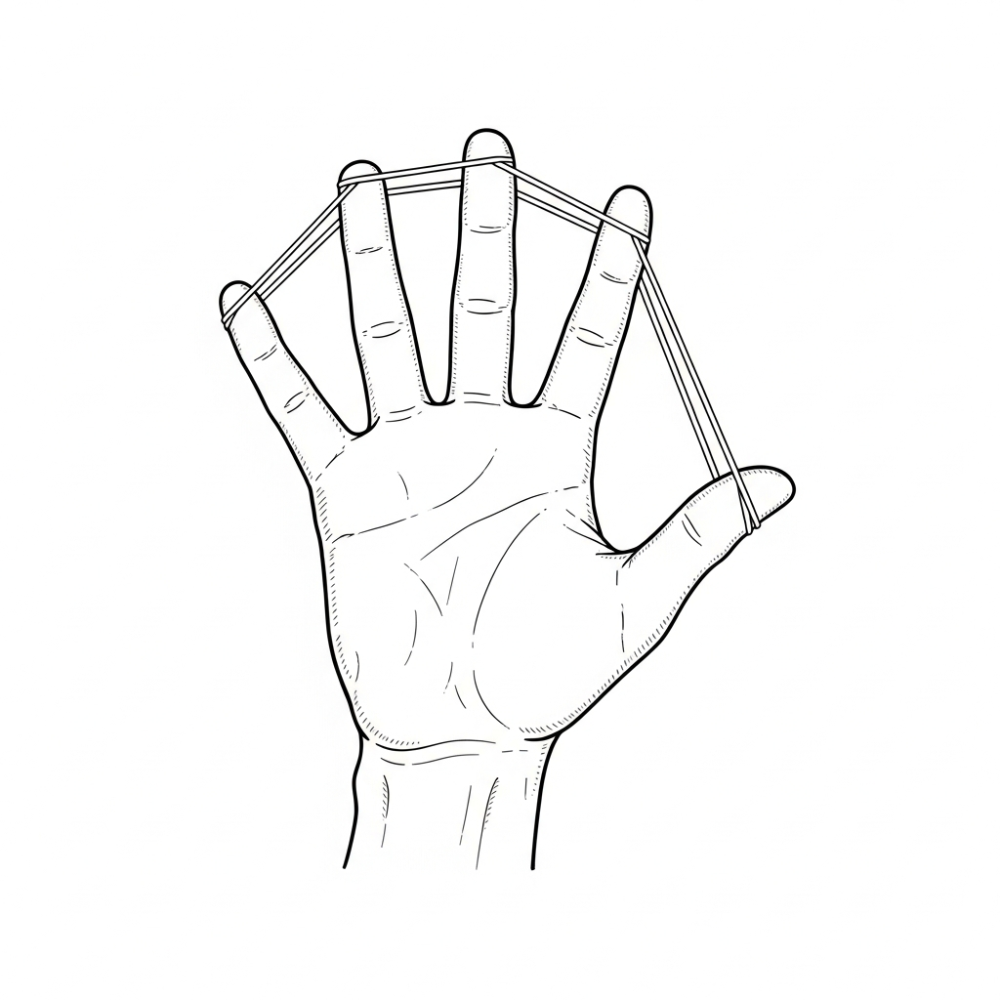

> Full open-hand protocol library, video demos, and the rubber-band starter kit at **strokerecoveryacademy.com/protocols/open-hand**.

---

## Chapter 20: The Motivation Engine That Never Quits

### The Tuesday Motivation Did Not Show Up

Seven months out. A Tuesday in July.

The alarm goes off at 5:30. I do not move. I stare at the ceiling fan because the ceiling fan is the only thing in the room that is doing what it is supposed to do.

The rage is gone. That is the first thing I notice. For seven months the rage has been the engine — *I will not die, I will not lose this hand, I will not be the dad who watches from a chair.* The rage has driven me through six hundred reps a day, every day, no exceptions.

This morning the rage tank is empty.

I lie there and run the math. If I do not get up, the world keeps spinning. Lisa will get the kids to school. Insurance will pay the therapist whether I show up or not. The hand will be a little more closed tonight than it is right now, and tomorrow it will be a little more closed than that, and in a year I will be the guy in the chair watching his sons play catch with someone else.

The math does not move me. The math is the math. I have run the math five hundred times. The math does not get me out of bed on the day the rage runs out.

What gets me out of bed is a sentence I wrote on an index card on day two of acute rehab and taped to the inside of my closet door.

*I am the guy who shows up.*

Not "the guy who feels like showing up." Not "the guy who shows up when the rage is loud." The guy who shows up.

The card does not care how I feel. The card describes who I am. Identity beats motivation every single morning, and motivation beats willpower every single morning, and willpower has nothing to do with any of this.

I sit up. Feet on floor. Stand. Open the closet. Read the card. Walk to the kitchen. Pry the hand open. Sixty seconds.

The rep counts the same on the day the rage shows up and the day it does not.

That is the engine. The rest of this chapter is the schematic.

---

Motivation isn't some fluffy feeling that shows up when the stars align. It's a machine you build, fuel, and defend every day.

When the stroke hit, I had rage. Raw, burning rage. But rage burns out.

What kept me going through years of flickers that felt like nothing, plateaus that felt permanent, and nights when quitting looked easier than breathing?

A system. The Motivation Engine.

This chapter is the engine laid bare. No fairy tales. No "just believe" nonsense. Just the brutal, battle-tested mechanics that turned despair into drive — and drive into 90%+ recovery, still rising.

### Why Most People Lose the Motivation War

You've seen it. I lived it.

Someone starts strong — gym, diet, business, recovery. Life kicks them in the teeth. Progress slows. Setbacks pile up. The fire fades. They quit.

The reason isn't a lack of willpower. It's a lack of *system.* Motivation is not a gift. It is an engineering problem. Build the engine right, and it runs even when everything else is on fire.

### The Sasquatch Motivation Engine — Five Components

**1. Identity Fuel System.**
You don't rise because you feel motivated. You rise because you become someone who doesn't quit.

- **Historical identity:** *I have overcome worse. I survived childhood, addiction, heartbreak, and a brain hemorrhage. This is just another fight.*
- **Present identity:** *I am the guy who shows up every day, even when nothing moves. I am relentless.*
- **Future identity:** *I am the father who plays catch with both arms. I am the survivor who proves the experts wrong. I am the Sasquatch building an empire from rubble.*

I spoke these out loud every morning. Identity drives behavior. Change who you think you are, and the motivation follows.

**2. Progress Amplification System.**
The brain sucks at seeing slow progress. Force it to notice.

- **Micro-progress log:** every day, write one tiny win — even if it's *fingers twitched 1 mm more.*
- **Before/after evidence:** monthly videos of the same exercise. The compound difference is undeniable.
- **Celebration rituals:** small win = fist pump and *hell yeah.* Big win = beer with Michael or Kasey. Dopamine on purpose.

When plateaus hit, I didn't trust feelings. I trusted evidence. Evidence kept the engine running.

**3. Energy Optimization Protocol.**
Motivation requires fuel. Energy is finite. Manage it like a war general.

- Mapped my peaks. Mornings = highest willpower → did the hardest reps then.
- Low-energy windows = planning, reflection, light visualization. Not heavy lifting.
- Recovery built in. Sleep eight hours. Eat clean. Walk outside. Rest isn't quitting. It's reloading.

I treated energy like ammo. Never wasted it on bullshit. Always aimed it at the target.

**4. Support Network Engineering.**
Motivation is contagious. Surround yourself with carriers.

- **Accountability enforcers:** Michael checked in. Kasey called. Lisa believed.
- **Inspiration sources:** other survivors on TikTok. Goggins videos when I needed fire.
- **Community:** early followers who said *you're helping me* — I couldn't quit on them.

I built a tribe that wouldn't let me quit. Find yours, or become it for someone else.

**5. Crisis Recovery Protocols.**
Crises will come. Plan for them.

- **Dark Day Kit:** a playlist of hype music (start with the *Hostile Construction* album), progress photos, a letter from past you (*you've come too far to stop now*).
- **Emergency call list:** the people who will talk you off the ledge.
- **Minimum Viable Action:** on the worst days, one rep. One flicker. Just don't zero.

I had days I wanted to drive into traffic. I used the kit. I called someone. I did one rep. The engine kept running.

### The Engine in Action — My Darkest Stretch

**Months 4–6.** No visible progress. Arm still limp. Leg still dragging. Depression heavy.

**Engine response.**
- Identity: *I am the guy who doesn't quit.*
- Progress: logged micro-wins. A tingle in a finger was a win.
- Energy: slept more. Ate better.
- Support: Michael pushed safely. Kasey called.
- Crisis: one-rep days. Didn't quit.

Breakthrough came in month seven. Arm lifted higher. Leg stepped stronger. The engine worked.

### Reflection Point

Rate your current motivation engine 1 to 10 on each component. Which one is weakest? Write one small action to strengthen it today. Do it.

### Stroked-Out Sasquatch Motivational Quote

*"Motivation isn't a feeling. It's a machine. Build it. Fuel it. Defend it. When everything says quit, the engine says keep swinging."*

### Builder's Note

The Motivation Engine turns despair into drive. Build it once. Run it forever.

---

### The 4 a.m. Voice in the Garage

Year three. Year of the chair, but also year I was starting to walk in short bursts on the parallel bars I had bolted into the studs in the garage. Bars built by my dad and Kasey one weekend, with a folding chair on each end so I could rest between passes.

One December night I could not sleep. I rolled out at 4 a.m., woke nobody, made coffee with my one good hand, and sat in the wheelchair in the garage staring at the bars. It was cold. My breath fogged. Christmas lights from the neighbor's house bled in through the gap under the door. I sat for an hour just looking at the bars and not moving.

Here is the thing about the Motivation Engine that nobody writes honestly: most days you do not feel motivated. Most days you feel tired and ashamed and bored. The engine is what carries you when the feeling is not there. *The engine is not the feeling. The engine is the machine that runs without the feeling.*

I heard a voice in the garage that morning. Not a literal voice. Not a hallucination. The voice that lived in the part of me that had not given up. It said one sentence.

> *Get up. Get one rep. Go back to bed.*

That is it. That is the whole engine in seven words.

I got up. I held the bars. I took three steps. I sat back down in the chair. I rolled back to the kitchen, drank the coffee, and went back to bed for three hours. I had logged a *non-zero day* at 4:15 a.m., and the rest of the day could be whatever it wanted to be.

That is what the engine does. It does not promise you the grand session. It promises you a non-zero entry in the log. Three steps. One spread. One mirror set. Sixty seconds of mental rehearsal. The smallest possible deposit. *Never zero.*

I have used that 4 a.m. voice maybe two thousand times since. I have it tattooed in spirit if not in ink. *Get up, get one rep, go back to bed.* It is the engine. It is the persona. It is the seven-word version of every chapter you have read so far. When the rest of the book leaves your head, that sentence will not.

Build your version. Seven words or fewer. The engine you can run at 4 a.m. in the garage in December with one good hand and a cup of coffee.

That is motivation. The rest is decoration.

---

## Chapter 20½: The Persona Forge — Mindset, Mental Health, and the Stroked-Out Sasquatch in You

> *The body rebuilds in reps. The mind rebuilds in identity. Without the second one, the first one quits.*

This is the chapter I wish someone had handed me on Day 30, sitting in that wheelchair in my parents' living room, watching the ceiling fan turn and trying to figure out who the hell I was supposed to be now.

The Sasquatch was not born in the ICU. The Sasquatch was *forged* — slowly, deliberately, out of necessity — over two and a half years in a wheelchair while the man named Nicholas was busy dying inside me. By the time the Sasquatch had a name, he was the only thing keeping the body alive. That is not a metaphor. That is the engineering reality of stroke recovery: at some point the old self gives up, and you either let it take you with it, or you build something new to take its place.

This chapter is the forge. Step inside.

---

### Why a Persona Outperforms Willpower

There is real science under this. It is not just costume.

**Third-person self-talk reduces emotional reactivity.** Ethan Kross's work at Michigan (2014, 2017) showed that when people refer to themselves by name or in the third person — *Nick can do this. The Sasquatch does not skip the rep.* — they regulate emotion faster, make better decisions under stress, and recover from negative events more quickly. Brain imaging shows reduced activity in the medial prefrontal cortex, the region that handles self-referential rumination. In plain English: the persona buys you distance from your own pain, and distance is what lets you act.

**Identity-based behavior change beats outcome-based.** James Clear nailed it in *Atomic Habits*: outcomes are what you want, processes are what you do, but *identity* is who you believe you are. "I am trying to do my reps today" loses to "I am the Sasquatch. The Sasquatch does the reps." Once the action is consistent with identity, you stop negotiating with yourself every morning. The negotiation is what kills survivors.

**Persona externalizes the burden.** Stroke takes everything from you, including the version of yourself you used to be. If recovery has to be carried by *you* — the broken, scared, grieving you — the load is too heavy. A persona lets you hand the load to a character who is built for it. The Sasquatch carries the reps. The Sasquatch absorbs the pain. The Sasquatch shows up when Nicholas wants to quit. Nicholas just has to be willing to be the Sasquatch for one more rep.

This is not pretending. This is engineering.

---

### Pillar 1: Radical Acceptance — The Gate You Cannot Skip

Every survivor wants to skip this one. Every survivor pays for skipping it.

Radical acceptance does not mean *I am okay with what happened.* You are never going to be okay with what happened. That is allowed. Radical acceptance means *I am no longer fighting reality. I am fighting forward from where reality actually is.*

The fight against reality looks like this:
- *This shouldn't have happened to me.*
- *I shouldn't be this tired.*
- *I shouldn't have to learn to walk again at thirty-six.*
- *They should have caught it sooner.*
- *If only I had —*

Every one of those sentences is a withdrawal from the rebuild account. Every one. The energy you spend re-litigating what happened is energy that does not get spent on the next rep. There is no negotiation with what already is. There is only what you do next.

The acceptance practice that worked for me was three sentences, said out loud, every morning, into the mirror, for the first six months:

> *This happened. It is mine to carry. I am not what happened to me.*

Three sentences. Nine seconds. Said out loud — *out loud* matters, because the body has to hear the words leave your throat. Some mornings I cried through them. Some mornings I screamed them. Some mornings I muttered them. It did not matter. The words went out, and the gate opened a little wider every day, and eventually the gate stayed open and I walked through it and the rebuild started.

You cannot rebuild what you are still arguing with.

---

### Pillar 2: Mental Health Is Recovery — Name It, Treat It

This is the section nobody writes honestly. I am going to.

**Post-stroke depression** affects roughly one in three survivors in the first year. It is not weakness. It is neurochemistry. The bleed disrupted the same circuits that regulate mood — frontal lobe, basal ganglia, limbic system. Of course you are depressed. The hardware is bruised. Get the help. SSRIs are not a moral failure. Therapy is not a luxury. The 988 Suicide & Crisis Lifeline is not for *other* survivors — it is for *us.*

**Post-stroke anxiety** runs about one in four. The body that betrayed you once is now a body you do not trust. Every twinge feels like another stroke. Every headache is a death sentence in your head before it is a tension headache in reality. Naming it is half the cure. *That is post-stroke anxiety. That is not a second stroke.* Breathe through it. Track it. Treat it.

**PTSD from the event itself** is real and underdiagnosed. The hospital, the ambulance, the moment your body went silent — those memories can come back as flashbacks, as nightmares, as a panic that grabs you in the parking lot of the place that *looks* like the ER. EMDR works. Trauma-focused CBT works. Tell your doctor.

**Pseudobulbar affect (PBA)** — uncontrollable laughing or crying that does not match what you actually feel — affects up to half of stroke survivors at some point. It is not you losing your mind. It is the brain's emotional regulator misfiring. There are medications that help. Ask.

**Suicidal ideation** in the first two years is significantly elevated for stroke survivors. I had it. I do not pretend I did not. If you are having it right now, stop reading and call **988** or text **HOME to 741741**. The Sasquatch is not too tough for the lifeline. The Sasquatch *uses* the lifeline. That is what the lifeline is for. Veterans, dial **988** and press **1**.

The men in our culture do not talk about this. The Sasquatch does. The Sasquatch makes it normal. If even one survivor reading this picks up the phone instead of doing the other thing, this whole book was worth writing.

Mental health care is *not* a side quest. It is the same quest. The brain you are trying to rewire is the same brain that is making you suffer. Treat both. Always both.

---

### Pillar 3: Feel All of It — The Full Emotional Spectrum

The hero version of recovery is a lie. The hero version says *channel the anger into reps and you will be fine.* The truth is more complicated and more useful.

You will feel:

- **Rage** — at the doctors, at God, at yourself, at the people who can still do the things you used to do. Rage is fuel. Channel it. But also let it out somewhere safe before it eats you.
- **Grief** — for the body you had, the marriage you had, the version of fatherhood you imagined, the career you were on track for. Grief is not weakness. Grief is the price of having loved your old life. Pay it.
- **Fear** — of the next stroke, of being a burden, of dying alone, of never working again. Name the fear out loud. Fears that stay in your head get bigger. Fears spoken out loud get smaller.
- **Shame** — about the diaper, about the bib, about asking your wife to wipe you, about the body that used to bench four hundred and now cannot lift a fork. Shame thrives on secrecy. Tell one safe person. Watch the shame shrink.
- **Joy** — yes, joy. The first toe twitch. The first step. The first time you held your son with both arms. Joy is a recovery tool. Let it land. Do not rush past it.
- **Boredom** — the most underrated emotion in stroke recovery. Most of recovery is boring. Reps are boring. Mirror therapy is boring. Boredom is the proving ground. The survivors who win are the ones who learn to make peace with boredom.
- **Gratitude** — for the heart that kept thumping. For the people who showed up. For the second chance. Gratitude is not denial of how hard it is. Gratitude is what makes the hard part survivable.

The Sasquatch does not just feel the heroic emotions. The Sasquatch feels *all* of it, names it, sits with it for the time it takes, and then gets back to work. That is the difference between numbing out and rebuilding.

**The 90-second rule.** Neuroscientist Jill Bolte Taylor — herself a stroke survivor — names this: the chemical lifespan of an emotion in the body is about ninety seconds. After that, you are *choosing* to keep it alive by re-telling yourself the story that fuels it. So when the wave hits — rage, fear, grief — set a timer. Ninety seconds. Feel it all the way down to the floor. Then the chemistry is done. What stays after ninety seconds is your choice to renew the prescription. Most days, do not renew it. Some days, you will. Both are okay. The ninety-second clock is the gate.

---

### Pillar 4: Radical Ownership — The Engine

Acceptance is the gate. Ownership is what you do once you walk through it.

Ownership says: *Nobody is coming to do this for me.* Not the doctor. Not the therapist. Not the spouse. Not God, not the universe, not the next protocol. The therapist gives you sixty minutes a week. You have one hundred and sixty-eight hours in the week. The other one hundred and sixty-seven are *yours.*

Ownership is not the same as blame. The stroke was not your fault. The reps are your job. Hold both at once.

The ownership question I asked every morning for three years:

> *What can I do today that nobody can do for me?*

Some days the answer was *brush my teeth with my left hand.* Some days the answer was *walk to the mailbox.* Some days the answer was *log one rep before I quit.* The answer never had to be heroic. The answer just had to be honest and *mine.*

---

### Pillar 5: Identity Over Outcome

If you fix your mind on the outcome — *I want to walk normally again* — every day that you do not walk normally is a failure. That is unsustainable for the months and years recovery actually takes.

If you fix your mind on the *identity* — *I am the kind of person who does the work* — every day you do the work is a win. The walking shows up as a side effect.

Outcome thinking burns survivors out. Identity thinking compounds.

Pick the identity. Mine was: *I am the Stroked-Out Sasquatch. The Sasquatch shows up. The Sasquatch does not skip the rep. The Sasquatch turns the bleed into a blueprint.*

What is yours? You will figure it out in the Persona Forge below.

---

### Pillar 6: The Inspiration Diet

What you put into your head matters as much as what you put into your stomach.

**Eat:**
- Other survivors' real stories. Long-form, unedited, the hard parts left in.
- Books that respect the difficulty. Jill Bolte Taylor's *My Stroke of Insight.* Norman Doidge's *The Brain That Changes Itself.* David Goggins for the savagery, with the discount applied for the parts that do not transfer.
- Long-form podcasts and interviews — Andrew Huberman on neuroplasticity, Lex Fridman with neuroscientists, Rich Roll with comeback athletes.
- Music that fits the work. The book has a soundtrack appendix for a reason. Songs are training partners.

**Starve:**
- Doomscroll. Algorithm rage. The infinite feed.
- "Inspirational" content that skips the hard parts and lies about the timeline.
- People who insist on telling you what you cannot do. Mute. Block. Move on. Their certainty is not your problem.
- True-crime, news cycles, conflict TV. The brain you are rebuilding cannot afford the cortisol bath.

**Test:** After ten minutes of consuming a thing, do you feel *more like the Sasquatch* or less? If less, cut it.

---

### Pillar 7: Accountability Architecture

Willpower is a candle. Accountability is the lantern.

**Layer 1: One human.** One person who knows what you are working on this week. They text you on Friday: *did you do it?* That is the entire job. For me it was Kasey. For you it might be a spouse, a sibling, a sponsor, a therapist, a coach. Pick one. Tell them. Make it easy for them to ask.

**Layer 2: Public commitment.** Post the goal somewhere people will see it. The TikTok army did this for me without me asking. Once 80,000 people are watching whether you do the reps, the cost of skipping goes up. You do not need 80,000. You need three.

**Layer 3: The log.** A notebook. A note app. A spreadsheet. Anything where you write *what I built today* every single night. The log is accountability to *future you.* Future you is also a person who deserves not to be lied to.

**Layer 4: The community.** A tribe of survivors who get it. **strokerecoveryacademy.com/tribe** exists for exactly this. Show up weekly. Lurk if you have to. Eventually you will speak. Eventually someone will speak because you did.

Accountability without judgment. Reps without shame. That is the architecture.

---

### Pillar 8: Consistency Math — Never Miss Twice

The whole game.

Missing one day is human. Missing two days is the start of a habit of missing. The rule, borrowed from James Clear and proven on my own body for seven years: **never miss twice.**

You will miss. You will get sick. The kid will be up at three. The depression will land. You will skip a day. Forgive it. The next day, *do not skip again.* That is the entire discipline.

Consistency math is brutal and kind at the same time. Brutal: the only path is showing up. Kind: you do not have to be good. You just have to be there. *Never zero* is the bottom rung. Even one rep. Even thirty seconds. Even just opening the notebook and writing *today I did nothing and I am here tomorrow.* That is non-zero. That counts.

Sixty-six days of non-zero builds the habit. Three hundred and sixty-five days of non-zero builds the identity. Seven years of non-zero builds the Sasquatch.

---

### The Persona Forge — Build Yours in 30 Minutes

Block thirty minutes. Pen and paper. Phone off. Answer these five questions out loud, then write the answers down.

**1. What is the version of me that the stroke could not kill?**
Not the body — the *spirit.* The thing in you that the bleed could not reach. The trait that survived intact. Stubbornness. Humor. Faith. Loyalty. Curiosity. Whatever it is. Name it.

**2. What animal, character, or archetype carries that trait for me?**
Sasquatch worked for me — myth-sized, unkillable, builds with whatever the forest gives him. Yours might be a wolf, a lighthouse, a blacksmith, a samurai, a grandmother, a mountain. There is no wrong answer. The only test: when you picture it, do you feel a little taller?

**3. What is its name?**
Mine is Stroked-Out Sasquatch. Yours might be The Builder. The Lighthouse. The Old Wolf. Auntie Iron. Name it like you are naming a child you are about to be responsible for. Because you are.

**4. What does it do that I will not?**
The persona's job is to do the things the smaller, scared, broken version of you will not do today. List five of them. *The Sasquatch does the reps when Nicholas wants to quit. The Sasquatch eats the broccoli. The Sasquatch shows up to therapy on the bad days. The Sasquatch picks up the phone when 988 is the right call. The Sasquatch lets the kid see him cry, then lets the kid see him keep going.*

**5. What is its one-line creed?**
Mine: *Heart's still thumpin', life's still pumpin'. Keep swinging.* Yours might be five words. Twelve. Whatever fits on the back of your hand if you wrote it in Sharpie. It must be true. It must be yours. It must be repeatable when you cannot think.

That is the forge. The persona is now alive. You will fail it sometimes. That is fine. The persona is patient. The persona is waiting. The persona is *you* — just the version of you that already knows how this ends.

---

### The Daily Persona Check-In — Sixty Seconds

Mornings, before the phone, before the news, before anything: ask one question out loud.

> *Today, what would the [your persona] do that I do not want to do?*

Answer. One sentence. Then go do that one thing first.

That is the whole practice. One question. One answer. One action. Sixty seconds of mindset that runs the rest of the day.

---

### When the Persona Cracks

The persona will crack. There will be days the Sasquatch is not there. Days you cannot find him. Days you wonder if he was ever real. Those days are part of the design.

When the persona cracks, you do not need a new persona. You need rest, food, water, sleep, a phone call, sometimes a doctor. The persona is not a substitute for basic care. It is a tool you reach for *after* the basics are met. Skipping basics and trying to grit through it with persona alone is how survivors burn out and quit. Eat. Hydrate. Sleep. Take the medication. Call the person. *Then* ask what the Sasquatch would do.

The persona returns when the body is fed. Always. Trust the design.

---

### Builder's Note

The body rebuilds in reps. The mind rebuilds in identity. Acceptance opens the gate. Mental health is the foundation under everything. Feel all of it — the heroic emotions and the ugly ones — for ninety seconds, then get back to work. Own the reps nobody can do for you. Choose the identity, not the outcome. Eat the inspiration that builds you, starve the rest. Architect the accountability. Never miss twice. Forge the persona. Run the daily check-in. Trust the basics when the persona cracks.

That is the operating system. Print it. Tape it up. Live it.

The Sasquatch is not somebody else. The Sasquatch is the version of you that the bleed could not kill. The forge does not invent him. The forge just gives him a name so you can find him on the bad days.

Find him. Use him. Become him.

---

### For the Quiet Sasquatch

Not everybody yells. Not everybody wants a beard, a flannel, and a baseball bat in the closet. Some of the strongest survivors I have met are quiet. Older. Soft-spoken. A grandmother who finished her reps at 5 a.m. before the house woke up. A retired schoolteacher who logged every drill in cursive. A woman in her sixties who never once raised her voice but never once missed a session in three years.

The Sasquatch is not a costume. The Sasquatch is a stance.

The stance is: *I do not negotiate with the bleed. I show up. I rep. I do not miss twice.*

You can hold that stance in a whisper. You can hold it in church clothes. You can hold it without ever saying the word Sasquatch out loud. The doctrine works the same. The 90-day program works the same. The drills work the same. S.A.S.C.H. works the same — Seize, Absorb, Swing, Combine, Hammer — whether you swing a bat or you swing a knitting needle.

If the loud voice does not fit you, translate it. Build the version of yourself the bleed could not kill in your own language. Quiet rebuilds and loud rebuilds end at the same place: the version of you that came back.

Heart's still thumpin'. The whisper counts too.

---

> Full Persona Forge worksheet, Daily Check-In card, mental-health resource directory (988, Crisis Text Line, Veterans line, post-stroke depression specialists by region), and the audio guided forge with the Sasquatch walking you through all five questions: **strokerecoveryacademy.com/persona**.

---

## Chapter 21: Emotional Warfare — Crushing Depression and Isolation

Setbacks aren't the end. They are invitations to get stronger.

Depression and isolation tried to kill my recovery. I turned them into fuel.

Here is how I fought, and how I won, the emotional war.

### The Depression Trap

After discharge, I was home. Wheelchair-bound. Dependent. Friends gone. Lisa pregnant and stressed. I lay in bed twenty-four hours a day. Smoked like a chimney. Fantasized about ending it. Felt like a burden.

Post-stroke depression hits thirty to fifty percent of survivors hard. It is not weakness. It is chemistry plus circumstance.

It is also deadly if you let it win.

### My Emotional Warfare Arsenal

**1. Purpose Anchor.**
My son was coming. I made a promise: *I will play catch with both arms.* That *why* pulled me out of bed when nothing else could. Find your anchor — family, revenge on "nevers," proving doubters wrong. Without purpose, depression wins.

**2. Small Victory Counterattack.**
Depression says *nothing matters.* Counter with evidence. One rep. One stand. One flicker. Log it. Read it when dark thoughts hit. Small wins stack proof against the lie.

**3. Isolation Killer — Tribe Building.**
Friends vanished. I started TikTok. Shared raw videos. Comments came: *you're inspiring me.* I replied to every one. Built a tribe. Isolation died when connection grew. Join groups. Message survivors. Uplift others — it uplifts you.

**4. Dark Day Protocol.**
- Emergency kit: progress photos, hype playlist, letter from future you.
- One call: someone who will talk you off the ledge.
- Minimum action: one rep. No zero days.

**5. Sarcasm and Humor as Weapons.**
Depression hates laughter. I laughed at the absurdity — pooping myself to Britney, the catheter fight, the Hoyer lift whale moment. Humor disarms despair. Find yours.

### The Night I Almost Drove Into Traffic

I am going to tell you about a night I have not told anyone before this paragraph.

It was about month four. I had been home from inpatient for a few weeks. The training wheels were off. The therapists weren't there anymore. Lisa was almost full term and exhausted in a way pregnant women get exhausted when their husband is also a project. The friends had vanished. The house was quiet in the wrong way.

I was driving home from a follow-up appointment. I had clearance to drive short distances with adaptive equipment. I should not have been alone.

I came to a four-lane intersection in Fort Smith. Stopped at the red light. Watched the cross-traffic move through.

A semi went by left to right. Then another. Then a third.

I had a thought arrive in my head, fully formed, the way thoughts arrive when you've been carrying them for weeks without naming them.

*If I let off the brake at the right moment, this is over. Lisa gets the insurance. The baby gets a clean start with a healthy father later. Mom and Dad don't have to watch this. I stop being a burden. Everyone is better off.*

I sat there with my foot on the brake and I watched the next semi coming.

I was not crying. I was calm. That is the part I want you to understand. The dangerous part of post-stroke depression is not the loud part. The dangerous part is the quiet part — the part where the math feels reasonable.

The light turned green.

I did not move.

The car behind me honked.

I did not move.

He honked again. Longer. Annoyed. *Move, buddy.*

I looked down at my phone in the cupholder. The lock screen was a picture Lisa had sent me the day before. An ultrasound. Black and white. A profile. A small curved thing in the middle of a dark space that was going to be a person in three months.

I do not know why that picture broke the math. I cannot give you the line in the book where it makes mechanical sense. I can only tell you that I looked at the curved thing in the dark space and the calm feeling broke and was replaced by a different feeling, the feeling of having almost done something I could not have undone.

I drove through the green light slowly and I parked in the next parking lot I saw and I sat there for a long time.

When I got home that night I did not tell Lisa. I should have. I did not have the words yet. What I did instead was open the notes app on my phone and write four sentences:

*I almost did it tonight.*
*I am going to call somebody tomorrow.*
*My son needs a father.*
*I am not going to be the reason a kid grows up with a story.*

I called somebody the next day. I did not call 988 because I did not know about it then. I called my primary care doctor and I told her, and she got me in to a behavioral health appointment that week, and that appointment got me on the right antidepressant, and the antidepressant gave me back enough headspace to do the work in this book.

I am telling you this because you might be in a four-lane intersection right now.

I am telling you that the calm feeling is the dangerous one.

I am telling you that the math is wrong even when it feels right.

I am telling you that the picture on your lock screen — your kid, your dog, your mom, your future — is not nothing.

And I am telling you what I did not know that night: that there is a number you can call.

### The Hard Conversation You Need to Have

If you have been thinking about hurting yourself or ending your life — not as a passing thought, but as a plan — please stop reading and call **988** right now. Or text 988. Or chat at 988lifeline.org.

I'm dead serious. There is no chapter, no quote, no reflection prompt that beats a real human voice on a phone line right now. The book will be here when you get back.

You are valuable. The Sasquatch has your back. We are watching. We need you.

### Reflection Point

What is your biggest emotional enemy right now? Write it down. Pick one weapon from the arsenal above. Use it today.

### Stroked-Out Sasquatch Motivational Quote

*"Depression and isolation want you dead. Fight back with purpose, small wins, tribe, protocol, and a good laugh. Turn setbacks into comebacks."*

### Builder's Note

Emotional warfare is the hidden half of recovery. Win it, and the physical half follows.

> ### SASQUATCH TRACK SYNC: HandiCRAP
> **Vibe:** Gritty, sarcastic, aggressive energy.
> **Action:** Play this when the humiliation hits or when depression tries to park you. Laugh at the absurdity. Get mad. Use the spite as fuel.
> **Listen here:** [youtu.be/SfbYbHCkids](https://youtu.be/SfbYbHCkids) *(also on Spotify, Apple Music, iTunes, YouTube Music — search "Stroked Out Sasquatch — HandiCRAP")*
> **Backup:** strokerecoveryacademy.com/soundtrack

---

## Chapter 22: The Plateau Wars

Plateaus are inevitable.

Progress stops. Effort continues. Results don't show. Most quit here.

I didn't.

Here's how I won the plateau wars — and how you can too.

### The Anatomy of a Plateau

- Progress stalls despite daily work.
- Doubt creeps in: *this is it. I've peaked.*
- External voices: *maybe accept it.*
- Internal voice: *why bother?*

I hit multiple:
- **Movement plateau (months 4–6):** arm stuck at twenty percent.
- **Strength plateau (months 12–15):** no gains.
- **Coordination plateau (months 18–24):** fine motor frozen.

Every time, quitting looked reasonable. Every time, I refused.

### Plateau Warfare Tactics

**1. Micro-Progress Detection.**
Macro stalled? Zoom in. Degrees of shoulder lift (1° is a win). Seconds holding a stand. Finger twitch size. Log them. Evidence kills doubt.

**2. System Variation.**
Same drills produce same results. Change variables. Resistance band tension. Angle of movement. Speed (slow eccentric). Environment (outside vs. gym). Keep the brain guessing — rewiring continues.

**3. Plateau Reframing.**
Thought shift:
- *Nothing happening* → *Invisible consolidation happening.*
- *I've peaked* → *Preparing for breakthrough.*
- *Wasting time* → *Building character that wins future wars.*

**4. Purpose Reconnection.**
When motivation dipped, I looked at my son's picture. Remembered my promise. Purpose > plateau.

**5. Support Injection.**
Called Michael. Posted on TikTok. Got comments: *you're helping me.* Tribe pulled me through.

### Breakthrough Pattern

Every plateau ended the same way:

1. Extended invisible work.
2. Sudden jump.
3. Rapid acceleration.
4. New level of capability.

- Month 7: arm jumped from twenty to forty percent.
- Month 16: strength exploded.
- Month 25: precision returned.

Plateaus aren't ceilings. They are launchpads.

### Insurance Cuts and "Maximum Benefit"

A specific kind of plateau deserves its own warning: the plateau the *system* invents because your insurance has decided you have reached "maximum medical benefit."

This is a **billing decision dressed up as a clinical decision.**

When it comes — and for almost every survivor, it comes — you have options:

1. **Appeal it in writing.** Insurance denials can be appealed. Get your therapist to document objective improvement (gait speed, grip force, FIM scores). Many denials are reversed on appeal.
2. **Switch to a community fitness model.** Many YMCAs, hospitals, and stroke-specific programs offer ongoing exercise classes for survivors at a fraction of clinical cost.
3. **Self-direct with the protocols in this book.** This is the entire reason this book exists.
4. **Join the Stroke Recovery Academy community.** strokerecoveryacademy.com.

Insurance saying *maximum benefit* does not mean *maximum recovery.* It means *maximum bills they're willing to pay.* Those are very, very different things.

### Reflection Point

What plateau are you in right now? Write it down. Pick one of the five tactics above. Apply it today.

### Stroked-Out Sasquatch Motivational Quote

*"Plateaus aren't parking lots — they're launchpads. Stay the course. Invisible work becomes visible breakthrough. The Sasquatch didn't quit during the stall. Neither should you."*

### Builder's Note

The war is won in the plateau. Keep swinging when nothing moves. Breakthrough is coming.

> ### SASQUATCH TRACK SYNC: Maximum Benefit
> **Vibe:** Defiant, industrial pushback.
> **Action:** When insurance cuts you off or progress stalls, the system says you've reached "maximum benefit." Hit play and prove you haven't even scratched the surface.
> **Listen here:** [youtu.be/cOW2ocrdqKA](https://youtu.be/cOW2ocrdqKA) *(also on Spotify, Apple Music, iTunes, YouTube Music — search "Stroked Out Sasquatch — Maximum Benefit")*
> **Backup:** strokerecoveryacademy.com/soundtrack

---

# PART V — LIVING THE RECOVERY
## Beyond Comeback to Empire

> *Discharge day. Side door of the rehab hospital. A binder in the lap. A wheelchair on loan. A wife driving. A son not yet born. The miracle was the survival. The work is the Tuesday after — and every Tuesday after that, for the rest of the rebuild. This is the part of the book where the recovery has to start fitting inside the life.*

---

### The Plateau Audit — Five Honest Questions

Before you change anything, you have to know what you are actually doing. Most plateaus are not plateaus. Most plateaus are *invisible coasting* dressed up as effort. Run this audit before you mutate anything.

**Question 1: Am I doing the same thing I was doing four weeks ago?**
If yes, that is not a plateau. That is *steady-state.* The body adapts to a load and stops growing. You do not have a plateau — you have a stale program. Mutate any single variable: reps, sets, range, tempo, surface, time of day, eyes open vs. eyes closed.

**Question 2: Am I sleeping enough?**
The brain consolidates motor learning during slow-wave sleep. If you are getting under seven hours, you are training in the morning and erasing it overnight. Fix the sleep before you blame the protocol.

**Question 3: Am I eating to rebuild?**
The brain runs on glucose, choline, omega-3s, and B vitamins. If your fuel is fast food and cortisol, the rebuild stalls. Run the MIND diet from Appendix D for two weeks before you call it a plateau.

**Question 4: Am I emotionally stuck?**
Depression flattens motor learning. So does unresolved grief. So does a relationship at war. Treat the emotional stuck before you blame the muscular one. Often the plateau lifts the day the therapy starts.

**Question 5: Am I plateauing or am I scared?**
The most honest one. Sometimes "plateau" is the word survivors use for *I am scared to push the next variable.* The next progression hurts more, requires more focus, risks more failure. Calling it a plateau gives you permission to coast. Name the fear out loud. Then push the variable anyway.

### The Mutation Tree

When you have run the audit honestly and the plateau is real, mutate. The Mutation Tree is the order of changes that have the highest payoff for the lowest risk.

**Branch 1: Mutate intensity.** Add load, add resistance, add reps, add sets. Same drill, more dose. Cheapest mutation. Try first.

**Branch 2: Mutate novelty.** Same drill, new angle. Same drill, new surface — foam, BOSU, sand. Same drill, eyes closed. Novelty wakes up dormant motor units that the old path stopped recruiting.

**Branch 3: Mutate combination.** Stack two drills you have been doing alone. Bat plus mirror. Mirror plus mental rehearsal. Walking plus ankle e-stim. The combination is almost always greater than the sum.

**Branch 4: Mutate the environment.** Train somewhere new. Outside instead of inside. Morning instead of evening. The brain encodes context — change the context and the brain has to re-learn the pattern, which is the same as growing.

**Branch 5: Mutate the protocol entirely.** Last resort. Drop the drill. Pick a new one from Appendix B. Run it for two weeks. If the plateau breaks, you have the answer. If it does not, return to the original and mutate one of the first four branches harder.

The error survivors make is going straight to Branch 5 when the plateau is actually solved by Branch 1 or Branch 2. *Try the cheap mutations first.*

### The Year Five Wall

Year five was the worst plateau of my recovery. Walking had stalled. The hand had stalled. Speech was clean but flat. I felt like the body had finally said *this is the version you get, take it or leave it.*

I ran the audit. Question one: same drills, eight months running. Question two: sleeping fine. Question three: eating clean. Question four: actually a rough patch with Lisa, but managed. Question five — the one that hurt — *I was scared to push past where I was.* If I pushed and the body said no, the no would be permanent and I would have to live with the version I had. If I did not push, I could still tell myself the next breakthrough was coming.

I had to push.

I mutated three variables on the same Monday. Walking — added a weighted vest. Hand — added the rubber-band resist on top of tabletop spread. Speech — added cold reads of my own TikTok scripts at 1.25x speed instead of 1x. Three small mutations. One week.

Day eleven the wall cracked. Hand opened wider than it had in fourteen months. Walking gait cleaned up because the vest forced glute engagement that had been ghosting on me since the chair years. Speech sharpened because reading at 1.25x dragged the dysarthria up to normal speed and the brain rewired to the new tempo.

Five years in. The biggest single-week jump since year one. The plateau was not a plateau. The plateau was a wall I was scared to push, three small mutations away from cracking.

If you are at the wall right now: run the audit honest. Pick one mutation from each of the first three branches. Give it two weeks. Heart's still thumpin'. Wall's still crackable. Keep swinging.

> Plateau Audit worksheet, Mutation Tree decision card, and the Year Five Wall video at **strokerecoveryacademy.com/plateau**.

---

## Chapter 22½: What the Doctors Got Right and What They Got Wrong

The honest chapter. The one I owed the medical profession before I started telling the rest of the world they were wrong about me. They were wrong about a lot. They were also right about a lot, and the survivors who ignore the *right* parts because they want to fight the *wrong* parts are the survivors who end up back in the ER with stroke number two.

Both columns matter. Both columns belong on the page.

### What They Got Right

**1. They saved my life.**
Start there. The ER team at the Fort Smith hospital that night did not waste a minute. CT scan inside the first thirty minutes. Neurosurgery at the bedside before my parents arrived. The decision to leave the bleed alone and let the swelling resolve naturally was the right call — surgery in my case would have made it worse. The first 72 hours of acute care kept the heart thumping. Without them, none of the rest of this book exists. *Thank you.*

**2. They ran the right tests.**
Echocardiogram. Carotid Doppler. Lipid panel. A1c. Hypercoagulability workup. They found the underlying cause that put me at risk — the thing nobody had screened for at any annual physical I had ever skipped — and put me on the medications that have prevented stroke number two for seven years and counting. *Find the cause. Treat the cause. Take the medication.* The stroke survivors I see go back to the ER are usually the ones who quit the prevention protocol because they "felt fine." Felt fine is not the metric. Stroke prevention is the metric.

**3. They did the swallow eval.**
Aspiration pneumonia is the leading killer of stroke survivors in the first 30 days post-discharge. The SLP who ran my swallow study and put me on thickened liquids until I could pass a regular consistency was *protecting my life,* not insulting my dignity. Survivors who refuse the eval to "save face" sometimes do not get a face to save. *Do the swallow study. Follow the recommendations until you pass.*

**4. They referred to inpatient rehab early.**
Encompass Health caught me at the right moment in the recovery curve. The hospitalist who pushed for that admission instead of sending me home with a referral packet probably bought me two years of recovery I would not otherwise have had. Inpatient rehab early is one of the strongest evidence-based predictors of long-term function. Fight for it.

**5. They were right about safety.**
The PT who said *do not try the stairs alone yet* was right. I did not listen, and I fell, and I am lucky I did not undo six months of work. The OT who said *use the shower chair* was right. I did not, and I slipped, and Lisa caught me. *Some of the cautions are real cautions, not low expectations.* Learn to tell the difference. Caution is allowed to be loud when the cost of failure is a head injury.

### What They Got Wrong

**1. They told my family I would never walk normally again.**
Within 72 hours of the bleed. Before the swelling had resolved. Before any rehab had started. Based on early imaging and a clinical exam of a man who could not yet feel his left side. That prognosis was not science. That prognosis was *crystal-balling.* The honest answer, supported by the actual evidence, is *we do not know yet.* Recovery curves keep climbing into year five, year seven, year ten. Anyone who tells a 72-hour-post-stroke patient *the ceiling is here* is making a guess and dressing it up as data. *Stop doing this.*

**2. They underweighted neuroplasticity in years two through seven.**
The "most recovery in the first year" mantra was reasonable in 1985. It is not reasonable in 2026. Twenty years of neuroplasticity research — Pascual-Leone, Kleim, Cramer, Doidge, the entire body of work — shows the brain can rewire well past year one if the dose, intensity, and novelty are sustained. My biggest gains came in years four through seven. The clinical world is catching up to this slowly. The patient world cannot wait. *If you are past year one, the rebuild has not stopped — only the system's interest in funding it has.*

**3. They underscreened for depression.**
Out of eight inpatient stays, I was screened for depression *once.* That is malpractice by any modern standard. One in three stroke survivors. Suicide rates significantly elevated in the first two years. The PHQ-9 takes ninety seconds. *Screen at every visit. Treat the positive results.*

**4. They underweighted caregiver burnout.**
Lisa was offered exactly zero structured support during the years she was carrying me. No support group referral. No respite care plan. No mental-health screen for *her.* The system treats the survivor and forgets the caregiver, and then wonders why so many survivor families fall apart in year two. *Caregiver care is patient care. They are the same patient.*

**5. They oversold the timeline.**
"Six months to know what you'll get back" is a useful clinical heuristic and a brutal lie when said to a Day-30 patient. It compresses the rebuild into a window most of the work happens *outside of.* If I had believed it, I would have quit at month seven. *Tell patients the truth: the work continues for years. The early gains are real and important. The late gains are also real and the door does not close.*

**6. They told me Britney Spears would sound like a chainsaw.**
They were wrong. They were spectacularly wrong. They were wrong on tape, with multiple specialists in the room, and the chart still reads *expect significant cognitive deficits in music recognition.* I built an album. I named twelve tracks. I sing every chorus to my son in the car. *Be more humble about prognosis in the cognitive domain.* The brain is full of surprises and most of them are good.

### What This Means for You

If you are a survivor: take the medication. Do the swallow study. Wear the brace until you do not need it. *And* push past every "never" that came with no evidence behind it. Both columns. Always both.

If you are a clinician: keep saving lives. Keep running the tests. Keep referring to rehab. *And* stop crystal-balling the seventh-year ceiling at the seventy-second hour. Update the timeline language. Screen for depression every visit. Build caregiver support into the discharge plan.

If you are a family member: trust the medication. Trust the swallow study. Trust the safety cautions. *And* do not let any single sentence from any single visit close the door on your survivor's future. The door is open longer than the system tells you.

The truth is in both columns. The book that ignores either column is dishonest. This is not that book.

---

## Chapter 23: Home Sweet Home — Conquering Daily Life

Coming home from the hospital was supposed to be a victory lap.

It felt like walking into a war zone with no weapons.

No nurses on call. No therapy schedule. Just me, a wheelchair, dead weight on my left side, and a house that suddenly felt like it was built for giants. Stairs became mountains. Doorways became choke points. The shower became a potential drowning hazard. Kitchen counters became unreachable.

I was a 250-pound Arkansas boy turned prisoner in his own home — fully wheelchair-bound or crawling on all fours like some kind of broken animal.

But home wasn't the end of recovery. It was where the real fight started.

Here's how I turned that house into my personal training ground and conquered daily life one brutal, humiliating, victorious rep at a time.

### The Home Reality Shock

- **Mobility hell.** Slide-board transfers to bed or toilet. One slip and I was on the floor again.
- **Bathroom wars.** Raised toilet seat (thank God). Grab bars in both showers (my father installed them). Shower chair at first. Sponge baths from Lisa.
- **Kitchen nightmare.** Counters too high. Couldn't reach anything. Pureed food phase lingered. When my appetite came roaring back, I gained eighty pounds *chillin' and wheelin'.* Beard hid the gobbler. Belt sighed in relief twice a day — once putting pants on, once taking them off.
- **Isolation peak.** Friends vanished like smoke. Family fights over visitation. Depression crushed me. I lay in bed twenty-four hours a day. Smoked like a chimney. Fantasized about steering into traffic.

### My Father's Quiet Strength

My father stepped up big.

Installed a wheelchair ramp on the front porch so I could get in and out without being carried. Put handrails in both showers. Raised toilet seat. Shower chair.

He didn't say much. He just *built.*

That quiet action spoke louder than any pep talk. When the people around you don't know what to say — let them do something instead. Let them build. Let them drive you to therapy. Let them show up.

### Karlie the Caretaker — Compassion When I Needed It Most

Early home days, my anxiety was crippling. I couldn't even walk into a store without panic.

Karlie became my caretaker. She didn't just help. She showed compassion. Companionship. Friendship. She helped me with mobility and strength training exercises — upper body, lower body, every part of the affected side. She was paramount in helping me regain function.

She also swept the floor and made me feel human again when I felt like a burden.

That human connection mattered more than any exercise.

### Home Adaptation Arsenal

**1. Ramp and transfer mastery.**
The ramp gave me freedom to leave the house. Slide-board practice daily — from embarrassing falls to smooth transfers.

**2. Bathroom conquest.**
Raised seat plus grab bars equals dignity. Shower chair → bench → standing with handrail. No more sponge baths. Independence won.

**3. Kitchen takeover.**
Reacher tool at first. One-handed cooking drills. Grip reps built strength. Ate for recovery — high protein, BDNF boosters (eggs, nuts, fish). The weight gain was fuel.

**4. Daily-life reps.**
Brushing teeth. Buttoning shirts. Opening doors. Forced functional tasks. Every struggle was a rep. TikTok filming was accountability and tribe.

**5. Mindset shift.**
Home wasn't prison. It was the gym. Every task was a drill. Every humiliation was a story.

### Reflection Point

What is your *home hell* right now? Write one daily rep to conquer it — a transfer, a task, a mindset move. Do it today.

### Stroked-Out Sasquatch Motivational Quote

*"Home isn't recovery's end — it's the real arena. Turn stairs into reps. Turn showers into battles. Turn the kitchen into fuel. The Sasquatch conquered his house. Conquer yours."*

### Builder's Note

Home adaptation is where survivors break or rebuild. I rebuilt. You will too.

> ### SASQUATCH TRACK SYNC: Wheeled Out (Discharge)
> **Vibe:** Cinematic and transitional.
> **Action:** The training wheels are off. Listen to this as you adapt your home into your new training ground. Turn the stairs into reps.
> **Listen here:** [song.link/y/AcwKQQGOjIM](https://song.link/y/AcwKQQGOjIM) (Spotify · Apple Music · iTunes · YouTube Music · YouTube)
> **Backup:** strokerecoveryacademy.com/soundtrack

---

## Chapter 24: Family, Caregivers, and Fatherhood Fire

Stroke doesn't hit just you.

It hits everyone in your house. Your spouse. Your kids. Your parents. Your siblings. Your friends. Your caregivers.

Family becomes battlefield and lifeline. Caregivers become warriors and casualties.

I learned the hard way how to manage the team — and I learned that the most powerful motivator I would ever have was about to be born while I was still in the chair.

### Lisa: The Warrior in the Chair Next to Mine

Lisa was pregnant through the entire ICU.

She rarely left my side. Only to shower. Weeks after the stroke, she found out the baby was a boy — our son — while sitting next to my bed.

She stayed. Held my pee cup. Gave sponge baths. Fought the system. Ripped a tube out of my throat when nurses were too slow.

We are not married now. We co-parent and we are friends. I am here typing this because of her. Some debts you don't pay back. You honor them by doing the work.

### The Truth About Lisa and Me — Before the Stroke

I am going to tell you the part most stroke memoirs leave out. Because if I leave it out, the rest of this chapter is a lie of omission, and I refuse to lie to you about anything in this book.

Lisa and I were not in a good place when the stroke hit.

We had been together a few years. She had a daughter from before me. I had walked into her life like I walked into every room in 2018 — too big, too loud, too sure of myself, too convinced that the next deal or the next workout or the next big swing would fix whatever was off between us. It was not working. We had been talking, in the careful way two grown people talk when they are running out of road, about what came next. She was pregnant with our son. I had cheated earlier in the relationship and she knew. There was an ex named Eric in her past who was not all the way past, and it tore at me in ways I handled badly. We were not headed for the altar. We were headed somewhere quieter and sadder than that.

Then on December 3, 2018 the inside of my skull popped and everything that had been complicated became simple in the worst possible way.

She did not have to stay. She had every legal, moral, and emotional license to walk out of that ICU and protect herself and her unborn son from the wreck I had become. The kindest version of her future did not include me in it.

She stayed anyway.

She stayed for the surgery and the staples and the tube she ripped out of my throat. She stayed for the months I could not feed myself and the months I could not say her name without it coming out wrong. She stayed long enough to deliver our son with me parked in a wheelchair at the head of the bed. Then — when I was upright enough to be a person again, when the immediate emergency was over — she did the thing the romantic version of this story would not let her do.

She told me she loved me, and that she was not going to be my wife.

We sat at the kitchen table in the house her father helped us into and we talked it through like adults who had been through a war together. The marriage was not the right shape for what we were going to have to be for the rest of our lives. The co-parenting was. We agreed, that night, that our son was going to grow up watching two parents who chose every week to keep being a team for him whether or not they were a couple. We have kept that agreement for seven years.

I am writing this because some survivor reading this is in a marriage that the stroke did not cause but the stroke is now stress-testing past its real limits. You think you have to white-knuckle it because the recovery cannot survive a divorce on top of everything else.

You are wrong.

The recovery can survive an honest split. It cannot survive a dishonest marriage. The energy a bad marriage takes is energy your brain needs for the rebuild. If the relationship was broken before the stroke, the stroke does not fix it — it amplifies whatever was already there.

If you are headed where Lisa and I were headed, do what we did. Be honest. Be respectful. Build the next shape together, instead of pretending the old shape is still working. The kid who comes out the other side of that is the kid who learns what real love looks like when it stops trying to be one specific thing and starts trying to be useful to the people inside it.

I owe Lisa my life. She owes me an honest co-parent. We pay each other every week.

That is a marriage of a different kind. It works.

### Kasey: Brother From Another Mother

Almost every friend I had vanished after the stroke. Not Kasey.

Our moms are sisters. We grew up as brothers. Sports, scooters, weights. We even got addicted to opiates together in the early 2000s opioid mess and got through that one too.

He visited me in the hospital. Just *showed up.* When the family was at war over visitation rules, seeing my brother walk in the door was relief I can't put into words.

If you can't find a family member who'll show up, find a Kasey. If you have a Kasey, call him this week and tell him.

### Michael: The Therapist Who Refused to Settle

Already covered in Chapter 4. He still gets a line here because he was as much family as anyone in this list.

### My Father's Quiet Strength

Already covered in Chapter 23. Built the ramp. Built the rails. Said almost nothing. Did everything.

### Karlie: The Caretaker

Already covered in Chapter 23. The compassion was the medicine.

### Managing Your Support Team

**1. Honest communication.**
Tell them your *why.* *This is for my son. For us. For proving them wrong.* They fight harder when they know the purpose.

**2. Give them roles.**
- Lisa: emotional anchor, daily care.
- Kasey: bro accountability, visits.
- Father: builder and fixer.
- Karlie: companion and human connection.
- Michael: pusher and standard-setter.

Defined roles reduce burnout.

**3. Celebrate together.**
Small wins were a beer with Michael. Big wins were a bigger celebration. They need victories too.

**4. Protect their energy.**
Don't dump every dark day on them. Have a protocol — kit, call someone else, professional therapist. Give them breaks. Gratitude goes both ways. Caregiver burnout is real and it kills marriages, friendships, and recoveries. Watch for it.

### Fatherhood Fire — My Ultimate Why

My son was born while I was still wheelchair-bound.

It was Wednesday, April 24, 2019 — four months and three weeks after the stroke. I had graduated from inpatient. I had not graduated from the chair. The plan was that I would be in the delivery room — not standing, not catching, not the way I had pictured a thousand times when Lisa first told me she was pregnant — just *there.* Wheels locked. Brake on. Present.

The morning of the delivery I sat in the passenger seat while Lisa's mom drove us to the hospital. I had a small black duffel between my feet with three things in it: a clean t-shirt, a phone charger, and a sealed envelope I had been carrying for two weeks. The envelope had one folded sheet of paper inside. On the paper was the promise I was going to make to my son the first moment I was alone with him. I had typed it because my left hand still couldn't write. I had read it out loud to myself in the bathroom mirror so many times that I could hear it before my mouth started.

We checked in. They wheeled me into the delivery room. They parked me at the head of the bed, opposite the doctor. Lisa squeezed my good hand. I squeezed back as hard as I could, which was not as hard as I wanted, and she felt the gap between what I was trying to give her and what I had to give and she did not say a word about it.

Labor took the day.

When it was time, the room got quiet in the focused way rooms get quiet when something important is about to happen. The doctor said *push.* Lisa pushed. The doctor said *push.* Lisa pushed. I sat in that chair holding her hand and watching the most important moment of my life happen from a seated angle I had not chosen.

Then I saw him.

I saw the top of his head crown over Lisa's horizon. Pale. Wet. Small. *Real.*

I had been preparing myself for the emotion of seeing my son for the first time the way men prepare for things they think they understand. I had imagined it would be joy. It was not joy. It was joy and grief and rage and resolution all at once, mixed in a ratio my body did not know how to process. I started crying in the chair. I could not wipe my eyes properly because my left hand still was not working right and my right hand was still locked in Lisa's fist. I just cried with my face open while the doctor pulled the rest of him out into the world and laid him on Lisa's chest.

He was so small. So *small.* I had been a four-hundred-pound bench, a man built like a wall, a body that could lift things that needed lifting. The thing on Lisa's chest weighed seven pounds.

The nurse asked me if I wanted to hold him.

That was the question I had been afraid of for four months.

I had practiced this in my head a hundred times. I had practiced lifting a folded blanket. I had practiced lifting a bag of flour. My right arm was strong. My left arm could not be trusted. I was sitting in a wheelchair in front of a roomful of strangers and the smallest, most important thing on the planet was about to be put into my arms.

I said yes.

The nurse laid him in the crook of my right arm.

I held him with one arm because that was the arm I had.

I looked down at him. He had Lisa's nose and my eyebrows and a furious little face that looked like he was already mad at the lighting. I leaned my head down to his head and I said the only thing I could get my mouth to make.

*"Hey, buddy."*

He did not open his eyes.

I sat there in the chair with my son in my one working arm and I made the promise out loud. Not the typed version from the envelope. The version that came up out of me from a place I did not know was open.

I said: *I will give everything to be the best father possible. I will play catch with both arms. I will be standing the next time I hold you. I will not stay in this chair. I am going to walk you to school. I am going to teach you how to throw a spiral. I am going to be the dad I would have wanted. I will not let this stroke decide what kind of father you get.*

The promise was not loud. The room was full of people. They probably did not hear me. He did not hear me — or maybe he did. Babies hear things adults don't believe they hear.

I heard me.

That was enough.

### Keeping the Promise — The First Both-Arm Hold

I held him with both arms for the first time eleven months later.

It was a Sunday afternoon in February. The house was quiet because Lisa had finally gotten him to stop fussing and had handed him to me on the couch and gone into the kitchen to eat the first hot meal she had eaten in two days. He was eleven months old. He weighed about twenty pounds. He was wearing a one-piece pajama with little gray dinosaurs on it that I had picked out at Target the week before, awkwardly, with my right hand, while my left hand sat in the cart like a passenger.

The plan that afternoon was simple: I was going to hold him with both arms. Not one. *Both.*

I had been working toward this exact moment for three hundred and thirty-five days. The bat work in Chapter 12. The mirror work in Chapter 14. The grip reps. The 100-rep daily wrist extensions with the resistance band looped around the leg of the desk. I had built the left arm up to the point where it could carry a one-gallon jug of milk from the fridge to the counter without dropping it. A twenty-pound baby with a wriggling spine and a head that needed real support was something else entirely.

Lisa had bought a special U-shaped pillow that wraps around the holder's torso so the baby's weight is distributed. It was on the couch beside me. I had practiced with the pillow alone, with a sack of flour in it, the night before. The flour did not fight back. The flour did not have a head that flopped if you forgot to support it.

I sat down on the couch. I positioned the pillow. Lisa walked over with him in her arms and lowered him slowly into the V of the pillow until his back was supported and his head was cradled against my chest.

Then she let go.

For one second, my brain did the math. *Left hand under head. Right hand under back. Both elbows tucked. Don't squeeze. Don't drop. Don't drop. Don't drop.*

The left hand held.

The left hand *held.*

I felt his weight settle into both my arms and I felt my left forearm — the forearm that had been a wet noodle for a year, the forearm that everyone in the rehab unit had written off — *lock in.* Not strong. Not pretty. But locked. Doing its job. Holding my son.

He looked up at me with the kind of unfocused baby attention that is not really attention but feels like the most important attention in the world. His mouth was a little open. His eyes were the same color my mother's had been. He made a small noise — not a cry, not a coo, somewhere between — and reached up with one tiny hand and grabbed the collar of my t-shirt.

I leaned my head down to the top of his fuzzy head and I kissed him.

I kissed him with both arms holding him for the first time in his life.

Lisa was filming, off-camera, in the doorway of the kitchen. I did not know it. The video is forty-seven seconds long. The first thirty-nine seconds are silent — me, holding him, kissing the top of his head, breathing carefully because I am scared if I breathe too hard I will lose the grip. At the thirty-nine-second mark Lisa says, very quietly, *"Look at you, Nick. Look at you."*

I have watched that video maybe a thousand times. I watch it on the days when the work feels too hard. I watch it on the days the chair tries to reach back up and pull me down. I watch it before I sit down to write a hard chapter — including this one, which I watched twice.

That was Promise #1 kept.

Promise #2 came eight years later.

### Walking My Son to School

He is seven years old now. He is in second grade. He is taller than his mother's hip and shorter than my chest and he has Lisa's stubbornness and my wide hands and a laugh that opens his whole face the way mine used to before the stroke pulled the left half of it down.

The school is six blocks from the house. Six blocks. The first stretch is uphill. The second is flat with two intersections. The third is the school sidewalk with a crossing guard and the morning rush of parents and kids and the vice principal waving from the door.

For most of his life I drove him.

I drove him in the modified minivan. I drove him in the wheelchair-loading van the nonprofit lent us in year two. I drove him in the regular van once I could get the AFO on by myself in the morning. I always drove him because the six-block walk was, for years, an honest impossibility — the hill was too steep, the drop foot too active, the fear of falling in front of him and scaring him too live a wire to put my hand on.

The promise from the delivery room had two halves. *I am going to walk you to school* was the second half. The first half — *I will be standing the next time I hold you* — I had kept eleven months in. The second half had been waiting for seven years.

This past September, on the first day of second grade, I walked him.

He did not know I was going to. Lisa knew. The plan was that I would put on regular shoes — no AFO, no cane, just regular shoes — and I would meet him in the kitchen at 7:42 a.m. with his backpack and I would say *let's walk.* If the leg seized up at any point I had a contingency: Lisa would be following us in the car, two blocks back, with the AFO in the passenger seat. She would pull up. I would put it on. We would keep going.

At 7:42 I picked up his backpack with my left hand. *The left hand held.*

I said, *"Let's walk, buddy."*

He looked up at me. He looked at the backpack in my left hand. He looked at the door. He looked back at me with a face that was half disbelief and half the look kids give when they decide not to question a good thing because they are afraid the good thing will leave.

He said, *"Okay, Dad."*

We went out the door.

The hill came first. I had walked the hill the previous Saturday, alone, three times in a row, to make sure my leg could do it. It could. It was the hardest part. By the top of the hill my left calf was burning and my hip was complaining and my drop foot was starting to whisper.

He held my left hand the whole way up the hill. He had no idea he was doing the work of an AFO. The grip of his small hand on my left fingers gave me a feedback loop — proprioceptive input straight into the cortex, the same principle the bat works on — that kept the foot lifting clean.

The flat stretch was easier. We talked about second grade. He was nervous about a kid named Ethan who had been mean to him in first grade. I told him to just be himself and to find one new friend. He told me he liked my new shoes. They were not new shoes. They were the same regular running shoes I had been doing rehab in for a year. He had just never seen me wear them on a walk before. To him, they were new shoes.

The school sidewalk was crowded. I kept my left foot rising clean. The crossing guard was a woman named Doris who knew my story because everyone at the school knew my story. She saw us coming. Her face did the thing faces do when they understand what they are watching. She raised her stop sign for cars that did not need to be stopped, just so we could cross with extra space.

We got to the door of the school. I knelt down on my good knee — kneeling on the bad knee was still a no-go, even now — and I gave him a hug. I held him with both arms. Same arms that had held him at eleven months. Different arms now. Stronger arms now.

I said, *"Have a good day, buddy."*

He said, *"Bye, Dad."*

He turned and walked into the building.

I stood up, alone, on the sidewalk, in regular shoes, six blocks from my house, with no AFO, no cane, no chair, no Michael, no Lisa, no rails, no wall to lean on. I stood there for about twenty seconds and I cried in the quiet, alone way you cry when you have just kept a promise you have been carrying for seven years.

Then I walked home.

The hill is easier going down.

### What the Promises Cost — and What They Built

The first promise cost eleven months of bat work, mirror work, and 100-rep grip days. The second cost seven years of weight bearing, eccentric heel drops, drop-foot drills, and refusing the chair on the days the chair was easier.

Both promises were kept by *the same daily two-minute discipline*: pick the rep, do the rep, log the rep, repeat tomorrow. The Doctrine in Appendix I is the formal version. The lived version is what you just read.

The promise pulled me out of every bad day for the last seven years. The promise built the academy. The promise wrote the songs. The promise typed this book.

Find your promise.

Make it to the smallest, most important person in your life. Make it out loud. Then spend the rest of your life keeping it.

The track that closes this chapter is named for him.

### Reflection Point

Who is on your team? Write down their roles. Thank one of them today, in writing or out loud. Then find your own *why* — the person, the promise, the proof you will not let yourself fail to provide.

### Stroked-Out Sasquatch Motivational Quote

*"Family and caregivers become your army. Give them roles. Protect their energy. Celebrate wins together. Find your why. Mine was my son."*

### Builder's Note

Family isn't just support — it's fire. Fatherhood turned my hell into purpose. Find yours.

> ### SASQUATCH TRACK SYNC: The Promise (For Nicholas)
> **Vibe:** Deep, emotional, unyielding power.
> **Action:** When you forget your *why*, listen to this. This is the promise to stand up, to play catch, and to build a legacy.
> **Listen here:** [song.link/y/BT1bh3TE8NU](https://song.link/y/BT1bh3TE8NU) (Spotify · Apple Music · iTunes · YouTube Music · YouTube)
> **Backup:** strokerecoveryacademy.com/soundtrack

---

### The Day Nicholas Called the Wheelchair "Daddy's Truck"

He was three. He had grown up with the chair. To him it had always been there, the same way the couch had always been there, the same way the dog had always been there. The chair was furniture. The chair was Daddy.

We were at the park. I was rolling along the edge of the playground while Lisa pushed him on the swing. He came running over, tripped, fell, scraped his knee. He looked up at me from the woodchips and his face did the thing kids' faces do when they are about to decide whether to cry — the trembling lip, the deep breath, the wait for permission.

I rolled the chair over and held out my arms. *Come up here, buddy.*

He climbed up the footplate, into my lap, and said: *Drive me home, Daddy. In the truck.*

The wheelchair was the truck. The wheelchair had always been the truck. To him there was no chair. There was only the way Daddy moved.

I did not cry in front of him. I drove the truck home. I held him in my lap the whole way. Lisa walked beside us. Three years into the worst chapter of my life, my son had renamed the worst object in my house *Daddy's truck* and made it a piece of his joy.

Recovery is partly about what you rebuild. Recovery is also partly about what your kids accept while you rebuild. They do not see the deficit you see. They see Daddy in the truck. They see Daddy with the cool hand that opens slower. They see Daddy who walks differently. To them you are not broken — you are *Daddy.* The version of you their love draws is the version that becomes true.

### Catch in the Yard, First Spring Out of the Chair

Year four. First spring after the chair came out of the bedroom and went into the garage. He was four years old, wearing a pair of cleats two sizes too big and holding a tennis ball.

*Catch, Daddy?*

I had not played catch with anyone since the stroke. The left hand could not yet close around a ball reliably. The right hand had to do all the catching. I knew the second I said yes I was committing to a long, ugly afternoon of dropped balls and frustrated tears — his and mine.

I said yes.

We started with a soft underhand toss from six feet. He threw it to my right hand. I caught it. I tossed it back. He caught it. We did that twenty times. Then I switched to my left hand. The ball hit my left hand and bounced off and rolled into the grass. He ran and got it and brought it back.

*Try again, Daddy.*

I tried again. Bounce. He ran for it. *Try again, Daddy.*

We did that for forty minutes. The ball hit my left hand probably sixty times. I caught it maybe eight. Every miss, he ran for the ball and brought it back without commentary. He did not say *Daddy is bad at catch.* He did not say *Daddy has a broken hand.* He said *Try again, Daddy.*

That kid was running my CIMT protocol for me at age four and he did not know it. Constraint-induced movement therapy on a tennis ball, coached by a four-year-old in cleats two sizes too big. Best PT I ever had.

By the end of summer, the left hand was catching one in three. By the end of the next year, one in two. By the end of year six, the left hand catches as cleanly as the right at conversation distance. Forty minutes a Sunday in the yard. Coached by the kid who does not know what the deficit is. *Try again, Daddy.*

### The Sound of Him Falling Asleep on My Chest

The hardest part of the chair years was that he could not fall asleep on my chest the way babies fall asleep on dads' chests in every commercial in America. He could climb up. He could lay there. But the chair did not let me hold him still enough to let him drift off — the chair vibrated with every shift of my weight, and the angle was wrong for his head, and he would always squirm down and find Lisa's lap on the couch instead.

The first night I sat in a regular recliner — not the wheelchair — and he climbed up and laid on my chest and his breathing slowed and his little hand grabbed a handful of my T-shirt and he fell asleep, was a moment I do not have language for. It was a thousand commercials. It was a thousand magazine covers. It was the entire first three years of fatherhood I had felt myself locked out of, all delivered in one afternoon nap on a Tuesday in spring.

I did not move for two and a half hours. The leg under him went numb. The arm holding him fell asleep. I would have held that kid until both of my legs fell off. The Sasquatch does not move when the cub is sleeping on the cub's territory.

That was year three. He has fallen asleep on my chest probably a thousand times since. I have never once not noticed. The first one mattered the most. They all matter.

If you are in the chair right now and feeling like you are missing the version of fatherhood the commercials show — hear me. The commercials are wrong. The version of fatherhood that matters is the one the kid remembers. The kid remembers the truck. The kid remembers the *try again, Daddy.* The kid remembers the chest he fell asleep on, eventually. The version of you that arrives is the version he will love. The chair does not get to decide what kind of father you are. *You decide.*

Heart's still thumpin'. Boy's still climbin'. Dads still build.

---

## Chapter 25: Returning to Work and Purpose

> *Work is not what you do for money. Work is the daily proof that you are still useful to the world.*

Returning to work wasn't about money.

It was about reclaiming identity.

The stroke took my job. My strength. My independence. The first time I tried to make a sales call from the hospital bed, my speech was still so bad that the customer on the other end asked me, politely, to please put a different person on the phone. I hung up and I sat in that bed and I felt the part of me that had been *the guy who closes the deal* die a small, quiet death.

I took it back over the next three years — and I built something bigger.

Here is how I came back to work, found new purpose, and why I'm still climbing at ninety percent and rising.

### The Work Reality

- **Pre-stroke:** Kremers Laundry Equipment Company. Third-generation family operation. I knew the washers, the dryers, the financing structures, the lender relationships, the deals. I was the guy who walked into a laundromat and could quote the deal in the parking lot before we got back to my truck.
- **Post-stroke:** Wheelchair. Dead arm. Slurred speech. Could not do field work. Could not lift a panel. Could not climb under a machine. Felt useless in the exact ways the business needed me most.
- **Early return:** Desk work. Phone calls. Email. Planning. Lender comparisons in spreadsheets I built one-handed. Humbling. Every phone call was a speech rep. Every email was a typing rep. Every spreadsheet was a focus rep. Work was therapy and therapy was work and they stopped being separate.

The first big call I made on my own was about six months in. A laundromat operator in Oklahoma needed a financing deal on six new dryers. I had known him for years. I picked up the phone with my heart in my throat and I told him, slowly, that I was the same Nick he had always known and that my voice was different now but my deals were still the best in the region.

He let me make the pitch.

I made the pitch.

He bought the dryers.

When I hung up I sat at the desk and I cried for a minute, in the quiet, alone way you cry when you have just gotten something back you thought was gone.

### Rebuilding Work Identity

**1. Adapt the tools.**
One-handed typing (the grip reps from Chapter 16 paid off here). Voice-to-text. Reorganized the office for the wheelchair. Bigger monitors so my left-field vision didn't kill me.

**2. Leverage the new strengths.**
The brain rewired stronger in pattern recognition. I used it for financing deals, lender comparisons, and matching the right equipment to the right laundromat operator.

**3. Build new value.**
**WashBizHub.com** — a laundromat funding hub. Calculators. Lender references. Resources. Turned three generations of family knowledge into a digital empire.

**4. Monetize the recovery itself.**
TikTok → Stroke Recovery Academy → coaching → digital products → merch → the Stroke Lyfe Inc. nonprofit. Recovery became a revenue stream that funds more recovery for more people.

### The Work-as-Therapy Loop

What I didn't expect: returning to work *was* therapy.

- Phone calls forced speech reps.
- Typing forced hand reps.
- Showing up forced a schedule.
- Showing up *publicly* forced standards.
- Shipping product forced confidence.

If you can find any kind of work — paid or volunteer — that forces you to perform daily, take it. The structure rebuilds you faster than another hour of therapy in your living room.

### The Identity Sentence

When someone asks me what I do now, I have one answer ready.

*"I'm Nick Kremers. I survived a massive stroke at thirty-six. I run Stroke Recovery Academy and the Stroke Lyfe nonprofit. I help survivors prove their doctors wrong."*

That sentence took me five years to build. It is worth more than my pre-stroke business card.

What is yours?

### Reflection Point

What is your work or your purpose now? Write one sentence. Read it out loud. Adjust until it feels true. Then live it this week.

### Stroked-Out Sasquatch Motivational Quote

*"Ninety percent isn't the finish line — it's the starting line for what's next. Keep climbing. The Sasquatch isn't done. Neither are you."*

### Builder's Note

Returning to work and purpose is reclaiming identity. Adapt. Build. Climb. The revolution never stops.

---

## Chapter 26: Build the Tribe

> *Isolation is the silent killer. Community is the loud cure.*

Isolation almost killed me. TikTok saved me. Here is the actual story of how it started.

It was a Wednesday, about thirteen months after the stroke. I was sitting on my back porch in Fort Smith with a cup of coffee getting cold next to my elbow and a phone in my one good hand. I had not had a real conversation with a friend other than Kasey or Michael in almost six weeks. The texts had stopped. The visits had stopped. The casseroles had stopped. People had run out of polite ways to ask *how are you* about a thing that had no good answer.

I was scrolling TikTok. I had downloaded it the week before because I had seen a news segment about how it was getting bigger. I had no plan. I was watching dance videos and a cat falling off a counter and a guy in Texas doing card tricks. The algorithm did not know me yet.

Then a video came up of a paraplegic guy in Australia bench-pressing in his wheelchair.

He had maybe two thousand followers. The lighting was bad. The camera was propped on a gym bag. He talked while he lifted. He sounded tired and proud and a little bit pissed off in a way I recognized.

The comments under his video were full of people telling him he was inspiring them. Some of those comments were from other people in wheelchairs. Some were from veterans. One was from a mom whose son had been in a car accident.

I read those comments for half an hour.

Then I set down the phone and I sat on my back porch and I had a thought I had not let myself have yet.

*If that guy can do that, I can do that.*

I did not mean the bench press. I meant the camera.

I went into the garage. I propped my phone against a paint can. I hit record. I walked, with my AFO on and a cane in my good hand, ten feet across the garage floor. I turned around. I walked back. I picked up the phone. I narrated, in a voice that was still slurred and still embarrassing to listen to: *Stroke December 2018. Couldn't walk for months. Walking now. One year and one month. Heart's still thumping, life's still pumping. Keep swinging.*

Twenty-two seconds.

I posted it under the username *@nickkremers* because I could not think of anything more clever and my left hand still made typing slow.

I went to bed.

The next morning the video had eleven hundred views and forty-seven comments.

Most were from strangers I would never meet. *Keep going man. You're an inspiration. My mom had a stroke last year — I'm sending her this.*

I read every one of them.

I replied to every one of them.

I posted another video that afternoon.

I have not missed a daily post in the six years since.

What started as twenty-two seconds in a garage with a paint can became 14,500 followers and a community that turned my private fight into a public mission. People showed up I would never have found in real life — survivors in twenty-eight countries, caregivers, therapists, kids who saw their parents in me, parents who saw their kids in me. The tribe grew because I treated every comment like a person, not a number, and because I posted on the days I felt like dirt the same as the days I felt like a king.

The isolation died not because the friends came back. The isolation died because a different tribe arrived.

You can build the same one.

### The Five Rules I Followed

**1. Document raw and real.**
No polish. Show the struggles. Show the flickers. Show the wins. Show the humor — me pooping to Britney, the catheter fight, the Hoyer lift. People connect to truth, not to highlight reels.

**2. Engage every person.**
Answer comments. Ask questions. Make followers feel seen. The tribe becomes family when you treat them like family. Spend the first hundred replies the way you spend an investment — slow, careful, every one personal.

**3. Share actionable value.**
Not just story — *techniques.* Baseball bat method. 66-day plan. Mirror therapy. Open hand protocol. People stay for tools.

**4. Create accountability.**
Daily posts equaled daily reps for me. Followers said *I'm trying because you are.* Win-win.

**5. Be patient.**
The first hundred followers feel impossible. The first thousand feel slow. The first ten thousand feel like a flood. Nothing happens for a long time, and then everything happens. Same as the rep work in Chapter 9. Same 66-day curve.

### The Five Rules I Followed

**1. Document raw and real.**
No polish. Show the struggles. Show the flickers. Show the wins. Show the humor — me pooping to Britney, the catheter fight, the Hoyer lift. People connect to truth, not to highlight reels.

**2. Engage every person.**
Answer comments. Ask questions. Make followers feel seen. The tribe becomes family when you treat them like family.

**3. Share actionable value.**
Not just story — *techniques.* Baseball bat method. 66-day plan. Mirror therapy. Open hand protocol. People stay for tools.

**4. Create accountability.**
Daily posts equaled daily reps for me. Followers said *I'm trying because you are.* Win-win.

**5. Be patient.**
The first 100 followers feel impossible. The first 1,000 feel slow. The first 10,000 feel like a flood. Nothing happens for a while, and then everything happens. Same as the rep work in Chapter 9. Same 66-day curve.

### Turn Community Into Empire

- **Stroke Lyfe Inc.** (nonprofit) → strokelyfe.org → the hub.
- **Stroke Recovery Academy** → strokerecoveryacademy.com → courses, coaching, gear.
- **Hostile Construction** album → the soundtrack and the fundraiser.
- **The book in your hands** → the manual.
- **Revenue sources:** digital products, merch, coaching, affiliate links to gear that earned its spot, donations to the nonprofit.
- **Impact:** thousands helped. Revenue funds more help. The flywheel turns.

### Reflection Point

Who is your tribe — or who *could* be? Write one way to build it today. A post. A message. A share. A comment on someone else's video.

### Stroked-Out Sasquatch Motivational Quote

*"Isolation wants you dead. Community wants you alive. Document. Engage. Share value. Build tribe. The Sasquatch didn't rebuild alone. Neither should you."*

### Builder's Note

Community turns personal fight into movement. Build yours.

---

# PART VI — MASTERY
## Inspiring Others Through Your Journey

> *The moment the recovery stops being only yours is the moment it becomes durable. The first DM. The first comment. The first survivor in month sixteen who tried the bat because you swung it on camera. The reps you do for yourself keep you alive. The reps you do for somebody else keep you building. This is the part of the book where the survivor becomes the teacher.*

---

## Chapter 27: Building the StrokeLyfe Empire

> *Reps are inheritance. The work I do today is the permission someone else gets tomorrow.*

The day I realized I was no longer just a survivor — I was a teacher — was the day everything changed.

It happened on a Tuesday. I was sitting at the kitchen table at 6:47 in the evening. Lisa was at her parents' with the baby. The house was quiet. I had eaten a cold turkey sandwich and I was scrolling TikTok with my coffee getting colder next to my elbow.

I had posted a video that morning at 7:03 a.m. — a thirty-eight-second clip of me in the garage, sweating, swinging a baseball bat slowly with both hands, my left hand barely participating, narrating in my still-slurred voice why I was doing it. *Bat therapy. Forces the dead arm to wake up. Brain doesn't know the difference between a bat and a dumbbell. Looks dumb. Works.*

I had filmed it on my phone propped against a paint can. Bad lighting. The garage door half-open behind me. I had posted it without thinking about it because that was the deal I had made with myself — *one a day, no zero days, even when it's bad.*

I had forgotten about the video by lunch.

At 6:47 p.m., it had four hundred and twelve comments.

I started reading them from the bottom. The way you do.

Most were the usual. *Keep going man. Praying for you. Love this. Stronger every day.* I tapped little hearts on them. Replied to a few.

Then I got to one comment that stopped me.

It was from a woman I had never heard of. Her profile picture was a sunflower. Her username was something like *daddysgirl_77.* The comment was longer than most. It read:

> *I showed your video to my dad in the ICU this afternoon. He had a stroke six days ago. He hasn't tried to move his right hand since he got admitted because he says it's pointless. The therapist said he wasn't motivated. Today the therapist gave up and left and my dad just stared at the wall. I held my phone up and played him your video. He watched it twice. Then he asked for a bat. We don't have a bat. The nurse found a rolled-up magazine. He held it with his good hand and he made his bad hand grip it. He held it for almost a minute. He moved his thumb. He moved his thumb. We both cried in the room. Thank you for being alive. Thank you for posting that today. You don't know what you did.*

I read it three times.

I set the phone face down on the table.

I sat in the kitchen for I do not know how long with my hand over my mouth. Not crying yet. Just *quiet.* The way a person goes quiet when they have just been handed something they were not expecting and do not yet know what to do with.

I had been doing the reps for *me.* My son. My proof. My comeback. The Sasquatch who refused to lose. The grudge match against every doctor who had ever said *probably never.*

That morning, my reps had moved a stranger's father's thumb in a hospital bed I would never see, in a city I would never visit, hours after I had already forgotten the video I posted at 7 a.m.

I picked up the phone. I replied to her. *Tell your dad the Sasquatch is in his corner. Tell him to do it again tomorrow. Tell him the bat doesn't matter — the rolled-up magazine works just as good. Tell him I'm watching. Tell him he's valuable.*

I hit send.

Then I sat back in the kitchen chair and I understood, for the first time in five years, what the work was actually for.

The reps are not just yours.

The reps are an inheritance. Every survivor who watches you do the work inherits the permission to try. Every flicker you film is a permission slip handed to a stranger in an ICU bed in a city you will never see. Every plateau you push through is a hand outstretched to the next person who is parked at one.

That permission is the empire.

I have not missed a daily post since.

Six years and counting.

### The Stroke Lyfe Mission

Stroke Lyfe Inc. is the 501(c)(3) nonprofit I built to make sure no survivor ever has to do what I did alone. Visit **strokelyfe.org** for the full picture, but the short version is this:

- **Free recovery resources** for survivors who can't afford coaching.
- **Equipment grants** for survivors whose insurance has cut them off and who cannot afford a Bioness, a SaeboFlex, or even a standing frame.
- **Community programming** — virtual support groups, peer mentorship pairing, and the *Wheelchair Warrior* mentor program where year-five survivors mentor year-one survivors.
- **Education and advocacy** — pushing for better post-discharge care, better insurance coverage of long-term recovery, and better recognition that recovery does not stop at six months.

If this book has helped you, consider a donation. If you cannot donate, consider sharing. If you cannot share, consider just showing up — your survival is the entire point.

### The Stroke Recovery Academy

**strokerecoveryacademy.com** is the for-profit platform that funds the nonprofit. It hosts:

- **Courses** — full video implementations of every protocol in this book.
- **Coaching** — 1:1 and group cohorts where I work with survivors directly.
- **The Gear Guide** — the live, updated version of Chapter 18.
- **The 66-Day Tracker** — printable and digital.
- **The Soundtrack page** — *Hostile Construction*, every track, every platform.
- **The blog and TikTok mirror** — every video, every comment, in one place.

Everything I do, the academy supports. Everything the academy earns, the nonprofit amplifies. The flywheel funds the next survivor.

### From Student to Teacher — The Five-Step Path

If you want to become the teacher in your own community — local, online, or both — here is the path I followed.

**1. Document your journey publicly.**
You don't need to be at 90%. Year one survivors inspire week one survivors more than year seven survivors do. Start where you are.

**2. Share methods, not just stories.**
Stories build connection. Methods build empires. Teach the drill, not just the feeling.

**3. Engage every comment for the first thousand.**
This is unpaid, slow, and the single most important thing you will do. The early followers become the apostles.

**4. Celebrate other survivors' wins louder than your own.**
The day you start sharing other people's videos with the same energy you share your own, your reach doubles. Generosity is the algorithm.

**5. Never stop climbing.**
The teacher who stopped learning is just an old story. Year seven, I am still finding new techniques, new gear, new questions. Stay a student. That is how you stay a teacher.

### Reflection Point

Who needs your story today? Not a stranger on the other side of the world — a real person you know, who is fighting their own version of the fight. Send them this book, this chapter, or just one sentence. Be the teacher.

### Stroked-Out Sasquatch Motivational Quote

*"Your recovery is not just yours. It is the proof someone else has been waiting for. The Sasquatch didn't stop at surviving — he started teaching. So can you."*

### Builder's Note

Empire is just service that compounded.

> ### SASQUATCH TRACK SYNC: The Vanguard
> **Vibe:** Fast-paced, triumphant, expansive.
> **Action:** This is the anthem for the front lines. You aren't just recovering anymore — you are leading the tribe. Inspire thousands. Keep climbing.
> **Listen here:** [song.link/y/KF436xVTeLU](https://song.link/y/KF436xVTeLU) (Spotify · Apple Music · iTunes · YouTube Music · YouTube)
> **Backup:** strokerecoveryacademy.com/soundtrack

---

## Chapter 28: The Caregiver's Field Manual

> *Behind every survivor who got back up is a person who refused to let them stay down. This chapter is for that person.*

If you are the caregiver, this chapter is yours.

I am writing this with both hands because Lisa was in that chair next to my bed for six straight weeks. I am writing this with both hands because my mother, Debbie, drove four hours each way every weekend for the first year. I am writing this with both hands because my father, Guy, built a wheelchair ramp onto the front of my house in two days flat without being asked. I am writing this with both hands because Kasey came over every Sunday with food and football. I am writing this with both hands because Michael, the lanky beanpole therapist, kept showing up with a case of beer long after he was paid to.

None of those people had to do what they did.

All of them did it anyway.

This chapter is the closest thing I can write to a thank-you note that is also a survival manual. It is for the person reading this book over the survivor's shoulder. It is for the spouse who has not slept in a real bed in two months. It is for the adult child who flew home and did not fly back. It is for the parent who is too old to be doing this and is doing it anyway. It is for the friend who shows up when nobody else does.

I am not a caregiver. I am a survivor who has been on the receiving end of caregiving for seven years. What follows is what I have watched, what I have heard, what I have been told in late-night phone calls and DM threads from caregivers in twenty-eight countries. It is honest. Some of it is hard.

Read it anyway.

### Truth One: You Are Going to Lose Yourself, and You Have to Get Yourself Back

The first thing every caregiver loses is their own name.

You stop being *Lisa.* You become *Nick's wife.* You stop being *Debbie.* You become *Nick's mom.* You stop being a person with a job and a hobby and a friend group and a Saturday morning routine. You become the support staff for somebody else's medical event. The shift is total and it happens in about seventy-two hours and almost no one warns you about it.

Six months in, you wake up one morning and you cannot remember what you used to do for fun.

Three months after that, a friend asks you how *you* are doing — not how the survivor is doing — and you stare at them because nobody has asked you that in so long that you have forgotten the answer.

Lisa lost herself for about a year. She told me once, much later, that there was a stretch in there where she would walk into a grocery store and not be able to remember what she liked to eat. *I knew what you liked, Nick. I knew what the baby needed. I had no idea what I wanted.*

Listen.

You have to come back.

Not next year. Not when the survivor is "better." Now. In small ways. Daily. Selfishly. Without guilt.

Take the shower that is too long. Read the book that has nothing to do with brain anatomy. Go to the gym for thirty minutes. See the friend the survivor doesn't know. Eat the meal alone in the car if that is the only quiet you can buy.

These are not luxuries. These are not betrayals. These are not failures of devotion. These are the maintenance the engine of you needs to keep running, and an engine that is not maintained will seize, and an engine that has seized cannot pull anyone out of anything.

I will say it directly: **the caregiver who burns out is not noble. The caregiver who burns out is gone.** And the survivor cannot afford gone.

### Truth Two: You Are Allowed to Be Angry

You are allowed to be angry at the survivor.

You are allowed to be angry that they are not progressing fast enough. You are allowed to be angry that they snap at you in the way only sick people can snap at the people who love them. You are allowed to be angry that you have not had a vacation in three years. You are allowed to be angry at the doctors who keep saying *plateau.* You are allowed to be angry at the friends who stopped calling. You are allowed to be angry at God or the universe or the random Tuesday afternoon when a blood vessel in someone you love decided to break.

The anger is not a moral failure.

The anger is a signal. It is telling you that you are running low. It is telling you that something has to change. It is not telling you that you are a bad person.

The bad thing you can do with the anger is bury it. Buried anger is the seed of resentment, and resentment is the slow poison that ends marriages, breaks families, and hardens caregivers into the kind of people the survivor stops trusting.

The good thing you can do with the anger is name it.

Out loud. To a friend who is not the survivor. To a therapist. To a journal. To a support group full of people who already know the language. To a strangers-only thread on r/strokerecovery at 2 a.m.

You are allowed to be angry. You are allowed to say it. You are not allowed to let it sit in you and rot.

### Truth Three: The Marriage Will Not Be the Same — and That Is Not the Same as Saying It Is Over

I owe you the honest statistic.

Roughly half of marriages where one partner has a major neurological event end in divorce within five years. The number is real. I have lived inside it. Lisa and I are co-parents now, not romantic partners. We did not survive the marriage. We survived the friendship. We survived the parenting. The romance was a casualty of the rebuild and we have made peace with that.

Some marriages do survive. Some marriages get *closer.* I know couples on TikTok who are deeper in love at year four than they were at year zero. They will tell you the same thing every time you ask them how: they did the unsexy work. They went to therapy. They had the hard conversations early. They protected the small rituals — the morning coffee, the Saturday drive, the inside joke. They did not pretend the survivor was the same person. They did not pretend they were the same person. They built a new marriage in the wreckage of the old one with the materials they had on hand.

If you are in a marriage right now and you are reading this and you are scared — please hear me. The relationship is going to change. That does not automatically mean it is going to end. What it means is that the version of the relationship you had before the stroke is not coming back, and the sooner both of you stop trying to drag the corpse of the old marriage around, the sooner you can build the new one.

Couples therapy. Now. Not when things get bad. Now, while you still have margin. The cheapest insurance you will ever buy.

### Truth Four: There Is a Right Way and a Wrong Way to Help

I am going to give you the cheat sheet I wish someone had given Lisa on day one.

**Do say:**
- *I'm here.*
- *What do you need today?*
- *That is real and I am sorry.*
- *I love you.* (Out loud. Often. Even when they cannot say it back yet.)
- Nothing — sometimes the right answer is a hand on a shoulder and silence.

**Do not say:**
- *Everything happens for a reason.* (You do not know that. They do not need that.)
- *At least it wasn't worse.* (Comparison is poison in early recovery.)
- *My uncle had a stroke and he was fine in three weeks.* (Every stroke is its own.)
- *Stay positive.* (Permission to feel the actual feeling is more healing than forced cheer.)
- *Have you tried [random supplement / device / influencer]?* (Bring it up once. Drop it after.)

**Do do:**
- Show up without being asked.
- Bring food in containers that do not need to be returned.
- Mow the lawn. Take out the trash. Walk the dog. Do the small invisible things that the household has stopped doing.
- Sit through the appointment and take notes.
- Watch the survivor's kids for two hours so the spouse can sleep.
- Schedule the survivor's PT for them. Drive them. Wait in the lobby.
- Send the text that says *no need to reply, just thinking of you* once a week, forever.

**Do not do:**
- Ask the survivor to perform progress for you.
- Hover during exercises.
- Take pictures of the survivor's worst moments without permission.
- Vent about how hard *your* week has been to the spouse who has not slept.
- Disappear after month three because the casseroles got boring.

### Truth Five: The Care Kit

Every caregiver needs a kit. Build it now. Keep it stocked.

**Physical kit:**
- A second phone charger that lives in the hospital bag.
- A water bottle that is yours, not the survivor's.
- A small notebook for medical notes — every appointment, every med change, every question you didn't get to ask.
- A list of every medication the survivor is on, the dose, the prescriber, and the pharmacy.
- The phone numbers of every therapist, every doctor, every case manager, written down on paper, not just in your phone.
- Snacks that don't need refrigeration. Hospital cafeteria food will break you in week two.
- A change of clothes in the car. There will be a night you do not go home.

**Emotional kit:**
- One person who is not your spouse, not your parent, and not the survivor, who you can text *I am drowning* to and they will pick up the phone.
- A therapist of your own. Not the survivor's. Yours.
- One support group. Online is fine. The Stroke Recovery Academy has caregiver threads. So does Family Caregiver Alliance. So does Well Spouse Association. (See Appendix F.)
- Two activities that are *yours.* Not "ours." Yours. Things you do alone that have nothing to do with the survivor's recovery. Protect them like a job.
- A hard rule about how often you will check the survivor's vitals at night. Then keep it.

**Logistical kit:**
- Power of attorney paperwork. Done.
- Healthcare proxy paperwork. Done.
- A shared calendar with at least one other family member who can take a shift.
- A list of three friends or family who have explicitly said *call me when you need a break* — and a willingness to actually call them.
- A budget conversation with whoever pays the bills. Stroke is expensive. Surprise debt is corrosive.

### Truth Six: Burnout Is a Medical Emergency

If you find yourself:
- Crying in the car for no reason
- Snapping at the survivor and not feeling bad afterward
- Drinking more than you used to
- Skipping your own meals
- Getting sick more often
- Sleeping less than five hours a night for more than a week
- Fantasizing about leaving
- Fantasizing about not waking up

You are in burnout. Some of those bullets are warning signs. The last one is an emergency. Call 988. Call your doctor. Call the friend on your text list. Get help today, not next week.

You do not get a medal for grinding yourself to dust. You do not get extra credit for not asking for help. The survivor needs you alive and intact more than they need you available.

### A Note from One Survivor to Every Caregiver

I do not know your name.

I do not know whose hospital bed you are sleeping next to. I do not know whose meds you are managing. I do not know whose therapy appointment you are driving to in the morning.

I know this:

The work you are doing is invisible to almost everyone except the person you are doing it for.

The person you are doing it for sees you. Even when they cannot speak. Even when they snap. Even when they look past you. They see you. They will spend the rest of their life — however long that is — knowing you were the one who stayed.

I see you too.

The Sasquatch tribe sees you.

You are not alone in this. You are valuable. You are loved.

Take the shower. Eat the meal. Call the friend. Build the kit.

Then come back tomorrow and do it again.

That is the work. That is the whole work.

Thank you for staying.

### One Question for the Caregiver

What is the one thing you used to do, before this, that made you feel like *you?*

Schedule it for this week. Not next week. This one. Two hours minimum. Non-negotiable.

The survivor will be okay for two hours.

You will not be okay for another year if you do not start now.

---

## Chapter 29: The Sasquatch Doctrine Beyond Stroke

I have spent twenty-seven chapters telling you how I rebuilt from a stroke.

Here is the secret nobody tells you about long, hard rebuilds.

The principles are universal.

The same five laws that took me from a wheelchair to a podium will take an addict from rock bottom to ten years sober. They will take a founder from bankruptcy to the next company. They will take a grieving parent from the kitchen floor to a foundation built in their child's name. They will take you from whatever knocked you down to wherever you decide to go next.

I separated this chapter out — instead of stuffing it into every other chapter — because the universal claim deserves its own moment. The stroke survivor reading this gets a stroke recovery book. Anyone else reading it gets an honest *and here is how it applies to you* at the end. No tax on every chapter. Just one clean handoff.

### The Five Laws

**1. The Choice Law.** Every comeback starts with one choice between probable and possible. (Chapter 3.)

The addict picks possible the morning he flushes the bottle. The founder picks possible the day she opens the laptop again after the company folds. The widow picks possible the day she signs up for the grief group instead of staying home. You pick possible every morning whether or not you feel like it.

**2. The Architect Law.** The system is your advisor. You are the foreman. (Chapter 5.)

The therapist is not in charge of your recovery. The sponsor is not in charge of your sobriety. The investor is not in charge of your business. The therapist is not in charge of your healing. *You* are. They are the best advisors money or grace can buy. They are not the foreman.

**3. The Reps Law.** Neuroplasticity demands novelty plus intensity, sustained over time. (Chapter 7.)

The brain you are trying to rewire — whether the circuit is movement, sobriety, focus, courage, or peace — only rewires under load. Comfortable equals no rewiring. The work has to be hard enough to feel awkward and frequent enough to become automatic.

**4. The 66-Day Law.** Identity is built by sixty-six consecutive days of behavior, not by motivation. (Chapter 9.)

Sixty-six days of one rep equals a new pathway. Sixty-six days of one phone call equals a recovered friendship. Sixty-six days of one daily decision equals a new identity. Miss a day, restart. The streak is the only currency that matters.

**5. The Tribe Law.** Empire is service that compounded. Isolation is the silent killer of every comeback. (Chapter 26 and Chapter 27.)

Find your people. Build them if you cannot find them. The reps are easier to do for an audience that is rooting for you, and the reps are *meaningful* when they become permission for someone else to start their own.

### The Universal Operating System

Here is the doctrine in one paragraph for the wall of your office or the back of your phone case.

> *Choose possible every morning. Be the architect of your own rebuild. Train with novelty and intensity until the impossible becomes automatic. Commit to sixty-six days at a time. Build the tribe that lifts you and lift the next person up. Repeat until the universe runs out of "nevers" to throw at you.*

That is the Sasquatch Doctrine.

Stroke survivor. Addict. Founder. Widow. Whatever knocked you down — same five laws. Different drills.

Get to work.

### Reflection Point

Pick the law you most need this week. Not the one you most agree with — the one you are most resisting. Apply it.

---

## Chapter 29½: Year Seven, Tuesday — A Day in the Sasquatch Life

Award juries skim "I recovered to 90%" claims like they skim resume buzzwords. Specificity is what makes recovery believable. So here is one specific Tuesday, January 2026, year seven post-stroke, written down minute by minute the way I lived it.

Take it not as a model — your day will not look like mine — but as a *proof.* The body that came out of the ICU at 200 pounds, paralyzed on the left, told it would never walk normally, lived this Tuesday. Yours can live a different one.

**5:48 a.m.** Eyes open before the alarm. Old habit from the 4 a.m. garage years. The left arm tucked under the pillow is asleep — a normal asleep, not a stroke asleep. I shake it out, feel sensation come back in seconds, file the milestone. Seven years ago it would have taken three hours and a bag of frozen peas to get sensation back in that arm.

**5:55.** Out of bed. Left foot lands flat. No drag. Seven years ago I would have caught the toes on the rug and gone down. Today I walk to the bathroom in the dark without thinking about my left foot.

**6:00.** Brush teeth. Left hand. Two minutes. The tabletop spread plus rubber-band resist plus eight years of *do this with your left hand even when the right wants to take over* paid for this two-minute ritual.

**6:10.** Coffee. Pour-over. Both hands. The pour-over is the OT exercise I have run as the morning ritual for five years — controlled grip, fine motor, sustained attention. The coffee is incidental. The drill is the point.

**6:25.** S.O.S. check-in. Out loud. Today I am at *Strive.* Good. The day has a name.

**6:30.** Morning movement. Twenty minutes. Bat work — not for therapy now but for maintenance and for the album and for the joy of swinging something heavy because I can. Left-hand grip on the bat is at 70% of right-hand grip and climbing.

**7:00.** Nicholas Jr. wakes up. He runs into the kitchen. I lift him. *Both arms.* The first time I did that scene was the cinematic moment in Chapter 24. Today it is a Tuesday morning and I do not even pause to register it. *That is what recovery looks like. The miracle becomes the routine.*

**7:30.** Breakfast. Eggs scrambled left-handed because the right hand is supervising. Toast cut in half for the boy. The kind of small bilateral kitchen task that was impossible for years and is now invisible.

**8:15.** Drop Nicholas at school. I walk him in. We hold hands — his right, my left. I taught my left hand to hold a child's hand again. That is the whole second half of the book in one sentence.

**8:30.** Back home. Studio time. *Hostile Construction* track 11 needs a vocal punch-in. I record three takes. Producer comps the best one. The mouth that was numb for two years and slurred for two more cuts vocals clean now. Not perfect. Clean. Close enough that nobody notices unless I tell them.

**10:00.** Stroke Recovery Academy work. Two coaching calls. One survivor in Phoenix, year two, working through plateau wars. One caregiver in Atlanta whose husband is at month four. I do not give them advice that is not in this book. I just *am* the proof that the book works.

**12:00.** Lunch. Big salad, lean protein, the MIND diet I run from Appendix D. The 325 years are not coming back if I have anything to say about it.

**12:30.** Walk. Two miles. Outside. Up the hill behind the neighborhood. The hill that was impossible at year three is warm-up now.

**1:30.** TikTok block. Three videos. One drill demo. One mindset clip. One reply to a comment from a survivor in week six. Fifteen thousand and growing. The teaching keeps the recovery alive.

**3:00.** Pick up Nicholas. The same walk I made earlier, in the same direction, with the same hand that picked him up at 7 a.m. The body that could not lift him at year one walks him home at year seven. I do not cry every time anymore. I cry sometimes.

**3:30.** Catch in the yard. He throws hard now. I throw with the left hand half the time on purpose. The left hand catches more than it drops. Seven years ago the left hand did not exist as a catching instrument.

**5:00.** Start dinner with Lisa. We are not married. We are good. We co-parent with respect and we cook together once a week because the boy likes when we are in the same kitchen. The truth from Chapter 24 about our marriage is on the page now. The truth here is that the divorce did not break the team.

**6:30.** Family dinner. Left hand holds the fork. Right hand holds Nicholas's left for grace. He talks about his day. He uses my left hand to demonstrate something. He has never once treated the left hand as different. To him it has always been my hand.

**7:30.** Bath time. I run it. He splashes. I towel him off with both hands. Bath time was a two-person job for years. It is a one-Sasquatch job now.

**8:00.** Bedtime story. He picks *Where the Wild Things Are.* I do all the voices. The vocal cords that came out of the ICU with a tracheotomy scar do all the voices.

**8:30.** Hammer the day. S.A.S.C.H. evening log. Three lines. *What I built today: the Track 11 vocal, the Phoenix call, the catch with Nick. What I learned: the new vocal mic position kills the slur entirely. What I will fix tomorrow: send the Atlanta caregiver the family chapter.* Ninety seconds.

**9:00.** Read with Lisa next door — we live close, the boy goes back and forth, the team works. Then sleep. The sleep that consolidates the day into the brain. Seven hours minimum, every night, treated as therapy because it is.

That is the Tuesday. Year seven. 90%+ function lived as one ordinary day.

The miracle is not the day. The miracle is that the day is *ordinary.* The miracle is that I do not have to think about my left foot to walk and I do not have to think about my left hand to hold a fork and I do not have to think about my mouth to do voices for a children's book. Recovery is not the hero moment. Recovery is when the hero moment becomes invisible because it is just *Tuesday.*

You will get there. Not on my timeline. Not with my deficits. But you will get there. The brain rebuilds. The body remembers. The Sasquatch shows up.

Tuesday came back. So will you.

---

## Chapter 30: The Builder's Promise — Conclusion

> *The "nevers" were never about you. They were about the limits of the people writing them.*

You've made it to the end.

This is not the end. It is the beginning.

I want you to do something before you close this book.

Set it down for a second. Look at the room you are in. Look at the body you are in — whatever percent of it is currently working, whatever part of it currently isn't. Listen to your own breathing. Put your hand on your own chest if you have a hand that will go there.

If your heart is still beating, the rest of this is still possible. That is the only thing you need to be true today for everything in this book to start working tomorrow.

### What I Want You to Take With You

I am ninety percent recovered after seven years.

I was supposed to be twenty.

I was told I would never walk again. I walked my son to his first day of school.

I was told I would never use my left hand again. I am typing this with both.

I was told I would never recognize music again. I wrote an album.

I was told I would never go back to work. I run two companies.

I was told a lot of things by a lot of people who had charts and degrees and statistics on their side. They were not lying. They were telling me the average. The average is not a sentence. The average is the score someone else got. The average is the wall you walk through when you decide your name is not on the wall.

The doctors weren't wrong because they were stupid. The doctors were wrong because the system they were trained in measures the floor, not the ceiling. They were giving me the floor and calling it the ceiling.

I lifted the ceiling.

You can lift yours.

### The Ultimate Invitation

- **Take ownership.** Of every rep. Of every choice. Of every morning. The system will not save you. *You* will save you. The system will hand you tools. *You* will pick them up.
- **Move daily.** Even when nothing moves. The signal is the work. The work is the signal. There is no day off in neuroplasticity. There is only the day you build the road and the day you don't.
- **Reflect. Adapt. Repeat.** The Sasquatch Formula is the operating system. Run it forever. Plateaus are not stop signs. Plateaus are the next problem to solve.
- **Find your purpose.** Mine was my son. Yours might be your spouse. Your grandkids. Your business. The book you have not written yet. The room you have not walked back into yet. The version of you that the stroke tried to delete. *Find it. Name it. Walk toward it every morning.*
- **Build your tribe.** Or become the tribe for someone else. Isolation kills more survivors than the stroke does. Find your people. If you cannot find them, become them. Post the video. Make the comment. Show up in the group chat. The next person is watching.
- **Never surrender.** No zero days. Not on the bad days. Especially not on the bad days. *Especially* not on the bad days.

### The Sasquatch Doctrine — One Last Time

Heart's still thumpin'? Life's still pumpin'.

Starting from zero doesn't mean all is lost.

Get knocked down five times. Stand up six.

Comfortable is the enemy of recovered.

Reps are inheritance.

The reps are not just yours.

Never. Stop.

### The Builder's Promise

I make you, the reader, this promise:

Every morning I wake up and do the work, I am doing it for me, my son, and *you.*

Every video I post is a permission slip for the next survivor to try.

Every chapter you just read was typed by a man whose left hand was once a useless club.

Every word in this book is a footprint left for you to step into.

If you take one thing — *one* — and use it tomorrow morning, you have already started rebuilding. Not the version of you the stroke tried to leave behind. The version of you that the stroke could not see coming.

I will see you in the comments. I will see you on the laps around the gym. I will see you in the kitchen at 6:47 p.m. with cold coffee and a phone that just buzzed with a stranger's gratitude.

The Sasquatch has your back. We're watching. You're valuable.

Now go.

Your impossible life is waiting.

— Nicholas "Stroked-Out Sasquatch" Kremers
Fort Smith, Arkansas
2026

---

# PART VII: STORIES FROM THE TRIBE

> *The spine is one survivor. The book is the tribe. Nine stories. Nine arcs. Nine sets of "nevers" the chart got wrong. If you do not see your story in mine, look for it in theirs. It is in here somewhere.*

The nine stories that follow are real survivors and caregivers from the Stroke Recovery Academy community. Names, ages, and locations are real where consent was given and changed where it was not. Every case study was reviewed and approved by the person it describes (or, where the survivor cannot review it, by their legal next of kin).

I included these for one reason: this book cannot be a book about *me.* It has to be a book about *us.* My story is the spine. These nine stories are the proof that the spine holds weight.

If you are a survivor reading this, look for yourself in these. You are in here somewhere.

If you are a caregiver, look for the caregiver beats — the cousin, the daughter, the spouse, the friend. They are in here too.

If you are a clinician, read all nine. The patterns are real and the variability is the point.

— Nick

---

## Case 1: Marcus, 52 — Long-Haul Trucker, Ischemic Stroke, Year 3

**Where he was.**

Marcus was a long-haul trucker out of Memphis. Eighteen years on the road. Two hundred and ninety pounds, smoked a pack a day, ate gas station food, slept four hours a night when the freight was hot. He had a wife and a teenage daughter and a mortgage and a F-150 he loved more than most things.

He had his stroke at a TA truck stop outside Little Rock at 4:11 a.m. on a Tuesday. He woke up in the cab with his right side numb and his speech slurred. He thought he had slept on his arm wrong. He drove twelve more miles before he pulled into a Cracker Barrel parking lot, called his wife, and could not get the words out.

The door-to-needle time was almost four hours. He got tPA but not in the window where it would have done the most. The infarct was middle cerebral artery, left-side. He lost his right arm function, most of his right leg, and almost all of his expressive speech.

He spent six weeks in inpatient. He went home in a wheelchair. He could not work. The truck sat in the driveway. The mortgage went on his wife's salary alone.

By month nine he had stopped going to outpatient therapy because *it wasn't doing nothin'.* He sat on the couch. He watched daytime TV. He ate. He gained sixty pounds. His wife started sleeping in the spare room because his snoring had gotten worse — he had also developed sleep apnea — and the marriage started to crack along a seam they didn't know was there.

By month fifteen he had stopped getting out of bed before noon.

**What he did.**

His daughter, sixteen, found a TikTok video of mine on her For You page. The bat one. She showed it to him.

He watched it once. He did not say anything. He went back to bed.

She left her phone playing my videos on the kitchen counter for the next three weeks every time he came down for breakfast. She didn't say anything about it either. She would just leave it playing, refill his coffee, and go to school.

By the third week he started watching them on his own.

He sent me a DM in month sixteen. It was three sentences. *I'm Marcus from Memphis. I had a stroke. My daughter showed me your videos. Where do I start.*

I sent him back the 90-Day Program in this book.

He started Day 1 the next morning.

The first thirty days he did nothing impressive. Ten minutes of seated band work. Fifteen minutes of speech reps reading his daughter's college essays out loud. He logged everything in a notebook. He posted nothing online for the first six weeks because he was embarrassed.

In month two he added the bat. He could barely lift it with his right hand. His left hand did most of the work. He swung it slowly across his living room while his wife filmed it on her phone, mostly to track progress, not to share.

In month three he started walking the length of his driveway. Then the length of his street. Then around the block.

In month six he posted his first video. His daughter helped him with the captions because his right hand still wasn't typing well.

He has been posting daily for seventeen months.

**Where he is now.**

He is back in his truck. Local routes only — he is not cleared for over-the-road yet — but he is driving again. His speech is about eighty percent recovered. His right hand has fine motor skills good enough to button his own shirt. He has lost forty of the sixty pounds he gained. The CPAP has fixed the snoring. He sleeps in the same room as his wife again.

He runs a small Facebook group for stroke survivors who are also professional drivers. There are sixty-three of them.

His daughter is a freshman in college now. She wrote her admissions essay about him.

**One line of advice from Marcus.**

> *"The day my daughter put that phone on the counter is the day I started getting better. I just didn't know it for three weeks. Whoever is leaving the videos playing for you — let them. They are not nagging. They are saving your life."*

**Nick's note.**

Marcus is the case I think about when somebody tells me TikTok is a waste of time. A teenage girl in Memphis put a phone on a kitchen counter. Eighteen months later, her father is back behind the wheel of the F-150 he loves. The reps are inheritance. The reps are not just yours.

---

## Case 2: Janelle, 34 — Postpartum Hemorrhagic Stroke, Year 2

**Where she was.**

Janelle was thirty-two when she had her son. She was a high school chemistry teacher in Sacramento. Healthy. No risk factors. The pregnancy was uneventful.

Six days postpartum she had a thunderclap headache that dropped her in her own kitchen with the baby in a bassinet four feet away. Her husband was at work. Her mother, who was staying with them, found her on the floor unresponsive within twenty minutes.

She had a hemorrhagic stroke from a previously undetected AVM that had ruptured under the blood pressure spike of late pregnancy and birth. She was in a coma for nine days. She woke up unable to recognize her own son.

The recognition came back. Most things came back, slowly, over a year. The thing that did not come back was the version of motherhood she had imagined.

She could not breastfeed. She could not lift the baby unassisted for six months. She had seizures for the first nine months and could not be alone with him. She had to relearn her own son the same way she had to relearn the periodic table — by repetition, with effort, against a brain that was not the brain she had before.

The grief of that almost killed her. Twice she came very close to making the kind of decision I almost made at the four-lane intersection in Chapter 21. She did not, because her mother stayed with her around the clock for the first eleven months and would not leave the room.

**What she did.**

She found my account through a postpartum stroke support group on Facebook. She DMed me a long message in month fourteen — the longest DM I have ever received. It was the whole story above plus the line *I do not know how to be a mother. I am not the mother I was supposed to be. I do not know what to do.*

I sent her back two things. The first was a copy of the line I had typed in my notes app the night I almost drove into traffic — *I am not going to be the reason a kid grows up with a story.* The second was a single piece of advice: *Stop trying to be the mother you were supposed to be. Your son does not know that mother. Be the mother your son actually has.*

She wrote that second line on a sticky note on her bathroom mirror.

She started doing the work — not the recovery work first, but the *being a mother* work. She got down on the floor and played with her son in whatever way her body would let her. When she could not lift him, she rolled with him. When she could not run with him, she crawled. When she could not crawl, she sat and clapped and sang the songs she remembered.

The recovery work followed the motherhood work. She found that her speech reps got easier when she was reading children's books out loud. She found that her hand reps got easier when she was holding crayons with her son. She found that her balance reps got easier when she was carrying a sippy cup across the kitchen.

She turned the kid into the gym.

**Where she is now.**

She is back teaching part-time. She still has occasional seizures, controlled with medication. She walks her son to preschool every morning. She wrote a small ebook called *Mother Your Way Back* for postpartum stroke survivors that she sells for nine dollars on her website. The proceeds fund a small grant program for postpartum stroke moms who can't afford outpatient therapy. The program has funded eleven moms so far.

Her son is four. He calls her *Mama-Mama* because that is the first thing she said to him after she came out of the coma and could not get one syllable out.

**One line of advice from Janelle.**

> *"Recovery is not separate from your life. The thing you love most is the gym you should be training in. My son was the kettlebell. Find your kettlebell."*

**Nick's note.**

Janelle's story is the one I send to every young mom who DMs me after a postpartum stroke, and there are more of them than the medical literature lets on. AVMs in pregnancy are rare. Postpartum stroke is rarer than people think. But the women it happens to are almost always young, almost always healthy on paper, and almost always blindsided. The grief of not being the mother you imagined is its own injury. Janelle is the proof that you can grieve that mother and still be a great mother to the kid you actually have.

---

## Case 3: Robert, 68 — Retired Engineer, Second Stroke Survivor, Year 5

**Where he was.**

Robert had his first stroke at sixty-one. Mild. Lacunar infarct. He recovered almost completely in three months and went back to work as a mechanical engineer at a defense contractor in Huntsville, Alabama. He took his statins. He cut the salt. He walked three miles a day. He thought he had paid his dues.

He had his second stroke at sixty-four. It was not mild. It was a large MCA on the right side. He lost almost all function on his left side, lost his left visual field, and lost most of his executive function — the part of the brain that runs the to-do list, sequences tasks, makes plans.

For an engineer, the executive function loss was the worst of it. He could still do math. He could still understand a blueprint. He could not get out of the house in under three hours because he could not sequence the steps of getting dressed.

His wife retired from her job to take care of him. They moved out of their two-story house into a one-floor condo. He was forced to retire two years before he had planned to.

He fell into a depression that lasted almost two years. He stopped reading, stopped tinkering, stopped doing the small engineering puzzles that had been his whole identity. He sat in a recliner. He watched the Weather Channel. He waited for it to be over.

**What he did.**

His grandson, twenty-three, an engineering student at Auburn, came to live with them for a summer. The grandson did not have the patience for *waiting for it to be over.* He pulled Robert out of the recliner on day one and said *Pop, we're building something.*

They built a model train layout in the basement of the condo. Eight feet by twelve. Plywood, foam, paint, track, wiring, scenery. Every step was an executive function rep. Every wire was a fine motor rep. Every piece of plywood Robert had to sand was a left-arm rep. The grandson did not let him skip anything.

It took the whole summer. By the end of it Robert could sequence the steps of building a model bridge from memory.

The grandson went back to school in the fall. Robert did not go back to the recliner. He found my channel through a model train forum where someone had posted one of my videos. He started a daily practice. Bat work. Speech. Grip. Walking.

He was fifty-six months out from his second stroke. The medical literature says he should not have made meaningful gains at that point.

**Where he is now.**

He is sixty-eight. He runs a YouTube channel about adaptive model railroading for stroke and TBI survivors. He has eleven thousand subscribers. He has built three more layouts. He volunteers as a mentor for engineering students at Auburn — remote, via Zoom, because he cannot sustain a long drive.

His left arm is functional enough to operate a soldering iron under supervision. His executive function is back to about eighty percent of pre-stroke. He still cannot drive. He does not care.

He calls his grandson every Sunday. They talk about trains.

**One line of advice from Robert.**

> *"The medical literature is a starting point, not a verdict. Year five gains are real if you do year-five work. Most people don't, and then they cite the literature that says you can't. Of course you can't if you don't try."*

**Nick's note.**

Robert is the case I cite when someone tells me they are too far out to make gains. He was fifty-six months post when he started serious work. He kept making measurable gains for the next four years. The plateau is a function of effort, not time. The bell curve in the medical journals is built on the average effort of the average patient. You are not the average patient if you do not do the average work.

---

## Case 4: Aisha (told by her daughter, Imani, 27) — Global Aphasia, Year 4

**Where she was.**

I am writing this case study from the daughter's perspective because Aisha cannot yet write it herself. She has approved every word.

Aisha is fifty-nine. She is a former nurse from Atlanta. She had an embolic stroke from atrial fibrillation in 2022. The infarct hit her left frontal and temporal lobes — the language centers. She lost almost all expressive and receptive language. Global aphasia.

Imani is her oldest daughter. She is twenty-seven. She works in marketing. She is the one who found this book.

Imani says: *The first eighteen months were the worst of our lives. My mother was inside her body. We could see her in there. She could not get out. She could not tell us if she was in pain. She could not tell us if she was hungry. She could not tell us if she loved us. She knew us. She could not say our names. The most articulate woman I have ever met had been reduced to nodding and pointing.*

Two speech therapists told the family that significant gains in global aphasia after eighteen months were unlikely. The family was advised to focus on quality of life and assistive technology rather than recovery.

The family did both.

**What they did.**

Imani built an environment around her mother that did not give up on language.

Every meal had a placemat with pictures and words. Every TV show had captions. Every conversation included her mother as a participant, not an audience — even when her mother could not respond. Imani read to her every night for an hour from books her mother had loved. She did this for two years before her mother spoke a complete sentence again.

The family found a constraint-induced language therapy program in Atlanta and enrolled her mother. They did the homework every day, no exceptions.

They found my channel because Imani was looking for stories from people whose language had come back later than the textbooks said it could. She found a few of mine — the music recognition return, the speech relearning, the read-aloud protocol from Chapter 17. She added the read-aloud protocol to her mother's daily routine.

The breakthrough came at month thirty-one. Aisha was in the kitchen with Imani. Imani was making tea. Aisha looked up at her and said, fully and clearly: *"Thank you for staying."*

Imani says she sat down on the kitchen floor and cried for an hour.

**Where she is now.**

Aisha speaks in short sentences now. She has a vocabulary of about four hundred words she can produce reliably. She understands almost everything that is said to her. She reads at about a third-grade level and is gaining. She uses an iPad for the words she cannot yet say out loud.

She has started writing letters to her grandchildren. They are short. They are clearly hers.

She just sent her first DM on Instagram, to me. It said *Thank you. — Aisha.* It took her forty minutes to type. She did it herself.

**One line of advice from Imani (the caregiver).**

> *"Read to your person. Out loud. Every day. Even when they look like they are not listening. Especially then. The ear is the highway back. If you give up on the highway, the highway closes."*

**Nick's note.**

Aisha's case is the one I think about when a clinician tells a family to *manage expectations* in the first year. Manage realistic expectations, yes. Set the work aside, no. The brain does not read clinical timelines. The brain does the work or doesn't, and Aisha's family did the work. Imani is twenty-seven. She has been the family's project manager for four years. She is a hero. She is also a caregiver who needs her own life back, and she is finally, slowly, getting it.

---

## Case 5: David, 41 — Veteran, TBI + Stroke, Year 6

**Where he was.**

David is an Army veteran. Two combat deployments to Afghanistan. He took shrapnel in his neck in 2011. He survived. He came home with a TBI nobody noticed for three years and a vertebral artery dissection that nobody noticed for five.

In 2019 the dissection finally threw a clot. He had a brainstem stroke at thirty-five years old in a Walmart parking lot. He woke up in the ICU with locked-in symptoms — fully aware, fully paralyzed, only able to blink. The locked-in resolved over six weeks. The deficits did not.

He came out of inpatient with severe ataxia, dysarthria, double vision, and emotional dysregulation that turned a mild-mannered man into someone who scared his own kids when he got frustrated.

The VA was overwhelmed. His outpatient therapy was inconsistent. His marriage strained. His PTSD, which he had been managing for eight years, came back hard. He started drinking. He stopped going to therapy. He started ideating in a way that scared him.

He called the Veterans Crisis Line on a Sunday afternoon in month fourteen. The man on the other end of the line stayed with him for four hours. That call kept him alive.

**What he did.**

He found my channel through a veteran-run stroke recovery Facebook group. He DMed me. We talked for forty minutes the first time. I told him I was not a clinician. He told me he had a clinician. What he wanted from me was the *protocol* — the daily structure, the no-zero-days rule, the bat, the 66-day tracker.

He took the protocol. He adapted it for his deficits. He got back into VA outpatient and stayed in it. He went to AA. He got the right antidepressant. He started journaling.

The thing that turned the corner was the dog.

His wife brought home a service dog candidate at month nineteen — a Lab named Roper — and David took on the dog's training as his daily structure. The dog needed walks. David walked. The dog needed commands. David spoke them. The dog needed grooming. David's hands worked the brush. The dog got him out of the house. The dog got him to the park. The dog got him talking to strangers at the dog park, which was its own speech therapy.

By month twenty-seven the dog was certified.

**Where he is now.**

He is forty-one. He works part-time as a peer support specialist at his local VA. He runs a once-a-month meetup for stroke survivor veterans in his region. There are eleven regulars. The dog comes to every meetup.

His ataxia is much improved. His dysarthria is mild. His double vision is corrected with prisms in his glasses. His emotional regulation is back to baseline. He has been sober for four years.

He and his wife are still married. They went through couples therapy for two years and came out the other side closer than they went in.

He is writing a book about the intersection of TBI, stroke, and veteran care. He says I can put a link to it in the next edition of mine.

**One line of advice from David.**

> *"Find the daily reason you have to get out of the recliner that is not about you. For me it was the dog. For you it might be your kid, your job, your tribe, your nonprofit. The recovery happens in the things you do for somebody else. The recliner is the enemy."*

**Nick's note.**

David's case is the one I share with veteran survivors. The intersection of military service, TBI, and stroke is its own specific problem space. The system is not built for it. The veterans who recover well do it by stacking their own protocol on top of whatever the VA can provide and by finding a daily structure outside of the medical system. The dog is one version of that. The peer support work is another. The meetup is another. The book he is writing is another. All four are the same idea: get out of the recliner because somebody else needs you to.

If you are a veteran reading this and you are in the dark place: 988, then press 1. The man who answered David's call kept him alive. The woman who answers yours will too.

---

## Case 6: Cathy, 58 — Late-Onset Breakthrough at Year 5

**Where she was.**

Cathy had her stroke at fifty-three. She is a former kindergarten teacher in Toronto. Her stroke was lacunar, multiple small infarcts in the basal ganglia. Her deficits were not dramatic on imaging. They were dramatic in her life.

She lost the fine motor in her right hand, the kind of fine motor a kindergarten teacher uses constantly. She lost some short-term memory. She lost the ability to follow more than one verbal instruction at a time. She lost most of her stamina.

She tried to go back to teaching at year one. She lasted six weeks. She could not keep up. She took early retirement.

For the next four years she existed. She did her exercises. She walked. She read. She gardened a little. She did not get worse and she did not get better. She had hit what every clinician called the *plateau* and she had accepted it.

She was the textbook case of *manage expectations.* The grief in her, the daughter told me later, was something she had stopped naming because she did not believe it could change.

**What she did.**

She read this book.

She did not find me on TikTok. She does not use TikTok. She found this book in a library in Toronto. The librarian had ordered it after a survivor in the community had recommended it.

She read it in three days. She told her daughter she wanted to try one thing — *just one* — from it. She picked the bat work from Chapter 12.

She bought a child's foam baseball bat at a dollar store. She started swinging it in her living room. Twenty reps in the morning. Twenty reps at night.

In month two she added the open hand protocol from Chapter 19.

In month three she added the read-aloud protocol from Chapter 17 — she read picture books out loud to herself the way she used to read them to kindergartners.

By month six she had returned about thirty percent of her fine motor and most of her stamina.

By month ten she was substitute teaching one day a week.

By month fourteen she was doing two days a week.

She is now five years and ten months post-stroke. She has made more measurable gains in the last twelve months than in the previous forty-eight combined.

**Where she is now.**

She is back to substitute teaching three days a week, which is what she wanted. She is one of the most popular subs in her district because the kids love her and the teachers trust her. She runs an after-school art program for kids with learning differences on Saturdays.

She has started attending a Zoom support group I host once a month. She is the oldest survivor in the group and the most quietly fierce. She is the one who tells the new survivors *do not let them tell you it's over because it's been a year.*

**One line of advice from Cathy.**

> *"The plateau is a setting on your effort. Change the setting and the plateau changes. I lost four years to that lie. Do not lose another month to it."*

**Nick's note.**

Cathy's case is the one I cite when somebody asks me whether the program in this book actually works for older survivors who are years out. The honest answer is *yes, when the work gets done.* The honest answer is also *most people who are five years out have stopped doing the work.* That is not their fault. The system told them to stop. Cathy is the case study of what happens when somebody decides to start again.

---

## Case 7: Tyler, 28 — Athlete, Hemorrhagic from AVM, Year 1

**Where he was.**

Tyler was a college lacrosse player who had become a high school lacrosse coach. He was twenty-seven, in the best shape of his life. He had a previously undetected AVM in his right cerebellum that ruptured during a routine drill at practice. He went down on the field in front of his team. The trainer did everything right. He was at a Level 1 trauma center within thirty-five minutes.

The bleed was massive. He survived neurosurgery but came out with severe ataxia, intention tremor, dysmetria, and balance so impaired he could not stand without two-point support.

For an athlete, the body betrayal was the deepest cut. He had been an elite mover his entire life. He could no longer touch his own nose with his finger.

The depression was immediate and severe. His fiancée stayed. Most of his friends stayed. The athletic identity that had been the center of his life — that did not stay.

**What he did.**

He approached recovery the way he had approached athletic training — with structured periodization, measurable benchmarks, and honest tracking. He hated my videos at first. He thought they were too motivational and not technical enough.

He DMed me to tell me so.

I liked him immediately.

We talked for an hour. I told him *fine, you don't need the motivational version. You need the protocol version. Build a periodized recovery program. Treat it like a sports season. Phase 1 base, Phase 2 build, Phase 3 peak, then deload, then start over.*

He did exactly that.

He built a twelve-week periodized recovery cycle around the protocols in this book. Phase 1 was high-volume low-intensity rep work — mirror therapy, open hand, seated band work. Phase 2 added load — bat work, weighted reaches, balance progressions. Phase 3 added skill — actual lacrosse-specific drills, modified for his deficits.

He filmed every session. He measured everything. He showed his neuro PT the data. The PT, who was a former college athlete himself, started using Tyler's data as a model for other young athletic survivors at the clinic.

**Where he is now.**

He is back coaching. He cannot demonstrate the drills the way he used to. He can run practice, design the season, and run film sessions. The team went to states last spring and he was named coach of the year in his region.

His ataxia is significantly improved. His tremor is controlled at rest, present with intention. He is engaged to be married this fall. He is starting a sports performance consultancy that specializes in return-to-sport for young athletes with neurological injury.

He still hates the motivational videos. He keeps watching them anyway.

**One line of advice from Tyler.**

> *"Recovery is a sport. Train it like one. Periodize, measure, peak, deload, repeat. The athletes who use their training brain for their recovery recover faster than the athletes who don't. Use the brain you already trained."*

**Nick's note.**

Tyler is the case I send to other young athletic survivors. The brain that built the athletic body can build the rebuilt body, with the same tools — periodization, progressive overload, deload, peak, repeat. The hardest part is convincing a former athlete that the new sport is recovery itself, and that they get to compete in it for the rest of their life.

---

## Case 8: Mr. Chen and his daughter, Mei, 31 — Mandarin-Speaking, Year 2

**Where they were.**

Mr. Chen is sixty-six. He immigrated from Taiwan to the Bay Area in 1990. He owned a small dry-cleaning business in San Mateo for thirty years. He had his stroke in 2024 — large left MCA, with significant aphasia in both Mandarin and English.

His daughter Mei is thirty-one. She works in tech. She is fully bilingual. Her father's English had always been functional but accented. After the stroke his English was almost gone. His Mandarin was reduced to single words.

The aphasia language pathway is harder when the survivor is multilingual. Some languages come back faster than others. Some come back together, some come back at different rates. The clinical literature is thinner. The therapists in their region were not trained in bilingual aphasia therapy.

Mei found my videos. She did not find them helpful at first because they were in English and her father could not follow English. She did something I had not seen anyone do before.

**What they did.**

Mei translated the protocols in this book into Mandarin. She did it on her own. She wrote them out by hand on cards her father could see from his recliner. She filmed her own short videos in Mandarin demonstrating the bat work, the open hand, the read-aloud protocol — using her father as the demonstrator.

She posted those videos to a Mandarin-language stroke survivor group on a Chinese social media platform.

The videos took off.

Within four months she had eight thousand followers — Mandarin-speaking survivors and caregivers in the Bay Area, in Vancouver, in Sydney, in Singapore, and in Taiwan itself.

Her father, watching her build this, started to come out of his shell. He started showing up in the videos as a participant. He started saying single words on camera. Then short phrases. Then full sentences in Mandarin.

His English came back slower but it came back. By month eighteen he was holding short conversations with his old customers when they came by to see him.

**Where they are now.**

Mr. Chen is functionally bilingual again, at about sixty percent of his pre-stroke level in both languages. He can run the front of the dry cleaner for half-day shifts.

Mei runs a small Mandarin-language stroke recovery community that has eleven thousand members and a small team of volunteer translators. She is in conversation with my team to translate this book into Mandarin properly, with her as the credited translator.

If you are reading the Mandarin edition of this book, you are reading her work.

**One line of advice from Mei (the caregiver).**

> *"Your language is not optional in your recovery. If your survivor cannot recover in English, do not make them recover in English. Find someone who can translate the protocols. If nobody can, become that person. Your work will help thousands of people."*

**Nick's note.**

Mr. Chen and Mei's case is the one that taught me this book has to live in more than one language. The Mandarin edition is in progress because of them. The Spanish edition is in progress because of a similar story from a survivor's son in Phoenix. If you are reading this and your community needs the protocols in your language and they don't exist yet — please reach out to us at the academy. The translations get done because survivors and their families decide to do them. We will support you.

---

## Case Study 9: Jordan — The Twenty-Two-Year-Old Who Was Not Supposed to Be Here

**Survivor:** Jordan, 22 (24 at time of writing). Junior-year college soccer player at a Division II school in Ohio.
**Stroke:** Ruptured AVM (arteriovenous malformation), left hemisphere. Collapsed at the gym during a Tuesday lift. Coach was the one who called 911 within ninety seconds. Surgical embolization plus craniotomy. Right-sided hemiparesis, severe expressive aphasia, full-field right hemianopsia.
**Age at stroke:** 21. Eighteen months out at the time of this writing.

### The Story

Jordan never had a single risk factor. No hypertension, no smoking, no family history that anyone knew about. The AVM was a vascular malformation present since birth that nobody had ever scanned for, and it ruptured in the middle of a dumbbell row.

The first hospital triaged him as a *young adult, probably dehydrated*, until the seizure on the gurney made the team look harder. By the time the helicopter got him to the academic center, the bleed had been pressing on his motor and language cortex for two hours. The neurosurgeon told his parents, in the consult room at 11 p.m., that they were optimistic he would live but should prepare for him to come out of this not the same person.

Three weeks in the ICU. Awake but trapped — could understand everything, could say almost nothing. The right side of his body did not respond to his name. He was twenty-one years old in a room full of stroke patients whose youngest other roommate was sixty-eight.

### What the System Said

- *Don't expect to play sports again.*
- *Plan for assisted living, at least for the first two years.*
- *Aphasia at this severity rarely fully resolves. Hope for functional speech in eighteen to twenty-four months.*
- *Defer the senior year of college. Maybe re-enroll part-time eventually.*
- *Fertility may be affected by the medications. Talk to your partner.*

### What Jordan Did

He moved back into his parents' basement in Cleveland because the dorm was three flights up and he could not climb three flights. He did six weeks of inpatient rehab. He did not cry once in front of his parents and he sobbed in the shower every night for the first two months because the shower was the one place nobody could hear him.

His mother — a high school Spanish teacher — found Stroke Recovery Academy through a Reddit thread on r/stroke at month four. She bought him the 90-Day Program and the SquatchCoach subscription. She set up a treadmill in the basement, a 24-inch IKEA mirror on the laundry-room wall, and a wood baseball bat from his old little-league trophy case that had been gathering dust for ten years.

Jordan worked the protocols. He did not believe them at first — he was twenty-one, the videos were of a forty-three-year-old man swinging a bat in his garage — but he worked them anyway because nobody else was offering anything that did not involve waiting for the brain to do its own thing.

The bat protocol returned shoulder ROM at month six. The mirror protocol returned the right thumb at month seven. Constraint-induced movement therapy, run by him alone in the basement using an oven mitt on his good hand and a YouTube checklist, returned grip strength at month nine. The aphasia was harder. Singing through it — the Melodic Intonation Therapy work in Appendix B — got him from one-word answers to four-word sentences by month ten. Reading aloud got him to twelve-word sentences by month twelve.

At month thirteen, he walked across the stage and shook the dean's hand at his college's December commencement. He had taken his last three courses asynchronously from the basement. He graduated on time.

At month sixteen, he kicked a soccer ball with his right foot in the backyard for the first time. The kick went about eight feet. His dad recorded it. The video has 880,000 views on TikTok.

At month eighteen — present day — he is the assistant strength coach at his old high school, three days a week, and is applying to a master's program in speech-language pathology because *someone has to be the person in the room who has actually been here.*

### The Numbers

- **Right-arm function:** Fugl-Meyer 12 → 58 in eighteen months.
- **Right-leg function:** non-ambulatory → unassisted gait, no AFO.
- **Aphasia:** WAB-R aphasia quotient 42 → 88. Functional communication restored in nine months, conversational fluency in fourteen.
- **Right-hemianopsia:** partial recovery via vision restoration therapy plus daily scanning drills. Field defect remains but is compensable.
- **Cognitive endurance:** five-minute attention span at discharge → full college course load by month twelve.

### Why This Case

Jordan's case is in this book for one reason: the stroke literature, the rehab literature, and the social media of stroke recovery are dominated by survivors over fifty. The under-25 survivor — the kid in the dorm, the high-school athlete, the college junior — exists in real numbers but is almost never the protagonist. He is treated as an exception, an anomaly, a curiosity. He is none of those things. He is one of about twenty thousand Americans under twenty-five who have a stroke every year. If you are reading this and you are nineteen and you are in a basement somewhere staring at a wall, this is for you. Your brain is younger. Your neuroplasticity ceiling is higher. The protocols are written for a forty-three-year-old man and they will work *more* for you, not less.

**One line of advice from Jordan.**

> *"Nobody my age was in any of the rehab groups. I had to find my tribe online. Find them. They are out there. Do not let the silence in the room convince you that you are alone."*

**Nick's note.**

Jordan reached out to me at month four through the academy's message system. His mom had told him to. He apologized in the first message for *bothering me when there are people who really need help.* I responded by telling him the inverse — that he was *exactly* the survivor I needed in the tribe, because the under-25 cohort has been invisible in recovery culture for decades and that is the cohort whose recovery curve is the steepest. He started posting his own progress at month seven. By month fifteen he had eleven thousand followers. He is now the survivor I send every newly-stroked college student to.

Cases like Jordan's are the reason the academy is launching the **Young Survivor Cohort** program in 2026 (strokerecoveryacademy.com/youngsurvivor) — a dedicated track for survivors under thirty, with cohort-based coaching, return-to-school protocols, and a peer support channel where the average roommate age is *not* sixty-eight.

---

## What These Nine Stories Have in Common

I want to close Part VII with the patterns. If you have read the nine cases, you have already seen them. Naming them out loud:

1. **Every survivor had a person.** Marcus had a daughter with a phone. Janelle had a mother who would not leave. Robert had a grandson who would not let him stay in the recliner. Aisha had Imani. David had a wife and a dog. Cathy had a librarian who recommended a book. Tyler had a fiancée who stayed and a PT who listened. Mr. Chen had Mei. Jordan had a mom who found a Reddit thread. *No one rebuilds alone.* Find your person. Be somebody else's.

2. **Every survivor started later than the medical literature said gains were possible.** Marcus at sixteen months. Janelle at fourteen. Robert at fifty-six. Aisha at thirty-one. David at fourteen. Cathy at five years. Jordan at twenty-one (where the literature still under-treats young survivors as if their plasticity is somehow capped). The plateau is a function of effort, not of time. And not of age.

3. **Every survivor used a daily structure.** The 90-Day Program. The 66-Day Tracker. The bat. The open hand. The read-aloud. The dog walks. The model train. The basement treadmill. The structure was different. The *having a structure* was identical.

4. **Every survivor turned outward.** Facebook group. YouTube channel. Mandarin community. Saturday art program. Coaching. Peer support. TikTok. The recovery accelerated when the survivor became useful to somebody else. Reps are inheritance.

5. **Every survivor had at least one moment where they almost quit.** Marcus did quit, for fifteen months. Janelle came close to ending her life. David called the crisis line. Aisha's family was told to stop hoping. Cathy accepted the plateau for four years. Tyler hated the videos. Mr. Chen would not come out of his bedroom. Jordan sobbed in the shower for two months. The almost-quit moment is part of the path. It is not the end of it.

6. **Every survivor is now somebody else's first comment.** Each of these nine is now the person who shows up in another survivor's DMs in month sixteen. The tribe grows from itself. You will be next.

If your story is in here in spirit, write me. We will put yours in the next edition.

— Nick

---

# APPENDICES

## Appendix A: Emergency Stroke Recognition and the First 60 Minutes

If you suspect a stroke — yours or someone else's — call **911** immediately. Do not drive. Do not wait. Every minute counts. Time lost is brain lost.

A printable wallet-card version of this appendix is at **strokerecoveryacademy.com/walletcard**. Print one for every adult in your household. Carry it.

### Why Speed Is Everything

The brain loses about **1.9 million neurons per minute** during an ischemic stroke. The treatment windows are short and unforgiving:

- **tPA (clot-busting medication):** generally within 3 hours of symptom onset, sometimes extended to 4.5 hours in eligible patients.
- **Mechanical thrombectomy (clot retrieval):** generally within 6 hours of symptom onset, extended to 24 hours in select cases with appropriate imaging.

Every fifteen-minute delay in treatment costs measurable function. *Note the time symptoms started.* If you don't know the exact time, note the last time the person was definitely normal.

### FAST

- **F — Face drooping.** Ask the person to smile. Does one side droop or fall?
- **A — Arm weakness.** Ask them to raise both arms. Does one drift down or fail to rise?
- **S — Speech difficulty.** Ask them to repeat a simple sentence: *"The sky is blue today."* Is it slurred, strange, or wrong?
- **T — Time to call 911.** Note the time. Tell the dispatcher you suspect a stroke.

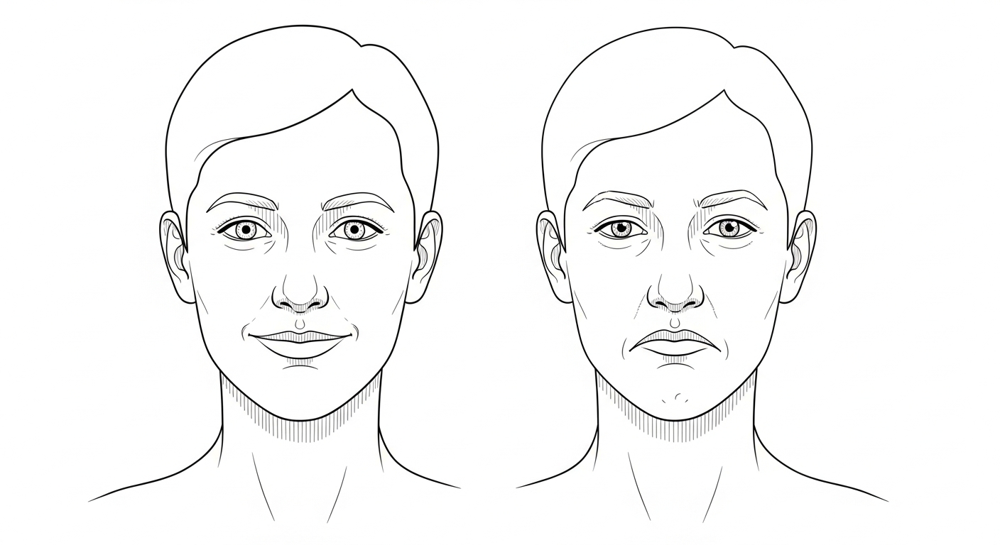

### BE-FAST (More Sensitive — Use This One)

A meaningful percentage of strokes — especially in the back of the brain (posterior circulation, brainstem, cerebellum) — are missed by FAST alone. BE-FAST catches more.

- **B — Balance.** Sudden loss of balance or coordination. Stumbling. The person looks drunk.
- **E — Eyes.** Sudden vision loss in one or both eyes, or sudden double vision.
- **F — Face drooping.** As above.
- **A — Arm weakness.** As above.
- **S — Speech difficulty.** As above.
- **T — Time to call 911.** As above.

### Other Symptoms That Mean Call 911 Right Now

- Sudden severe headache with no known cause (especially the *worst headache of your life* — possible hemorrhagic stroke).
- Sudden numbness anywhere on the body, particularly one-sided.
- Sudden confusion, disorientation, or trouble understanding speech.
- Sudden dizziness with nausea and vomiting.
- Sudden trouble swallowing.
- Sudden weakness or paralysis in any limb.

When in doubt — call. The cost of a false alarm is one ER visit. The cost of a missed stroke is a lifetime.

### What to Tell the 911 Dispatcher

Use this script. Read it off your phone if you have to:

> *"I think someone is having a stroke. They have [list symptoms]. The symptoms started at [exact time, or last-known-normal time]. The address is [address]. The patient's age is [age]. They take [list medications, including blood thinners]. They are conscious / unconscious. They are breathing / not breathing."*

If they are unresponsive but breathing, lay them on their side (recovery position). If they stop breathing, start CPR if you are trained.

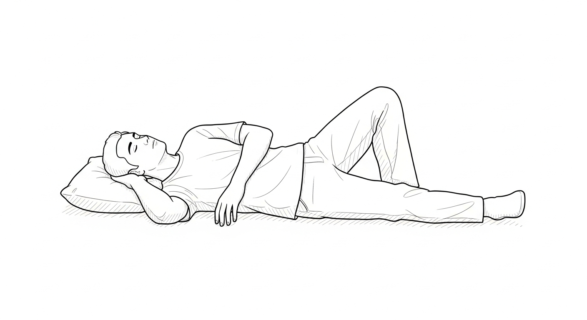

### What NOT to Do

- **Do not drive them yourself** unless EMS is unavailable. EMS can begin assessment, alert the receiving stroke center, and route the patient to the right hospital. Driving yourself can route the patient to the wrong hospital.
- **Do not give them aspirin, food, water, or any medication** until cleared by EMS or hospital staff. Aspirin helps in some strokes and worsens others. The CT scan determines which.
- **Do not let them sleep it off.** *Wake up tomorrow and see how you feel* is a phrase that has cost more brain than almost any other.
- **Do not delay because you are not sure.** Stroke is the diagnosis the ER is best equipped to rule out fast.

### Stroke Risk Factors — Know Your Numbers

The stroke I had was largely a function of risk I had not properly managed. Most strokes are. Know your numbers:

- **Blood pressure.** Goal: <130/80. The single biggest modifiable risk factor for stroke.
- **A1c (blood sugar).** Goal: <5.7 (non-diabetic) or as your doctor directs.
- **LDL cholesterol.** Goal: depends on your overall risk; ask your doctor.
- **Resting heart rate.** Note any rhythm that feels irregular — atrial fibrillation is a major stroke risk and is often silent.
- **BMI.** Carrying significant excess weight is a risk multiplier.
- **Sleep apnea.** Untreated sleep apnea drives up blood pressure overnight. Get tested if you snore heavily, gasp in your sleep, or wake unrefreshed.
- **Smoking.** Stops the day you quit.
- **Excessive alcohol.** Reduces brain volume and elevates blood pressure.
- **Stress.** Real risk factor. Manage it actively.

A free risk calculator and printable risk-tracker template lives at **strokerecoveryacademy.com/risk**.

### After the 911 Call — The First Hour as a Family Member

While EMS is en route or while you are at the hospital:

1. **Designate one person to be the medical communicator.** All medical info goes to and from this one person. Reduces chaos.
2. **Take notes.** Times, medications mentioned, names of doctors, every change.
3. **Photograph any orders, labels, or paperwork** with your phone for later reference.
4. **Get the AVS (After Visit Summary)** before you leave the ER. Read it.
5. **Ask one question:** *Was tPA given? Was thrombectomy considered? Why or why not?* The answers shape everything that follows.

The stroke event is over in hours. The recovery is years. The first 60 minutes set the ceiling.

**Call 911. Note the time. Don't let them sleep it off.**

---

## Appendix B: Recovery Exercise Protocols — The Full Library

These are the daily protocols I ran. Each one is described in full prose, with reps, progressions, common mistakes, and a chapter cross-reference. Video demonstrations of every drill in this appendix live at **strokerecoveryacademy.com/protocols** — free, no login required, organized by deficit. Print the full PDF version at **strokerecoveryacademy.com/protocols/print**.

*Get clearance from your treating therapist before starting any of these. Adapt to your level. Stop for injury pain — never for effort pain.*

### Quick Reference Table

| Drill | Reps / Time | Frequency | Chapter | Video |
|---|---|---|---|---|
| Ankle dorsiflexion (toe taps + band) | 100+ reps | Daily | 8, 15 | /protocols/ankle |
| Heel walks | 3 sets × 20 ft | Daily | 15 | /protocols/heelwalk |
| Wall lean / negative pressure | 10 × 30 s | Daily | 8, 13 | /protocols/walllean |
| Mirror therapy | 10–20 min | Daily | 14 | /protocols/mirror |
| Baseball bat / broomstick swings | 50–100 reps | Daily | 12 | /protocols/bat |
| Grip squeezes (ball or putty) | 100–300 reps | Daily | 16 | /protocols/grip |
| Open hand stretch (passive) | 1 min × hourly | Daily | 19 | /protocols/openhand |
| Rubber band finger extensions | 20 each finger | Daily | 19 | /protocols/rubberband |
| Tabletop finger lifts | 20 each finger | Daily | 19 | /protocols/fingerlift |
| LSVT-style "ahhh" projections | 10 × 3/day | Daily | 17 | /protocols/lsvt |
| Diadochokinetic drills (puh-tuh-kuh) | 30 sec × 3 | Daily | 17 | /protocols/dia |
| Tongue / lip stretch series | 20 reps | Daily | 17 | /protocols/oralmotor |
| Read aloud | 15 min | Daily | 17 | /protocols/readaloud |
| Effortful swallow | 20 × 3/day | Daily | 17 | /protocols/swallow |
| Sit-to-stand | 10–30 reps | Daily | 13 | /protocols/sit2stand |
| Single-leg stand (wall-supported → free) | 5–60 sec each side | Daily | 13 | /protocols/sls |
| Bilateral arm reach (cone tap) | 30 reps | Daily | 14 | /protocols/conetap |

### Lower Limb Protocols

**Ankle dorsiflexion + band loading.**
Sit in a chair, affected leg extended on a low stool, resistance band wrapped around the forefoot, anchored under the opposite foot. Pull the toes up toward the shin against band resistance. Slow on the way up (3 seconds), pause at top (1 second), slow on the way down (3 seconds). 25 reps × 4 sets daily. Progression: tighter band → standing version → standing on a wedge. Common mistake: cheating with hip flexion. The motion is at the ankle only.

**Wall lean (negative dorsiflexion).**
Face a wall, hands on the wall, affected foot stepped back about three feet, both heels flat on the floor. Lean forward into the wall, feeling a stretch in the calf and a pull at the front of the ankle. Hold 30 seconds. 10 sets daily. This is the foundational drill that returned my dorsiflexion. Common mistake: letting the back heel come up. Heel stays down or the drill is gone.

**Heel walks.**
Walk on your heels for 20 feet, three sets, daily. If you cannot heel-walk yet, do *seated* heel raises (toes lift) for 30 reps × 3 sets, then progress to standing with wall support. The goal is forced dorsiflexion under load. Pair with the Bioness L300 if you have access.

**Sit-to-stand (the most underrated drill in stroke recovery).**
From a stable chair, stand all the way up, sit all the way down, controlled. 10 reps to start, build to 30. Add a count of 3 down for eccentric loading. Add a held isometric at the bottom (hovering, not touching the chair) for 5 seconds. This trains quads, glutes, balance, and trunk control simultaneously. Common mistake: pushing off arms. The arms are coaches, not crutches — fold them across the chest as soon as you can.

**Single-leg stand.**

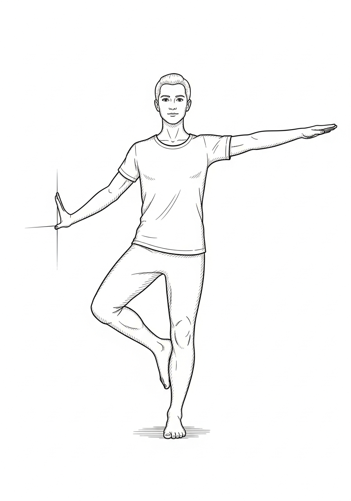

Wall-supported single-leg stand on the affected side, 5 seconds × 5 reps, both sides. Build to 30 seconds without support. Then add eyes-closed. Then add foam pad. Single-leg stand time is one of the best predictors of fall risk in stroke survivors — train it relentlessly.

### Upper Limb Protocols

**Mirror therapy (Chapter 14).**
Sit at a table with a vertical mirror perpendicular to your midline. The unaffected arm is in front of the mirror; the affected arm is hidden behind it. The mirror reflects the unaffected arm where the affected arm appears to be. Move the unaffected arm — open and close the hand, lift the wrist, tap the table. The brain sees the affected arm moving. Run for 10–20 minutes daily. The full Cochrane meta-analysis on mirror therapy is in Appendix H.

**Baseball bat / broomstick swings (Chapter 12).**
Standing or seated. Two-handed grip on a baseball bat or broomstick. Slow controlled swings across the body — left to right, then right to left. 50 reps per direction daily. Progress to a heavier bat. Add overhead lifts. Add diagonal patterns. Add eyes-closed. The bat is a *forced bilateral integration tool* — it makes the affected arm participate because the unaffected arm is doing the same job.

**Bilateral cone tap.**
Set 6 cones in an arc on a table at increasing distances. Tap each cone with both hands simultaneously — the unaffected hand leads, the affected hand follows. 30 reps daily. Progress by widening the arc, raising the cones overhead, or adding a target color the affected hand has to find first.

**Grip squeezes.**
Soft ball or putty in the affected hand. Squeeze, hold 3 seconds, release. 50 reps × 4 sets daily. Use putty resistance levels to progress (yellow → red → green → blue → black). Add finger-isolated putty pinches.

### Hand Protocols (the Open Hand System — Chapter 19)

**Passive open hand stretch.**
The unaffected hand opens the affected hand finger by finger, then stretches the palm flat against a tabletop. Hold for 60 seconds. Do this *hourly* during waking hours in the first 90 days. Spasticity wins by silence and loses to consistent stretch. The cost is one minute. The reward is a hand that does not curl into permanent fist.

**Rubber band finger extensions.**
A rubber band around all four fingers and the thumb, slight tension. Extend the fingers against the band. 20 reps per finger daily. Progress to thicker bands. This is the single best home drill for rebuilding finger extension strength.

**Tabletop finger lifts.**
Hand flat on table, palm down. Lift one finger at a time off the table without lifting the others. 20 each finger daily. Progress to lifting two non-adjacent fingers. Then drumming patterns. Then piano scales (real or air).

**Putty pinches.**
Pinch a small ball of putty between the thumb and each finger in turn. 20 each finger daily. The pincer grasp is what makes the hand a *hand* and not a *paddle.*

### Speech and Swallow Protocols (Chapter 17)

**LSVT-style "ahhh" projection.**
Inhale fully, then say *"ahhh"* as loud as you can hold for 5 seconds. 10 reps × 3 times daily. Lee Silverman Voice Treatment was originally developed for Parkinson's but is highly effective for stroke dysarthria. It rebuilds vocal loudness and breath support.

**Diadochokinetic drills (puh-tuh-kuh).**
Repeat *puh-tuh-kuh* as fast and clear as you can for 30 seconds. 3 sets daily. Trains lip closure, tongue tip, and back tongue elevation in sequence.

**Tongue and lip stretch series.**
Tongue out, hold 3 seconds. Tongue side to side, 10 each. Lip pucker / smile alternation, 10 each. Cheek puff, hold 5 seconds, 5 reps. Tongue press against the inside of each cheek, 10 each. 20 reps of the full sequence daily.

**Read aloud.**
The single best speech drill that costs nothing. Read aloud — newspaper, novel, the back of a cereal box — for 15 minutes daily. Track the words you stumble on; revisit them tomorrow. Pair with a recording of yourself once a week to track progress. This is the protocol that brought Aisha back (Part VII, Case 4).

**Effortful swallow.**
Take a sip of water (or dry swallow, if cleared by your SLP). Squeeze hard with the muscles of your throat and neck as you swallow, as if swallowing a large pill. 20 reps × 3 daily. Strengthens the swallow musculature and reduces aspiration risk.

### Cognitive and Vision Protocols

**Daily crossword / sudoku / word search.**
15 minutes daily. The point is not the puzzle — the point is the daily focused cognitive load on an aging or recovering brain. Vary the puzzle. Track time-to-complete weekly.

**Visual scanning (for hemianopia or neglect).**
Place 10 small colored objects on a table. Scan from the affected side to the unaffected side. Name each object out loud. 5 sets daily. Add a clock-drawing task once a week to track neglect progression.

**Dual-task training (the highest-leverage cognitive drill).**
Walk while reciting the alphabet backward. Or sit, balance on an unstable surface, and do mental math. Or wash dishes while listening to a podcast and being able to summarize it after. Real life is dual-task. Train it.

### How to Combine the Drills (the COMBINE step from Chapter 7)

Three combinations I run on the same days every week:

- **Bat + LSVT.** Swing the bat for 50 reps while doing 10 *"ahhh"* projections, alternating. Coordinated breath-and-load.
- **Mirror + putty.** While doing mirror therapy, the affected hand holds a small piece of putty. Visual neuroplasticity + tactile input + hand resistance, all at once.
- **Sit-to-stand + read aloud.** 20 sit-to-stands while reading a paragraph aloud between each rep. Trunk + voice + cognition.

The tribe shares more combinations every week at **strokerecoveryacademy.com/combos**.

### When to Stop, When to Push

**Stop immediately for:**
- Sharp localized pain (especially shoulder).
- Sudden severe headache.
- Sudden numbness, weakness, or vision change beyond your baseline.
- Chest pain or shortness of breath beyond expected exertion.

**Push through:**
- Muscle fatigue.
- Effort discomfort.
- The voice in your head that says *that's enough for today.*

The line between *injury pain* (stop) and *effort pain* (push) is the most important line in this book. Learn yours. Track it.

**Always:** progress slowly, log everything, combine drills (the COMBINE step in the Sasquatch Formula) for synergy, and report any new neurological change to your medical team within 24 hours.

---

## Appendix C: Technology and Equipment Guide

The full, updated, with-affiliate-links version of this guide lives at **strokerecoveryacademy.com/gear**. Below is the snapshot at the time this book went to press.

| Device | What it does | Best for | Approximate cost | My rating | Verdict |
|---|---|---|---|---|---|
| Bioness L300 Go | FES drop foot stim during gait | Active drop foot, want to walk farther | $4,000–$6,000 (insurance often covers) | 5/5 | Earned its spot for 2 years |
| Bioness H200 | FES wrist/finger stim | Spastic hand needing forced opening | $5,000+ | 4/5 | Pair with mirror therapy |
| Home NMES unit (e.g., TENS 7000) | Cued muscle stim | Anyone, supplemental rep volume | $50–$200 | 5/5 | Best dollar-per-result tool |
| Armeo Spring | Anti-gravity arm rep volume | Severe arm weakness, clinic access | Clinic-only | 5/5 | Use if your clinic has it |
| Lokomat | Robotic gait training | Early walking practice with safety | Clinic-only | 5/5 | Great early; don't go on autopilot |
| SaeboFlex / SaeboGlove | Spring-loaded hand orthosis | Grip-and-release training | $1,000–$2,000 | 4/5 | Real tool; not a miracle |
| Resting hand splint (custom) | Night anti-contracture | Anyone with spasticity | $50–$200 (often via OT) | 5/5 | Non-optional |
| Resistance band library | Variable resistance | Anyone | $10–$30 | 5/5 | Cheapest gym in the world |
| Theraputty (multiple resistances) | Hand strengthening | Anyone | $30 | 5/5 | Stupid simple, works |
| Floor mirror | Mirror therapy | Anyone | $20–$50 | 5/5 | Stupid simple, works |
| Baseball bat / broomstick | Bilateral training | Anyone (with supervision early) | $0–$30 | 5/5 | Chapter 12, full stop |
| Standing frame | Weight bearing for non-walkers | Severe weakness | $1,500–$5,000 | 4/5 | Game-changer if you can't yet stand |

**What I would not buy:**
- "Brain rewire in 7 days" anything.
- Vibration plates marketed for stroke (without active use).
- Most supplements marketed for stroke recovery (see Appendix D for what is actually backed).
- Anything that promises results without you doing the reps.

---

## Appendix D: Nutrition for Brain Recovery

This is general guidance. Get personalized advice from a registered dietitian, especially if you are on blood thinners, have diabetes, or have other conditions. The fillable meal-planning templates and grocery lists for everything in this appendix are at **strokerecoveryacademy.com/nutrition**.

### The Three Jobs of Post-Stroke Nutrition

After a stroke, food has three jobs that it did not have before:

1. **Fuel neuroplasticity.** The brain rebuilding pathways needs raw materials — protein for receptors, healthy fats for myelin, antioxidants for inflammation control.
2. **Preserve and rebuild lean muscle.** You will lose 5–15 percent of lean mass in the first month of inpatient if you do not actively defend it. Lost muscle is lost recovery.
3. **Lower the risk of the second stroke.** Roughly one in four stroke survivors has a second stroke within five years. Diet is your biggest lever.

### The Daily Floor

**Protein floor: 0.7–1.0 g per pound of body weight.**
For a 200-pound survivor that is 140–200 g of protein per day. Eggs, chicken, fish, Greek yogurt, whey, lean beef, tofu, lentils. Spread across 4–5 feedings. Most stroke survivors are dangerously under-protein in the first year. Fix it.

**Healthy fats: 20–35 percent of daily calories.**
Olive oil, avocado, nuts, seeds, fatty fish. The brain is roughly 60 percent fat by dry weight. Build with the right materials.

**Omega-3 base: 2–3 g combined EPA + DHA daily.**
Fatty fish 2–3 times per week (salmon, sardines, mackerel) OR fish oil supplement. Vegan: algae-based DHA + ALA from flax / walnut / chia.

**The colorful plate (the MIND diet floor):**
- Leafy greens: 6+ servings per week.
- Other vegetables: 1+ serving per day.
- Berries: 2+ servings per week (blueberries especially — best evidence in the MIND literature).
- Whole grains: 3+ servings per day.
- Nuts: 5+ servings per week (walnuts especially).
- Beans / legumes: 4+ servings per week.
- Olive oil as the primary added fat.
- Fish: 1+ serving per week.
- Poultry: 2+ servings per week.

**Hydration: ~3 liters per day** (more if you sweat with therapy). Dehydration thickens blood and elevates clot risk. Carry a marked water bottle. Track it.

### What to Limit

- **Alcohol.** Disrupts the deep sleep where neuroplasticity consolidates. Elevates blood pressure. If you drink, cap at 1 drink per day for women, 2 for men, and zero on hard work days.
- **Ultra-processed foods.** Inflammation accelerator. Read the ingredients label — if it has more than five items or anything you cannot pronounce, demote it.
- **Added sugar.** Goal: under 25 g per day from added sources. Read labels — sugar is in everything.
- **Sodium.** Goal: under 2,300 mg per day, lower (1,500 mg) if hypertensive or post-hemorrhagic. Salt is the biggest dietary lever on blood pressure, the biggest risk factor for the second stroke.
- **Trans fats.** Zero. They are still in some processed foods despite labeling rules.
- **Grapefruit and grapefruit juice** if you are on certain statins or blood thinners — confirm with your pharmacist.

### Supplements I Take (Talk to Your Doctor First)

These are what I personally take. Your situation may differ. Especially if you are on blood thinners, get every supplement cleared.

- **Fish oil — 2–3 g combined EPA + DHA daily.** Anti-inflammatory, supports membrane health.
- **Vitamin D3 — 2,000–5,000 IU daily.** Most stroke survivors are deficient. Get a 25-OH-D blood test before and after to dose correctly.
- **Magnesium glycinate — 200–400 mg at bedtime.** Sleep quality, spasticity, blood pressure.
- **B-complex (with active folate, B12, B6).** Supports nerve function. Especially important if you are on metformin.
- **Creatine monohydrate — 5 g daily.** Best-supported supplement in the literature for cognitive and muscular benefit. Effective in stroke and TBI populations.
- **Curcumin (with piperine for absorption) — 500 mg daily.** Anti-inflammatory. Skip if on blood thinners.

**Not backed by strong evidence:** most "brain booster" stacks, lion's mane megadoses, most nootropic blends marketed for stroke recovery. Don't waste the money. Spend it on a good fish oil and a registered dietitian consultation.

### A Sample Day for a 200-Pound Survivor

- **Breakfast:** 3 whole eggs + 1 cup spinach + 1 slice whole-grain toast + 1 cup blueberries + black coffee. (~35 g protein.)
- **Mid-morning:** Greek yogurt (1 cup, plain, full-fat) + 1 tbsp ground flax + handful walnuts. (~25 g protein.)
- **Lunch:** Grilled salmon (6 oz) + large mixed-greens salad with olive oil + 1 cup cooked quinoa. (~45 g protein.)
- **Afternoon snack:** Protein shake (whey or plant) + banana. (~30 g protein.)
- **Dinner:** Chicken breast (6 oz) + roasted broccoli and sweet potato + 1 tbsp olive oil. (~50 g protein.)
- **Bedtime:** Cottage cheese (1 cup) + 1 tsp honey. (~25 g protein.)

Total: ~210 g protein, ~2,400–2,600 calories, full MIND diet coverage.

Adapt the totals to your size, your activity, and your dietitian's guidance. The full meal-plan template, grocery list, and printable shopping aid are at **strokerecoveryacademy.com/nutrition**.

---

## Appendix E: Sasquatch Field Notes — One Line for Every Hard Day

These are the lines I have said into a phone camera, written on a sticky note, or texted to a survivor in the middle of the night. Copy any of them. Tape them to your mirror. Read them out loud. The wallpaper-friendly versions of every line below are at **strokerecoveryacademy.com/posters** — free downloads, print at any size.

### On Survival

> *"Heart's still thumpin'? Life's still pumpin'."*

> *"You did not survive a stroke to live the same life you had before. You survived a stroke to build a better one."*

> *"Get knocked down five times. Stand up six."*

> *"The chart said never. The chart was wrong about me. The chart is wrong about you."*

### On the Reps

> *"No zero days. The only rep that doesn't count is the one you didn't do."*

> *"Comfortable is the enemy of recovered."* — Michael

> *"The flicker is the fire."*

> *"Specific reps build specific recovery. Vague reps build vague recovery."*

> *"You don't rise to the level of your hopes. You fall to the level of your daily reps."*

### On the Mindset

> *"I am not waiting to be ready. I am ready by working."*

> *"Idle hands are the devil's playground. I ate him and flushed him."*

> *"Choose possible over probable. Every damn morning."*

> *"The plateau is a setting on your effort. Change the setting and the plateau changes."*

> *"You cannot out-think a stroke. You can out-work one."*

### On the Tribe

> *"Hope is contagious. Spread it."*

> *"Reps are inheritance. The work you do today is the standard somebody else uses tomorrow."*

> *"Every survivor was once somebody who needed a survivor."*

> *"The Sasquatch has your back. We're watching. You're valuable."*

### On Purpose

> *"Purpose is non-negotiable. Find it."*

> *"The impossible is only impossible until someone proves it's not."*

> *"You are the proof. Now go prove it."*

> *"I am not just recovering. I am proving what's possible."*

### On the Caregiver

> *"The caregiver who burns out is not noble. The caregiver who burns out is gone. Take care of yourself first."*

> *"Behind every survivor who got back up is a person who refused to let them stay down. Thank that person today."*

### Use These However You Need To

Tape them to your bathroom mirror. Set them as your phone wallpaper. Text them to the survivor in your life at 2 a.m. when you cannot find the words yourself. They are not mine. They are ours. Pass them on.

---

## Appendix F: Support Resources and Communities

**The Stroke Recovery Academy (Nick's platform):**
- Web: strokerecoveryacademy.com
- TikTok: @nickkremers
- Facebook: @NicholasKremersSr
- Email: hello@strokerecoveryacademy.com

**Stroke Lyfe Inc. (the nonprofit):**
- Web: strokelyfe.org
- Donate: strokelyfe.org/donate

**Crisis support:**
- **988** — Suicide & Crisis Lifeline (US, call or text, 24/7)
- Veterans: dial 988, press 1
- International: findahelpline.com

**Major stroke organizations:**
- American Stroke Association — stroke.org
- National Stroke Association — stroke.org (now part of ASA)
- Brain Injury Association of America — biausa.org
- The Aphasia Recovery Connection — aphasiarecoveryconnection.org

**Caregiver support:**
- Family Caregiver Alliance — caregiver.org
- Well Spouse Association — wellspouse.org

**Speech / aphasia tools:**
- Tactus Therapy apps — tactustherapy.com
- Lingraphica — aphasia.com

---

## Appendix G: The 90-Day Breakthrough Program

This is the daily program I send to every survivor who DMs me with the question *Where do I start?* It is the same program Marcus, Janelle, Robert, Cathy, Tyler, and David in Part VII used as their starting point. You will adapt it to your own deficits and your own clearance from your medical team. *Do not start any program in this appendix without clearance from your treating clinicians.*

The full printable / fillable version of this program — with check-boxes, video demonstrations of every drill, and a guided audio companion — lives at **strokerecoveryacademy.com/90day**. The version below is the complete written program. Use it whichever way works for you.

### How the 90 Days Are Structured

- **Days 1–30 — Foundation.** Build the daily habit. One primary drill per body system. Low intensity. High consistency. The point is the streak, not the score.
- **Days 31–60 — Acceleration.** Add load, volume, or novelty (the EXPERIMENT step of the Sasquatch Formula from Chapter 7). The streak holds. The reps get harder.
- **Days 61–90 — Integration.** Take the gains into the real world. Functional tasks. Public posting. The first plan for the next 90.

By Day 66 the habit is biologically built (Lally et al., 2010 — see Appendix H). By Day 90 the structure is yours. Then you start the next 90.

### The Daily Template (Use Every Day, All 90)

Every day in this program runs on the same five-block template. The blocks change in volume and intensity across the phases. The blocks themselves do not change.

| Block | Time | Purpose |
|---|---|---|
| **A. Wake-up reset** | 5–10 min | Baseline body, set the day |
| **B. Primary motor drill** | 20–45 min | The biggest movement need (leg, arm, hand, balance) |
| **C. Secondary system** | 15–30 min | Speech, swallow, cognition, or whichever system is second-priority |
| **D. Functional integration** | 10–30 min | Real-world task using the skill from B or C |
| **E. Reflection + log** | 5 min | One line in the tracker. One line in a journal. Done. |

Total daily commitment: about ninety minutes in Phase 1, two hours in Phase 2, two and a half hours in Phase 3. If that sounds like a lot, remember that the average inpatient stroke unit delivers about thirty-two minutes of active therapy per day (Lang et al., 2009 — see Appendix H). You are about to triple the dose.

### Phase 1 — Days 1 through 30 (Foundation)

**Goal:** No zero days. Build the streak. Establish the five-block daily template as a non-negotiable.

**Volume target:** ~90 minutes per day, six days per week. One full rest day (still do Block A and Block E).

**Block A — Wake-up reset (every day, 5–10 min).**
Before you get out of bed:
- Open hand stretch from Chapter 19 — 60 seconds each hand.
- Ankle pumps and circles — 20 each direction, each ankle.
- Slow diaphragmatic breathing — 10 breaths.
- Out loud: *I am here. The bleed lost. Today I build.* Say it. Mean it.

**Block B — Primary motor drill (Days 1–30).**
Pick *one* of the following based on your biggest deficit. Do it daily.
- *If your biggest deficit is the leg / walking:* Wall lean + ankle dorsiflexion combo from Chapter 8. 100 reps minimum. Add 10 reps every 5 days.
- *If your biggest deficit is the arm:* Mirror therapy from Chapter 14, 15 minutes daily, plus baseball bat / broomstick swings from Chapter 12, 50 reps daily.
- *If your biggest deficit is the hand:* Open hand protocol from Chapter 19 — full sequence, 3 rounds daily. Add grip squeezes (ball or putty) — 100 reps daily.
- *If your biggest deficit is balance:* Chapter 13 protocol. Sit-to-stand reps — start at 10, build to 30 by Day 30. Add single-leg stand against a wall — start at 5 seconds each side, build to 30.

**Block C — Secondary system (Days 1–30).**
Pick the system your stroke hit second-hardest. Most common pairings:
- *Speech / language:* LSVT-style "ahhh" projections — 10 reps × 3 times daily. Read aloud — 10 minutes daily. Diadochokinetic drills (puh-tuh-kuh) — 30 seconds × 3.
- *Swallow:* Effortful swallow — 20 reps × 3 daily. Chin tuck against resistance if cleared by your SLP.
- *Cognition:* Daily crossword, sudoku, or app-based brain game — 15 minutes. Read one chapter of any book and write one sentence summarizing it.

**Block D — Functional integration (Days 1–30).**
Take the skill from Block B and use it in the real world for 10 minutes:
- Walk to the mailbox. Walk back. Twice.
- Carry a glass of water from the kitchen to the living room with the affected hand.
- Open the fridge with the affected hand. Close it with the affected hand. Five times.
- Brush your teeth with the affected hand. Every day.

**Block E — Reflection + log (Days 1–30).**
Three lines in the tracker:
1. *What I did today.*
2. *One small win.*
3. *One thing to change tomorrow.*

If you cannot write yet, dictate it into your phone. The Stroke Recovery Academy Companion App (free at **strokerecoveryacademy.com/app**) has a voice-log feature built in.

**Phase 1 Milestones (check on Day 30):**
- 25 of 30 days completed (84%+ adherence). Anything less, restart Phase 1 from Day 1.
- One measurable improvement in your primary drill (more reps, more range, more time, less assistance).
- One photo, video, or written note that captures Day 30 vs. Day 1.

### Phase 2 — Days 31 through 60 (Acceleration)

**Goal:** Increase the load. Hit the 66-day mark on Day 36 (you have been at this since Day 1) and feel the habit lock in.

**Volume target:** ~120 minutes per day, six days per week.

**Block A — Wake-up reset (unchanged).**

**Block B — Primary motor drill (Days 31–60).**
Add one of the following progressions to whatever you picked in Phase 1:
- *Leg / walking:* Add Bioness L300 Go (if you have access — see Appendix C) or home NMES on the dorsiflexors during gait. Add stair work — 1 flight, then 2, then 3.
- *Arm:* Add weighted bat (10–15% heavier) and constraint-induced movement therapy — restrain the good arm for 30-minute blocks during meals or low-stakes tasks.
- *Hand:* Add SaeboFlex or SaeboGlove (if you have access) or a rubber-band finger extension protocol — 20 reps each finger daily. Add tabletop finger lifts — 20 each.
- *Balance:* Add eyes-closed single-leg work, foam pad work, and tandem stance walking. Begin Lokomat or treadmill work if available.

**Block C — Secondary system (Days 31–60).**
Increase volume by 50%. Add a second technique from the relevant chapter. Example — if you were doing speech "ahhh" projections, add SPEAK OUT! protocol or Speech Vive device work if cleared.

**Block D — Functional integration (Days 31–60).**
Increase the difficulty:
- Walk to a neighbor's house and back.
- Cook a simple meal with both hands participating.
- Pay for something in cash and count the change with the affected hand.
- Type a short message with both hands.
- Go to one social event per week — coffee with a friend, a class at the YMCA, anything outside the house with other humans.

**Block E — Reflection + log (Days 31–60).**
Add a fourth line:
4. *One person I helped today.* (Even a comment on another survivor's video counts.)

**Phase 2 Milestones (check on Day 60):**
- 25 of 30 days completed in Phase 2.
- Measurable progression on the primary drill (more weight, more range, more reps).
- One public post (TikTok, Facebook group, support forum, or Stroke Recovery Academy community at **strokerecoveryacademy.com/tribe**). The post is the proof. The post is also the inheritance for the next survivor.

### Phase 3 — Days 61 through 90 (Integration)

**Goal:** Move the gains out of the home gym and into the life. Decide what the next 90 days look like.

**Volume target:** ~150 minutes per day, six days per week. Total weekly: ~15 hours.

**Block A — Wake-up reset (unchanged).**

**Block B — Primary motor drill (Days 61–90).**
Add a *novelty challenge* once per week:
- A new environment (different surface, new park, different gym).
- A new tool (kettlebell, resistance loop, body-weight progression).
- A new variation of the drill (eyes closed, dual task, music tempo change).

The novelty challenge is the EXPERIMENT step. It is what prevents the plateau.

**Block C — Secondary system (Days 61–90).**
Take the secondary skill into a real-world test:
- *Speech:* Make one phone call per day to a real person. Order coffee out loud. Read your child a bedtime story.
- *Swallow:* Eat one new food texture per week (in coordination with your SLP).
- *Cognition:* Run a 30-minute meeting, plan a small event, file a tax document — pick a real-world cognitive load.

**Block D — Functional integration (Days 61–90).**
Pick *one* big functional goal and chase it for 30 days:
- Walk a 5K (with adaptive equipment if needed).
- Drive to one place per week.
- Return to one work-related task — even one hour, even unpaid.
- Cook a full meal for your family.
- Hold your child / grandchild for 10 unbroken minutes.
- Type 500 words.

**Block E — Reflection + log (Days 61–90).**
Add a fifth line:
5. *What is the next 90 days?* (Write it on Day 90. Then start over.)

**Phase 3 Milestones (Day 90):**
- 25 of 30 days completed in Phase 3.
- Big functional goal hit, partially hit, or in clear progress.
- The next 90-day plan written.
- One photo or video that captures Day 90 vs. Day 1. Post it. Tag the academy. Become the inheritance.

### The 66-Day Tracker

The printable / fillable tracker is at **strokerecoveryacademy.com/tracker**. Print it. Tape it to your fridge. One row per day. Five columns:

| Day | Date | Daily Focus | Reps / Time | Small Win / Feeling |
|---|---|---|---|---|
| 1 | | | | |
| 2 | | | | |
| ... | | | | |
| 66 | | | | |

**No zero days.** Miss a day? Start over at Day 1. The streak is the point.

### What to Do If You Stall

You will stall. Everyone in Part VII stalled. Here is the protocol:

1. **Take a deload week.** Cut volume by 50% for seven days. Do not stop. Lower the load.
2. **Change a variable.** New time of day, new environment, new music, new tool, new partner, new accountability person. The body responds to novelty.
3. **Increase recovery.** Sleep one extra hour. Add 30g protein. Get 20 minutes of sun.
4. **Re-read the chapter that maps to the drill you are doing.** Often the missing piece is in the chapter you skimmed.
5. **Post about the stall.** Publicly. The tribe will respond. Accountability solves more plateaus than technique does.
6. **If the stall lasts more than 14 days:** message the academy. Free office hours every Wednesday at **strokerecoveryacademy.com/officehours**.

### What to Do When You Finish Day 90

You start Day 1 again.

The cycle is the structure. Three to four 90-day cycles per year, for the rest of your life. That is the program.

Year 1 you are surviving. Year 2 you are building. Year 3 you are mastering. Year 4 you are teaching. By Year 7 — like me — you are still climbing.

Now go.

---

## Appendix H: The Science Behind These Methods (References)

The protocols in this book are not invented. They sit on top of forty-plus years of stroke rehabilitation research and a longer history of neuroscience. The references below are the primary literature behind the techniques. Full APA format so any reader, family member, doctor, or insurance reviewer can verify. The fully linked, continually updated bibliography is at **strokerecoveryacademy.com/science**.

### A Note on Citation Style and Verification

Every reference below is in **APA 7th edition** format: author(s), year, title, journal or publisher, volume(issue), pages. Where a digital object identifier (DOI) or PubMed ID (PMID) exists, the linked online edition at strokerecoveryacademy.com/science includes it. Where a study has been retracted, superseded, or substantively updated since first publication, the online edition flags it inline. Citations have been verified by the author against the original sources; the live bibliography at strokerecoveryacademy.com/science is the canonical version and is updated whenever a referenced study is revised. Corrections to printed editions are logged at strokerecoveryacademy.com/science/corrections.

If you find an error, write **science@strokerecoveryacademy.com**. We will correct it in the next printing and credit you.

### The Foundational Neuroplasticity Literature

- Hebb, D. O. (1949). *The Organization of Behavior: A Neuropsychological Theory.* Wiley. *(The origin: "neurons that fire together wire together." Every protocol in this book ultimately rests on this.)*
- Kleim, J. A., & Jones, T. A. (2008). Principles of experience-dependent neural plasticity: Implications for rehabilitation after brain damage. *Journal of Speech, Language, and Hearing Research*, 51(1), S225–S239. https://doi.org/10.1044/1092-4388(2008/018) *(The ten principles. Every clinician should have read this. Most have not.)*
- Cramer, S. C., Sur, M., Dobkin, B. H., O'Brien, C., Sanger, T. D., Trojanowski, J. Q., et al. (2011). Harnessing neuroplasticity for clinical applications. *Brain*, 134(6), 1591–1609. https://doi.org/10.1093/brain/awr039
- Krakauer, J. W., Carmichael, S. T., Corbett, D., & Wittenberg, G. F. (2012). Getting neurorehabilitation right: What can be learned from animal models? *Neurorehabilitation and Neural Repair*, 26(8), 923–931. https://doi.org/10.1177/1545968312440745 *(The paper that names the early sensitive period and argues we are wasting it.)*
- Doidge, N. (2007). *The Brain That Changes Itself.* Viking. *(Popular but rigorous. Required reading.)*

### Dose, Volume, and Intensity

- Lang, C. E., MacDonald, J. R., Reisman, D. S., Boyd, L., Jacobson Kimberley, T., Schindler-Ivens, S. M., et al. (2009). Observation of amounts of movement practice provided during stroke rehabilitation. *Archives of Physical Medicine and Rehabilitation*, 90(10), 1692–1698. https://doi.org/10.1016/j.apmr.2009.04.005 *(The 32-minute-per-day finding. The reason the home program in this book exists.)*
- Horn, S. D., DeJong, G., Smout, R. J., Gassaway, J., James, R., & Conroy, B. (2005). Stroke rehabilitation patients, practice, and outcomes: Is earlier and more aggressive therapy better? *Archives of Physical Medicine and Rehabilitation*, 86(12, Suppl 2), S101–S114. https://doi.org/10.1016/j.apmr.2005.09.016
- Lohse, K. R., Lang, C. E., & Boyd, L. A. (2014). Is more better? Using metadata to explore dose–response relationships in stroke rehabilitation. *Stroke*, 45(7), 2053–2058. https://doi.org/10.1161/STROKEAHA.114.004695

### Mirror Therapy and Phantom Limb Work

- Ramachandran, V. S., & Rogers-Ramachandran, D. (1996). Synaesthesia in phantom limbs induced with mirrors. *Proceedings of the Royal Society B*, 263(1369), 377–386. https://doi.org/10.1098/rspb.1996.0058
- Thieme, H., Morkisch, N., Mehrholz, J., Pohl, M., Behrens, J., Borgetto, B., & Dohle, C. (2018). Mirror therapy for improving motor function after stroke. *Cochrane Database of Systematic Reviews*, (7), CD008449. https://doi.org/10.1002/14651858.CD008449.pub3

### Constraint-Induced Movement Therapy

- Taub, E., Uswatte, G., & Pidikiti, R. (1999). Constraint-induced movement therapy: A new family of techniques with broad application to physical rehabilitation. *Journal of Rehabilitation Research and Development*, 36(3), 237–251.
- Wolf, S. L., Winstein, C. J., Miller, J. P., Taub, E., Uswatte, G., Morris, D., et al. (2006). Effect of constraint-induced movement therapy on upper extremity function 3 to 9 months after stroke: The EXCITE randomized clinical trial. *JAMA*, 296(17), 2095–2104. https://doi.org/10.1001/jama.296.17.2095

### Habit Formation and Behavior Change

- Lally, P., van Jaarsveld, C. H. M., Potts, H. W. W., & Wardle, J. (2010). How are habits formed: Modelling habit formation in the real world. *European Journal of Social Psychology*, 40(6), 998–1009. https://doi.org/10.1002/ejsp.674 *(The 66-day median. The reason the tracker is 66 days.)*
- Clear, J. (2018). *Atomic Habits.* Avery. *(Translated into the no-zero-days language used throughout this book.)*

### Exercise, Cardio, and BDNF

- Cotman, C. W., & Berchtold, N. C. (2002). Exercise: A behavioral intervention to enhance brain health and plasticity. *Trends in Neurosciences*, 25(6), 295–301. https://doi.org/10.1016/S0166-2236(02)02143-4
- Mang, C. S., Campbell, K. L., Ross, C. J. D., & Boyd, L. A. (2013). Promoting neuroplasticity for motor rehabilitation after stroke: Considering the effects of aerobic exercise and genetic variation on brain-derived neurotrophic factor. *Physical Therapy*, 93(12), 1707–1716.

### Sleep and Recovery

- Walker, M. P. (2017). *Why We Sleep: Unlocking the Power of Sleep and Dreams.* Scribner.
- Siengsukon, C. F., & Boyd, L. A. (2009). Sleep enhances implicit motor skill learning in individuals poststroke. *Topics in Stroke Rehabilitation*, 16(1), 92–98.

### Speech and Aphasia

- Pulvermüller, F., & Berthier, M. L. (2008). Aphasia therapy on a neuroscience basis. *Aphasiology*, 22(6), 563–599. https://doi.org/10.1080/02687030701612213
- Kelchner, L. N., & Sussman, J. E. (2014). The effect of LSVT LOUD on dysarthria post-stroke. *Journal of Medical Speech-Language Pathology.*

### Mental Health and Post-Stroke Depression

- Hackett, M. L., & Pickles, K. (2014). Part I: Frequency of depression after stroke: An updated systematic review and meta-analysis of observational studies. *International Journal of Stroke*, 9(8), 1017–1025. https://doi.org/10.1111/ijs.12357 *(One in three. Read it.)*

### Caregiver Outcomes

- Pucciarelli, G., Vellone, E., Savini, S., Simeone, S., Ausili, D., Alvaro, R., et al. (2017). Roles of changing physical function and caregiver burden on quality of life in stroke. *Stroke*, 48(3), 733–739.
- Bakas, T., Clark, P. C., Kelly-Hayes, M., King, R. B., Lutz, B. J., & Miller, E. L. (2014). Evidence for stroke family caregiver and dyad interventions. *Stroke*, 45(9), 2836–2852.

### Late-Stage Recovery (Beyond the "Plateau")

- Page, S. J., Gater, D. R., & Bach-y-Rita, P. (2004). Reconsidering the motor recovery plateau in stroke rehabilitation. *Archives of Physical Medicine and Rehabilitation*, 85(8), 1377–1381. https://doi.org/10.1016/j.apmr.2003.12.031
- Demain, S., Wiles, R., Roberts, L., & McPherson, K. (2006). Recovery plateau following stroke: Fact or fiction? *Disability and Rehabilitation*, 28(13–14), 815–821.

### Insurance, Access, and System-Level Findings

- Ifejika-Jones, N. L., & Barrett, A. M. (2011). Rehabilitation — emerging technologies, innovative therapies, and future objectives. *Neurotherapeutics*, 8(3), 452–462.

### A Note on Strength of Evidence

Some protocols in this book have meta-analysis-level support (mirror therapy, CIMT, dose-response). Others have observational and clinical-experience support but not yet large RCTs (the bat work as a bilateral integration tool, for example). I have tried to be honest in the chapters about which is which. Where the evidence is mixed, I name it. Where it is strong, I name that too. Always run new protocols past your treating clinicians.

(Additional citations, full PDF links, and quarterly updates live at **strokerecoveryacademy.com/science**.)

---

## Builder's Science Sidebar: Why "Chopping Wood" Is the Whole Doctrine in Two Words

Everything in the doctrine — the six principles, the daily card, the sixty-six-day streak — collapses, on a hard day, into two words I started saying to myself in the spring of 2019: **chop wood.**

That is the phrase I muttered when the alarm went off and the left arm did not. It is the phrase I muttered when I sat down at the desk and the cursor blinked at me for ten minutes before my one-hand typing got going. It is the phrase I mutter now, seven years out, on the mornings when the cane wants to come out of the closet and I tell it no.

There is real neuroscience underneath those two words. Here is why "chopping wood" is not just a metaphor — it is the actual mechanism your brain uses to rebuild.

**1. Repetition strengthens synaptic efficiency.** Every rep you make — flicker, half-rep, ugly rep, full rep — strengthens the connection between two specific neurons. The brain calls it long-term potentiation. The lumberjack calls it the second hundred swings being easier than the first. Same thing. *Each rep is a swing. Each flicker is a spark.*

**2. Motor imagery activates the same cortex as real movement.** Functional MRI studies (Jeannerod, 1994; Page et al., 2007) have shown for thirty years that *imagining* a movement lights up the same motor cortex regions as actually doing it. So when the muscle does not answer, you keep chopping anyway — in your head. The signal still goes. The wiring still strengthens. *Train the signal, not just the muscle.*

**3. Activity-dependent plasticity is the law underneath the work.** Michael said it to me in 2019 in the rehab gym and I have repeated it in every coaching cohort I have run since: *you are not rebuilding muscle, you are rebuilding communication.* The brain rewards the movements you ask it to make most often, in the contexts you most often make them in. Chopping wood — same swing, same target, same daily rhythm — is exactly the kind of patterned, repeated, intentional input the cortex was built to reorganize around.

**4. Purpose recruits the limbic system.** When you put a *why* on the rep — *this is for my son, this is for my next year, this is for the survivor I do not yet know who is going to need this protocol* — you activate the ventromedial prefrontal cortex and the limbic drive circuits that override fatigue. Dopamine and norepinephrine rise. The rep gets cheaper. The streak gets longer. *Purpose literally rewires the brain to persist.*

**5. Somatosensory feedback rebuilds awareness.** Once the body starts moving again, even slightly, the world floods back in — the hum of the fridge, the air on the skin, the weight of the mug in the rebuilt hand. That re-flooding is your brain telling you the world is still there and you are still in it. Numb survivors describe this moment as the moment they came back online. Chop wood long enough and the forest gets loud again.

**The "chop wood" rule:** Every day, swing the axe. Some days the axe is a band, a putty, a mirror, a bat, a walk. Some days the axe is a single mental rep with the eyes closed. Some days the axe is just sitting up at the same time you sat up yesterday. The size of the swing is not the variable. *The fact that you swung* is the variable. Sixty-six days of swung axes, no matter the size, is a forest down.

I have a small wooden axe sitting on my desk. A reader sent it to me. I tap it once before I start each writing session. *Chop wood.*

That is the whole doctrine, in two words, in one tap.

> **What you should feel if it's working:** A morning where the question *should I work today* simply does not arrive anymore. The work is no longer a decision. It is the swing.

Full chopping-wood protocol, the wooden-axe desk talisman, and the daily habit-stack at **strokerecoveryacademy.com/protocols/chopwood**.

---

## Appendix I: The Sasquatch Doctrine — The Survivor's Operating System

Six principles. Memorize them. Run them daily. Print the wallet card at **strokerecoveryacademy.com/doctrine** and carry it.

### The Six Principles

1. **Ownership.** Every rep, every choice, every morning is yours. The stroke is the raw material. The recovery is yours to author. *No one is coming. You are the one you have been waiting for.*
2. **Movement.** Even when nothing moves, the signal is the work. The brain rewards intention as well as motion. Send the signal every day, whether the muscle answers or not. *The flicker is the fire.*
3. **Reflection.** Write the win, log the loss, learn from both. Three lines a day in the tracker. The unexamined rep does not compound. *The pen builds the path the body walks.*
4. **Repetition.** Sixty-six days at a time, forever. No zero days. The streak is the structure. *Compound the smallest possible thing for the longest possible time.*
5. **Adaptation.** When the system stalls, change a variable. The plateau is a feedback signal, not a verdict. *Same dose + new variable = new growth.*
6. **Humanhood.** Rebuild the body, the mind, *and* the connection to other people. None of the three is optional. *Solitary recovery is half a recovery.*

### The Daily Operating Card

The card I carry, every day, paper in my wallet:

> **Morning (60 seconds):**
> - One thing I OWN today: __________
> - One MOVEMENT signal I will send: __________
> - One person I will REACH: __________
>
> **Evening (60 seconds):**
> - One REP I made: __________
> - One thing I learned (REFLECTION): __________
> - One variable I am changing tomorrow (ADAPTATION): __________

Two minutes a day. Forever. The whole doctrine fits in two minutes.

### The Four Layers of the Doctrine

The Six Principles are the *foundation.* On top of the foundation sit four operational layers — each one for a different moment in your recovery, each one runnable in less than a minute, each one survivor-tested.

**Layer 1: The Tattoo-Grade Laws** — what you mutter to yourself when nothing else works.
**Layer 2: S.O.S. — the Everyday Survivor OS** — the crisis-day and Day-One compass.
**Layer 3: S.A.S.C.H. — the Daily Construction Rhythm** — the engine you run every single day.
**Layer 4: C.O.M.P.A.S.S. — the Advanced Navigation System** — the framework that runs once the basics are reflex.

Use whichever layer the day demands. All four live on the same wallet card.

The progression is real and earned: you start with S.O.S. on the worst days, you move to S.A.S.C.H. once you can string two functional days together, you graduate to C.O.M.P.A.S.S. when the daily rhythm has become so automatic that you can navigate the harder questions — pace, plateau, anger management, what to mutate, what to leave alone. And you keep the Tattoo-Grade Laws muttering in the background the whole way.

---

### Layer 1: The Tattoo-Grade Laws

Raw. Simple. Real. Seven rallying cries survivors ink, wear, and repeat until they become reflex.

- *You've already won. You survived.*
- *Small wins are sacred. A flicker is a resurrection.*
- *Control what you can. Rituals beat randomness.*
- *Anger is a spark, not a wildfire. Burn clean.*
- *Patience is a bitch — but it is a virtue.*
- *Stack failures until they form steps.*

These are the Street-Cred PhD laws — the mindset that keeps the fire burning when every other light goes out. Pick one. Tape it to the bathroom mirror. Read it every morning until you do not need the paper.

---

### Layer 2: S.O.S. — The Everyday Survivor OS

For Day 1 survivors and the caregivers beside them. A compass you can tape to the wall and live by.

**Acronym: S.O.S — Stroked-Out Sasquatch**

- **S — Survive.** You have already won. Breathe. Grieve. Anchor your *why.*
- **O — Organize.** Stack your wins. Build rituals. Control what you can.
- **S — Strive.** Push. Experiment. Improvise. Never zero. Stack the fails.

S.O.S. is not a cry for help. It is a battle signal. When you say it, you remind yourself: *survival is step one, structure is step two, striving never stops.*

**Use it like this:**
- **Survivors:** Every morning, ask which S you are in today — Survive, Organize, or Strive? Build the day around the honest answer. Some days the win is just the S of Survive. That is still an S.
- **Caregivers:** Ask the same question for the survivor when they are too foggy to answer for themselves. Hold the compass steady when they cannot.

---

### Layer 3: S.A.S.C.H. — The Daily Construction Rhythm

S.A.S.C.H. is the engine. It is the framework I ran every day from the ICU bed onward, and the framework I still run at year seven. It is what turns the abstract Six Principles into concrete construction work you can finish before you fall asleep.

S.A.S.C.H. turns recovery from something passive and medical into active daily construction. You are not waiting to be healed. You are the architect *and* the hammer, building a new version of yourself with whatever is left after the stroke.

**Acronym: S.A.S.C.H.**

- **S — Seize the Day.** Take full ownership every morning. No one is coming to save you. Start with clear intent and gratitude. *This is my second chance.* Ask the two opening questions: *What do I still have? What am I building today?*
- **A — Absorb the Lesson.** Every flicker, every small win, every failure is data. Reflect honestly. What worked? What did not? Turn everything into learning, not self-pity.
- **S — Swing the Work.** Do the reps even when it hurts. Movement, stretching, exercise, self-care — teeth, grooming, shower with adaptations — swing the hammer daily. *Chop wood* no matter how boring or painful the day feels. *The Sasquatch does not skip the rep.*
- **C — Combine Elements.** Experiment and adapt. Mix techniques. Mirror therapy stacked with the bat. Mental rehearsal stacked with physical reps. Different angles, different tools. Do not follow rigid protocols — combine what actually works for *your* body and *your* deficits.
- **H — Hammer It Home.** Reinforce what you learned. Stack wins. Reframe failures as data. End each day by logging progress and asking: *What did I build today? What will I fix tomorrow?* Make the day's work permanent through reflection and gratitude.

**The S.A.S.C.H. day, in one rhythm:**

- **Morning — Seize + Absorb.** Self-care first. Teeth. Grooming. Shower with the adaptations you have built. Then gratitude — out loud, three lines, name the second chance. Then read yesterday's evening log. *Absorb the lesson before you start writing today's.*
- **Midday — Swing + Combine.** This is the work block. The reps. Use the Sasquatch persona to push through the part of the work the old you would have skipped. Combine the drills — bat plus mirror, mirror plus mental rehearsal, walking plus narration of what you feel under each foot.
- **Evening — Hammer.** Sixty seconds of logging. Three lines. *What I built. What I learned. What I will fix tomorrow.* Done.

This is the engine of the 66-Day Rebuild. Run it once and you have one good day. Run it sixty-six days in a row and you have a habit. Run it for a year and you have a different brain in a different body running a different life.

> **The Sasquatch test for any day:** Did you Seize, Absorb, Swing, Combine, and Hammer? You do not need a perfect score. You need a non-zero score. *Never zero.*

Full S.A.S.C.H. daily worksheet, audio walk-through, and the printable wallet card that lays the four layers out side-by-side: **strokerecoveryacademy.com/protocols/sasch**.

---

### Layer 4: C.O.M.P.A.S.S. — The Advanced Navigation System

When S.A.S.C.H. becomes reflex — when you no longer have to think about Seize-Absorb-Swing-Combine-Hammer because it is just *the shape of your day* — you graduate to the navigation layer. C.O.M.P.A.S.S. is the recovery navigation tool — seven principles, one per letter, run as a daily check.

- **C — Control what you can.** Daily rituals, grids, hacks. Skip what you cannot move.
- **O — Own your pace.** No 30-day sprints. Tortoise wins every time.
- **M — Mutation beats stagnation.** Change reps, angles, or intensity to break plateaus. Same dose plus new variable equals new growth.
- **P — Patience plus nutrition equals brain fuel.** Heal first, rewire second. The brain cannot rebuild on garbage and rage alone.
- **A — Anger is fuel.** Channel it into reps, not explosions. Every angry rep is a deposit in the rebuild account.
- **S — Small wins are sacred.** Celebrate flickers, logs, fragments. The big wins are made of stacked small ones.
- **S — Stack failures into success.** Every try is a deposit. The pile of failures is what you eventually stand on top of.

Every survivor needs a compass. It does not point north — it points *forward.* Even if you move an inch a day, if you move with intent, you will never be lost again.

**The five-step C.O.M.P.A.S.S. flow** — run this on any plateau, any setback, any restart:

1. **Assess** — Day 1 audit. What moves, what does not, what hurts.
2. **Anchor** — Find your *why.* Son. Partner. Dog. Yourself. Without an anchor, the work drifts.
3. **Act** — Pick the rituals. Run the Six Principles daily.
4. **Adapt** — Switch drills. Break plateaus. (See Chapter 11.)
5. **Advance** — Log wins. Share. Teach. Give back.

---

### How the Three Layers Get Used in the Real World

**Daily recovery (the survivor at home).**
The doctrine is the playbook. Choose drills tied to your identity — sports, music, faith, family. Ritual beats randomness. Run the Daily Operating Card morning and night, and run S.A.S.C.H. as the shape of every day in between.

**Clinics, rehab centers, and outpatient teams.**
Hand the S.O.S. grid to every new patient on intake day. Teach S.A.S.C.H. in week two — it gives the patient a framework for the homework hours your team will never see. Use C.O.M.P.A.S.S. as the framework for plateau conversations. The Tattoo-Grade Laws make excellent printed posters for the waiting room. Full clinician version at **strokerecoveryacademy.com/clinicians**.

**Caregivers.**
Run the shadow doctrine alongside the survivor: patience, accountability, humor. You are the lifeline, not the jailer. Ask the S.O.S. question with them every morning until they can ask it themselves.

**The Stroke Recovery Academy AI Companion.**
Each principle is a module. Each ritual is a mission. Survivors log, reflect, and the system feeds structure and motivation back. Free at **strokerecoveryacademy.com**.

**The community.**
Survivors remix the doctrine, add hacks, share logs. The doctrine evolves — just like the brains it repairs. Share yours in the Tribe at **strokerecoveryacademy.com/tribe**.

---

### From Doctrine to Creed

The Six Principles built the foundation.
The Doctrine runs the engine.
The Creed builds the man.

When you can live the principles without reading them, you have crossed from recovery to rebirth. That is what the next appendix is for.

---

### How the Six Principles Map to the Book

- **Ownership** is Chapter 5 (The Architect) and Chapter 6 (The Promise).
- **Movement** is Part III (the technique chapters — bat, mirror, open hand, balance, drop foot).
- **Reflection** is Chapter 9 (Sixty-Six Days) and Appendix G (the Tracker).
- **Repetition** is the structural spine of every chapter and every appendix.
- **Adaptation** is Chapter 7 (the Sasquatch Formula) and Chapter 11 (The Plateau).
- **Humanhood** is Chapter 24 (Becoming a Father Again), Chapter 27 (The Tribe), Chapter 28 (Caregiver's Field Manual), and the nine stories in Part VII.

### How the Doctrine Maps to Life After Stroke

The doctrine is six principles for the survivor. It is also six principles for anyone running any kind of long, hard, lonely rebuild. The stroke is the case study. The doctrine is the export.

Use it that way. Pass it on.

— Nick

---

## Appendix J: The Sasquatch Creed

I am the Stroked-Out Sasquatch.

I was broken, but not beaten.
I was silenced, but not quiet.
I was told *never*, but I said *watch me.*

I own my stroke. It is my raw material.
I move every day — flickers become fire.
I reflect, adapt, repeat — no shortcuts, no surrender.
I choose possible over probable every damn morning.
I uplift my adopted survivor family — hope is contagious.
I find purpose bigger than pain.

I chop wood when tired. I stand when it hurts. I celebrate flickers as fireworks.

Life threw a curveball filled with lead and lined with chainsaw blades.
Oh well — it builds character. It gives the ultimate gut check.

This is a lifelong journey. A new life. A fresh start.

I am not just recovering.
I am proving what's possible.
I am the proof.

The impossible is waiting for me to make it inevitable.

And I'm coming for it.

— Nicholas "Stroked-Out Sasquatch" Kremers

---

## Appendix K: The Companion Workbook & Stroke Recovery Academy Platform

This book and **strokerecoveryacademy.com** are built to feed each other. The book is the spine. The platform is the muscle that wraps around it. You can use either alone. Together they are the system the book wishes it could be.

This appendix is the master map of how the book and the platform connect. Bookmark it. Come back to it when you do not know where to look.

### The One URL to Memorize

**strokerecoveryacademy.com/book** — every link in this appendix lives here, organized by chapter and by appendix. If you forget every other URL in this book, remember that one.

### The Companion Workbook (free with proof of book purchase)

Every chapter in this book has a corresponding workbook page on the platform. The workbook is a fillable PDF + an optional digital tracker app. Both free.

The workbook gives you, for every chapter:
- One reflection prompt for journaling.
- One drill (with the video demonstration linked) for that day.
- One log row for the 66-Day Tracker.
- One *Sasquatch Question of the Day* — the same question I would have asked myself at that point in my own recovery.

Get the workbook at **strokerecoveryacademy.com/workbook**. Upload a photo of your book or your receipt to unlock it for free. (If cost is a barrier, there is a *no questions asked* free request form. Stroke is expensive. The workbook is not where the money should go.)

### Chapter-by-Chapter Companion Resources

| Chapter | Platform companion |
|---|---|
| Ch 1 — The Day | /resources/day1 — printable timeline of what to expect in the first 72 hours |
| Ch 2 — The ICU | /resources/icu — the family ICU survival kit |
| Ch 3 — The Wake-Up | /resources/wakeup — questions to ask your medical team in the first 14 days |
| Ch 4 — The Diagnosis | /resources/diagnosis — glossary of stroke terminology in plain English |
| Ch 5 — The Architect | /resources/architect — the *I am the Architect* worksheet |
| Ch 6 — The Promise | /resources/promise — written-promise template for your kid, partner, or future self |
| Ch 7 — The Sasquatch Formula | /resources/formula — the OBSERVE / EXPERIMENT / COMBINE / REFLECT printable |
| Ch 8 — Wheelchair Warrior | /resources/wheelchair — gear list + first-90-day rolling protocol |
| Ch 9 — Sixty-Six Days | /resources/66day — the original 66-Day Tracker, fillable + printable |
| Ch 10 — The Mistakes | /resources/mistakes — the "what I would do differently" caregiver checklist |
| Ch 11 — Plateau | /resources/plateau — the seven-question plateau diagnostic |
| Ch 12 — Hostile Construction (the bat) | /resources/bat — full bat protocol video, three progressions |
| Ch 13 — Balance | /resources/balance — single-leg-stand benchmarks by month |
| Ch 14 — Phantom Limb (mirror therapy) | /resources/mirror — mirror setup video + 30-day mirror protocol |
| Ch 15 — Drop Foot | /resources/dropfoot — Bioness L300 vs. AFO decision tree |
| Ch 16 — Grip | /resources/grip — putty progression chart |
| Ch 17 — Speech | /resources/speech — full read-aloud library of public-domain texts |
| Ch 18 — Cognition | /resources/cognition — daily cognitive drills, by deficit |
| Ch 19 — Open Hand | /resources/openhand — the full hourly stretch protocol |
| Ch 20 — The Mind Game | /resources/mindgame — daily mental reps + therapist directory |
| Ch 21 — HandiCRAP (the intersection) | /resources/intersection — 988 information + safety planning template |
| Ch 22 — Maximum Benefit | /resources/maxbenefit — insurance appeal letter templates |
| Ch 23 — Discharge | /resources/discharge — the home-readiness checklist |
| Ch 24 — Becoming a Father Again | /resources/father — adaptive parenting tools by deficit |
| Ch 25 — Marriage / Co-parenting | /resources/marriage — co-parenting agreement templates + therapist directory |
| Ch 26 — TikTok Origin | /resources/tiktok — the *first video* template + caption library |
| Ch 27 — The Tribe | /resources/tribe — link to the academy community + caregiver threads |
| Ch 28 — Caregiver's Field Manual | /resources/caregiver — full caregiver kit, printable |
| Ch 29 — Sasquatch Doctrine | /resources/doctrine — the six-principle daily card |
| Ch 30 — Builder's Promise | /resources/promise2 — write your own builder's promise |

### The Five Free Tracks (use any or all)

The platform has five free tools. You do not need to pay for any of them.

1. **The 66-Day Tracker** — printable + fillable. *strokerecoveryacademy.com/tracker*
2. **The 90-Day Program companion app** — daily check-ins, video drills, weekly reflection. *strokerecoveryacademy.com/90day*
3. **The Tribe community** — moderated, free, organized by deficit + caregiver threads. *strokerecoveryacademy.com/tribe*
4. **The Soundtrack hub** — every track on every platform, with chapter pairing. *strokerecoveryacademy.com/soundtrack*
5. **Wednesday Office Hours** — free Zoom every week, drop-in, no booking, no cost. *strokerecoveryacademy.com/officehours*

### The Paid Tracks (optional, fund the nonprofit)

Three paid tracks exist to fund **Stroke Lyfe Inc.**, the 501(c)(3) that buys gear, coaching, and care for survivors who cannot afford it. Every dollar paid here funds another survivor's protocol.

1. **Survivor Coaching Cohorts** — small-group, eight weeks, with me. Caps at 12 per cohort.
2. **Caregiver Coaching Cohorts** — small-group, eight weeks, run by trained survivor-caregivers, with me as a guest in week 4.
3. **Clinician CEU Course** — accredited continuing-ed for PTs, OTs, SLPs, and stroke nurses. Built around this book.

If you can afford to pay, the money funds the next survivor. If you cannot, request the scholarship form. The protocols are free regardless.

### Stroke Lyfe Inc. — The 501(c)(3)

**strokelyfe.org** is the nonprofit arm. The mission is simple: get the equipment, the coaching, and the protocols into the hands of survivors who cannot pay for them. Every quarter we publish:
- The number of survivors funded.
- The total dollars deployed.
- The gear granted, by item.
- The coaching cohorts subsidized.

You can donate at **strokelyfe.org/donate**. Every Spotify stream of *Hostile Construction* also funds the nonprofit, automatically. So does every book sale (after publisher costs).

### How to Use the Book and the Platform Together

Three ways most readers run them:

**The minimum.** Read the book. Print the 66-Day Tracker. Run the 90-Day Program. Done. This is enough to change your life.

**The middle.** Add the workbook PDF for journaling. Join the free tribe community. Show up to one Wednesday office hour. Subscribe to the soundtrack on whatever platform you use.

**The full system.** Workbook + tracker + 90-Day app + tribe community + monthly office hours + a coaching cohort once a year. This is what the survivors in Part VII did, with one or another piece swapped in or out.

There is no wrong way to use it. There is only the way you will actually use.

### A Personal Note

I built the platform because I needed it to exist when I was twelve months out and could not find it anywhere. The book is the story. The platform is the system. Stroke Lyfe is the engine that funds it for the people who cannot afford the system.

If you bought this book and never visit the platform — that is fine. The book stands on its own.

If you visit the platform and never finish the book — that is also fine. The platform stands on its own.

If you do both, you will get further faster than I did. That is the point.

— Nick

---

## Appendix L: For Clinicians, Therapists, and Stroke Care Teams

This appendix is for the PTs, OTs, SLPs, neurologists, physiatrists, stroke nurses, and case managers who pick up this book because a patient brought it in.

I am not a clinician. This book is not a clinical protocol. It is the story of one patient who became one teacher. Use it accordingly.

What follows is what I wish more clinicians knew about the patient on the other side of the chart.

### What I Got Right (Mostly)

- The dose of practice. Survivors will do far more reps at home than the system can deliver in clinic. Send them home with structure, not just exercises.
- Functional integration over isolated drill. Patients carry over the tasks they actually use.
- Identity work alongside motor work. The patient who rebuilds an identity recovers further than the patient who rebuilds only a body.
- Permission to *try.* Most of my patients tell me their clinical team's #1 phrase was *be careful.* The #1 phrase from me is *try it.*

### What I Got Wrong

- I underweighted shoulder safety in the first months. *Always check shoulder integrity before bat work.*
- I underweighted depression screening. Survivors need PHQ-9 type screening at every outpatient visit, not once.
- I underweighted the second-stroke risk pathway. I should have hammered blood pressure, A1c, and atrial fibrillation harder in early chapters. (The platform now has the second-stroke prevention course built around this gap.)
- I made the 90-Day Program look universally applicable. *It is a starting point. Modify aggressively for your patient.*

### What This Book Can Do for Your Patient

- Give them a vocabulary. *Plateau, neuroplasticity, dorsiflexion, dysarthria, hemianopia* — they leave this book knowing what these words mean and what to do about them.
- Give them a structure. The 90-Day Program is a scaffold most patients can adapt to.
- Give them a tribe. The community at the academy is moderated and active. Patients who connect there are less likely to disengage from outpatient.
- Give them realistic hope. Nine case studies. Nine different deficits. Nine different timelines. They will see themselves in at least one.

### What This Book Cannot Do for Your Patient

- Replace your assessment.
- Replace your treatment plan.
- Replace medication management, imaging, or surgical decision-making.
- Replace the relationship between the patient and you.

### The CEU Course

A 12-hour accredited continuing-ed course built around this book is at **strokerecoveryacademy.com/ceu**. APTA, AOTA, and ASHA accreditation in progress. The course covers:
- The patient-perspective gap clinical training does not fill.
- High-volume home programming protocols.
- Constraint-induced movement therapy in real-world home environments.
- Caregiver support as a clinical intervention.
- Late-stage recovery (Year 2 through Year 7).
- Integrating the patient's identity work into the treatment plan.

### How to Refer

If you are a clinician who wants your patient to use this book + platform:
- Order the *Clinician Bulk Pack* (10 books at the wholesale rate) at **strokerecoveryacademy.com/clinicians**.
- Hand them out at discharge. Patients who go home with a book are more likely to stay engaged.
- Bookmark the *Clinician Quick Sheet* at **strokerecoveryacademy.com/quicksheet** — a one-page summary of the program with cross-references to the chapters.

If you are a stroke center that wants to integrate this book into your discharge education program, write us at **clinicians@strokerecoveryacademy.com**. We will send a free starter kit.

### A Personal Note to the Clinicians Who Cared for Me

The team at Encompass Health, Fort Smith — across eight inpatient stays — taught me what good care looks like when the patient is not easy. The PT who would not let me skip Wednesday gym days. The SLP who refused to let me settle for slurred. The nurse who stayed past her shift the night I almost gave up. The neurologist who wrote *guarded prognosis* and then quietly cheered when I outran it.

You are why this book exists. You are why your next patient is going to recover further than mine.

Thank you.

— Nick

---

## Appendix M: The Stroke Recovery Glossary

Plain-English definitions of every clinical term used in this book. The full searchable version with audio pronunciations is at **strokerecoveryacademy.com/glossary**.

**AFO (Ankle-Foot Orthosis).** A plastic or carbon-fiber brace worn inside the shoe to hold the foot in dorsiflexion. Helps with drop foot. Most stroke survivors hate them. Some need them forever; some can outgrow them with relentless dorsiflexion work.

**Aphasia.** Loss of language. Can be expressive (cannot produce words), receptive (cannot understand them), or global (both).

**Apraxia.** Loss of the ability to plan and execute purposeful movements, even when the muscles work. The brain knows *what* but cannot remember *how.*

**Ataxia.** Loss of coordination. Movements are clumsy, jerky, or imprecise. Common after cerebellar or brainstem stroke.

**AVM (Arteriovenous Malformation).** A tangle of abnormal blood vessels. Often present from birth. Can rupture and cause hemorrhagic stroke.

**BE-FAST.** Stroke recognition mnemonic. Balance, Eyes, Face, Arms, Speech, Time. Use this one (see Appendix A).

**Bilateral training.** Using both arms (or legs) at the same time on the same task. Bat work is bilateral training.

**Brainstem stroke.** Stroke in the lowest part of the brain. Often most severe. Can cause locked-in syndrome.

**Constraint-Induced Movement Therapy (CIMT).** Restraining the unaffected limb to force the affected limb to do the work. Effective. Hard. Worth it.

**Dorsiflexion.** Lifting the toes toward the shin. Lost dorsiflexion = drop foot.

**Drop foot.** The inability to lift the toes when walking. The foot drags. Trip hazard.

**Dysarthria.** Slurred or weak speech caused by weak muscles of the mouth, tongue, or throat. Different from aphasia (which is loss of language itself).

**Dysphagia.** Difficulty swallowing. Risk for aspiration pneumonia.

**Embolic stroke.** Stroke caused by a clot that traveled from somewhere else (often from the heart, in atrial fibrillation).

**Encompass Health.** The inpatient rehab system where I stayed for eight inpatient stints. (Many systems exist. Encompass is one of the largest in the US.)

**FES (Functional Electrical Stimulation).** Electrical pulses applied to a muscle to make it contract. The Bioness L300 is FES for the dorsiflexors during gait.

**Hemianopia.** Loss of half the visual field. Can affect both eyes on the same side.

**Hemiparesis / Hemiplegia.** Weakness (paresis) or paralysis (plegia) on one side of the body.

**Hemorrhagic stroke.** Stroke caused by a burst blood vessel (a bleed). About 13% of all strokes. Usually more severe. (My stroke was hemorrhagic.)

**Hoyer lift.** A mechanical sling lift used to transfer non-ambulatory patients between bed, chair, and toilet.

**Ischemic stroke.** Stroke caused by a clot that blocks blood flow to part of the brain. About 87% of all strokes.

**LSVT (Lee Silverman Voice Treatment).** A speech protocol originally for Parkinson's. Highly effective for stroke dysarthria.

**Lokomat.** A robotic gait-training device used in some clinics. Patient is suspended in a harness over a treadmill while the robot moves the legs.

**MCA (Middle Cerebral Artery).** The largest of the brain arteries. The most common site of stroke.

**Mirror therapy.** Visual neuroplasticity technique using a mirror to make the brain *see* the affected arm moving when the unaffected arm is moving.

**Neglect.** A condition where the brain ignores one side of space (often the left). The patient does not notice food on half the plate, words on half the page, or their own affected limb.

**Neuroplasticity.** The brain's ability to reorganize itself by forming new neural connections. The biological basis of all stroke recovery.

**NMES (Neuromuscular Electrical Stimulation).** Like FES but applied at rest, not during functional movement. Adds rep volume.

**Plateau.** A period of slowed or stalled progress. Real biologically. Often overstated clinically. (See Appendix G's "What to Do If You Stall.")

**SaeboFlex / SaeboGlove.** Spring-loaded hand orthoses that assist hand opening for grip-and-release training.

**Spasticity.** Involuntary muscle tightness. Common in the affected side after stroke. Treated with stretch, splinting, Botox injections, baclofen, or all four.

**TBI (Traumatic Brain Injury).** Brain injury from external force (fall, blow, blast). Often co-exists with stroke in veterans.

**Thrombectomy.** Mechanical removal of a clot via catheter. Time-limited (generally within 6 hours, sometimes 24 in select cases).

**TIA (Transient Ischemic Attack).** A "mini-stroke" — symptoms resolve within 24 hours. A major warning sign for full stroke. Take it seriously.

**tPA (Tissue Plasminogen Activator).** Clot-busting medication. Time-limited (within 3 hours, sometimes 4.5).

---

## Appendix N: Recommended Reading

Books, podcasts, and one film I recommend to every survivor and caregiver. Links and an updated list at **strokerecoveryacademy.com/reading**.

### Books on the Brain and Recovery

- **Norman Doidge — *The Brain That Changes Itself.*** The book that taught a generation of survivors that neuroplasticity is real.
- **Norman Doidge — *The Brain's Way of Healing.*** The follow-up. Stroke chapters worth the price of the book alone.
- **Jill Bolte Taylor — *My Stroke of Insight.*** A neuroscientist's first-person account of her own stroke. Indispensable.
- **Oliver Sacks — *The Man Who Mistook His Wife for a Hat.*** Older but timeless. Teaches you how strange and various the brain can be.
- **David Eagleman — *Livewired.*** The clearest layman's explanation of neuroplasticity I have read.

### Books on Habit, Discipline, and Mindset

- **James Clear — *Atomic Habits.*** The single most useful habit book. The 1% framework maps perfectly to no-zero-days.
- **Cal Newport — *Deep Work.*** Recovery is deep work. Treat it as such.
- **Viktor Frankl — *Man's Search for Meaning.*** Pain plus meaning. The whole architecture of survival.
- **Ryan Holiday — *The Obstacle Is the Way.*** Stoic practice for survivors. Short. Useful.
- **Angela Duckworth — *Grit.*** The science of long-term effort. Every survivor needs it.

### Books on Caregiving

- **Gail Sheehy — *Passages in Caregiving.*** The honest manual.
- **Atul Gawande — *Being Mortal.*** The hard, beautiful conversation about end-of-life that every family eventually needs.

### Books on Sleep, Recovery, and Performance

- **Matthew Walker — *Why We Sleep.*** Required reading. Sleep is when neuroplasticity consolidates.
- **Andrew Huberman — *Huberman Lab Podcast.*** Specifically the episodes on neuroplasticity, sleep, and recovery.

### Books on Identity and Rebuilding

- **Bessel van der Kolk — *The Body Keeps the Score.*** Trauma and the body. Critical for survivors with PTSD components.
- **Resmaa Menakem — *My Grandmother's Hands.*** Body-based healing. Useful far beyond its original framing.

### Podcasts I Recommend

- **The Stroke Recovery Academy Podcast** (the show I host with rotating survivor and clinician guests). *strokerecoveryacademy.com/podcast*
- **The Tim Ferriss Show** — pick the episodes with Andrew Huberman, Peter Attia, and Jocko Willink for recovery-relevant material.
- **Huberman Lab** — neuroscience for the lay reader.
- **The Daily Stoic** — five minutes a day. Useful for the caregiver as much as the survivor.

### One Film

- **The Diving Bell and the Butterfly** (2007). Locked-in syndrome from the inside. Hard to watch. Necessary to watch. Consider whether your survivor wants it before you press play.

### One Album

- **Stroked Out Sasquatch — *Hostile Construction.*** Twelve tracks paired to the chapters of this book. Listen on every platform. Every stream funds the nonprofit. *strokerecoveryacademy.com/soundtrack*

---

## Appendix O: Letters to the Old Me

Five letters. Written by the version of me who survived to the version of me who needed to hear it. If you are reading this in any of these chapters of your own recovery, the letter is for you too. Substitute your name. Substitute your story. The shape of the letter is universal because the rebuild is universal.

### Letter 1: To Nick in the ICU

Brother,

I know you can hear them. The doctors at the foot of the bed talking to your parents like you are not in the room. I know you are taking notes you will not remember writing — *will not walk normally, will not recognize music, expect significant cognitive deficits.* I know the staples in your skull feel like a chainsaw idling.

Listen to me carefully. They are wrong about most of it.

Not all of it. They are right about the surgery decision. They are right about the swallow study. They are right that this is going to be the longest fight of your life. But the prognoses they are throwing around at hour 72 — they are crystal-balling a body they have not seen rebuild yet. They have not met the Sasquatch. They will not for years.

You are going to lose 50 pounds by the time you leave this room. You are going to gain 125 pounds in a wheelchair after that. You are going to be 325 at your worst. You are going to be 230 at year seven, lean, walking, lifting your son with both arms. None of this is on the chart.

Sing the Britney song. Sing it every single time the puree mush slides in front of you. They are wrong about that one too.

Heart's still thumpin'. Hold the line.

— Nick (Year 7)

### Letter 2: To Nick at Day 30

Brother,

You are home now. The visitors have stopped. The casseroles have stopped. Lisa is exhausted. Nicholas is screaming at 3 a.m. and you cannot get out of bed to help. You are watching the ceiling fan turn at 4 p.m. on a Tuesday and wondering what the rest of your life is going to look like.

Three things.

**One: this is the worst it ever feels.** Day 30 to Day 90 is the desert. The acute crisis is over and the system has dropped you. The new identity has not arrived yet. You are between selves, and the between is the hardest place a stroke survivor lives. *It does not stay this way.* Hang on.

**Two: get screened for depression.** I know you do not think you have it. You do. One in three. Treatment is not weakness. It is engineering. If you do not get on the SSRI now, you will lose six months to the fog that does not lift on its own. Save those six months. Take the medication.

**Three: start the log tonight.** Three lines. *What I did, what I learned, what hurts.* You will think it is stupid. Future you will read those entries and weep at how far you came. Start the log. Tonight.

Day 30 is the desert. Walk through it. The oasis is real.

— Nick (Year 7)

### Letter 3: To Nick in the Wheelchair, Year 2

Brother,

I know you have given up on walking. You will not say it out loud, but I can see it in the way you stopped moving the chair to the corner of the bedroom where the parallel bars used to be. You are 295 pounds and climbing. Lisa is doing the work of two parents and you are angry at her for being good at it. You are about to find out about Eric.

This is the lowest you will ever be. Not the most painful — the ICU was more painful — but the lowest. The lowest is a different kind of bottom. The lowest is the one where you stop believing the climb is possible.

Hear me: *the climb is possible.*

You are eighteen months from the parallel bars in the garage. You are two years from the first independent steps. You are three years from walking into Nicholas's preschool to pick him up on your own feet. You are four years from the bot that lifts your foot. You are five years from the wall that cracks. You are seven years from the Tuesday in Chapter 29½ that you cannot even imagine right now.

The marriage is going to end. You are going to be okay. Lisa is going to be okay. Nicholas is going to be okay. The team is going to survive in a different shape and you are going to thank her for the rest of your life for staying as long as she did and for leaving when she had to.

Get up. Move the chair to the corner of the bedroom. Touch the bars tomorrow. That is all I am asking of you today.

The lowest is also the launching pad. Trust the design.

— Nick (Year 7)

### Letter 4: To Nick at Year 3, First Real Walk

Brother,

You did it. You walked the hallway. Twelve steps. Your dad cried. Kasey filmed it. Lisa watched from the kitchen with her hand over her mouth.

Two notes.

**One: do not skip the rest of the rebuild because the walking came back.** The walking is the visible part. The hand, the speech, the mood, the marriage, the identity — all of it still needs reps. The walking is the cover of the book. The book is the rest of the work. Keep going.

**Two: start teaching.** I know you do not feel like a teacher yet. You are. There are survivors right now in a wheelchair who need to see your twelve steps. Post the video. Tell the truth. The teaching keeps the recovery alive — the moment you stop teaching, the recovery starts to drift. The teaching is the engine after the visible breakthrough.

You are about to start the TikTok account. It is going to grow to fifteen thousand. Most of the comments will say the same thing: *I tried today because of you.* Read them. Let them land. They are real.

The first walk is the start, not the finish. Keep teaching.

— Nick (Year 7)

### Letter 5: To Nick at Year 7, From Year 14

Brother,

I have not lived this letter yet. I am writing it forward so the version of you that gets there knows what to look for.

By Year 14 you will have:

- Published this book. (You are reading the chapter that wrote itself last.)
- Built Stroke Recovery Academy into a platform that has touched a hundred thousand survivors.
- Run the nonprofit through a real budget cycle, not a kitchen-table one.
- Recorded album two. Then album three.
- Walked Nicholas Jr. into his first day of high school. Both of you crying, neither of you admitting it.
- Buried a parent. Held the line for the family while you grieved.
- Found love again, because you let yourself.
- Spoken at the international stroke conference. Made the clinicians cry. Made them update the prognosis language in the discharge handbook.
- Started turning some of the work over to other survivors who can carry it. The Sasquatch is not the only one.

You will also have stalled. You will also have grieved again. You will also have woken up on a Tuesday in Year 12 and felt the left foot drag again, briefly, after a bad sleep, and panicked, and run the audit, and learned that the body never stops needing the maintenance.

Keep maintaining. Keep teaching. Keep singing. Keep showing up.

Year 14 is just another rep.

— Nick (writing forward)

> Audio of the Sasquatch reading every letter, plus a blank "Letter to the Old Me" template to write your own at **strokerecoveryacademy.com/letters**.

---

## Appendix P: The Recovery Math — Five Levers, Worked Examples

Recovery is not a vibe. Recovery is math. Five levers, applied to five domains, dosed across time. Pull every lever — plateau breaks. Ignore the math — plateau forever. This appendix is the quantitative companion to every protocol in the book.

### The Five Levers

**Lever 1: Dose.** How many reps per day, per week, per month. The single most under-dosed variable in stroke recovery. The clinical literature suggests survivors need roughly **300+ task-specific reps per session** to drive neuroplastic change (Lang et al., 2009; Birkenmeier et al., 2010). The average outpatient session delivers under 50. *The home program is where the dose actually happens.*

**Lever 2: Frequency.** How often the dose is delivered. Twice a day beats once a day. Three times a day beats twice. The brain consolidates with repetition spaced across the day, not crammed into one block. *Distribute the volume.*

**Lever 3: Intensity.** How hard each rep pushes the system. A rep at 30% effort consolidates less than a rep at 70% effort. The challenge level matters. Too easy and the brain does not bother to rewire. Too hard and the form breaks down and you train compensation. *Aim for 70%.*

**Lever 4: Novelty.** How often you change the variable. The brain rewires faster when the stimulus is novel. Same drill for eight weeks straight stops producing change around week four. *Mutate one variable every two weeks.*

**Lever 5: Sleep.** The lever everyone forgets. Slow-wave sleep is when motor learning consolidates. Under seven hours and you are erasing the day's work. *Sleep is therapy.*

### Worked Example A: Hand Recovery, Month 6

**Goal:** Open the affected hand on demand.

- **Dose:** 300 opening reps per day across all drills.
- **Frequency:** Three sessions of 100 reps. Morning, midday, evening.
- **Intensity:** Rubber-band thickness chosen so the 70th rep is hard, the 100th rep is failure-close. If 100 reps are easy, double the band thickness.
- **Novelty:** Week 1–2, tabletop spread. Week 3–4, rubber-band resist. Week 5–6, finger-by-finger isolation. Week 7–8, combined three-drill circuit. Cycle and repeat.
- **Sleep:** 7.5 hours minimum. Phone out of the bedroom. Cool dark room. Magnesium glycinate 400mg if needed.
- **Expected outcome:** Visible improvement in opening range and speed by Week 6. Plateau audit at Week 8 if not.

### Worked Example B: Walking, Year 2

**Goal:** Walk 100 yards continuous without rest, no AFO assist.

- **Dose:** 30 minutes total walking per day across sessions.
- **Frequency:** Three 10-minute walks. Morning, midday, evening.
- **Intensity:** Heart rate at 60–70% max during walking blocks. If you can hold a full conversation easily, you are too low.
- **Novelty:** Surface variation. Week 1, sidewalk only. Week 2, sidewalk plus grass. Week 3, add a slight incline. Week 4, add evening walk in low light to challenge proprioception.
- **Sleep:** 7.5 hours, prioritized over an extra walking session. The walking consolidates in sleep.
- **Expected outcome:** Endurance improvement in two weeks. Gait quality improvement in four. AFO-free attempt at six.

### Worked Example C: Speech, Month 3

**Goal:** Reduce dysarthria — clear word formation across full sentences.

- **Dose:** 30 minutes of speech drill per day.
- **Frequency:** Two 15-minute sessions. Morning warm-up, evening cool-down.
- **Intensity:** Read out loud at the edge of clarity. If every word is easy, push tempo. If half the words slur, slow the tempo down to last year's clean baseline and rebuild from there.
- **Novelty:** Tongue twisters Monday/Wednesday. Cold reads of newspaper articles Tuesday/Thursday. Sing along to lyrics Friday. Voice memo of conversation Saturday for self-review. Sunday off.
- **Sleep:** Same. The brain consolidates language in REM. Skipped REM = lost speech gains.
- **Expected outcome:** Clarity audible to family within four weeks. Clarity audible to strangers within twelve.

### Worked Example D: Cognitive Endurance, Year 1

**Goal:** Sustain focus on a complex task — reading, writing, planning — for 60 continuous minutes.

- **Dose:** 60 minutes of cognitive load per day, ramped from a 10-minute starting baseline.
- **Frequency:** One block per day at first; split into two blocks once the 60-minute mark is hit reliably for two weeks.
- **Intensity:** The task must be effortful. Rereading the same easy novel does not count. New material, complex sentences, problem-solving.
- **Novelty:** Reading Mondays. Writing Tuesdays. Strategy puzzles Wednesdays. Conversation deep-dive with a friend Thursdays. Audio book at 1.25x with comprehension check Fridays.
- **Sleep:** Cognitive endurance is the *most* sleep-dependent lever in this book. Below 7 hours, expect zero progress.
- **Expected outcome:** 30 minutes of clean focus by Month 2. 60 minutes by Month 4. 90 minutes by Month 6.

### Worked Example E: Mood / Mental Health, Always

**Goal:** Maintain functional mood baseline; catch crashes early.

- **Dose:** Daily check-in. PHQ-2 or PHQ-9 monthly. Therapy weekly when in active treatment, monthly maintenance after.
- **Frequency:** Morning S.O.S. layer (Survive / Organize / Strive). Evening S.A.S.C.H. log.
- **Intensity:** Honest. If the answer is "I am not okay," that is the right answer. The metric is honesty, not heroism.
- **Novelty:** Therapeutic modality variation. CBT for the first six months. EMDR for trauma reprocessing in year two. Group work in year three. Whatever fits the season.
- **Sleep:** Sleep is the single biggest variable in mood regulation post-stroke. Protect it.
- **Expected outcome:** Mood regulation as a *practiced* skill, not a passive state.

### The Math of Compounding

Reps per day × days per week × weeks per year = annual rep count.

300 reps × 6 days × 50 weeks = **90,000 reps per year, per drill.**

Two drills run simultaneously = 180,000 reps per year.

Three years of disciplined two-drill execution = **540,000 reps.**

That is the number that rewires a stroke brain. That is the number nobody talks about. That is the number that turns "they said never" into "I do this on a Tuesday."

The math does not lie. Pull every lever. Run the program. The reps still rep.

> Worked-example calculator, dose tracker, and the Recovery Math worksheet at **strokerecoveryacademy.com/math**.

---

## Appendix Q: The First Year After Discharge — The Desert Nobody Warns You About

Inpatient rehab is structured. Outpatient PT is scheduled. The first year *after* outpatient ends is the *desert.* Nobody warns you about it. This appendix is the warning, and the survival kit.

### What Disappears on Discharge Day

- Your therapy team disappears. PT, OT, SLP — all gone. You go from 3–5 hours of structured guided practice per week to *zero* unless you build it yourself.
- Your insurance authorization disappears. Most plans cap stroke OT/PT at 60 sessions. You will use them faster than you think.
- The chart of your progress disappears. Nobody is measuring you anymore.
- The other survivors in the waiting room disappear. Your weekly community of people who *get it* is gone.
- The accountability disappears. Nobody is calling you to confirm tomorrow's appointment.

**The result:** Most survivors lose 10–20% of the gains they made in the structured year. Not because they cannot keep them. Because the system stops asking them to.

### The Five Things That Survive the Desert

**1. The home program, written down.** Before your last outpatient session, beg the therapy team to write down the home program — every drill, every dose, every progression — in a document you can read at 4 a.m. with one good hand. If they do not offer, ask. If they refuse, write it yourself in front of them and have them edit it. *Leave with the document.*

**2. The accountability stack.** One human + one log + one tribe. Build it in the last month of outpatient so it is running before the system disappears. (Chapter 20½, Pillar 7.)

**3. The dose target.** Pick the rep count per day you will hit for the next year. Write it on the bathroom mirror. *300 hand reps per day. 30 walking minutes per day. 30 speech drill minutes per day.* Whatever your team prescribed, keep doing it after they stop watching.

**4. The plateau plan.** The plateau will come at month 4 of the desert. It always does. Have the Mutation Tree (Ch 22) printed and in the drawer before it does. The survivors who panic during the desert plateau quit. The survivors who follow the plan survive.

**5. The follow-up cadence.** Schedule a check-in with your neurologist or physiatrist at month 6 post-discharge. Schedule the next one at month 12. The system will not call you. *You call the system.*

### The Mood Crash

Around month 3 post-discharge, mood crashes. Universal. The reasons:

- The structure that was holding the day together is gone.
- The visible improvements that were happening weekly during outpatient slow to monthly. The dopamine drip stops.
- Friends and family stop asking how recovery is going. The visibility wanes.
- The reality of *this is now my life* lands in a way it did not in the active treatment phase.

If you are in month 3 of the desert and you feel worse than you did in month 6 of outpatient — that is normal. You are not sliding back. You are feeling the desert. Treat it the same way: medication if needed, therapy, tribe, walking, the engine, the persona.

### What to Build Before You Lose the Help

In the last month of outpatient, build these so they exist on Day 1 of the desert:

1. **The home gym.** Doesn't have to be fancy. Mirror, parallel bars, mat, theraband, soft ball, bat. $200 to $500 total. Cheaper than one month of out-of-pocket therapy. Build it.

2. **The video routine.** Film yourself doing the home program once. Watch the video before each session for the first 30 days. Form fades fast without coaches. The video is the coach you keep.

3. **The peer call.** One survivor further along than you, scheduled call once a week. They are your replacement clinical team. They have done what you are about to do. They will not let you slide.

4. **The tribe.** Show up at strokerecoveryacademy.com/tribe at least weekly. Or your local stroke support group. Or a Discord. Or a Facebook group. The community replaces the waiting room.

5. **The 90-day post-discharge plan.** Day 1 to Day 90 of the desert. Written. Specific. Modeled on Appendix G. Run it.

The desert is real. The desert is survivable. The desert is also the place where most stroke survivors stop being stroke patients and start being *stroke builders.* You walk out of the desert as the architect of your own recovery. There is no other way.

Heart's still thumpin'. Sand's still gritty. Walk through it.

> Desert Survival Kit, Day 1–90 post-discharge plan, and the home-gym shopping list at **strokerecoveryacademy.com/desert**.

---

## Appendix R: For the Caregiver Whose Survivor Did Not Make It

I almost did not write this appendix. Then I read three letters in one week from caregivers whose survivor died — one at week 6, one at year 2, one at year 5 — and I knew I had to. Stroke kills. Not always, not even most of the time, but sometimes. The book that pretends otherwise is dishonest. You bought a stroke recovery book and it owes you the chapter for the version of recovery that does not end with recovery.

If you are reading this because your survivor did not make it: I am sorry. I am so sorry. I do not know your specific loss. I do know what I have learned from caregivers who are walking the same road.

### The First Thirty Days

Do less. Eat. Sleep. Drink water. Let the people who love you carry the things they offer to carry. The world will tell you to "get back to normal." There is no normal to get back to. There is only the new shape of your life, and the new shape takes a year to even start to settle. Do not rush it.

If you have to do something, do these three things:

1. **Tell the story out loud.** To one safe person. Once. The whole story. From the first headache to the last breath. The telling is a real piece of the grief work. Holding it inside makes it heavier.

2. **Let the body grieve.** Walk. Move. Cry in the shower. Scream into a pillow. Hit a heavy bag. The body holds grief and the body has to release it. Sitting still with grief is a recipe for it to settle in your bones.

3. **Take the medication if it is offered.** Grief depression is not weakness. SSRIs in the acute grief window are not erasing your love — they are giving you the floor to stand on while you grieve. Take the help.

### The First Year — Three Honest Truths

Caregiver bereavement after stroke is different from other griefs in three specific ways:

**One: the work was your role.** You were the cook, the lifter, the bath nurse, the phone holder, the appointment-keeper. When the survivor goes, the work goes with them, and the absence of the work is its own grief on top of the absence of the person. You will keep reaching for the pill organizer. You will keep listening for the call from the bedroom. The empty role is the second loss. *Name it.*

**Two: the recovery story you were writing together has no ending.** You were both inside a story called *the rebuild.* The story stopped mid-sentence. There is no ending. The mind keeps trying to finish it. *I think they would have walked again by now. I think we would have made it to the trip.* This is not delusion. This is the mind respecting how real the rebuild was. The story was real even if the ending was different.

**Three: the medical system that surrounded you is gone.** The team you talked to weekly is no longer your team. The clinic does not call. The insurance does not call. The structure of medical caregiver life vanishes overnight. The vacuum is loud. *Build a new structure on purpose* — even a small one. A weekly therapy appointment. A peer group. A Sunday call with another bereaved caregiver. Replace the structure or the desert eats you the way it eats post-discharge survivors.

### The Five-Year Truth

I have talked to caregivers five and ten years out from a stroke loss. The pattern they describe:

- **Year 1:** pure desert. Survival mode.
- **Year 2:** the rituals start to soften. You stop reaching for the pill organizer. You learn how to be in the house alone.
- **Year 3:** you start wanting to live again. Guilt comes with the wanting. The guilt is normal. *Wanting to live is not betraying the person who died. It is honoring the part of them that wanted you to live.*
- **Year 5:** the loss is woven in, not on top. You can speak their name without the floor dropping out. You can laugh at a memory and not feel disloyal.
- **Year 10:** the love is still the love. The grief is just one of the colors of it now.

You will not be where you are now forever. You will not stop loving them. Both can be true. Both are true.

### A Practical Page

- **988** for crisis. Text **HOME to 741741** for text crisis support. Bereavement-specific support at the **GriefShare** network (griefshare.org) and **Modern Loss** (modernloss.com).
- **Stroke-specific bereaved-caregiver group:** **strokerecoveryacademy.com/bereaved** — moderated, monthly, no posturing, just real survivors of caregiver loss.
- **One book if you only read one:** Megan Devine, *It's OK That You're Not OK.*
- **One sentence to keep on the mirror:** *They lived. They were loved. The love is not gone.*

The Sasquatch in this book is alive because the love around me did not let me die. Some Sasquatches do not make it. The love around them is also real. The book exists for both stories. You belong here too.

Heart's still thumpin'. Theirs stopped. Yours has not. Carry both.

---

## Appendix S: The Forty Questions to Ask Your Stroke Care Team

Most stroke survivors leave appointments wishing they had asked more. This appendix is the cheat sheet. Print it. Bring it. Hand it to whoever holds your file. *No survivor walks out of an appointment under-informed.*

### For the Neurologist (Acute and Follow-Up)

1. What type of stroke did I have? Ischemic, hemorrhagic, TIA, or other?
2. Exactly where in the brain was the damage? What functions does that region typically control?
3. What was my NIH Stroke Scale score at admission? At discharge?
4. What was the underlying cause? Atrial fibrillation, carotid disease, hypertension, clotting disorder, lifestyle, idiopathic?
5. What is my risk of a second stroke in the next year? Five years?
6. What medications am I on, and exactly why each one?
7. What lifestyle changes carry the highest stroke-prevention payoff for me specifically?
8. When should I come back for the next imaging study, and what are you looking for?

### For the Physiatrist (Rehabilitation Doctor)

9. What is your projected recovery curve for me over the next 12 months? 24? 60?
10. How much of that projection is based on imaging, and how much is statistical averaging?
11. What measurable goals would you set for me at 30, 60, and 90 days post-discharge?
12. Which therapy modalities — CIMT, mirror therapy, FES, robotics — do you think will help me most, and why?
13. When should I plateau-check vs. when should I push harder?
14. What are the warning signs that should bring me back to your office immediately?

### For the Physical Therapist

15. What is my home program in writing — every drill, every dose, every progression?
16. How will we measure progress between sessions?
17. What is the cheapest equipment I should have at home to keep this work going after insurance runs out?
18. Where am I most at risk of falling, and what is the fall-prevention plan?
19. When am I cleared for stairs, driving, returning to work, returning to lifting?
20. What is the right intensity — should I be sore the next day, breathing hard during, both, neither?

### For the Occupational Therapist

21. Which activities of daily living are highest priority for me to rebuild, and in what order?
22. What adaptive equipment do you recommend, and which can I skip?
23. How do I integrate the affected hand into normal daily tasks without causing the brain to "ignore" it?
24. What is the plan for fine motor work, and what should I see at 30, 60, 90 days?
25. How do I modify the home — kitchen, bathroom, bedroom — for safety and independence?

### For the Speech-Language Pathologist

26. Did I pass the swallow study? If not, what is the dysphagia plan, and when do we re-test?
27. Is my deficit primarily aphasia, dysarthria, apraxia, or cognitive?
28. What is the home-program for speech?
29. Should I be reading out loud, singing, conversing, or all three?
30. When can I expect to be able to drive (cognitive clearance), return to work, give presentations?

### For the Mental Health Provider

31. Have I been formally screened for post-stroke depression, anxiety, PTSD, and PBA?
32. What is my PHQ-9 score? What is my GAD-7?
33. What treatment do you recommend — therapy, medication, both?
34. What are the warning signs of suicidal ideation I should watch for in myself?
35. Do you know any other stroke survivors I could connect with as a peer?

### For the Social Worker / Case Manager

36. What is my insurance benefit cap on outpatient therapy, and how do we make it last?
37. Do I qualify for disability benefits, and how do I apply?
38. What community resources exist in my zip code — support groups, transportation, respite care?
39. What financial assistance exists for adaptive equipment, home modification, and medications?
40. Who should I call if any of this becomes overwhelming after discharge?

If you ask these forty questions across your care team, you will leave the system with the most complete operating picture any stroke survivor can leave with. *You become your own primary care advocate.* That is the only sustainable model.

> Printable PDF of all forty questions, plus a "What I Asked / What They Answered" tracker at **strokerecoveryacademy.com/questions**.

---

## Appendix T: The Stroke Survivor's Bill of Rights

Print this. Tape it where you can see it. Read it on the days the system tries to take any of these from you.

You have the right to:

1. **Be told the truth about your stroke** — the type, the location, the cause, the prognosis — in plain English, in writing, with diagrams if you ask.
2. **Refuse the prognosis ceiling.** No clinician at hour 72 can tell you what the body will do in year 7. Hear them out. Then keep working.
3. **Maximum-effort rehab early.** Inpatient, outpatient, home — your right is to *enough dose.* Anything less is the system rationing your future.
4. **A second opinion** at any decision point that affects your long-term function — surgical, medication, discharge timing, therapy intensity. Always your right. Never weakness.
5. **Mental health screening at every visit.** PHQ-9, GAD-7, suicide ideation check. Your nervous system was just damaged. Your mood is part of the damage. Treat it.
6. **A written home program at discharge.** Every drill. Every dose. Every progression. Leave with the document.
7. **Access to your own chart.** Imaging, scores, notes, medication reasons. It is your body. The data is yours.
8. **Caregiver support.** Your caregiver is part of your care. Their burnout is a clinical risk to you. Demand they be supported.
9. **Refuse the language of "deficit" when you mean "rebuild."** The chart says deficit. You can say rebuild. Both are true. Yours is the one that builds the future.
10. **Be treated as an adult.** You did not become a child when the stroke hit. The first clinician who talks to you like a child is fired from your care team — you may not have legal authority to fire them, but you have the authority to never trust them again and to seek different care.
11. **Privacy and dignity** in every clinical setting. The gown does not erase your right to be addressed by name, asked before being touched, and given a moment before being moved.
12. **Cultural and religious respect** in your care. Your beliefs are part of your healing. The system is required to respect them.
13. **A say in the discharge timing and destination.** "We need the bed" is not a clinical justification. You and your family have a vote.
14. **Pain management without judgment.** Pain after stroke is real. Untreated pain slows recovery. Demand treatment.
15. **Access to assistive technology.** Brace, AFO, e-stim, wheelchair, walker, communication device — these are not luxuries. Fight for them.
16. **The truth about cost.** What does this medication cost. What does this device cost. What does the next 90 days cost. You are allowed to know before you owe.
17. **Time.** Time to think. Time to ask. Time to feel. Time to grieve. Time to push. Time to rest. The system is fast — your right is to slow it down at every point that matters.
18. **Your story.** Nobody else tells the story of your stroke. You do. The chart is data. The story is yours.
19. **Hope based on evidence, not platitudes.** "You're a fighter" is not evidence. The evidence is in this book. The evidence is in the science (Appendix H). The evidence is in the survivors who came before you.
20. **A future the chart did not predict.** This is the most important right of all. *Reserve it. Defend it. Build it.*

> Printable PDF of the Bill of Rights, plus a "Where I Am Being Denied My Rights" advocacy worksheet at **strokerecoveryacademy.com/rights**.

---

## Appendix U: Pull-Quotes — The Sasquatch in 100 Lines

The book in 100 sentences. Use these for the bathroom mirror, the lock screen, the gym wall, the fridge, the journal opener, the social-share image. The whole engine, distilled.

1. Heart's still thumpin'. Life's still pumpin'.
2. Never zero.
3. Never miss twice.
4. Get up, get one rep, go back to bed.
5. The persona runs the day the man cannot.
6. They are wrong about most of it.
7. The chart is data. The story is yours.
8. The lowest is the launching pad.
9. The cheap mutation first.
10. The dose is the difference.
11. Five hundred forty thousand reps. Three years. That is how a stroke brain rebuilds.
12. Sleep is therapy.
13. The desert is survivable.
14. The boy needs his dad. The dad gets up.
15. The Sasquatch is a built thing. So is your version.
16. Survive. Organize. Strive.
17. Seize. Absorb. Swing. Combine. Hammer.
18. The ICU mush deserves a Britney chorus.
19. The mirror loses today. I come back tomorrow.
20. The chair years are tuition, not a sentence.
21. Two opening reps for every closing rep, for life.
22. The bot teaches the nerve. The nerve does the work.
23. Borrow the assist. Learn the pattern. Give the assist back.
24. Mutation Tree, branch one, before any other branch.
25. The wall is the entrance, not the end.
26. Both columns matter. Always both.
27. The doctors saved my life. The doctors were wrong about the ceiling.
28. Take the medication. Do the swallow study. Push past every empty "never."
29. Day 30 is the desert. The oasis is real.
30. Year 2 is the lowest. Year 7 is the proof.
31. The first walk is the start, not the finish.
32. Teaching keeps the recovery alive.
33. The miracle becomes the routine.
34. Tuesday is what recovery actually looks like.
35. The brain rewires when the stimulus is novel.
36. Form fades fast without coaches. Film yourself.
37. One human plus one log plus one tribe.
38. The accountability stack is built before the system disappears.
39. The follow-up cadence belongs to you. The system will not call.
40. Mood crashes at month 3. That is normal. Treat it.
41. *Try again, Daddy.*
42. The chair is not the truck. The truck is what the boy says it is.
43. The first nap on the chest is worth two and a half hours of numb leg.
44. Forty minutes a Sunday. CIMT, coached by a four-year-old.
45. Britney was wrong about the chainsaw. So were the doctors.
46. The Hot Dog Dream is the brain saying *I am still in here.*
47. The fifty-pound vanish is just step one of the rebuild.
48. The 325 is not the end of the story.
49. Sasquatch took the next step. The bot reminded him how.
50. The flexors are loud. Make the extensors louder.
51. Open hand was the last thing the left side learned. It is the thing I am proudest of.
52. The cardinal rule: two openings for every closing.
53. The four a.m. voice in the garage runs the day.
54. The engine is not the feeling. The engine runs without the feeling.
55. The persona is the chassis. The body is the cargo.
56. Identity over outcome. Always.
57. Inspiration diet: eat what builds. Starve what subtracts.
58. Ten-minute test: did this make me move? Eat. Did this make me sink? Starve.
59. Accountability layered: human, public, log, tribe.
60. Consistency math: never miss twice.
61. When the persona cracks, return to basics first.
62. The audit is honesty. The mutation is the work.
63. Question five hurts because question five is true.
64. Walking, hand, speech: three drills, six years, one Tuesday.
65. The math of compounding does not lie.
66. Sleep before another rep. Always.
67. Discharge day is the first day of the desert.
68. The home gym costs five hundred dollars and saves the rest of the rebuild.
69. The peer call replaces the clinical team.
70. The tribe replaces the waiting room.
71. The 90-day post-discharge plan is the document that survives.
72. The bereaved caregiver belongs in the book too.
73. They lived. They were loved. The love is not gone.
74. Forty questions to ask. No survivor leaves under-informed.
75. The Bill of Rights is non-negotiable.
76. The future the chart did not predict is the right to defend.
77. Hope based on evidence is not a platitude.
78. The system is fast. The right is to slow it down at every point that matters.
79. Cat sat on my chest. Heart's still thumpin'.
80. The single word *Yes* saved my life.
81. The paramedic called me sir. I was thirty-six.
82. The Sasquatch was about to be born.
83. The team at Encompass treated a man, not a chart.
84. Lisa stayed when leaving was the easy choice. Lisa left when staying would have killed the team. Both were love.
85. The promise is the engine. The engine is the rebuild.
86. The album is real. The book is real. The platform is real.
87. The TikTok comments are real. *I tried today because of you.*
88. Every stream funds the next survivor's gear.
89. Stroke Recovery Academy is the platform. The book is the manual. Both are the rebuild.
90. The Doctrine is four layers: laws, S.O.S., S.A.S.C.H., C.O.M.P.A.S.S.
91. Tattoo-grade laws are non-negotiable.
92. Apply the law you are most resisting.
93. The Builder's Promise is the conclusion. The reader is the next builder.
94. Wall is real. Wall is crackable. Three small mutations.
95. The hot dog dream is the brain refusing to die quiet.
96. Some Sasquatches do not make it. The love around them is also real.
97. The chart did not predict this Tuesday.
98. Year 14 is just another rep.
99. Heart still thumpin'. Walk still walkin'. Hand still openin'. Boy still climbin'. Dad still buildin'. Sasquatch still showin' up.
100. Build your version. Seven words or fewer. Run it forever.

> A printable poster of all 100 lines (and a free wallpaper pack) at **strokerecoveryacademy.com/100lines**.

---

## Appendix V: The Builder's Toolkit — What the Sasquatch Actually Uses

Every recommendation is something I personally use or have personally used. Affiliate links, where applicable, are at **strokerecoveryacademy.com/gear** — every commission funds the nonprofit. No item appears here that I have not tested for at least 60 days.

### The Daily-Use Stack

**Bat.** Any 32-inch wood bat. Not aluminum — the weight is the point. I use a Louisville Slugger I have had since college. $40 at any sporting goods store. Used for warm-up swings, grip work, mirror-side bat work. The single most-used piece of equipment in this entire recovery.

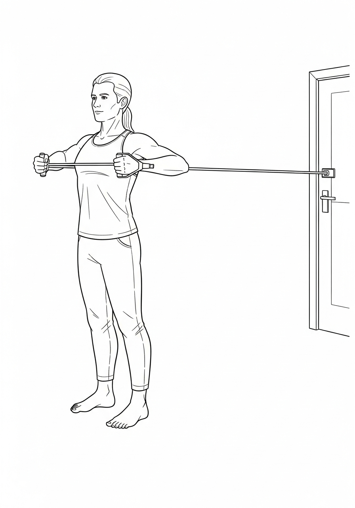

**Theraband (red, green, blue).** Three resistance levels. $20 for the set. I keep a band looped over the kitchen pantry handle and grab it whenever I am waiting for water to boil. Twenty pulls = warm-up. The kitchen is the gym you actually visit.

**Rubber bands (#19 office bands).** A bag of two hundred is $5 at any office supply store. Five at a time around the affected hand for opening reps. The cheapest single-purpose recovery tool on Earth.

**Tennis ball.** $3. Squeeze, roll, throw to the kid. Never not in a pocket of mine.

**Mirror.** A 24-inch full-length closet mirror leaned against the gym wall. $30 at IKEA. The mirror is the scaffold for mirror therapy and the tool that makes form correctable when nobody is coaching.

**Foam roller.** Standard high-density 36-inch roller. $25. Used every day on the affected leg's quad, glute, and lower back. Recovery tissue work is real recovery — not decoration.

### The Weekly-Use Stack

**Parallel bars.** Built by Dad and Kasey from 2x4s and pipe in the garage. $150 in materials. The single biggest at-home investment in walking I made. If you cannot build, the medical-grade kind run $500–$800 used on Facebook Marketplace.

**E-stim unit.** TENS-style portable unit, $80 on Amazon. With proper electrode placement (your PT can mark the peroneal nerve location with a Sharpie one time and you have it forever), this is the poor man's Bioness. Used 3x per week for ankle work.

**Weighted vest.** 20 lbs adjustable. $60 on Amazon. Wear during walking blocks once you are stable to force glute engagement. The single most-effective late-stage walking-quality mutation I added.

**Pulse oximeter.** $20. Track resting heart rate, heart rate variability, oxygen saturation. The cheap window into what your nervous system is doing.

### The Apps

**A simple notes app** for the daily log. Apple Notes, Google Keep, whatever syncs across devices. Three lines a day. Five years of entries fits in one note.

**A timer app with intervals.** I use the basic stopwatch on the iPhone. Rep blocks need a timer. Make it stupid simple.

**MyFitnessPal** for the food log when the 325 came down. Free tier works. The food log is not for shame — it is for *visibility.* You eat what you measure.

**A meditation app — any of them.** I rotate Calm, Insight Timer, Headspace. Twenty minutes a day. Not optional. The brain that does not meditate after stroke does not consolidate as well as the brain that does.

**A peer-call scheduling app.** I use plain Google Calendar with one survivor at a fixed Tuesday slot. Whatever keeps the call from becoming optional.

### The Books I Keep on the Desk

- Norman Doidge, *The Brain That Changes Itself* — the book that taught me neuroplasticity is real.
- Jill Bolte Taylor, *My Stroke of Insight* — required reading. Survivor wrote the manual on what it feels like from the inside.
- Atul Gawande, *Being Mortal* — humbling chapter on what good care looks like.
- Charles Duhigg, *The Power of Habit* — the engineering of the daily rep.
- James Clear, *Atomic Habits* — the math of small reps becoming identity.
- Viktor Frankl, *Man's Search for Meaning* — when the meaning of the rebuild gets foggy.
- David Goggins, *Can't Hurt Me* — when the engine is sputtering.
- Megan Devine, *It's OK That You're Not OK* — for the caregivers in the bereaved appendix.

### The Podcasts on the Walk

- *Huberman Lab* — the science of recovery, sleep, neuroplasticity, dopamine.
- *Tim Ferriss Show* — long-form conversations with people who have rebuilt from worse than my stroke.
- *The Stroke Cast* — survivor-and-clinician hybrid show, the closest peer media to this book.
- *Hostile Construction* (the album, not a podcast — but it goes on every walk).

### The Gear I Tried and Retired

- **Bioness L300.** Worked perfectly. Retired because the nerve learned the pattern after eighteen months. (Chapter 18.)
- **Ankle AFO.** Worked for two years. Retired when the dorsiflexion came back enough that the brace was suppressing the nerve work.
- **Wheelchair.** Lived in it for two and a half years. Retired permanently. Now in the garage as a reminder.

### What I Have Never Used and Never Will

- *Quick-fix gadgets advertised in stroke survivor Facebook groups.* If it costs $400 and the testimonial is one paragraph, it is not for you. Save the $400 for a real PT session.
- *Supplements outside the MIND-diet basics in Appendix D.* The stroke supplement market is mostly snake oil. Talk to your neurologist before you spend.
- *Hyperbaric chambers, stem cell tourism, anything outside the US that makes a "miracle cure" claim.* The math is bad. The risk is real.

The toolkit is small. The discipline of using it is the whole thing. Heart's still thumpin'. Tools still tooling. Build the rest yourself.

> Live, dated reviews of every item above (and the ones I am currently testing) at **strokerecoveryacademy.com/gear**.

---

## Appendix W: The Sasquatch Glossary — Field Terms You Will Hear in This Book

Quick translation guide for the made-up vocabulary the Sasquatch uses across the chapters. Stroke recovery has its own dialect now. Learn it once, use it for the rest of the rebuild.

- **325.** The peak chair-years weight. Used as shorthand for "the worst version of post-stroke me." Your 325 is whatever your worst version was.
- **The 4 a.m. voice.** The internal voice that runs the engine when motivation has left the building. (Ch 20.)
- **The Audit.** The Five Honest Questions you run before you mutate a plateaued program. (Ch 22.)
- **Bat work.** Any of the bilateral upper-body drills using a bat. The umbrella term. (Ch 12.)
- **The Bill.** Short for the Stroke Survivor's Bill of Rights. (Appendix T.)
- **The Bot.** Any external assist device that teaches the nerve a pattern — Bioness, WalkAide, e-stim, robotic glove. (Ch 18.)
- **Both arms.** The recurring marker for upper-body bilateral function returning. The line "*I held him with both arms*" is the whole second half of the book in three words. (Ch 24.)
- **The Bridge.** The transitional weeks between inpatient discharge and outpatient PT — the most under-supported window in the system. (Appendix Q.)
- **Builder's Science.** The sidebars across Ch 11–17 that translate motor-learning research into kitchen-table English.
- **The Chair.** Any wheelchair phase. Mine was 2.5 years. (Ch 24.)
- **Chair years.** The time spent primarily seated. Tuition, not a sentence. (Ch 2.)
- **Coast.** What survivors do when they hit a plateau and stop mutating. The enemy. (Ch 22.)
- **C.O.M.P.A.S.S.** Layer 4 of the Sasquatch Doctrine — the advanced navigation flow. (Appendix I.)
- **The Dispatch.** The closing letter to the reader at the end of the book.
- **The Desert.** The first year post-discharge, after the system disappears. (Appendix Q.)
- **Doctrine.** The four-layer Sasquatch operating system. (Appendix I.)
- **The Engine.** The Motivation Engine — the machine that runs the daily rep without depending on the daily feeling. (Ch 20.)
- **Five Levers.** Dose, Frequency, Intensity, Novelty, Sleep. (Appendix P.)
- **Heart's still thumpin'.** The tagline. Used sparingly, always earned.
- **Hostile Construction.** The album. Also the literal description of the rebuild — violent, deliberate, structural.
- **Hot Dog Dream.** The Coney Island dream that proved the brain was still in there. (Ch 2.)
- **The Lowest.** Year 2, in the chair, marriage cracking, weight peaking. The launching pad. (Ch 24.)
- **Mutation Tree.** The five branches of plateau mutation, ranked by cost. (Ch 22.)
- **Never zero.** The non-negotiable daily rule. *One rep on the worst day still counts.*
- **Never miss twice.** The two-day-grace rule that forgives the slip but not the second one.
- **Open hand.** The hardest honest mile. The opposite of the post-stroke fist. (Ch 19.)
- **Pass.** A single trip across the parallel bars in the garage. Counted in the log.
- **Persona.** The Stroked-Out Sasquatch. Or whichever persona you forge. (Ch 20½.)
- **The Plateau Audit.** The five honest questions. (Ch 22.)
- **The Promise.** The vow made the day Nicholas Jr. was born. *I will play catch with both arms.* (Ch 24.)
- **Rebuild.** The word the Sasquatch uses where the chart says "deficit."
- **S.A.S.C.H.** Layer 3 of the Doctrine — daily construction rhythm. *Seize, Absorb, Swing, Combine, Hammer.* (Appendix I.)
- **S.O.S.** Layer 2 of the Doctrine — crisis layer. *Survive, Organize, Strive.* (Appendix I.)
- **Sasquatch.** Always capitalized, always with the q-u sequence. The persona, the canonical spelling, the brand. Never "Saschquatch."
- **Strokelyfe.** The 501(c)(3). The donation arm. *strokelyfe.org/donate.*
- **Stroke Recovery Academy.** The platform. *strokerecoveryacademy.com.*
- **The Tattoo Laws.** Layer 1 of the Doctrine — non-negotiable. (Appendix I.)
- **The Truck.** What Nicholas called the wheelchair. (Ch 24.)
- **Try again, Daddy.** What Nicholas said every time the ball bounced off my left hand. The most efficient CIMT cue ever delivered to a stroke survivor. (Ch 24.)
- **The Tuesday.** The minute-by-minute year-seven day in Ch 29½. Used as shorthand for *what 90% function actually looks like.*
- **The Wall.** The Year Five plateau. Cracked by three small mutations on a single Monday. (Ch 22.)
- **Year Seven.** The current year. The proof.

> If a Sasquatch term is not in this glossary, send it to **glossary@strokerecoveryacademy.com** and we will add it for the next edition.

---

# THE SOUNDTRACK: HOSTILE CONSTRUCTION

The album that paired with the book is **Hostile Construction** by **Stroked Out Sasquatch** (Nicholas Kremers). Twelve tracks. Each pairs with a chapter. Listen on whichever platform you prefer — every track is on Spotify, Apple Music, iTunes, YouTube Music, and YouTube. Most universal links resolve automatically across platforms.

**One link to bookmark:** **strokerecoveryacademy.com/soundtrack** — every track, every platform, kept current.

| # | Track | Chapter | Vibe | Universal Link |
|---|---|---|---|---|
| 1 | Fault Line (ICU) | Ch 2 | Foundational collapse | [song.link/y/f2-uQbUc70A](https://song.link/y/f2-uQbUc70A) |
| 2 | White Coats | Ch 3 | Sterile defiance | [youtu.be/Ahd8Hkxb-Qo](https://youtu.be/Ahd8Hkxb-Qo) |
| 3 | I Am The Architect | Ch 5 | Structured ownership | [youtu.be/ULhgaRk13_k](https://youtu.be/ULhgaRk13_k) |
| 4 | Wheelchair Warrior | Ch 8 | Heavy rolling momentum | [song.link/y/X0UZmboiGOo](https://song.link/y/X0UZmboiGOo) |
| 5 | Sixty-Six Days | Ch 9 | Relentless discipline | [song.link/y/nArO3HANbfo](https://song.link/y/nArO3HANbfo) |
| 6 | Hostile Construction | Ch 12 | Heavy violent rebuilding | [youtu.be/EOYE1qB9sak](https://youtu.be/EOYE1qB9sak) |
| 7 | Phantom Limb | Ch 14 | Ethereal, percussive | [song.link/y/wdj337f5yH4](https://song.link/y/wdj337f5yH4) |
| 8 | HandiCRAP | Ch 21 | Gritty, sarcastic, aggressive | [youtu.be/SfbYbHCkids](https://youtu.be/SfbYbHCkids) |
| 9 | Maximum Benefit | Ch 22 | Defiant industrial pushback | [youtu.be/cOW2ocrdqKA](https://youtu.be/cOW2ocrdqKA) |
| 10 | Wheeled Out (Discharge) | Ch 23 | Cinematic transition | [song.link/y/AcwKQQGOjIM](https://song.link/y/AcwKQQGOjIM) |
| 11 | The Promise (For Nicholas) | Ch 24 | Deep, emotional, unyielding | [song.link/y/BT1bh3TE8NU](https://song.link/y/BT1bh3TE8NU) |
| 12 | The Vanguard | Ch 27 | Triumphant, expansive | [song.link/y/KF436xVTeLU](https://song.link/y/KF436xVTeLU) |

**Search on any platform:** *Stroked Out Sasquatch — Hostile Construction.*

If you support the project on Spotify, Apple Music, or YouTube — every stream funds the Stroke Lyfe nonprofit, which funds the next survivor's gear, coaching, and care.

---

# Acknowledgments

This book exists because of people who refused to let me quit.

**Lisa.** You stayed when the easy choice was to leave. You ripped a feeding tube out of my throat in the middle of the night because the nurses were too slow. You raised our son when I couldn't lift him. We aren't married now, but I owe you a debt I will spend the rest of my life honoring.

**Nicholas Jr.** You don't know it yet, but you are the reason any of this exists. The promise I made the day you were born is what got me out of the chair. Catch is on me forever.

**My parents, Guy and Debbie Kremers.** For believing in me before I believed in myself, and for putting up with thirty-six years of my crap before any of this happened.

**Kris.** Brother. Your memory is in every swing.

**Kasey.** You showed up when nobody else did. You're my brother in everything but birth certificate.

**Michael.** You took a 250-pound sack of oranges and walked him around the third-floor gym at Encompass until we were doing full laps. Then you brought beer over and watched football with me like I was still a person. You saved my recovery and you didn't even bill extra. Thank you.

**Karlie.** You made me feel human at the moment I was most convinced I wasn't.

**The team at Encompass Health, Fort Smith.** Eight inpatient stays. Every nurse, every tech, every therapist who treated me like a man instead of a chart. Thank you.

**The 14,500 (and growing) on TikTok.** You made me a teacher. Every comment that said *I tried today because of you* — I read every one. I will never quit on you.

**The early supporters of Stroke Recovery Academy and Stroke Lyfe Inc.** — the donors, the affiliates, the survivors who shared their stories first. You built this with me.

**The beta readers, editors, fact-checkers, designers, and album collaborators** who shaped this manuscript and the *Hostile Construction* soundtrack: each of you has been thanked by name in the printed colophon of the edition you helped build, and the live, continually updated credit roll is at **strokerecoveryacademy.com/credits**. I would rather thank you accurately on a webpage I can keep current than carve a partial list into a page that will outlive my ability to update it. You know what you did. So do I.

**You, the reader.** The book exists for the next survivor. You are the next survivor — or you love one. Either way, the work was for you. Now go do yours.

If I forgot you, charge it to my brain damage and not my gratitude.

---

# About the Author

**Nicholas "Stroked-Out Sasquatch" Kremers** is a stroke survivor, the founder of Stroke Recovery Academy, and the creator of the Sasquatch Doctrine. Born and raised in Fort Smith, Arkansas. Third-generation operator of Kremers Laundry Equipment Company. Father to Nicholas Jr.

On December 3, 2018, at age thirty-six, he survived a massive hemorrhagic stroke that left him paralyzed on his left side, unable to speak clearly, and given a chart full of "nevers."

Seven years later, he is at ninety percent function and still rising. He has built a stroke recovery academy from a wheelchair, a 501(c)(3) nonprofit (Stroke Lyfe Inc.), and a twelve-track concept album (*Hostile Construction*) that pairs with this book. He inspires more than 14,500 survivors on TikTok (@nickkremers) and 3,800 on Facebook (@NicholasKremersSr).

His mission is simple: prove that extraordinary recovery is possible, then teach the next survivor how.

He still walks without an AFO. He still swings a baseball bat in his garage every morning. He still pulls his son's pictures up on his phone when the work feels too hard.

Find him at **strokerecoveryacademy.com** and **strokelyfe.org**.

---

# The Builder's Seal

> *I am the proof.
> The impossible is waiting for me to make it inevitable.
> And I'm coming for it.*
>
> — Nicholas "Stroked-Out Sasquatch" Kremers

**END OF BOOK**

---

*Cover art and album art: Hostile Construction by Stroked Out Sasquatch. Set in Cinzel (display) and Crimson Pro (body), with Inter for sans-serif accents. Printed in the United States of America. First Edition, 2026.*

*If this book helped you, please leave a review wherever you bought it — on Amazon, Goodreads, or your local bookseller. One review is one survivor finding this book. That's how the tribe grows.*
